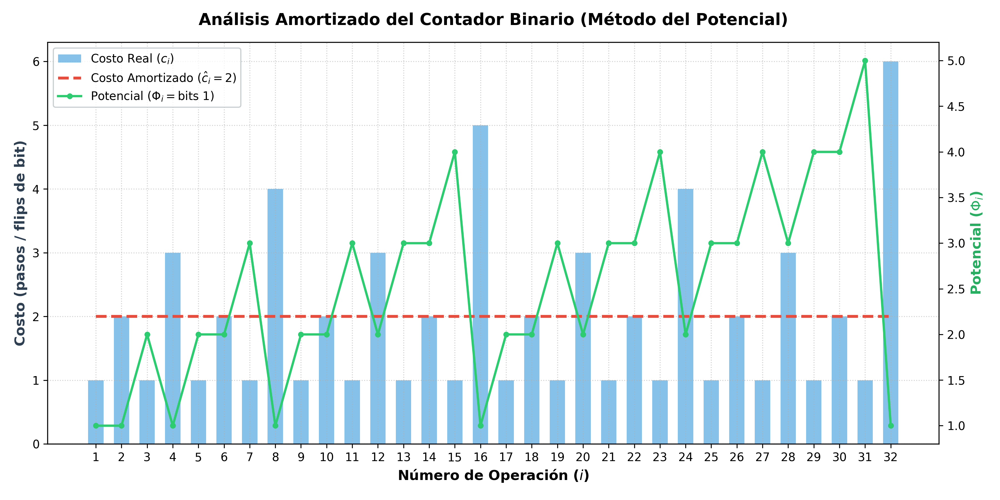

# Ejercicio 4: El contador binario en una máquina de Turing, del ejercicio 7 de la conferencia 1. Demuestra con un potencial que $\mathbf{m}$ incrementos desde 0 cuestan  $\mathbf{O(m)}$ pasos en total, aunque uno solo pueda costar $\mathbf{\Theta(\log m)}$.Es la pregunta que la conferencia 1 dejó abierta

## Contexto y Definición del Problema

En la Conferencia 1 (Ejercicio 7), analizamos un contador binario implementado sobre una cinta de máquina de Turing o un arreglo de bits, donde un incremento suma $1$ al número actual en representación binaria. 
El número de bits que se examinan o modifican durante el $i$-ésimo incremento. Para sumar $1$ en binario, recorremos los bits menos significativos que son $1$ (cambiándolos a $0$) y el primer $0$ (cambiándolo a $1$). Por lo tanto, si el incremento hace flip a $k_i$ bits que eran $1$ antes de cambiar un $0$ a $1$, el costo real es:
$$c_i = k_i + 1$$
**El Peor Caso Individual** es cuando el contador pasa de $2^j - 1$ a $2^j$ (por ejemplo, de $0111_2$ a $1000_2$), todos los $k = \log_2(m)$ bits cambian, lo que requiere $\Theta(\log m)$ pasos. Si analizamos operación por operación de forma aislada, concluiríamos erróneamente que $m$ incrementos cuestan $O(m \log m)$. El **análisis amortizado** nos permitirá demostrar que el costo real total está acotado por $O(m)$.

---

## El Método del Potencial

Para aplicar el método del potencial, debemos definir una función de estado $\Phi$ de la estructura de datos que mida la "deuda" acumulada o el trabajo pendiente.
Sea $\Phi_i$ el **número de bits $1$** en la representación binaria del contador después del $i$-ésimo incremento.

**Valor inicial:** Antes del primer incremento, el contador está en $0$ (todos sus bits son $0$). Por lo tanto, el potencial inicial es:
$$\Phi_0 = 0$$
**No negatividad:** Como $\Phi_i$ cuenta la cantidad de bits $1$, es evidente que para cualquier estado $i$:
$$\Phi_i \ge 0$$


## Demostración del Costo Amortizado

El costo amortizado $\hat{c}_i$ de la $i$-ésima operación se define como:
$$\hat{c}_i = c_i + \Phi_i - \Phi_{i-1}$$

Analicemos cómo cambia el potencial en el $i$-ésimo incremento.
Supongamos que el número termina en $k_i$ bits $1$ consecutivos (por ejemplo, $...\underbrace{11\dots1}_{k_i}$).
 Durante el incremento, estos $k_i$ bits $1$ se convierten en $0$. Esto reduce el número de bits $1$ en $k_i$.
El bit inmediatamente a la izquierda (que era $0$) se convierte en $1$. Esto aumenta el número de bits $1$ en $1$.
Por lo tanto, el cambio neto en el potencial es:
$$\Phi_i - \Phi_{i-1} = 1 - k_i$$

Sustituyendo el costo real $c_i = k_i + 1$ y el cambio de potencial en la fórmula del costo amortizado:
$$\hat{c}_i = (k_i + 1) + (1 - k_i) = 2$$

El costo amortizado de **cualquier** incremento, sin importar cuán costoso sea en la realidad es constante, exactamente $\mathbf{2}$ ($\hat{c}_i = O(1)$).

Para $\mathbf{m}$ incrementos tenemos utilizando la propiedad telescópica de la suma del potencial:
$$\sum_{i=1}^{m} \hat{c}_i = \sum_{i=1}^{m} (c_i + \Phi_i - \Phi_{i-1}) = \sum_{i=1}^{m} c_i + \Phi_m - \Phi_0$$

Despejando la suma de los costos reales ($\sum c_i$):
$$\sum_{i=1}^{m} c_i = \sum_{i=1}^{m} \hat{c}_i - (\Phi_m - \Phi_0)$$

Dado que $\hat{c}_i = 2$ para todo $i$, $\sum_{i=1}^{m} \hat{c}_i = 2m$. Además, sabemos que $\Phi_0 = 0$ y $\Phi_m \ge 0$:
$$\sum_{i=1}^{m} c_i \le 2m - \Phi_m \le 2m$$

Por lo tanto, el costo total de $m$ incrementos partiendo desde $0$ es **$O(m)$**, demostrando formalmente que el costo amortizado por operación es $O(1)$.

---

## Simulación Computacional

A continuación, presentamos un script en Python que simula el contador binario paso a paso, mostrando el valor decimal, su representación binaria, el costo real ($c_i$), el potencial ($\Phi_i$) y el costo amortizado ($\hat{c}_i$), validando que la cota se cumple estrictamente.

```python
def simular_contador_binario(m):
    """Simula m incrementos de un contador binario y calcula costos y potencial."""
    bits = [0]  # Representación binaria (el menos significativo a la izquierda)
    
    print(f"{'Op (i)':<6} | {'Decimal':<8} | {'Binario':<10} | {'Costo Real (c_i)':<16} | {'Potencial (Phi)':<16} | {'Amortizado (hat_c)':<18}")
    print("-" * 80)
    
    potencial_anterior = 0
    costo_total_real = 0
    
    for i in range(1, m + 1):
        # Encontrar el costo real (número de bits que cambian)
        costo_real = 0
        idx = 0
        while idx < len(bits) and bits[idx] == 1:
            bits[idx] = 0
            costo_real += 1
            idx += 1
        
        if idx < len(bits):
            bits[idx] = 1
            costo_real += 1
        else:
            bits.append(1)
            costo_real += 1
            
        costo_total_real += costo_real
        
        # Potencial actual: número de 1s en la representación
        potencial_actual = sum(bits)
        
        # Costo amortizado = costo_real + Phi_i - Phi_{i-1}
        amortizado = costo_real + potencial_actual - potencial_anterior
        
        # Valor decimal actual para visualización
        val_decimal = sum(b * (2**idx) for idx, b in enumerate(bits))
        bin_str = "".join(str(b) for b in reversed(bits))
        
        if i <= 16:  # Imprimir los primeros 16 pasos para ilustrar
            print(f"{i:<6} | {val_decimal:<8} | {bin_str:<10} | {costo_real:<16} | {potencial_actual:<16} | {amortizado:<18}")
            
        potencial_anterior = potencial_actual

    print("-" * 80)
    print(f"Costo real total para m = {m}: {costo_total_real}")
    print(f"Costo promedio por operación: {costo_total_real / m:.2f}")

# Ejecutar simulación para m = 16
simular_contador_binario(16)
```

### Resultados de la Ejecución (Primeros 16 incrementos)

| Op ($i$) | Decimal | Binario | Costo Real ($c_i$) | Potencial ($\Phi_i$) | Amortizado ($\hat{c}_i$) |
| :--- | :--- | :--- | :--- | :--- | :--- |
| 1 | 1 | `1` | 1 | 1 | 2 |
| 2 | 2 | `10` | 2 | 1 | 2 |
| 3 | 3 | `11` | 1 | 2 | 2 |
| 4 | 4 | `100` | 3 | 1 | 2 |
| 5 | 5 | `101` | 1 | 2 | 2 |
| 6 | 6 | `110` | 2 | 2 | 2 |
| 7 | 7 | `111` | 1 | 3 | 2 |
| 8 | 8 | `1000` | 4 | 1 | 2 |
| 9 | 9 | `1001` | 1 | 2 | 2 |
| 10 | 10 | `1010` | 2 | 2 | 2 |
| 11 | 11 | `1011` | 1 | 3 | 2 |
| 12 | 12 | `1100` | 3 | 2 | 2 |
| 13 | 13 | `1101` | 1 | 3 | 2 |
| 14 | 14 | `1110` | 2 | 3 | 2 |
| 15 | 15 | `1111` | 1 | 4 | 2 |
| 16 | 16 | `10000`| 5 | 1 | 2 |

Como se observa en la tabla, aunque el costo real salta esporádicamente hasta $4$ o $5$ ($\Theta(\log m)$), el costo amortizado $\hat{c}_i$ permanece constante en $2$ en todas y cada una de las operaciones.

Para ilustrar de qué forma el potencial absorbe las operaciones costosas (picos de costo real), se incluye a continuación un script en Python con `matplotlib` que grafica el **Costo Real** (barras), el **Costo Amortizado** (línea horizontal) y la variación del **Potencial** $\Phi$ a lo largo de las operaciones.

```python
import matplotlib.pyplot as plt

def graficar_analisis_amortizado_contador(m=32):
    """
    Genera un gráfico comparativo del Costo Real, Costo Amortizado
    y la Función de Potencial Phi a lo largo de m incrementos.
    """
    bits = [0]
    costos_reales = []
    potenciales = [0]  # Phi_0 = 0
    costos_amortizados = []
    
    for i in range(1, m + 1):
        costo_real = 0
        idx = 0
        while idx < len(bits) and bits[idx] == 1:
            bits[idx] = 0
            costo_real += 1
            idx += 1
        
        if idx < len(bits):
            bits[idx] = 1
            costo_real += 1
        else:
            bits.append(1)
            costo_real += 1
            
        costos_reales.append(costo_real)
        potencial_actual = sum(bits)
        
        # Amortizado = c_i + Phi_i - Phi_{i-1}
        amortizado = costo_real + potencial_actual - potenciales[-1]
        costos_amortizados.append(amortizado)
        potenciales.append(potencial_actual)

    operaciones = list(range(1, m + 1))
    potenciales_ops = potenciales[1:]  # Tomar Phi_1 a Phi_m

    # Configuración de la figura
    fig, ax1 = plt.subplots(figsize=(12, 6))

    # Gráfico de barras: Costo Real
    bars = ax1.bar(operaciones, costos_reales, color='#3498db', alpha=0.6, width=0.6, label='Costo Real ($c_i$)')
    # Gráfico de línea: Costo Amortizado
    line_amort = ax1.plot(operaciones, costos_amortizados, color='#e74c3c', linewidth=2.5, linestyle='--', label=r'Costo Amortizado ($\hat{c}_i = 2$)')
    
    ax1.set_xlabel('Número de Operación ($i$)', fontsize=12, fontweight='bold')
    ax1.set_ylabel('Costo (pasos / flips de bit)', fontsize=12, color='#2c3e50', fontweight='bold')
    ax1.set_xticks(operaciones)
    ax1.grid(True, linestyle=':', alpha=0.6)

    # Segundo eje Y: Potencial Phi
    ax2 = ax1.twinx()
    line_pot = ax2.plot(operaciones, potenciales_ops, color='#2ecc71', linewidth=2, marker='o', markersize=4, label=r'Potencial ($\Phi_i = \text{bits } 1$)')
    ax2.set_ylabel(r'Potencial ($\Phi_i$)', fontsize=12, color='#27ae60', fontweight='bold')

    # Ajustes visuales de leyenda y título
    lines = [bars] + line_amort + line_pot
    labels = [l.get_label() for l in lines]
    ax1.legend(lines, labels, loc='upper left', frameon=True, facecolor='#ffffff', edgecolor='#bdc3c7')

    plt.title('Análisis Amortizado del Contador Binario (Método del Potencial)', fontsize=14, fontweight='bold', pad=15)
    plt.tight_layout()
    plt.savefig('grafica_analisis_amortizado.png', dpi=300)

# Generar el gráfico para 32 operaciones
graficar_analisis_amortizado_contador(32)
```



Cuando el costo real es alto (ej. Op 8, $c_{real} = 4$), el potencial cae bruscamente (de $3$ a $1$). El ahorro acumulado en las operaciones "baratas" paga el cambio masivo de bits.
Cuando el costo real es bajo ($c_{real} = 1$, ej. Op 9), el potencial se incrementa suavemente, preparando crédito para el siguiente pico.

Hemos demostrado mediante el método del potencial que el contador binario, a pesar de tener operaciones individuales costosas de $\Theta(\log m)$, posee un costo amortizado de $O(1)$ por operación, garantizando un tiempo total de **$O(m)$** para $m$ incrementos desde $0$. Esto resuelve formalmente la pregunta abierta de la Conferencia 1.