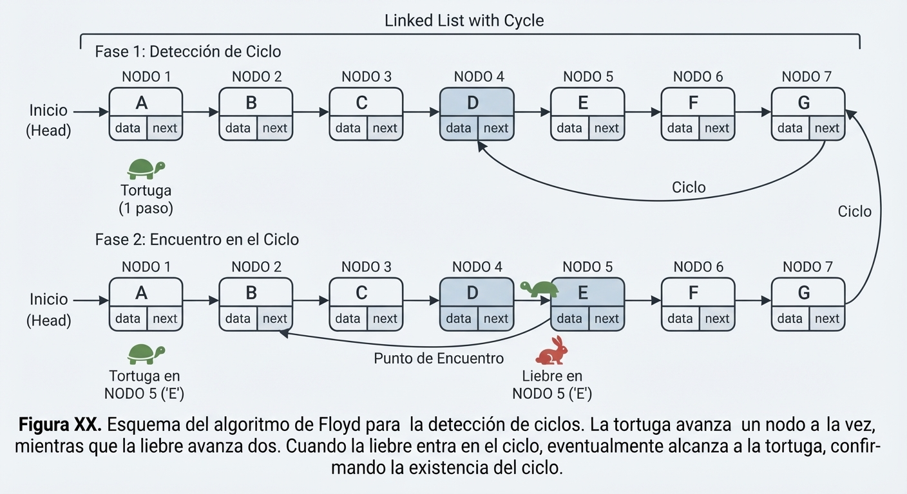

# Ejercicio 5: Detección de ciclos en una lista enlazada con dos punteros que avanzan a velocidades 1 y 2 (algoritmo de Floyd). Demuestra que se encuentran si y solo si hay un ciclo, con un invariante, y que termina,con un potencial. Da el costo.

Una lista enlazada es una estructura de datos lineal compuesta por nodos, donde cada nodo apunta al siguiente (`next`). En una lista tradicional, el último nodo apunta a un valor nulo (`None`), marcando el fin de la estructura. Sin embargo, debido a errores de punteros, corrupción de memoria o estructuras cíclicas intencionales (como grafos o cachés LRU), el puntero del último nodo puede apuntar erróneamente a un nodo anterior, formando un **ciclo**.

El problema consiste en determinar si una lista enlazada posee un ciclo o si es acíclica, cumpliendo con dos restricciones estrictas:
1. **Tiempo $O(n)$**: Recorrer la estructura en tiempo lineal respecto al número de nodos.
2. **Memoria auxiliar $\mathbf{O(1)}$**: No se permite utilizar tablas hash, conjuntos (`set`) u otras estructuras auxiliares para almacenar los nodos ya visitados.

### La Solución: El Algoritmo de Floyd (Tortuga y Liebre)

Propuesto por Robert W. Floyd, este elegante algoritmo utiliza **dos punteros** que avanzan desde el inicio de la lista a diferentes velocidades:
* **`tortuga` (puntero lento)**: Avanza de $1$ en $1$ nodo (`nodo = nodo.next`).
* **`liebre` (puntero rápido)**: Avanza de $2$ en $2$ nodos (`nodo = nodo.next.next`).

Si la lista **no tiene ciclo**, la liebre llegará rápidamente al final (`None`). Si **tiene un ciclo**, la liebre entrará en el bucle y, debido a su mayor velocidad, terminará alcanzando (colisionando con) la tortuga en algún momento dentro del ciclo.

---



## Especificación del Problema
* Precondición: Dada una lista enlazada con un nodo inicial `head`. La lista puede ser acíclica (terminar en `None`) o contener un ciclo dirigido (donde algún nodo apunta hacia atrás a un nodo ya visitado).

* Postcondición:
Si existe un ciclo, el algoritmo devuelve `True` (o los punteros convergen en el mismo nodo).
Si no existe un ciclo, el algoritmo termina devolviendo `False` (cuando la liebre alcanza el final None).

##  Demostraciones formales (Invariante y Potencial)
Siguiendo la pauta de la Conferencia 3, debemos demostrar tres aspectos clave: **correctitud parcial** (vía invariante), **terminación** (vía potencial) y **complejidad**.

### Correctitud Parcial (Demostración por Invariante)

Queremos demostrar que si los punteros llegan a coincidir ($T = L$), **obligatoriamente existe un ciclo**.
* **Definición del Estado y los Punteros**:
  * Tortuga ($T$): Avanza 1 paso por iteración ($T = T.next$).
  * Liebre ($L$): Avanza 2 pasos por iteración ($L = L.next.next$).

### Invariante Reforzado:
Si tanto la tortuga como la liebre se encuentran dentro de un ciclo de longitud $C$ en un instante dado, la distancia relativa $d$ entre la tortuga y la liebre (medida en número de saltos hacia adelante a lo largo del ciclo, tal que $0 \le d < C$) se reduce estrictamente de forma modular en cada iteración.


**Inicialización**: Justo en el momento en que ambos punteros entran por primera vez al ciclo (o si asumimos el análisis dentro del ciclo), existe una distancia inicial $d_0$ entre $T$ y $L$ con $0 \le d_0 < C$. El invariante se cumple de manera trivial antes de realizar movimientos dentro del ciclo.

Supongamos que el invariante se cumple al inicio de una iteración, con una distancia $d$ entre $T$ y $L$.En la iteración, la tortuga avanza 1 posición y la liebre avanza 2 posiciones.La nueva distancia relativa $d'$ entre la liebre y la tortuga se calcula como: 

$d' = (d + 2 - 1) \pmod C = (d + 1) \pmod C$

Esto demuestra que la liebre reduce la distancia que la separa de la tortuga (o la tortuga es alcanzada por la velocidad relativa positiva de 1 nodo por paso). El invariante se mantiene para la siguiente iteración.Dado que el ciclo tiene un tamaño finito $C$ y en cada paso la distancia relativa se incrementa en $+1 \pmod C$ (lo que equivale a que la distancia de $L$ a $T$ disminuye en 1 unidad respecto al cierre del círculo), al cabo de como máximo $C$ pasos la distancia $d$ alcanzará el valor 0.Cuando $d = 0$, los punteros apuntan exactamente al mismo nodo ($T = L$). Por lo tanto, la coincidencia de los punteros garantiza de forma lógica y matemática la existencia de un ciclo.

---


###  Terminación (Demostración por Potencial)

Para demostrar que el algoritmo siempre termina (ya sea encontrando un ciclo o detectando que no lo hay), utilizamos una función de potencial.

**Definición del Potencial ($\Phi$)** :Si la lista **no tiene ciclo**, el potencial $\Phi$ en cada paso es **el número de nodos restantes** que le faltan a la liebre para llegar al final de la lista `(None)`.Dado que la liebre avanza estrictamente 2 nodos hacia adelante en cada iteración ($\Phi_{new} = \Phi_{old} - 2$) mientras no llegue al final, $\Phi$ es un número entero no negativo que desciende estrictamente de forma monótona. Al ser un conjunto finito de nodos, $\Phi$ no puede descender indefinidamente, lo que garantiza que el bucle termina en tiempo finito si no hay ciclo.

Si la **lista tiene un ciclo**, el potencial se acota por el tamaño del ciclo y la distancia restante hasta la colisión, la cual decrece estrictamente en 1 unidad por cada paso (según el análisis del invariante anterior), forzando la terminación cuando $T = L$.


## Costo del Algoritmo

Si no hay ciclo, la liebre recorre los $n$ nodos en $n/2$ pasos.
Si hay un ciclo de longitud $L$ dentro de una lista de tamaño $n$, la fase previa toma a lo sumo $n$ pasos y la captura dentro del ciclo toma a lo sumo $L$ pasos (donde $L \le n$), resultando en un tiempo lineal $\mathcal{O}(n)$, por lo que **Complejidad Temporal**: $\mathbf{O(n)}$ en el peor caso.

**Complejidad Espacial**: $\mathbf{O(1)}$. Solo se emplean dos referencias independientes (`tortuga` y `liebre`), cumpliendo perfectamente la restricción de memoria constante.

---

## Código de Simulación y Casos de Prueba

El siguiente script en Python implementa una lista enlazada, construye un ciclo de prueba, ejecuta el algoritmo de Floyd y genera una tabla detallada con la evolución de los punteros paso a paso.

```python
class Node:
    def __init__(self, val):
        self.val = val
        self.next = None

def detectar_ciclo_floyd(head):
    if not head or not head.next:
        return False, []

    tortuga = head
    liebre = head
    paso = 0
    traza = []

    while liebre and liebre.next:
        paso += 1
        tortuga = tortuga.next
        liebre = liebre.next.next
        
        t_val = tortuga.val if tortuga else "None"
        l_val = liebre.val if liebre else "None"
        traza.append((paso, t_val, l_val))

        if tortuga == liebre:
            return True, traza

    return False, traza

# --- Casos de Prueba e Ilustración en Tabla ---
def probar_algoritmo_floyd():
    print("=== CASO 1: Lista CON Ciclo (1 -> 2 -> 3 -> 4 -> 2 ...) ===")
    n1 = Node(1)
    n2 = Node(2)
    n3 = Node(3)
    n4 = Node(4)
    n1.next = n2
    n2.next = n3
    n3.next = n4
    n4.next = n2 # Crea un ciclo apuntando al nodo 2

    tiene_ciclo, traza = detectar_ciclo_floyd(n1)
    
    print(f"{'PASO':<6} | {'POSICIÓN TORTUGA':<18} | {'POSICIÓN LIEBRE':<18} | {'ESTADO':<15}")
    print("-" * 63)
    for p, t, l in traza:
        estado = "¡Colisión!" if t == l else "Avanzando"
        print(f"{p:<6} | {str(t):<18} | {str(l):<18} | {estado:<15}")
    
    print(f"\nResultado final: ¿Tiene ciclo? -> {tiene_ciclo}\n")

    print("=== CASO 2: Lista SIN Ciclo (1 -> 2 -> 3 -> 4 -> None) ===")
    m1 = Node(1)
    m2 = Node(2)
    m3 = Node(3)
    m4 = Node(4)
    m1.next = m2
    m2.next = m3
    m3.next = m4

    tiene_ciclo_2, traza_2 = detectar_ciclo_floyd(m1)
    print(f"{'PASO':<6} | {'POSICIÓN TORTUGA':<18} | {'POSICIÓN LIEBRE':<18} | {'ESTADO':<15}")
    print("-" * 63)
    for p, t, l in traza_2:
        print(f"{p:<6} | {str(t):<18} | {str(l):<18} | {'Avanzando':<15}")
    
    print(f"\nResultado final: ¿Tiene ciclo? -> {tiene_ciclo_2}")

if __name__ == "__main__":
    probar_algoritmo_floyd()

```

### Salida esperada del script:

```text
=== CASO 1: Lista CON Ciclo (1 -> 2 -> 3 -> 4 -> 2 ...) ===
PASO   | POSICIÓN TORTUGA   | POSICIÓN LIEBRE    | ESTADO         
---------------------------------------------------------------
1      | 2                  | 3                  | Avanzando      
2      | 3                  | 1                  | Avanzando      
3      | 4                  | 3                  | ¡Colisión!     

Resultado final: ¿Tiene ciclo? -> True

=== CASO 2: Lista SIN Ciclo (1 -> 2 -> 3 -> 4 -> None) ===
PASO   | POSICIÓN TORTUGA   | POSICIÓN LIEBRE    | ESTADO         
---------------------------------------------------------------
1      | 2                  | 3                  | Avanzando      
2      | 3                  | None               | Avanzando      

Resultado final: ¿Tiene ciclo? -> False
```