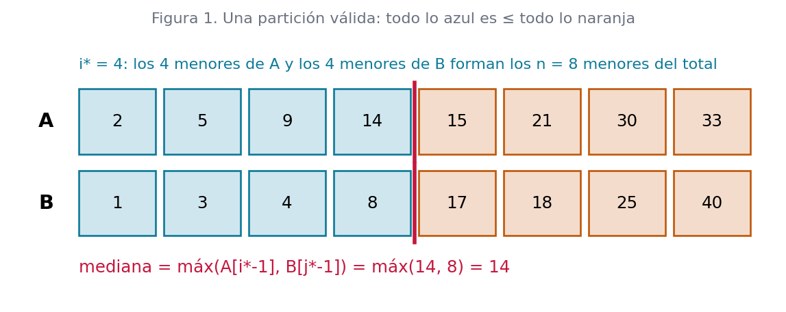
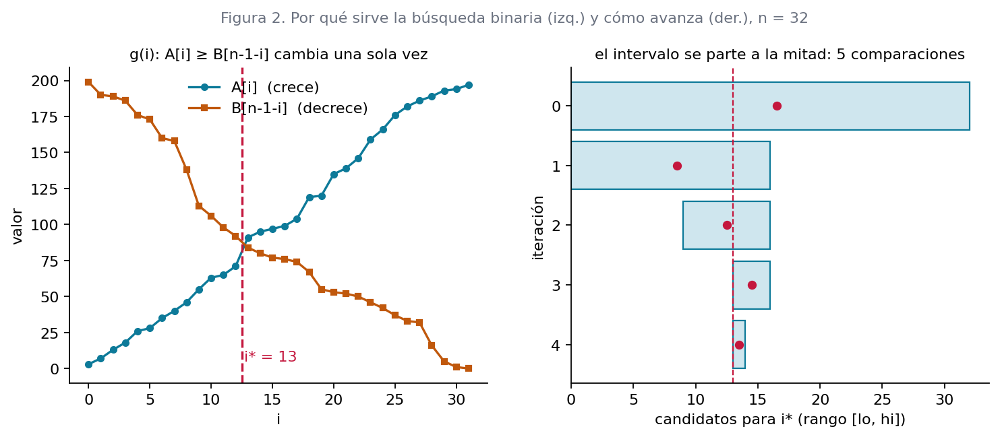
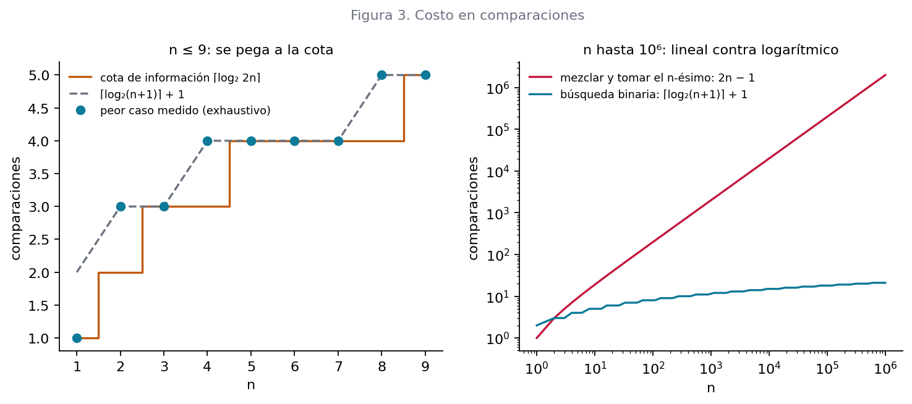

# Ejercicio 7: Mediana de dos arreglos ordenados de largo $n$: el $n-ésimo$ menor de los $2n$ elementos. Diseña un algoritmo $O(\log n)$ , demuestra su correctitud y da la cota de información

## El problema

**Mediana de dos arreglos.** Entrada: $A[0..n-1]$ y $B[0..n-1]$, ambos ordenados de forma no decreciente, $n ≥ 1$. Salida: el elemento de posición $n$ en el orden de $A ∪ B$

Tres precisiones, siguiendo la sección 2 de la conferencia 2:

* **Empates.** Los valores pueden repetirse, dentro de un arreglo y entre los dos. La salida es un *valor*, así que el empate no hay que resolverlo. Todo el análisis usa $≤$ y $≥$ para que esto funcione.
* **Qué mediana.** Con $2n$ elementos hay dos medianas, el $n$-ésimo y el $(n+1)$-ésimo menor. El enunciado pide la primera (mediana inferior). La segunda sale gratis de la misma partición, como se ve en la sección 3.
* **Qué se puede hacer con los datos.** Trabajamos en el **modelo de comparaciones**: sobre los valores solo se sabe lo que dicen las preguntas $x < y$. El costo es el número de comparaciones.

**Precondición:** ambos arreglos ordenados y del mismo largo $n ≥ 1$. Sobre arreglos desordenados el contrato no dice nada.

---

## Cómo se le ocurre a uno

**Primera idea: mezclar.** Mezclar los dos arreglos y tomar la posición $n$ es correcto, pero cuesta $2n − 1$ comparaciones en el peor caso. La conferencia 5 (sección 6) demostró que mezclar necesita exactamente $2n − 1$. Una solución logarítmica tiene que *no mezclar*.
**La observación clave.** Los $n$ menores del total son un prefijo de $A$ más un prefijo de $B$. Si el prefijo de $A$ tiene $i$ elementos, el de $B$ tiene $j = n − i$. Todo el problema se reduce a hallar $i$, un número entre $0$ y $n$.

| i | elementos de A | elementos de B | ¿forman los n menores? |
|---|---|---|---|
| 0 | ninguno | los $n$ | solo si $B[n-1] ≤ A[0]$ |
| ... | ... | ... | ... |
| n | los $n$ | ninguno | solo si $A[n-1] ≤ B[0]$ |

Hay $n + 1$ candidatos para $i$, y eso dice que una búsqueda binaria basta. Falta ver cuál es la *condición monótona* sobre la que se busca. La respuesta está en las dos condiciones que hacen válida una partición:

```text
        A:  [ A[0] ... A[i-1] | A[i] ... A[n-1] ]
        B:  [ B[0] ... B[j-1] | B[j] ... B[n-1] ]       j = n - i
              \_____ L _____/    \_____ R _____/
```

$L$ (a la izquierda del corte) tiene $n$ elementos. Hace falta que *todo lo de L sea ≤ todo lo de R*. Dentro de cada arreglo eso ya se cumple por estar ordenado. Quedan dos condiciones cruzadas:

$$
(1)  A[i-1] ≤ B[j]
$$
$$(2)  B[j-1] ≤ A[i]
$$



*Figura 1. Una partición válida sobre un ejemplo con $n = 8$. Todo lo azul es ≤ todo lo naranja, y la mediana es el máximo de los dos últimos elementos azules.*

---

## El algoritmo

Para que la búsqueda tenga una sola comparación por paso, se define para $0 ≤ i ≤ n − 1$

> **g(i)** ≡ $A[i] ≥ B[n-1-i]$, y por convención $g(n)$ = verdadero.

El algoritmo busca el menor $i*$ con $g(i*)$ verdadero.

```python
def mediana(A, B):
   
    n = len(A)
    assert len(B) == n and n >= 1
    lo, hi = 0, n                       # invariante: g(i) falso si i < lo; g(i) cierto si i >= hi
    while lo < hi:                      # potencial: hi - lo
        mid = (lo + hi) // 2
        if A[mid] >= B[n - 1 - mid]:    # g(mid)
            hi = mid
        else:
            lo = mid + 1
    i, j = lo, n - lo                   # i elementos de A y j de B forman los n menores
    if i == 0:
        return B[j - 1]
    if j == 0:
        return A[i - 1]
    return A[i - 1] if A[i - 1] > B[j - 1] else B[j - 1]
```

Con la misma partición, la mediana superior (el $(n+1)$-ésimo menor) es $min(A[i], B[j])$ con centinelas $+∞$.

**Traza a mano** sobre $A = [1, 3, 5, 7]$, $B = [2, 4, 6, 8]$ ($n = 4$):

| iteración | lo | hi | mid | $A[mid] ≥ B[3-mid]$ | nuevo intervalo |
|---|---|---|---|---|---|
| 1 | 0 | 4 | 2 | $5 ≥ B[1]=4$ sí | $hi = 2$ |
| 2 | 0 | 2 | 1 | $3 ≥ B[2]=6$ no | $lo = 2$ |
| fin | 2 | 2 | | | $i* = 2$, $j = 2$ |

La mediana es $máx(A[1], B[1]) = máx(3, 4) = 4$, que es el 4.º menor de $1 2 3 4 5 6 7 8$. ✓



*Figura 2. A la izquierda, $A[i]$ crece y $B[n-1-i]$ decrece, así que se cruzan una sola vez y $g$ cambia de falso a verdadero una sola vez. A la derecha, el intervalo de candidatos para $i*$ en cada iteración: 5 comparaciones para $n = 32$.*

---

## Correctitud

Siguiendo la conferencia 3, son dos demostraciones separadas: correctitud parcial (con un invariante) y terminación (con un potencial). Antes hay dos lemas que dicen *por qué* hallar $i*$ resuelve el problema.

### Lema 1 (una partición válida da la mediana)

> Sea $i ∈ [0, n]$, $j = n − i$, y supongamos que $L = A[0..i-1] ∪ B[0..j-1]$ cumple que todo elemento de $L$ es ≤ todo elemento de $R = A[i..n-1] ∪ B[j..n-1]$. Entonces el $n$-ésimo menor de $A ∪ B$ es $m = máx(L)$.

*Demostración.* Sea $S$ el multiconjunto ordenado $A ∪ B$. Hay que ver $S[n-1] = m$, con dos desigualdades.

* **$S[n-1] ≤ m$.** Los $n$ elementos de $L$ son todos $≤ m$. Hay al menos $n$ elementos $≤ m$, así que el $n$-ésimo menor es $≤ m$.
* **$S[n-1] ≥ m$.** Los $n$ elementos de $R$ son todos $≥ m$, y ninguno es $< m$. El propio $m$ tampoco es $< m$. Entonces los elementos estrictamente menores que $m$ están todos en $L \backslash {m}$, que son a lo sumo $n − 1$. Con a lo sumo $n − 1$ elementos menores que $m$, el $n$-ésimo menor no puede ser menor que $m$.

Esta demostración no usa que los valores sean distintos, así que los empates quedan cubiertos.

### Lema 2 (cuándo la partición es válida, y monotonía de g)

> **(a)** $g$ es monótona: si $g(i)$ es verdadera, $g(i+1)$ también (para $i < n$).
> **(b)** Sea $i* = mín{ i ∈ [0, n] : g(i) }$ (existe porque $g(n)$ es verdadera). La partición $(i*, n − i*)$ es válida en el sentido del Lema 1.

*Demostración de (a).* Para $i + 1 ≤ n − 1$, usando que $A$ crece y $B$ crece:
$A[i+1] ≥ A[i] ≥ B[n-1-i] ≥ B[n-2-i] = B[n-1-(i+1)]$. Si $i + 1 = n$, $g(n)$ es verdadera por convención.

*Demostración de (b).* Sean $i = i*$ y $j = n − i$. Las condiciones dentro de cada arreglo, $A[i-1] ≤ A[i]$ y $B[j-1] ≤ B[j]$, valen porque están ordenados. Quedan las dos cruzadas (cuando los índices existen):

* **$B[j-1] ≤ A[i]$**, con $i < n$. Es exactamente $g(i*)$, que es verdadera por definición de $i*$.
* **$A[i-1] ≤ B[j]$**, con $i > 0$ (y entonces $j = n − i < n$). Como $i*$ es el *menor* con $g$ verdadera, $g(i*-1)$ es falsa, o sea $A[i*-1] < B[n-1-(i*-1)] = B[n-i*] = B[j]$. Es incluso una desigualdad estricta.

Cuando $i = 0$ no hay $A[i-1]$ y cuando $i = n$ no hay $B[j-1]$: las condiciones correspondientes se cumplen vacuamente. Esos son los centinelas $−∞$ y $+∞$

### Correctitud parcial (invariante de la búsqueda)

> **Invariante.** En todo momento, $0 ≤ lo ≤ hi ≤ n$ y
>
> **(I)** $g(k)$ es falsa para todo $k < lo$,
>
> **(II)** $g(k)$ es verdadera para todo $k$ con $hi ≤ k ≤ n$.

**Inicialización.** Con $lo = 0$, (I) se cumple vacuamente. Con $hi = n$, (II) dice $g(n)$, que es verdadera por convención.
Supongamos que el invariante vale y $lo < hi$. Entonces $mid = ⌊(lo+hi)/2⌋$ cumple $lo ≤ mid < hi ≤ n$, así que $mid ≤ n − 1$ y los accesos $A[mid]$ y $B[n-1-mid]$ son válidos.
Si $g(mid)$ es verdadera, por monotonía (Lema 2a) lo es para todo $k ≥ mid$. Con $hi = mid$, (II) se mantiene y (I) no se toca.
Si es falsa, por monotonía lo es para todo $k ≤ mid$. Con $lo = mid + 1$, (I) se mantiene y (II) no se toca.
Al salir, $lo = hi$. Por (I) $g$ es falsa para $k < lo$, y por (II) verdadera para $k ≥ lo$. Entonces $lo$ es el menor $i$ con $g(i)$ verdadera, o sea $lo = i*$. Por el Lema 2b la partición es válida, y por el Lema 1 la respuesta $máx(L)$ es el $n$-ésimo menor. El código calcula $máx(L)$ como el máximo de $A[i-1]$ y $B[j-1]$, o el único que exista si $i = 0$ o $j = 0$.

### Terminación (potencial)

El potencial es $hi − lo$, un entero no negativo por el invariante. En cada vuelta baja al menos en 1: con $hi = mid$ baja en $hi − mid ≥ 1$ porque $mid < hi$, y con $lo = mid + 1$ baja en $mid + 1 − lo ≥ 1$. Como no puede bajar para siempre, el ciclo termina. La correctitud total es la suma de las dos partes.

## Costo: $O(log n)$

Sea $c = hi − lo + 1$ el número de candidatos para $i*$. Al empezar, $c = n + 1$. En cada vuelta $c$ pasa a lo sumo a $⌈c/2⌉$.
Si $hi = mid$, el nuevo $c$ es $mid − lo + 1 = ⌊(c−1)/2⌋ + 1 = ⌈c/2⌉$.
Si $lo = mid + 1$, el nuevo $c$ es $hi − mid = (c−1) − ⌊(c−1)/2⌋ = ⌈(c−1)/2⌉ ≤ ⌈c/2⌉$.

Después de $t$ vueltas, $c ≤ ⌈(n+1)/2^t⌉$, y el ciclo termina cuando $c = 1$, lo que ocurre cuando $2^t ≥ n + 1$. Por tanto hace a lo sumo $⌈log₂(n+1)⌉$ vueltas.

Ahora con respecto a las comparaciones, el algoritmo realiza una por vuelta, más a lo sumo una al final para $máx(A[i-1], B[j-1])$, que solo hace falta si $0 < i < n$. En total

$$\#\text{comparaciones} \;\le\; \lceil \log_2 (n+1) \rceil + 1 \;=\; O(\log n),$$

con tiempo $O(log n)$ y memoria $O(1)$: tres enteros ($lo$, $hi$, $mid$).

### Verificación

El módulo $Contado$ envuelve cada elemento y cuenta cada $>=$ o $>$ que se le aplica. Así se mide el costo real y se comprueba que el algoritmo solo compara.

```python
import itertools
class Contado:
    __slots__ = ("v",)
    cuenta = 0
    def __init__(self, v): self.v = v
    def __ge__(self, o): Contado.cuenta += 1; return self.v >= o.v
    def __gt__(self, o): Contado.cuenta += 1; return self.v > o.v

def mediana_contada(A, B):
    Contado.cuenta = 0
    r = mediana([Contado(x) for x in A], [Contado(x) for x in B])
    return r.v, Contado.cuenta

def oraculo(A, B):
    return sorted(A + B)[len(A) - 1]

def intercalaciones(n):
    """Todas las formas de intercalar dos arreglos de largo n con valores distintos 0..2n-1."""
    for pos in itertools.combinations(range(2 * n), n):
        s = set(pos)
        yield list(pos), [r for r in range(2 * n) if r not in s]

```

**Casos a mano.** Incluyen empates, $n = 1$, y los extremos $i* = 0$ (todo $B$ va antes) e $i* = n$ (todo $A$ va antes):

```python
    casos = [([1], [2]), ([5], [3]), ([1, 2], [3, 4]), ([3, 4], [1, 2]),
             ([1, 3], [2, 4]), ([2, 2], [2, 2]), ([1, 1, 5], [1, 5, 5]),
             ([1, 2, 3, 4], [5, 6, 7, 8]), ([5, 6, 7, 8], [1, 2, 3, 4]),
             ([1, 3, 5, 7], [2, 4, 6, 8])]
    print(f"{'A':>14} {'B':>14} {'mediana':>8} {'oráculo':>8}")
    for A, B in casos:
        print(f"{str(A):>14} {str(B):>14} {mediana(A, B):>8} {oraculo(A, B):>8}")
        assert mediana(A, B) == oraculo(A, B)
```

### Salida

```text
             A              B  mediana  oráculo
           [1]            [2]        1        1
           [5]            [3]        3        3
        [1, 2]         [3, 4]        2        2
        [3, 4]         [1, 2]        2        2
        [1, 3]         [2, 4]        2        2
        [2, 2]         [2, 2]        2        2
     [1, 1, 5]      [1, 5, 5]        1        1
  [1, 2, 3, 4]   [5, 6, 7, 8]        4        4
  [5, 6, 7, 8]   [1, 2, 3, 4]        4        4
  [1, 3, 5, 7]   [2, 4, 6, 8]        4        4
```

**Exhaustivo con valores distintos.** Para cada $n ≤ 9$ se prueban *todas* las $C(2n, n)$ formas de intercalar los dos arreglos, no una muestra. Contra $\text{sorted} (\mathbb{ A+B})\mathbb{[n-1]}$ no hay un solo fallo:

```python
    print(f"{'n':>3} {'C(2n,n)':>8} {'fallos':>7} {'peor caso':>10} {'promedio':>9} "
          f"{'(log_2 2n)':>10} {'(log_2(n+1))+1':>14}")
    peor = {}
    for n in range(1, 10):
        total = fallos = mx = suma = 0
        for A, B in intercalaciones(n):
            r, c = mediana_contada(A, B)
            fallos += r != oraculo(A, B); mx = max(mx, c); suma += c; total += 1
        peor[n] = mx
        print(f"{n:>3} {total:>8} {fallos:>7} {mx:>10} {suma / total:>9.2f} "
              f"{ceil(log2(2 * n)):>10} {ceil(log2(n + 1)) + 1:>14}")
```

## Simulación

```text
  n  C(2n,n)  fallos  peor caso  promedio  (log_2 2n)  (log_2(n+1))+1
  1        2       0          1      1.00          1              2
  2        6       0          3      2.50          2              3
  3       20       0          3      2.90          3              3
  4       70       0          4      3.21          3              4
  5      252       0          4      3.59          4              4
  6      924       0          4      4.00          4              4
  7     3432       0          4      4.00          4              4
  8    12870       0          5      4.00          4              5
  9    48620       0          5      4.47          5              5
```

El peor caso medido nunca pasa de la cota $⌈log₂(n+1)⌉ + 1$, y la iguala para $n = 2, …, 9$. Para $n = 1$ hace una sola comparación, porque $i$ es $0$ o $1$ y no hace falta el máximo final.

**Exhaustivo con empates.** Todos los pares de arreglos ordenados con valores en ${0,1,2,3}$ y $n ≤ 4$: $1741$ pares, $0$ fallos.

```python
    total = fallos = 0
    for n in range(1, 5):
        mult = list(itertools.combinations_with_replacement(range(4), n))
        for A in mult:
            for B in mult:
                total += 1; fallos += mediana(list(A), list(B)) != oraculo(list(A), list(B))
    print(f"{total} pares de arreglos, fallos: {fallos}")
```

## Resultado

```text
1741 pares de arreglos, fallos: 0
```

**Aleatorio grande, con empates** (valores en $[0, 3n)$, así que hay muchos repetidos):

```python
    random.seed(2026)
    print(f"{'n':>9} {'pruebas':>8} {'fallos':>7} {'comparaciones (peor visto)':>27} {'cota (log_2(n+1))+1':>20}")
    for n, k in [(10, 3000), (1000, 1000), (100_000, 50), (1_000_000, 5)]:
        fallos = pc = 0
        for _ in range(k):
            A = sorted(random.randrange(3 * n) for _ in range(n))
            B = sorted(random.randrange(3 * n) for _ in range(n))
            r, c = mediana_contada(A, B)
            fallos += r != oraculo(A, B); pc = max(pc, c)
        print(f"{n:>9,} {k:>8} {fallos:>7} {pc:>27} {ceil(log2(n + 1)) + 1:>20}")
```

```text
        n  pruebas  fallos  comparaciones (peor visto)   cota (log_2(n+1))+1
       10     3000       0                           5                    5
    1,000     1000       0                          11                   11
  100,000       50       0                          18                   18
1,000,000        5       0                          21                   21
```

Con $n = 10⁶$, mezclar costaría casi dos millones de comparaciones y este algoritmo usa 21.



*Figura 3. Izquierda: el peor caso medido sobre todas las intercalaciones queda pegado a la cota de información para $n ≤ 9$. Derecha: mezclar ($2n − 1$) contra la búsqueda binaria, en ejes logarítmicos.*

---

## La cota de información

**Teorema.** Todo algoritmo del modelo de comparaciones que halle la mediana de dos arreglos ordenados de largo $n$ hace, en el peor caso, al menos

$$\lceil \log_2 (2n) \rceil \;=\; \lceil \log_2 n \rceil + 1$$

comparaciones. En particular, $O(log n)$ es el orden correcto: no se puede hacer $o(log n)$.

Fijado $n$, un algoritmo de comparaciones es un árbol. Cada nodo interno compara dos elementos de la entrada, y como la cota se prueba sobre entradas de valores distintos, cada comparación tiene dos respuestas. El árbol es binario. Su altura es el peor caso.
 El algoritmo no ve los valores, solo las respuestas. Entonces su salida solo puede decir *quién* es la mediana, es decir, "$A[k]$" o "$B[k]$" para algún $k$. Dos entradas que llegan a la misma hoja reciben la misma salida.

 Sea cualquier $k ∈ [0, n−1]$. El elemento $A[k]$ es la mediana exactamente cuando hay $n − 1$ elementos menores que él en el total: los $k$ anteriores de $A$ y $n − 1 − k$ de $B$. Eso se puede arreglar con una entrada válida, porque $B$ tiene $n ≥ n − 1 − k$ elementos. Lo mismo vale para $B[k]$. Así hay $2n$ identidades posibles, y por el Paso 1 una entrada con mediana $A[k]$ y otra con mediana $B[k']$ no pueden compartir hoja, porque la salida sería incorrecta para una de las dos. Las $2n$ identidades necesitan $2n$ hojas distintas.

La tabla comprueba el conteo del Paso 2 enumerando todas las intercalaciones:

```text
  n  identidades de mediana posibles   2n
  1                                2    2
  2                                4    4
  3                                6    6
  4                                8    8
  5                               10   10
  6                               12   12
  7                               14   14
  8                               16   16
```

Por el Lema 1 de la conferencia 5, un árbol binario de altura $h$ tiene a lo sumo $2^h$ hojas. Hacen falta al menos $2n$ hojas, luego $2^h ≥ 2n$ y $h ≥ ⌈log₂ 2n⌉ = ⌈log₂ n⌉ + 1$. □

### ¿Qué tan cerca está nuestro algoritmo?

Cota inferior: $⌈log₂ n⌉ + 1$. Cota superior del algoritmo: $⌈log₂(n+1)⌉ + 1$. Las dos expresiones son iguales salvo cuando $n$ es una potencia de 2 con $n ≥ 2$, donde difieren en 1. En la tabla del exhaustivo se ve en $n = 2, 4, 8$: el algoritmo usa 3, 4 y 5, y la cota es 2, 3 y 4.

Esa diferencia, ¿es del algoritmo o de la cota? Para $n$ pequeño se puede responder con una búsqueda minimax exacta: se enumeran las $C(2n,n)$ intercalaciones, el estado es el conjunto de las que siguen siendo consistentes con las respuestas, y se calcula el mínimo del peor caso sobre *todas* las estrategias posibles.

``` python
import time
def optimo_exacto(n):

    from functools import lru_cache
    inter = list(itertools.combinations(range(2 * n), n))     # posiciones (rangos) de A
    # mediana = elemento de rango n-1; su identidad: ('A',k) o ('B',k)
    ident = []
    for pos in inter:
        s = set(pos)
        if (n - 1) in s: ident.append(("A", pos.index(n - 1)))
        else: ident.append(("B", [r for r in range(2 * n) if r not in s].index(n - 1)))
    preguntas = []
    for i in range(n):
        for j in range(n):
            m = 0
            for k, pos in enumerate(inter):
                s = set(pos); b = [r for r in range(2 * n) if r not in s]
                if pos[i] < b[j]: m |= 1 << k
            preguntas.append(m)
    ident_masks = {}
    for k, idn in enumerate(ident): ident_masks[idn] = ident_masks.get(idn, 0) | (1 << k)
    masks = list(ident_masks.values())
    @lru_cache(maxsize=None)
    def f(mask):
        if any(mask & m == mask for m in masks): return 0       # una sola respuesta posible
        mejor = 99
        for q in preguntas:
            si, no = mask & q, mask & ~q
            if si and no: mejor = min(mejor, 1 + max(f(si), f(no)))
        return mejor
    return f((1 << len(inter)) - 1)

    
    print(f"{'n':>3} {'C(2n,n)':>8} {'(log_2 2n)':>10} {'óptimo':>7} {'nuestro algoritmo':>18} {'tiempo':>8}")
    for n in range(1, 6):
        t = time.perf_counter(); o = optimo_exacto(n)
        print(f"{n:>3} {comb(2 * n, n):>8} {ceil(log2(2 * n)):>10} {o:>7} {peor[n]:>18} {time.perf_counter() - t:>7.1f}s")
```

```text
  n  C(2n,n)  (log_2 2n)  óptimo  nuestro algoritmo   tiempo
  1        2          1       1                  1     0.0s
  2        6          2       2                  3     0.0s
  3       20          3       3                  3     0.0s
  4       70          3       3                  4     0.0s
  5      252          4       4                  4     0.1s
```

Para $n ≤ 5$, el óptimo **coincide con la cota de información**: la cota es exacta. La diferencia en $n = 2$ y $n = 4$ es del algoritmo, que usa una comparación de más. En $n = 2$ se ve a mano: se compara $A[0]$ con $B[0]$. Si $A[0] < B[0]$, el menor de todo es $A[0]$ y el segundo menor es $min(A[1], B[0])$. Si no, es simétrico. Son 2 comparaciones, y es la mediana. Nuestro algoritmo, en cambio, gasta 2 en la búsqueda y 1 más en el máximo final.

Lo que *no* afirmamos es que la cota $⌈log₂ 2n⌉$ sea exacta para todo $n$: la búsqueda exacta solo llegó hasta $n = 5$ y no tenemos demostración general. Lo que sí está demostrado es

$$\lceil \log_2 n \rceil + 1 \;\le\; \text{óptimo}(n) \;\le\; \lceil \log_2 (n+1) \rceil + 1,$$

una ventana de ancho 1 para todo $n$. Esto cierra la quinta pregunta del ciclo: el problema cuesta $Θ(log n)$ comparaciones.

### Por qué aquí la información sí alcanza

La sección 4 de la conferencia 5 mostró casos donde contar salidas se queda corto: el máximo tiene $n$ salidas pero cuesta $n − 1$. Aquí pasa lo contrario. Las salidas son pocas ($2n$) y el algoritmo las separa casi sin trabajo extra, porque cada comparación de la búsqueda binaria descarta la mitad de los candidatos para $i*$. Hay un algoritmo que iguala la cota salvo una constante, y por eso la información alcanza.

### Script para generar las graficas

```python
import numpy as np
import matplotlib
matplotlib.use("Agg")
import matplotlib.pyplot as plt
from matplotlib.patches import Rectangle
from math import comb, ceil, log2

AZUL, NARANJA, ROJO, GRIS = "#0d7a99", "#c0580c", "#c4173d", "#6b7280"
plt.rcParams.update({"font.size": 10, "axes.spines.top": False, "axes.spines.right": False})

def indice_corte(A, B):
    n = len(A); lo, hi = 0, n; traza = []
    while lo < hi:
        mid = (lo + hi) // 2
        traza.append((lo, hi, mid))
        if A[mid] >= B[n - 1 - mid]: hi = mid
        else: lo = mid + 1
    return lo, traza
    
A = [2, 5, 9, 14, 15, 21, 30, 33]
B = [1, 3, 4, 8, 17, 18, 25, 40]
n = len(A); i, _ = indice_corte(A, B); j = n - i
fig, ax = plt.subplots(figsize=(9, 3.2))
for fila, (arr, y, corte, nombre) in enumerate([(A, 1, i, "A"), (B, 0, j, "B")]):
    for k, v in enumerate(arr):
        izq = k < corte
        ax.add_patch(Rectangle((k, y), 0.9, 0.8, fc="#cfe6ee" if izq else "#f3dccb",
                               ec=AZUL if izq else NARANJA, lw=1.2))
        ax.text(k + .45, y + .4, str(v), ha="center", va="center", fontsize=11)
    ax.text(-.3, y + .4, nombre, ha="right", va="center", fontsize=13, weight="bold")
    ax.plot([corte - .05] * 2, [y - .08, y + .88], color=ROJO, lw=2.5)
med = max(A[i - 1], B[j - 1])
ax.text(0, 2.05, f"i* = {i}: los {i} menores de A y los {j} menores de B forman los n = {n} menores del total",
        color=AZUL, fontsize=10)
ax.text(0, -.45, f"mediana = máx(A[i*-1], B[j*-1]) = máx({A[i-1]}, {B[j-1]}) = {med}", color=ROJO, fontsize=11)
ax.set_xlim(-.8, n + .2); ax.set_ylim(-.8, 2.5); ax.axis("off")
ax.set_title("Figura 1. Una partición válida: todo lo azul es ≤ todo lo naranja", fontsize=10, color=GRIS)
fig.savefig("figuras/fig1_particion.png", dpi=160, bbox_inches="tight"); plt.close(fig)
assert med == oraculo(A, B)

random.seed(5)
n = 32
A = sorted(random.sample(range(200), n)); B = sorted(random.sample(range(200), n))
istar, traza = indice_corte(A, B)
fig, (a1, a2) = plt.subplots(1, 2, figsize=(11, 3.8))
xs = np.arange(n)
a1.plot(xs, A, "o-", color=AZUL, ms=4, label="A[i]  (crece)")
a1.plot(xs, [B[n - 1 - k] for k in xs], "s-", color=NARANJA, ms=4, label="B[n-1-i]  (decrece)")
a1.axvline(istar - .5, color=ROJO, ls="--")
a1.text(istar - .3, 5, f"i* = {istar}", color=ROJO)
a1.set_xlabel("i"); a1.set_ylabel("valor"); a1.legend(frameon=False)
a1.set_title("g(i): A[i] ≥ B[n-1-i] cambia una sola vez", fontsize=10)
for t, (lo, hi, mid) in enumerate(traza):
    a2.barh(t, hi - lo, left=lo, color="#cfe6ee", ec=AZUL)
    a2.plot(mid + .5, t, "o", color=ROJO, ms=5)
a2.axvline(istar, color=ROJO, ls="--", lw=1)
a2.set_yticks(range(len(traza))); a2.invert_yaxis()
a2.set_xlabel("candidatos para i* (rango [lo, hi])"); a2.set_ylabel("iteración")
a2.set_title(f"el intervalo se parte a la mitad: {len(traza)} comparaciones", fontsize=10)
fig.suptitle("Figura 2. Por qué sirve la búsqueda binaria (izq.) y cómo avanza (der.), n = 32", fontsize=10, color=GRIS, y=1.02)
fig.savefig("fig_busqueda.png", dpi=160, bbox_inches="tight"); plt.close(fig)

ns = list(range(1, 10)); peor = []
for m in ns:
    peor.append(max(mediana_contada(a, b)[1] for a, b in intercalaciones(m)))
fig, (a1, a2) = plt.subplots(1, 2, figsize=(11, 3.8))
a1.step(ns, [ceil(log2(2 * m)) for m in ns], where="mid", color=NARANJA, label="cota de información ⌈log₂ 2n⌉")
a1.plot(ns, [ceil(log2(m + 1)) + 1 for m in ns], "--", color=GRIS, label="⌈log₂(n+1)⌉ + 1")
a1.plot(ns, peor, "o", color=AZUL, label="peor caso medido (exhaustivo)")
a1.set_xlabel("n"); a1.set_ylabel("comparaciones"); a1.legend(frameon=False, fontsize=8)
a1.set_title("n ≤ 9: se pega a la cota", fontsize=10)
g = np.unique(np.logspace(0, 6, 60).astype(int))
a2.loglog(g, 2 * g - 1, color=ROJO, label="mezclar y tomar el n-ésimo: 2n − 1")
a2.loglog(g, [ceil(log2(m + 1)) + 1 for m in g], color=AZUL, label="búsqueda binaria: ⌈log₂(n+1)⌉ + 1")
a2.set_xlabel("n"); a2.set_ylabel("comparaciones"); a2.legend(frameon=False, fontsize=8)
a2.set_title("n hasta 10⁶: lineal contra logarítmico", fontsize=10)
fig.suptitle("Figura 3. Costo en comparaciones", fontsize=10, color=GRIS, y=1.02)
fig.savefig("fig_costo.png", dpi=160, bbox_inches="tight"); plt.close(fig)

```
