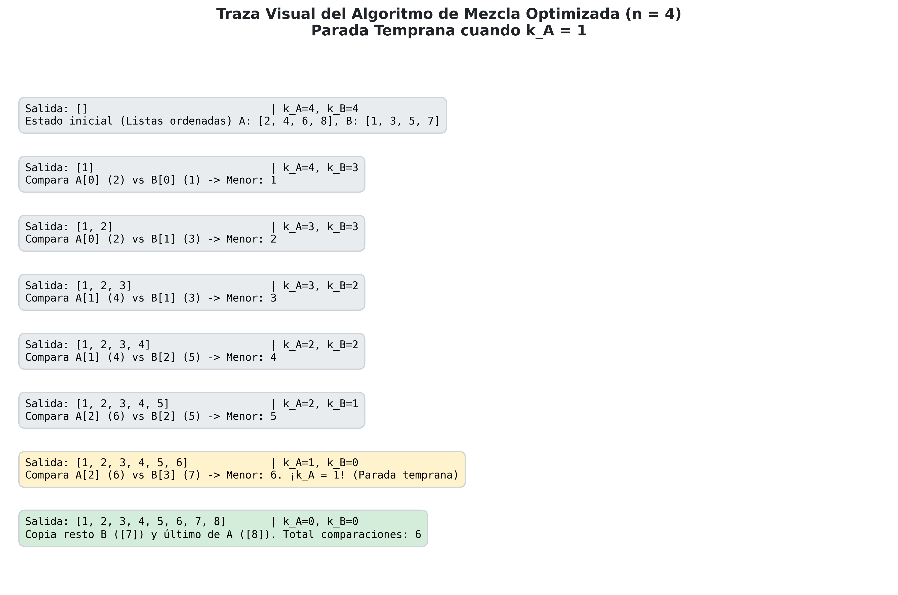
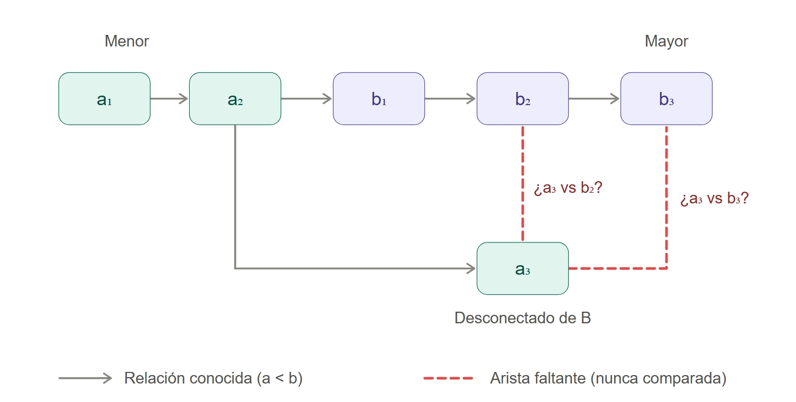

# Ejercicio 9: Una mezcla "optimizada" de dos listas ordenadas de largo deja de comparar cuando a la primera lista le queda un solo elemento, y lo pone al final. Cuenta cuántas comparaciones hace en el peor caso. Sin probarla, usa la sección 6 de la conferencia 5 para decidir si es correcta, y construye con el adversario la entrada en la que falla

## Planteamiento del Problema

Se analiza una variante "optimizada" del algoritmo de mezcla  que toma dos listas ordenadas $A = [a_1, a_2, \dots, a_n]$ y $B = [b_1, b_2, \dots, b_n]$ de igual longitud ($|A| = |B| = n$).

### Descripción del Algoritmo Propueto

Se mantienen dos punteros/índices inicializados al inicio de $A$ y $B$.
Se efectúan comparaciones entre los elementos actuales de $A$ y $B$, avanzando el índice correspondiente al elemento menor e insertándolo en la lista de salida.
**Condición de Parada Temprana ("Optimización"):** Tan pronto como a la primera lista ($A$) le queda **un solo elemento por procesar**, el algoritmo interrumpe las comparaciones, extrae los elementos restantes de $B$ (si los hay) a la salida y ubica el elemento restante de $A$ al final absoluto de la lista combinada.

---

## Análisis del Peor Caso: Conteo Exacto de Comparaciones

Para determinar el número máximo de comparaciones que realiza esta mezcla optimizada en el peor caso, analizamos el comportamiento del bucle de comparación.

En el modelo de comparaciones de la mezcla estándar cada comparación entre el elemento corriente de $A$ y el de $B$ determina cuál es menor y lo coloca en su posición definitiva en la salida.
Por lo tanto, **cada comparación reduce en 1 el número total de elementos no procesados** entre ambas listas.

Sea $k_A$ la cantidad de elementos restantes en la lista $A$ y $k_B$ la cantidad de elementos restantes en la lista $B$ , se tiene que inicialmente, $k_A = n$ y $k_B = n$.
El algoritmo continúa comparando **mientras $k_A > 1$ y $k_B > 0$**.

Para maximizar el número de comparaciones antes de activar el criterio de parada temprana, debemos retrasar el momento en que $k_A$ decrece a 1.Debemos agotar la mayor cantidad de elementos de la lista $B$ ($k_B$) manteniendo a $A$ con $k_A > 1$.
Para reducir $k_A$ de $n$ a 2, la mezcla debe haber extraído exactamente $n - 2$ elementos de la lista $A$.
Para maximizar las comparaciones totales, en ese instante la lista $B$ debe haber entregado $n - 1$ elementos (quedando solo 1 elemento en $B$), o incluso haber agotado completamente sus $n$ elementos.

Supongamos que el adversario entrelaza los elementos de $A$ y $B$ de la siguiente manera:
$$b_1 < a_1 < b_2 < a_2 < \dots < b_{n-1} < a_{n-1} < b_n < a_n$$

Siguiendo el trazo de ejecuciones para extraer $b_1, \dots, b_{n-1}$ (un total de $n-1$ elementos de $B$), se requieren $n-1$ comparaciones contra elementos de $A$.Para extraer $a_1, \dots, a_{n-2}$ (un total de $n-2$ elementos de $A$), se requieren $n-2$ comparaciones contra elementos de $B$.

En el punto en que se han extraído $n-2$ elementos de $A$ y $n-1$ elementos de $B$ quedan en $A$ $2$ elementos ($a_{n-1}, a_n$). Por lo tanto $k_A = 2$ y queda en $B$: $1$ elemento ($b_n$). Por lo tanto $k_B = 1$.
Comparaciones consumidas hasta el momento: $(n - 2) + (n - 1) = 2n - 3$.

Ahora para el siguiente paso del algoritmo se compara el elemento corriente de $A$ ($a_{n-1}$) con el de $B$ ($b_n$).
Supongamos que la respuesta indica $a_{n-1} < b_n$ ,
el elemento $a_{n-1}$ se envía a la salida y $k_A$ pasa a ser $2 - 1 = 1$,
se consume $1$ comparación adicional y en este instante, **$k_A = 1$**. El algoritmo activa la regla de optimización y **se detiene**.

$$\text{Comparaciones Máximas} = (2n - 3) + 1 = 2n - 2$$

> **Teorema 1:** *En el peor caso, la mezcla optimizada descrita realiza exactamente $2n - 2$ comparaciones.*

---

### Traza de Ejecución para $n = 4$ ($2n - 2 = 6$ comparaciones)

```python
import matplotlib.pyplot as plt
import numpy as np

# Configuración de los datos de la traza
pasos = [
    {"paso": "Inicio", "a": [2, 4, 6, 8], "b": [1, 3, 5, 7], "salida": [], "i": 0, "j": 0, "desc": "Estado inicial (Listas ordenadas) A: [2, 4, 6, 8], B: [1, 3, 5, 7]"},
    {"paso": "Paso 1", "a": [2, 4, 6, 8], "b": [1, 3, 5, 7], "salida": [1], "i": 0, "j": 1, "desc": "Compara A[0] (2) vs B[0] (1) -> Menor: 1"},
    {"paso": "Paso 2", "a": [2, 4, 6, 8], "b": [1, 3, 5, 7], "salida": [1, 2], "i": 1, "j": 1, "desc": "Compara A[0] (2) vs B[1] (3) -> Menor: 2"},
    {"paso": "Paso 3", "a": [2, 4, 6, 8], "b": [1, 3, 5, 7], "salida": [1, 2, 3], "i": 1, "j": 2, "desc": "Compara A[1] (4) vs B[1] (3) -> Menor: 3"},
    {"paso": "Paso 4", "a": [2, 4, 6, 8], "b": [1, 3, 5, 7], "salida": [1, 2, 3, 4], "i": 2, "j": 2, "desc": "Compara A[1] (4) vs B[2] (5) -> Menor: 4"},
    {"paso": "Paso 5", "a": [2, 4, 6, 8], "b": [1, 3, 5, 7], "salida": [1, 2, 3, 4, 5], "i": 2, "j": 3, "desc": "Compara A[2] (6) vs B[2] (5) -> Menor: 5"},
    {"paso": "Paso 6 (¡Alerta!)", "a": [2, 4, 6, 8], "b": [1, 3, 5, 7], "salida": [1, 2, 3, 4, 5, 6], "i": 3, "j": 4, "desc": "Compara A[2] (6) vs B[3] (7) -> Menor: 6. ¡k_A = 1! (Parada temprana)"},
    {"paso": "Finalización", "a": [2, 4, 6, 8], "b": [1, 3, 5, 7], "salida": [1, 2, 3, 4, 5, 6, 7, 8], "i": 4, "j": 4, "desc": "Copia resto B ([7]) y último de A ([8]). Total comparaciones: 6"}
]

# Crear la figura
fig, ax = plt.subplots(figsize=(12, 8))
y_pos = np.arange(len(pasos))

# Colores según el estado del paso
colores = ['#e9ecef'] * len(pasos)
colores[6] = '#fff3cd' # Alerta parada temprana
colores[7] = '#d4edda' # Final

ax.set_yticks(y_pos)
ax.set_yticklabels([p["paso"] for p in pasos], fontsize=11, fontweight='bold')
ax.invert_yaxis()   


 
for idx, p in enumerate(pasos):
    info_texto = f"Salida: {str(p['salida']):<30} | k_A={4-p['i']}, k_B={4-p['j']}\n{p['desc']}"
    
    # Caja de texto estilizada para cada paso
    ax.text(0.02, idx, info_texto, fontsize=10, family='monospace', va='center',
            bbox=dict(boxstyle='round,pad=0.6', facecolor=colores[idx], edgecolor='#ced4da', linewidth=1.2))

ax.set_xlim(0, 1)
ax.set_ylim(len(pasos), -1)
ax.axis('off')

plt.title("Traza Visual del Algoritmo de Mezcla Optimizada (n = 4)\nParada Temprana cuando k_A = 1", 
          fontsize=14, fontweight='bold', pad=20, color='#212529')

plt.tight_layout()

 
plt.savefig('traza_mezcla_optimizada.png', dpi=300, bbox_inches='tight')

```



---

## Implementación en Python y Evaluación Empírica

A continuación se presenta un script ejecutable en Python para validar el número de comparaciones en el peor caso para distintos tamaños $n$.

```python
import pandas as pd

def mezcla_optimizada(A, B):
    """
    Mezcla dos listas ordenadas A y B con la parada temprana cuando len(A) == 1.
    Retorna (lista_resultado, numero_de_comparaciones).
    """
    i, j = 0, 0
    len_A, len_B = len(A), len(B)
    salida = []
    comparaciones = 0

    
    while (len_A - i > 1) and (j < len_B):
        comparaciones += 1
        if A[i] <= B[j]:
            salida.append(A[i])
            i += 1
        else:
            salida.append(B[j])
            j += 1

     
    if j < len_B:
        salida.extend(B[j:])
    if i < len_A:
        salida.append(A[-1]) # El último de A va al final absoluto

    return salida, comparaciones

def generar_peor_caso(n):
    """
    Genera dos listas intercaladas para forzar el peor caso de 2n - 2 comparaciones.
    A: [2, 4, 6, ..., 2n]
    B: [1, 3, 5, ..., 2n - 1]
    """
    A = [2 * k for k in range(1, n + 1)]
    B = [2 * k - 1 for k in range(1, n + 1)]
    return A, B

def ejecutar_experimentos():
    resultados = []
    tamaños = [2, 3, 4, 5, 8, 10, 16, 32, 64]
    
    for n in tamaños:
        A, B = generar_peor_caso(n)
        _, comps = mezcla_optimizada(A, B)
        teorico = 2 * n - 2
        resultados.append({
            "n": n,
            "Cota Teórica (2n - 2)": teorico,
            "Comparaciones Medidas": comps,
            "Coincide": teorico == comps
        })
        
    df = pd.DataFrame(resultados)
    print(df.to_string(index=False))

if __name__ == "__main__":
    ejecutar_experimentos()
```

### Tabla de Resultados Experimentales

|   n | Cota Teórica (2n - 2) | Comparaciones Medidas | Coincide |
|----:|----------------------:|----------------------:|:--------:|
|   2 |                     2 |                     2 |   True   |
|   3 |                     4 |                     4 |   True   |
|   4 |                     6 |                     6 |   True   |
|   5 |                     8 |                     8 |   True   |
|   8 |                    14 |                    14 |   True   |
|  10 |                    18 |                    18 |   True   |
|  16 |                    30 |                    30 |   True   |
|  32 |                    62 |                    62 |   True   |
|  64 |                   126 |                   126 |   True   |

## Demostración de Incorrectitud mediante el Adversario

En la **Sección 6 de la Conferencia 5**, se demuestra que el número mínimo de comparaciones necesarias en el peor caso para intercalar correctamente dos listas ordenadas de tamaño $n$ es $2n - 1$.

### La Cota del Adversario para Mezclar

El adversario fuerza al algoritmo respondiendo las comparaciones de modo consistente con la cadena intercalada perfecta:
$$a_1 < b_1 < a_2 < b_2 < \dots < a_n < b_n$$

Esta cadena contiene exactamente **$2n - 1$ pares de vecinos inmediatos**:
$$(a_1, b_1), (b_1, a_2), (a_2, b_2), \dots, (a_n, b_n)$$

#### Teorema del Adversario

> *Cualquier algoritmo de comparaciones que no examine al menos una vez la relación entre cada uno de los $2n - 1$ pares vecinos en el orden intercalado cometerá un error para alguna entrada válida.*

---

### Demostración de Incorrectitud sin Probar la Mezcla "Optimizada"

Podemos decidir formalmente que la mezcla "optimizada" **es incorrecta** analizando únicamente su número de comparaciones frente a la cota mínima del adversario.

Por la prueba inicial, la mezcla optimizada realiza **a lo sumo $2n - 2$ comparaciones** en cualquier ejecución (incluso en su peor caso).
De acuerdo con el **Teorema del Adversario**, para garantizar la correctitud en la intercalación de dos listas de tamaño $n$, se requieren **al menos $2n - 1$ comparaciones**.
Puesto que $(2n - 2) < (2n - 1)$, el algoritmo finaliza su ejecución **sin haber comparado al menos un par de elementos vecinos críticos**.
Por el principio de contradicción derivado de la cota mínima (Sección 8 de la Conferencia 5): **Un algoritmo que realiza menos comparaciones que la cota mínima demostrada es obligatoriamente INCORRECTO.**

## Construcción Adversarial de la Entrada Fallida

Para construir explícitamente la entrada donde el algoritmo falla, aplicamos la técnica de la prueba por contradicción.
El adversario configura una secuencia objetivo donde la regla de la optimización fuerza la falta de comparación de un par vecino específico.

Elegimos la cadena intercalada:
$$b_1 < a_1 < b_2 < a_2 < \dots < b_n < a_n$$

Tomemos $n = 3$:
$$B = [b_1, b_2, b_3] = [1, 3, 5]$$
$$A = [a_1, a_2, a_3] = [2, 4, 6]$$

Sin embargo, para que el fallo sea evidente en la posición final elegida por el algoritmo (colocar el último elemento de $A$ al final absoluto), el adversario elige valores tal que el último elemento de $A$ ($a_n$) **NO sea el mayor absoluto de ambas listas**, sino que sea menor que el último elemento de $B$ ($b_n$).

Consideremos la relación de orden:
$$a_1 < a_2 < b_1 < b_2 < a_3 < b_3$$

Con valores concretos para $n = 3$:

* $A = [1, 2, 5]$
* $B = [3, 4, 6]$

1. **Comparación 1:** $A[0]$ vs $B[0]$ ($1$ vs $3$).
   * Menor: $A[0] = 1$.
   * Salida: `[1]`.
   * Punteros: $i=1, j=0$. Quedan en $A$: $2$ elementos ($k_A = 2$).
2. **Comparación 2:** $A[1]$ vs $B[0]$ ($2$ vs $3$).
   * Menor: $A[1] = 2$.
   * Salida: `[1, 2]`.
   * Punteros: $i=2, j=0$.
   * Elementos restantes en $A$: Queda **$1$ solo elemento** ($a_3 = 5$). Por lo tanto **$k_A = 1$**.

3. **Interrupción por Parada Temprana:**
   * El algoritmo detecta $k_A = 1$ y se detiene inmediatamente.
   * Total de comparaciones realizadas: **2**.
   * Par no comparado: $a_3$ ($5$) nunca se comparó con $b_1$ ($3$), $b_2$ ($4$), ni $b_3$ ($6$).

4. **Ensamblaje Forzado:**
   * Vuelca el resto de $B$: `[3, 4, 6]`.
   * Salida previa con $B$: `[1, 2, 3, 4, 6]`.
   * Inserta el último de $A$ ($a_3 = 5$) **al final absoluto**.
   * **Salida Producida por el Algoritmo:** `[1, 2, 3, 4, 6, 5]` **(INCORRECTA)**.
   * **Salida Correcta:** `[1, 2, 3, 4, 5, 6]`.

---

El grafo de comparaciones no examinadas ilustra la falla de información en el árbol de decisión:


*Las flechas grises son las relaciones que el algoritmo conoce, y las líneas rojas punteadas son las aristas que nunca comprobó.Lo importante es que a₃ solo está conectado con a₂ (a₂ < a₃), así que no se sabe cómo se ordena respecto a b₂ ni a b₃.*

---

El siguiente script en Python ejecuta una serie de pruebas de contraejemplos para ilustrar la falla del algoritmo

```python
import pandas as pd

def mezcla_optimizada(A, B):
    i, j = 0, 0
    salida = []
    comparaciones = 0
    
    while (len(A) - i > 1) and (j < len(B)):
        comparaciones += 1
        if A[i] <= B[j]:
            salida.append(A[i])
            i += 1
        else:
            salida.append(B[j])
            j += 1

    if j < len(B):
        salida.extend(B[j:])
    if i < len(A):
        salida.append(A[-1])

    return salida, comparaciones

def mezclar_correcta(A, B):
     
    i, j = 0, 0
    salida = []
    while i < len(A) and j < len(B):
        if A[i] <= B[j]:
            salida.append(A[i])
            i += 1
        else:
            salida.append(B[j])
            j += 1
    salida.extend(A[i:])
    salida.extend(B[j:])
    return salida

def construir_contraejemplo_adversario(n):
 
    A = list(range(1, n)) + [2 * n - 1]
    B = list(range(n, 2 * n - 1)) + [2 * n]
    return A, B

def probar_contraejemplos():
    casos = [2, 3, 4, 5, 8]
    reporte = []

    for n in casos:
        A, B = construir_contraejemplo_adversario(n)
        resultado_algoritmo, comps = mezcla_optimizada(A, B)
        resultado_esperado = mezclar_correcta(A, B)
        es_correcto = (resultado_algoritmo == resultado_esperado)

        reporte.append({
            "n": n,
            "Lista A": str(A),
            "Lista B": str(B),
            "Salida Algoritmo": str(resultado_algoritmo),
            "Salida Correcta": str(resultado_esperado),
            "¿Correcto?": es_correcto
        })

    df = pd.DataFrame(reporte)
    print(df.to_string(index=False))

if __name__ == "__main__":
    probar_contraejemplos()
```

### Tabla de Resultados del Contraejemplo

|   n | Lista A | Lista B | Salida Algoritmo | Salida Correcta | ¿Correcto? |
|----:|:--------|:--------|:-----------------|:----------------|:----------:|
|   2 | [1, 3]  | [2, 4]  | [1, 2, 4, 3]     | [1, 2, 3, 4]    |   False    |
|   3 | [1, 2, 5]| [3, 4, 6]| [1, 2, 3, 4, 6, 5]| [1, 2, 3, 4, 5, 6]| False   |
|   4 | [1, 2, 3, 7]| [4, 5, 6, 8]| [1, 2, 3, 4, 5, 6, 8, 7]| [1, 2, 3, 4, 5, 6, 7, 8]| False|
|   5 | [1, 2, 3, 4, 9]| [5, 6, 7, 8, 10]| [1, 2, 3, 4, 5, 6, 7, 8, 10, 9]| [1, 2, 3, 4, 5, 6, 7, 8, 9, 10]| False|
|   8 | [1, 2, 3, 4, 5, 6, 7, 15]| [8, 9, 10, 11, 12, 13, 14, 16]| [1, 2, 3, 4, 5, 6, 7, 8, 9, 10, 11, 12, 13, 14, 16, 15]| [1, 2, 3, 4, 5, 6, 7, 8, 9, 10, 11, 12, 13, 14, 15, 16]| False|
