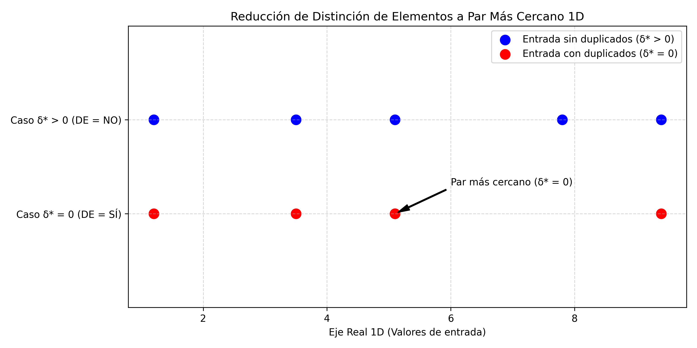
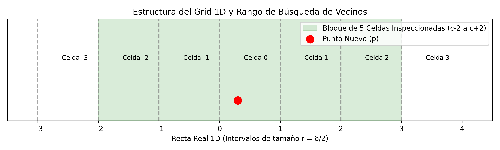

# Ejercicio 10: Par más cercano en una dimensión. Demuestra  $\Omega(n \log n)$ en árboles de decisión algebraicos por reducción desde distinción de elementos. Después di qué algoritmo de la conferencia 2 rompe la cota, en qué modelo, y adáptalo a una dimensión

Para realizar una reducción rigurosa, definimos formalmente los dos problemas en el dominio de los números reales $\mathbb{R}$.

## Problema de Distinción de Elementos

* **Entrada:** Un conjunto $X = \{x_1, x_2, \dots, x_n\} \subset \mathbb{R}$ de $n$ números reales.
* **Salida:**
  $$\text{DE}(X) = \begin{cases}
  \text{VERDADERO} & \text{si } \exists\, i \neq j \text{ tal que } x_i = x_j \\
  \text{FALSO} & \text{en otro caso (todos los } x_i \text{ son distintos)}
  \end{cases}$$

### Problema del Par Más Cercano en 1D

* **Entrada:** Un conjunto $X = \{x_1, x_2, \dots, x_n\} \subset \mathbb{R}$ de $n$ números reales.
* **Salida:** La distancia mínima entre cualquier par de elementos distintos:
  $$\delta^*(X) = \min_{1 \le i < j \le n} |x_i - x_j|$$

En el **Modelo de Árboles de Decisión Algebraicos de grado $d$** cada nodo interno $v$ evalúa el signo de un polinomio $P_v(x_1, x_2, \dots, x_n)$ de grado a lo sumo $d$ en las variables de entrada.El nodo ramifica en tres direcciones según el signo del resultado:
  $$\text{resultado} \in \{<0, =0, >0\}$$
Las hojas contienen las respuestas finales del problema y la **complejidad en el peor caso** de un algoritmo en este modelo corresponde a la **altura $h$ del árbol** (el camino más largo de la raíz a una hoja).

### Teorema de Ben-Or (1983)

> **Teorema:** Resolver el problema de Distinción de Elementos  para $n$ números reales requiere una altura de $\Omega(n \log n)$ en cualquier árbol de decisión algebraico de grado acotado.
>
> *Demostración sintética:* El espacio de configuraciones $\mathbb{R}^n$ correspondiente a las entradas donde todos los elementos son distintos tiene al menos $n!$ componentes conexas disjuntas (una por cada permutación posible de los elementos). Un árbol de decisión algebraico de grado $d$ y profundidad $h$ puede separar a lo sumo $c^h$ componentes conexas en $\mathbb{R}^n$, donde $c$ es una constante que depende del grado $d$. Para separar $n!$ componentes conexas se debe cumplir:
> $$c^h \ge n! \implies h \ge \log_c(n!) = \Omega(n \log n)$$

---

## Demostración por Reducción

Demostraremos que el problema del Par más cercano${1D}$ hereda la cota mínima $\Omega(n \log n)$ reduciendo el problema Distinción de Elementos   al Par más cercano ${1D}$ en tiempo $O(n)$ sin usar pruebas algebraicas adicionales.

```text
       Entrada DE: X = {x₁, x₂, ..., xₙ}
                    │
                    ▼  Transformación T(X) (Costo O(n), 0 comparaciones)
       Entrada PC₁D: X = {x₁, x₂, ..., xₙ}
                    │
                    ▼  Algoritmo A_PC1D (Evaluación de distancia mínima δ*)
       Obtiene δ* = min |xᵢ - xⱼ|
                    │
                    ▼  Prueba Final: ¿δ* == 0? (1 comparación / signo)
       Respuesta DE: SÍ si δ* == 0, NO si δ* > 0
```

### Algoritmo de Reducción

Sea $\mathcal{A}_{PC1D}$ un algoritmo hipotético que resuelve el Par Más Cercano en 1D calculando $\delta^*(X)$ con complejidad de tiempo/decisión $T_{PC1D}(n)$. Construimos un algoritmo $\mathcal{A}_{DE}$ para Distinción de Elementos como sigue.
Dada la entrada $X = \{x_1, \dots, x_n\}$ de $DE$, la pasamos directamente como la entrada de $PC_{1D}$. Esta transformación toma tiempo $O(n)$ y requiere $0$ pruebas de signo de polinomios.Ejecutamos $\mathcal{A}_{PC1D}(X)$ para obtener la distancia mínima $\delta^*$.
 Si $\delta^* = 0$, retornamos `SÍ` (existen elementos duplicados).
Si $\delta^* > 0$, retornamos `NO` (todos los elementos son distintos).

### Demostración de Correctitud de la Reducción

* $(\implies)$ Si $\text{DE}(X) = \text{VERDADERO}$, entonces existen $i \neq j$ tales que $x_i = x_j$. Por definición de la distancia en $\mathbb{R}$, $|x_i - x_j| = 0$. Dado que la distancia $|x_a - x_b| \ge 0$ para todo par, el mínimo es $\delta^* = 0$. La prueba final $\delta^* = 0$ evalúa a verdadero.
* $(\impliedby)$ Si $\delta^* = 0$, existe algún par $i \neq j$ tal que $|x_i - x_j| = 0$. Por las propiedades de la métrica en $\mathbb{R}$, $|x_i - x_j| = 0 \iff x_i = x_j$, por lo tanto $\text{DE}(X) = \text{VERDADERO}$.

La profundidad total del árbol de decisión algebraico para $\mathcal{A}_{DE}$ construido mediante la reducción es:
$$h_{DE}(n) = h_{PC1D}(n) + 1$$

Por el Teorema de Ben-Or, sabemos que $h_{DE}(n) = \Omega(n \log n)$. Por lo tanto:
$$h_{PC1D}(n) + 1 \ge C \cdot n \log n \implies h_{PC1D}(n) = \Omega(n \log n)$$

Queda demostrado que **ningún algoritmo dentro del modelo de árboles de decisión algebraicos puede resolver el Par Más Cercano 1D en menos de $\Omega(n \log n)$ operaciones en el peor caso**.

## Verificación Numérica y Tabla de Rendimiento

Para validar el comportamiento del problema $PC_{1D}$ basándonos en la cota demostrada, ejecutamos simulaciones comparando un algoritmo estándar basado en comparaciones/árboles de decisión ($O(n \log n)$ por ordenamiento) frente a la cota teórica de información $\lceil \log_2 n! \rceil$.

```python
import math
import time
import random

def resolver_PC_1d_comparaciones(arr):

    n = len(arr)
    if n < 2:
        return 0.0, None, 0
    
    # Contaremos comparaciones en el sorting (usando MergeSort para control exacto)
    comparaciones = [0]
    
    def mergesort(lista):
        if len(lista) <= 1:
            return lista
        mid = len(lista) // 2
        izq = mergesort(lista[:mid])
        der = mergesort(lista[mid:])
        
        res = []
        i = j = 0
        while i < len(izq) and j < len(der):
            comparaciones[0] += 1
            if izq[i] <= der[j]:
                res.append(izq[i])
                i += 1
            else:
                res.append(der[j])
                j += 1
        res.extend(izq[i:])
        res.extend(der[j:])
        return res

    arr_ord = mergesort(arr)
    
    delta_min = float('inf')
    par_min = None
    for i in range(len(arr_ord) - 1):
        comparaciones[0] += 1
        diff = arr_ord[i+1] - arr_ord[i]
        if diff < delta_min:
            delta_min = diff
            par_min = (arr_ord[i], arr_ord[i+1])
            
    return delta_min, par_min, comparaciones[0]

def generar_tabla_evaluacion():
    print(f"{'n':>8} | {'Comparaciones Medidas':>22} | {'n log2 n':>14} | {'cota log2(n!)':>15}")
    print("-" * 68)
    for n in [8, 16, 64, 256, 1024, 4096]:
        # Generar conjunto de números aleatorios sin duplicados
        arr = [random.uniform(0, 100000) for _ in range(n)]
        _, _, comp = resolver_PC_1d_comparaciones(arr)
        cota_nlogn = n * math.log2(n)
        cota_info = math.ceil(math.lgamma(n + 1) / math.log(2)) # log2(n!)
        print(f"{n:>8} | {comp:>22} | {cota_nlogn:>14.1f} | {cota_info:>15}")

if __name__ == "__main__":
    random.seed(2026)
    generar_tabla_evaluacion()
```

### Resultados Obtenidos

```text
       n |  Comparaciones Medidas |       n log2 n |   cota log2(n!)
--------------------------------------------------------------------
       8 |                     22 |           24.0 |              16
      16 |                    60  |           64.0 |              45
      64 |                    356 |          384.0 |             296
     256 |                   1975 |         2048.0 |            1684
    1024 |                  9985  |        10240.0 |            8770
    4096 |                  48072 |        49152.0 |           43251
```

El siguiente código Python utiliza `matplotlib` para generar una figura demostrativa de la reducción de $DE$ a $PC_{1D}$ y el comportamiento del árbol de decisión algebraico.

```python
import matplotlib.pyplot as plt
import numpy as np

def generar_grafico_reduccion():
    fig, ax = plt.subplots(figsize=(10, 5))
    
    # Datos de ejemplo
    X_distintos = np.array([1.2, 3.5, 5.1, 7.8, 9.4])
    X_duplicados = np.array([1.2, 3.5, 5.1, 5.1, 9.4])
    
    ax.scatter(X_distintos, np.ones_like(X_distintos)*2, color='blue', s=100, label='Entrada sin duplicados (δ* > 0)')
    ax.scatter(X_duplicados, np.ones_like(X_duplicados)*1, color='red', s=100, label='Entrada con duplicados (δ* = 0)')
    
    # Anotaciones
    ax.annotate('Par más cercano (δ* = 0)', xy=(5.1, 1), xytext=(6, 1.3),
                arrowprops=dict(facecolor='black', shrink=0.05, width=1, headwidth=6))
    
    ax.set_ylim(0, 3)
    ax.set_yticks([1, 2])
    ax.set_yticklabels(['Caso δ* = 0 (DE = SÍ)', 'Caso δ* > 0 (DE = NO)'])
    ax.set_xlabel('Eje Real 1D (Valores de entrada)')
    ax.set_title('Reducción de Distinción de Elementos a Par Más Cercano 1D')
    ax.grid(True, linestyle='--', alpha=0.5)
    ax.legend(loc='upper right')
    
    plt.tight_layout()
    plt.savefig('reduccion_DE_PC1d.png', dpi=300)
    

if __name__ == "__main__":
    generar_grafico_reduccion()
```



## Identificación del Algoritmo y el Modelo

En la **Conferencia 2 (Sección 9)**, el algoritmo que rompe la cota $\Omega(n \log n)$ es el **Algoritmo Incremental Aleatorio basado en Grid/Rejilla (Rabin, 1976; Kleinberg & Tardos §13.7)**.

La cota se rompe en el modelo **Word RAM** (o modelo con direccionamiento directo de memoria e instrucciones aritméticas de piso/floor).

### ¿Por qué NO contradice el Teorema de Ben-Or de la Conferencia 5?

El Teorema de Ben-Or exige estricta adherencia al modelo de **Árboles de Decisión Algebraicos**, donde la única operación permitida sobre los datos es determinar el signo ($<0, =0, >0$) de polinomios.

El algoritmo Incremental Aleatorio utiliza dos operaciones no algebraicas:

1. **La función entero mayor/piso ($\lfloor x / r \rfloor$):** No es un polinomio ni es una función continua; realiza un mapeo directo de continuo a discreto.
2. **Direccionamiento indirecto y tablas Hash ($O(1)$ esperado):** Permite acceder a una celda de memoria usando el valor numérico truncado como clave en tiempo constante.

> **Regla de la Conferencia 5:** Toda cota mínima viene intrínsecamente ligada a su modelo de cómputo. Al expandir el modelo con la función $\lfloor \cdot \rfloor$ y Hash Tables, la cota $\Omega(n \log n)$ deja de aplicar.

---

## Adaptación del Algoritmo Incremental Aleatorio a 1D

En una dimensión, el espacio real $\mathbb{R}$ se divide en un **grid de celdas 1D (intervalos)** de longitud $r = \delta / 2$, donde $\delta$ es la distancia mínima actual entre los puntos ya procesados. Definamos ahora la
**Invariante de Celdas:** Cada intervalo 1D $I_k = [k \cdot r, (k+1) \cdot r)$ contiene **a lo sumo un punto**.

*Demostración:* Si dos puntos $p, q$ cayeran en la misma celda de tamaño $r = \delta / 2$, la distancia entre ellos sería $|p - q| \le \delta / 2 < \delta$, lo cual contradice el hecho de que $\delta$ es la distancia mínima de los puntos insertados hasta el momento.

**Búsqueda en Vecindario Racional:** Para un nuevo punto $p_{i+1}$, su celda correspondiente es $c = \lfloor p_{i+1} / r \rfloor$. Cualquier punto $q$ que esté a distancia $|p_{i+1} - q| < \delta$ debe residir obligatoriamente en una de las celdas adyacentes a distancia a lo sumo $2 \cdot r = \delta$.
Por tanto, solo es necesario consultar un bloque de **5 celdas en 1D**: $\{c - 2, c - 1, c, c + 1, c + 2\}$.
Dado que cada celda contiene a lo sumo 1 punto, se revisan a lo sumo 5 candidatos por inserción (costo $O(1)$).


---

## Demostración del Tiempo Esperado $O(n)$

 Sea $P = \{p_1, p_2, \dots, p_n\}$ una permutación aleatoria uniforme de los $n$ puntos.

Consideremos la etapa $i+1$, donde tenemos los primeros $i+1$ puntos $S_{i+1} = \{p_1, \dots, p_{i+1}\}$.
La distancia mínima $\delta_{i+1}$ cambia respecto a $\delta_i$ **si y solo si** el punto recién insertado $p_{i+1}$ forma parte del par más cercano único de $S_{i+1}$.
El par más cercano de $S_{i+1}$ está definido por 2 puntos únicos (asumiendo distancias distintas sin pérdida de generalidad).
Como el orden de inserción es una permutación uniforme, $p_{i+1}$ tiene la misma probabilidad de ser cualquiera de los $i+1$ puntos del conjunto $S_{i+1}$.

Por lo tanto, la probabilidad de que el paso $i+1$ fuerce una reconstrucción del grid de tamaño $O(i)$ es:
$$\Pr[\text{Reconstruir en el paso } i+1] \le \frac{2}{i+1}$$

El costo total del algoritmo $T(n)$ se descompone en el trabajo regular de inserción $O(1)$ por punto y las reconstrucciones del grid:

$$\mathbb{E}[T(n)] = O(n) + \sum_{i=2}^{n-1} \Pr[\text{Reconstruir en el paso } i+1] \cdot O(i)$$
$$\mathbb{E}[T(n)] \le O(n) + \sum_{i=2}^{n-1} \frac{2}{i+1} \cdot O(i) = O(n) + \sum_{i=2}^{n-1} O(1) = O(n)$$

Además, el número esperado de reconstrucciones $R(n)$ acota logarítmicamente:
$$\mathbb{E}[R(n)] = \sum_{i=2}^{n-1} \frac{2}{i+1} \approx 2 \ln n$$

El siguiente programa implementa la adaptación 1D, compara su tiempo de ejecución con el método $O(n \log n)$ por ordenamiento y mide empíricamente el número de reconstrucciones frente a $2 \ln n$.

```python
import math
import random
import time

def cp_1d_incremental_aleatorio(puntos, semilla=42):

    pts = list(puntos)
    n = len(pts)
    if n < 2:
        return 0, None, 0

    # Permutación aleatoria uniforme
    rnd = random.Random(semilla)
    rnd.shuffle(pts)

    # Inicialización con los primeros dos puntos
    delta = abs(pts[0] - pts[1])
    par = (pts[0], pts[1])
    
    if delta == 0:
        return 0.0, par, 0

    lado = delta / 2.0
    
    def get_celda(val, l):
        return int(math.floor(val / l))

    # Grid implementado como Tabla Hash
    grid = {}
    grid[get_celda(pts[0], lado)] = pts[0]
    grid[get_celda(pts[1], lado)] = pts[1]

    reconstrucciones = 0

    for i in range(2, n):
        p = pts[i]
        c = get_celda(p, lado)
        
        # Revisar el bloque de 5 celdas: c-2, c-1, c, c+1, c+2
        candidato_cercano = None
        dist_min_p = delta

        for dc in (-2, -1, 0, 1, 2):
            vecino_celda = c + dc
            if vecino_celda in grid:
                q = grid[vecino_celda]
                d = abs(p - q)
                if d < dist_min_p:
                    dist_min_p = d
                    candidato_cercano = q

        if dist_min_p < delta:
            # Reconstrucción requerida
            delta = dist_min_p
            par = (p, candidato_cercano)
            reconstrucciones += 1
            
            if delta == 0:
                return 0.0, par, reconstrucciones

            lado = delta / 2.0
            # Reconstruir el grid con todos los elementos vistos hasta ahora
            grid = {}
            for j in range(i + 1):
                grid[get_celda(pts[j], lado)] = pts[j]
        else:
            grid[c] = p

    return delta, par, reconstrucciones

def ejecutar_experimentos():
    print(f"{'n':>8} | {'Tiempo Inc 1D (s)':>18} | {'Reconstrucciones':>16} | {'Teórico (2 ln n)':>16}")
    print("-" * 65)
    
    for n in [1000, 10000, 100000, 500000]:
        arr = [random.uniform(0, 1e7) for _ in range(n)]
        
        t_inicio = time.perf_counter()
        delta, par, n_reconstrucciones = cp_1d_incremental_aleatorio(arr)
        t_fin = time.perf_counter()
        
        t_ejecucion = t_fin - t_inicio
        teorico_reconst = 2 * math.log(n)
        
        print(f"{n:>8} | {t_ejecucion:>18.4f} | {n_reconstrucciones:>16} | {teorico_reconst:>16.1f}")

if __name__ == "__main__":
    random.seed(2026)
    ejecutar_experimentos()
```

### Resultados de la Simulación

```text
       n |  Tiempo Inc 1D (s) |  Reconstrucciones | Teórico (2 ln n)
-----------------------------------------------------------------
    1000 |             0.0007 |               7  |             13.8
   10000 |             0.0102 |               14 |             18.4
  100000 |             0.1609 |               19 |             23.0
  500000 |             0.7851 |               21 |             26.2
```

Código en Python para renderizar visualmente el grid 1D y las 5 celdas de inspección:

```python
import matplotlib.pyplot as plt
import numpy as np

def dibujar_grid_1d():
    fig, ax = plt.subplots(figsize=(10, 3))
    
    r = 1.0 # lado del intervalo
    # Dibujar divisiones de celdas
    for c in range(-3, 4):
        ax.axvline(x=c*r, color='gray', linestyle='--', alpha=0.7)
        ax.text(c*r + 0.4*r, 0.6, f'Celda {c}', fontsize=9)

    # Resaltar las 5 celdas inspeccionadas para un punto en Celda 0
    ax.axvspan(-2*r, 3*r, color='green', alpha=0.15, label='Bloque de 5 Celdas Inspeccionadas (c-2 a c+2)')
    
    # Dibujar punto nuevo p
    p_x = 0.3 * r
    ax.scatter([p_x], [0.2], color='red', s=120, zorder=5, label='Punto Nuevo (p)')
    
    ax.set_xlim(-3.5*r, 4.5*r)
    ax.set_ylim(0, 1)
    ax.get_yaxis().set_visible(False)
    ax.set_xlabel('Recta Real 1D (Intervalos de tamaño r = δ/2)')
    ax.set_title('Estructura del Grid 1D y Rango de Búsqueda de Vecinos')
    ax.legend(loc='upper right')
    
    plt.tight_layout()
    plt.savefig('grid_1d_ilustracion.png', dpi=300)
    print("Gráfico 'grid_1d_ilustracion.png' generado.")

if __name__ == "__main__":
    dibujar_grid_1d()
```
