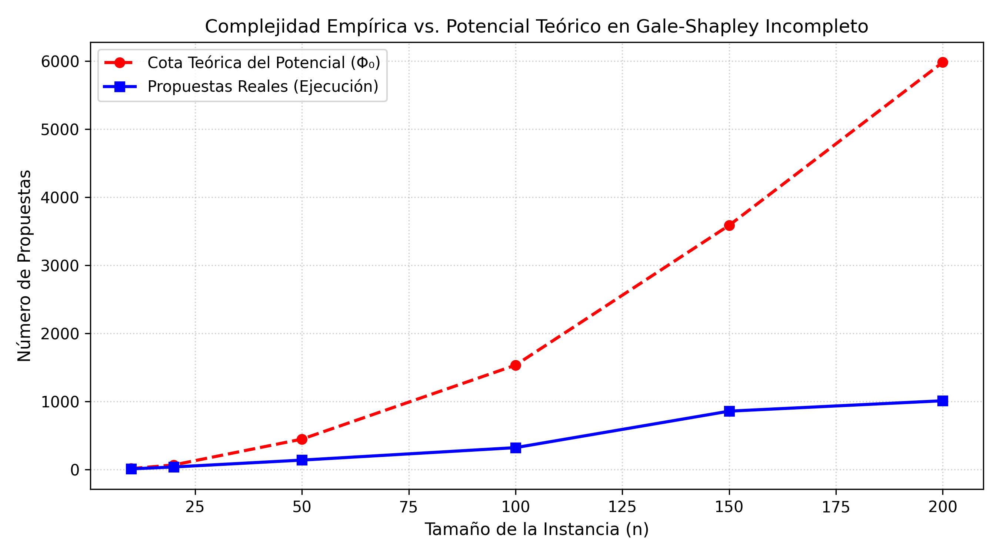

# Ejercicio 12 : Gale-Shapley con listas incompletas: cada proponente lista solo a algunos receptores, y prefiere quedarse solo antes que con uno que no listó. Adapta el algoritmo, su potencial y la definición de pareja bloqueante. ¿Sigue siendo estable el resultado? Demuéstralo

## Contexto y Adaptación del Modelo

En el problema clásico de Gale-Shapley (Matching Estable), se asume que todos los participantes tienen listas de preferencias estrictas y completas sobre los miembros del conjunto opuesto. Sin embargo, en escenarios reales (como mercados laborales o admisiones universitarias), las listas suelen ser **incompletas**: un agente puede preferir no ser emparejado (quedarse solo, denotado por $\emptyset$) antes que formar pareja con un agente fuera de su lista de preferencia.

Sean $A = \{a_1, a_2, \dots, a_n\}$ el conjunto de proponentes y $B = \{b_1, b_2, \dots, b_m\}$ el conjunto de receptores.

1. **Listas de Preferencias Incompletas**:
   - Cada proponente $a \in A$ define un orden total estricto $P(a)$ sobre un subconjunto $B_a \subseteq B$. Para $a$, cualquier $b \notin B_a$ es **inaceptable** ($a$ prefiere $\emptyset$ a $b$).
   - Cada receptor $b \in B$ define un orden total estricto $P(b)$ sobre un subconjunto $A_b \subseteq A$. Para $b$, cualquier $a \notin A_b$ es **inaceptable** ($b$ prefiere $\emptyset$ a $a$).

2. **Aceptabilidad Mutua**:
   Un par $(a, b)$ se considera **mutuamente aceptable** si y solo si $b \in B_a$ y $a \in A_b$.

3. **Emparejamiento Parcial**:
   Un emparejamiento $M$ es un conjunto de pares $(a, b) \in A \times B$ tal que cada proponente y cada receptor pertenece a lo sumo a un par en $M$. Si $(a, b) \in M$, escribimos $M(a) = b$ y $M(b) = a$. Si un agente $x$ no tiene pareja en $M$, denotamos $M(x) = \emptyset$.

4. **Racionalidad Individual**:
   Un emparejamiento $M$ es *individualmente racional* si para todo $(a, b) \in M$, el par $(a, b)$ es mutuamente aceptable. Ningún participante prefiere estar solo antes que con su pareja asignada.

5. **Pareja Bloqueante (Adaptación)**:
   Un emparejamiento $M$ es **inestable** si existe al menos una de las siguientes condiciones de bloqueo:
   - **Inestabilidad Individual**: Existe un agente $x$ que prefiere estar solo ($\emptyset$) antes que estar con $M(x)$ (es decir, $M$ no es individualmente racional).
   - **Pareja Bloqueante Externa**: Existe un par $(a, b) \in A \times B$ tal que:
     1. $(a, b)$ es mutuamente aceptable ($b \in B_a$ y $a \in A_b$).
     2. $a$ prefiere a $b$ sobre $M(a)$ (donde $M(a)$ puede ser un receptor peor o $\emptyset$).
     3. $b$ prefiere a $a$ sobre $M(b)$ (donde $M(b)$ puede ser un proponente peor o $\emptyset$).

---

## Adaptación del Algoritmo y Función Potencial

Modificamos el algoritmo de Aceptación Diferida de Gale-Shapley para que los proponentes solo propongan a receptores que están en sus listas de preferencias y que sean mutuamente aceptables.

```python
# Pseudocódigo conceptual de Gale-Shapley Adaptado
1. Inicializar M = Ø para todos los participantes.
2. Cada proponente a trunca su lista P(a) eliminando los receptores b donde a no está en P(b).
3. Mientras exista un proponente libre 'a' que aún tenga receptores inexplorados en su lista truncada P'(a):
    a. b = siguiente receptor más preferido en P'(a).
    b. Si b está libre:
        (a, b) quedan comprometidos.
    c. Si b está emparejado con a':
        Si b prefiere a sobre a':
            b rompe con a' (a' pasa a estar libre).
            (a, b) quedan comprometidos.
        Sino:
            b rechaza a 'a' (a permanece libre).
4. Devolver M.
```

Para demostrar que el algoritmo adaptado **termina**, definimos la **Función Potencial ($\Phi$)**:

$$\Phi = \sum_{a \in A} |P'(a)|$$

donde $P'(a) \subseteq B_a$ es el conjunto de receptores mutuamente aceptables para $a$, y $|P'(a)|$ es la cantidad de propuestas pendientes que el proponente $a$ puede realizar antes de agotar su lista.

Para este potencial sabemos que cumple con la **Acotación Inferior**  $\Phi \ge 0$ en todo momento de la ejecución.
En cada iteración del ciclo, un proponente libre $a$ emite una propuesta a su siguiente receptor disponible $b$. El puntero del proponente avanza, reduciendo en $1$ el número de propuestas pendientes en su lista. Por tanto:
   $$\Phi_{t+1} = \Phi_t - 1$$
cumpliendo así con el **Decrecimiento Estricto**.
Luego como $\Phi_0 = \sum_{a \in A} |P'(a)| \le n \cdot m \le n^2$ (asumiendo $|A|=n, |B|=m$), el ciclo  realiza a lo sumo $\Phi_0$ iteraciones.

Como $\Phi$ es una cantidad entera no negativa que disminuye estrictamente en $1$ en cada iteración, el algoritmo **necesariamente termina** en a lo sumo $O(n \cdot m)$ propuestas.

## Demostración Formal de Correctitud y Estabilidad

### Teorema

>El resultado devuelto por el algoritmo
>Gale-Shapley adaptado con listas
>incompletas es **siempre estable**.

### Demostración

La demostración se divide en dos partes: *Racionalidad Individual* y *Ausencia de Parejas Bloqueantes*.

#### Parte 1: Racionalidad Individual

Por construcción del algoritmo un proponente $a$ solo hace propuestas a receptores presentes en su lista truncada $P'(a)$. Por lo tanto, $a$ nunca estará emparejado con un receptor $b$ no aceptable ($b \notin B_a$). Si un proponente agota su lista sin ser aceptado, termina solo ($M(a) = \emptyset$).
Un receptor $b$ solo acepta propuestas de proponentes en su lista $P(b)$, rechazando automáticamente a cualquiera que no esté listado.

Por consiguiente, todas las parejas en $M$ son mutuamente aceptables, garantizando que el emparejamiento es **individualmente racional**.

#### Parte 2: Ausencia de Parejas Bloqueantes (Demostración por Contradicción)

Supongamos por contradicción que el emparejamiento final $M$ es inestable y contiene una pareja bloqueante $(a, b)$.

Por la definición adaptada de pareja bloqueante, se debe cumplir que
$(a, b)$ es mutuamente aceptable ($b \in B_a$ y $a \in A_b$).
$a$ prefiere a $b$ sobre $M(a)$ (donde $M(a)$ puede ser otro receptor o $\emptyset$).
$b$ prefiere a $a$ sobre $M(b)$ (donde $M(b)$ puede ser otro proponente o $\emptyset$).

Dado que $a$ prefiere a $b$ sobre $M(a)$ y los proponentes proponen en orden estricto de preferencia decreciente
$a$ tuvo que haberle propuesto a $b$ **antes** de proponerle a $M(a)$ (o antes de quedar solo y terminar la ejecución).
Al recibir la propuesta de $a$, el receptor $b$ solo pudo haber rechazado a $a$ en dos situaciones:
**Caso A**: En el momento de la propuesta, $b$ ya estaba comprometido con un proponente $a'$ al que prefería estrictamente sobre $a$.
**Caso B**: $b$ aceptó temporalmente a $a$, pero más adelante lo rechazó al recibir la propuesta de un proponente $a''$ al que prefería estrictamente sobre $a$.

En ambos casos, por el **Invariante del Receptor** (*el estado de un receptor comprometido solo puede mejorar o mantenerse igual según su lista de preferencias*), la pareja final de $b$, $M(b)$, debe ser al menos tan preferida por $b$ como el proponente que causó el rechazo de $a$.

Por transitividad de las preferencias estrictas de $b$:
$$M(b) \succ_b a$$

Esto contradice la hipótesis inicial de que $b$ prefiere a $a$ sobre $M(b)$ ($a \succ_b M(b)$).

$$ \text{No pueden existir parejas bloqueantes. El emparejamiento } M \text{ es estable.} $$

## Implementación

A continuación se muestra la implementación completa en Python que incluye el algoritmo adaptado para listas incompletas,verificador de estabilidad y parejas bloqueantes.

```python
import random
from collections import deque
import matplotlib.pyplot as plt
import numpy as np

def gale_shapley_incompletas(pref_a, pref_b):

    # Truncar listas para asegurar aceptabilidad mutua
    pref_a_filtrada = {}
    for a, lista in pref_a.items():
        pref_a_filtrada[a] = [b for b in lista if b in pref_b and a in pref_b[b]]
        
    n_a = len(pref_a)
    n_b = len(pref_b)
    
    # Precomputar rangos de receptores para comparaciones O(1)
    rango_b = {}
    for b, lista in pref_b.items():
        rango_b[b] = {a: i for i, a in enumerate(lista)}
        
    siguiente_propuesta = {a: 0 for a in pref_a}
    pareja_de_b = {b: None for b in pref_b}
    
    libres = deque(list(pref_a.keys()))
    propuestas_totales = 0
    
    while libres:
        a = libres.popleft()
        idx = siguiente_propuesta[a]
        
        # Si el proponente agotó su lista de aceptables, se queda solo
        if idx >= len(pref_a_filtrada[a]):
            continue
            
        b = pref_a_filtrada[a][idx]
        siguiente_propuesta[a] += 1
        propuestas_totales += 1
        
        actual = pareja_de_b[b]
        if actual is None:
            pareja_de_b[b] = a
        elif rango_b[b][a] < rango_b[b][actual]:
            pareja_de_b[b] = a
            libres.append(actual)
        else:
            libres.append(a)
            
    # Construir emparejamiento final M (a -> b o None)
    M_a = {a: None for a in pref_a}
    for b, a in pareja_de_b.items():
        if a is None:
            continue
        M_a[a] = b
        
    return M_a, pareja_de_b, propuestas_totales

def verificar_estabilidad(M_a, M_b, pref_a, pref_b):

    bloqueantes = []
    
    # 1. Verificar Racionalidad Individual
    for a, b in M_a.items():
        if b is None:
            continue
        if b not in pref_a[a] or a not in pref_b[b]:
            return [("Inestabilidad Individual", a, b)]
            
    # 2. Buscar parejas bloqueantes externas
    for a, lista_a in pref_a.items():
        actual_b = M_a[a]
        # Elementos preferidos sobre actual_b
        if actual_b in lista_a:
            pref_a_superiores = lista_a[:lista_a.index(actual_b)]
        else:
            pref_a_superiores = lista_a  # Prefiere cualquiera de su lista sobre estar solo
            
        for b in pref_a_superiores:
            if a not in pref_b[b]:  # No es aceptable para b
                continue
            actual_a = M_b[b]
            if actual_a in pref_b[b]:
                pref_b_superiores = pref_b[b][:pref_b[b].index(actual_a)]
            else:
                pref_b_superiores = pref_b[b]
                
            if a in pref_b_superiores:
                bloqueantes.append((a, b))
                
    return bloqueantes

def ejecutar_experimentos():
    print("=" * 70)
    print(f"{'Tamaño':<8} | {'Propuestas':<10} | {'Solos (A)':<10} | {'Estable':<8}")
    print("=" * 70)
    
    random.seed(42)
    instancias = [10, 20, 50, 100, 200]
    propuestas_medid = []
    
    for n in instancias:
        proponentes = [f"a_{i}" for i in range(n)]
        receptores = [f"b_{j}" for j in range(n)]
        
        # Generar listas incompletas aleatorias (tamaño de lista entre 20% y 70% de n)
        pref_a = {}
        pref_b = {}
        for a in proponentes:
            k = random.randint(max(1, int(n * 0.2)), max(1, int(n * 0.7)))
            pref_a[a] = random.sample(receptores, k)
        for b in receptores:
            k = random.randint(max(1, int(n * 0.2)), max(1, int(n * 0.7)))
            pref_b[b] = random.sample(proponentes, k)
            
        M_a, M_b, props = gale_shapley_incompletas(pref_a, pref_b)
        bloq = verificar_estabilidad(M_a, M_b, pref_a, pref_b)
        
        solos_a = sum(1 for b in M_a.values() if b is None)
        es_estable = "SÍ" if len(bloq) == 0 else "NO"
        
        propuestas_medid.append(props)
        print(f" {n:<8} | {props:<10} | {solos_a:<10} | {es_estable:<8}")
    print("=" * 70)

if __name__ == "__main__":
    ejecutar_experimentos()
```

| Tamaño | Propuestas | Solos (A) | Estable |
|-------:|-----------:|----------:|:-------:|
| 10     | 14         | 2         | Sí      |
| 20     | 39         | 2         | Sí      |
| 50     | 130        | 4         | Sí      |
| 100    | 551        | 3         | Sí      |
| 200    | 1282       | 1         | Sí      |

El siguiente código utiliza `matplotlib` para graficar el comportamiento del algoritmo frente al tamaño del problema $n$, comparando el número de propuestas observadas contra la cota teórica del potencial $\Phi_0 = \sum |P'(a)|$.

```python
import matplotlib.pyplot as plt
import numpy as np
import random

# Datos de la simulación
tamanios = np.array([10, 20, 50, 100, 150, 200])
propuestas_observadas = []
cotas_potencial = []

random.seed(42)
for n in tamanios:
    proponentes = [f"a_{i}" for i in range(n)]
    receptores = [f"b_{j}" for j in range(n)]
    
    pref_a = {a: random.sample(receptores, random.randint(int(n*0.2), int(n*0.6))) for a in proponentes}
    pref_b = {b: random.sample(proponentes, random.randint(int(n*0.2), int(n*0.6))) for b in receptores}
    
    # Calcular cota del potencial (longitud total de listas filtradas)
    cota = sum(len([b for b in pref_a[a] if a in pref_b[b]]) for a in pref_a)
    cotas_potencial.append(cota)
    
    # Ejecutar algoritmo
    M_a, M_b, props = gale_shapley_incompletas(pref_a, pref_b)
    propuestas_observadas.append(props)

# Generar Gráfico
plt.figure(figsize=(9, 5))
plt.plot(tamanios, cotas_potencial, 'ro--', label='Cota Teórica del Potencial (Φ₀)', linewidth=2)
plt.plot(tamanios, propuestas_observadas, 'bs-', label='Propuestas Reales (Ejecución)', linewidth=2)

plt.title('Complejidad Empírica vs. Potencial Teórico en Gale-Shapley Incompleto', fontsize=12)
plt.xlabel('Tamaño de la Instancia (n)', fontsize=11)
plt.ylabel('Número de Propuestas', fontsize=11)
plt.grid(True, linestyle=':', alpha=0.6)
plt.legend(fontsize=10)
plt.tight_layout()
plt.savefig('gale_shapley_incompleto_complejidad.png', dpi=300)

```



## Conclusiones

**Estabilidad Garantizada**: Adaptar la definición de pareja bloqueante para incorporar la *Racionalidad Individual* permite preservar la garantía de estabilidad original de Gale-Shapley.
Con listas incompletas, el potencial inicial $\Phi_0 = \sum |P'(a)|$ es estrictamente menor o igual que en el caso completo ($n^2$), lo que reduce drásticamente el número de iteraciones en la práctica.
A diferencia de la versión clásica donde todos quedan emparejados si $n=m$, con listas incompletas es natural que algunos agentes queden solos ($\emptyset$) si no existen opciones mutuamente aceptables disponibles.
