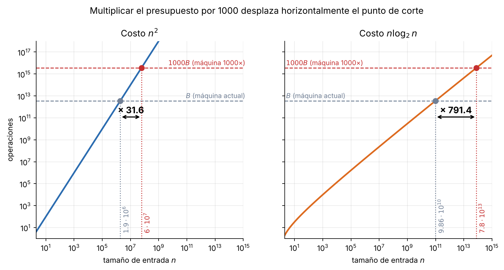
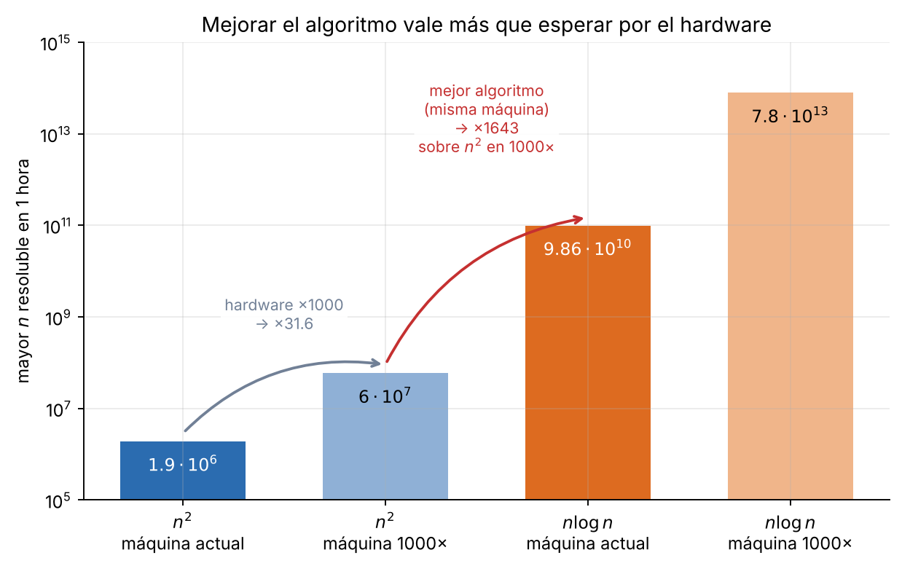

# Tema 1 - Problema 1

Una computadora mil veces más rápida. ¿Cuánto crece el tamaño de entrada que se resuelve en una hora con un algoritmo de complejidad $\Theta(n^2)$? ¿Y con uno de complejidad $\Theta(n log n)$? Estima los dos factores.

## Modelo y supuestos

Primeramente necesitamos establecer cuánto trabajo puede realizar cada computadora en una hora.

Supondremos que la computadora actual puede realizar $10^9$ operaciones por segundo, por lo que el presupuesto de operaciones disponible durante una hora será: $B = 3600 \cdot 10^9 = 3.6\cdot 10^{12} \text{ operaciones.}$

Si la nueva computadora es mil veces más rápida, durante esa misma hora podrá ejecutar: $1000B = 3.6\cdot10^{15}$ operaciones.

Por otra parte, aunque trabajaremos con algoritmos de complejidad $\Theta(n^2)$ y $\Theta(n log n)$, esta notación no especifica una función de costo exacta. Para poder realizar los cálculos numéricos, supondremos que el costo es, respectivamente,

$
f(n)=n^2
\qquad\text{y}\qquad
f(n)=n\log_2 n,
$

es decir, tomaremos una constante multiplicativa igual a $1$.

Llamaremos **tamaño máximo de entrada** al mayor entero $n$ cuyo costo no supere el presupuesto de operaciones $P$. Matemáticamente, podemos expresarlo como:

$$n^*(P)=\max\{\,n\in\mathbb{N} : f(n)\le P\,\}.$$

Por tanto, lo que queremos calcular en cada caso es el factor de crecimiento: $F = n^*(1000B)\,/\,n^*(B)$.

Este cociente nos permitirá comparar el tamaño máximo de los problemas que pueden resolverse en una hora con ambas computadoras.

## Algoritmo

Para resolver el ejercicio utilizamos la función `mayor_n(costo, presupuesto)`, presentada en la Conferencia 1. Esta función calcula $n^*(P)$.

## Implementación

```python
import math

OPS_POR_SEGUNDO = 10**9        
HORA = 3600 * OPS_POR_SEGUNDO   


def mayor_n(costo, presupuesto):
    alto = 2
    while costo(alto) <= presupuesto:
        alto *= 2
    bajo = alto // 2
    while bajo + 1 < alto:
        medio = (bajo + alto) // 2
        if costo(medio) <= presupuesto:
            bajo = medio
        else:
            alto = medio
    return bajo


COSTOS = {
    "n log n": lambda n: n * math.log2(n),
    "n^2":     lambda n: n ** 2,
}

def factor(costo, k, base=HORA):
    n1 = mayor_n(costo, base)
    n2 = mayor_n(costo, base * k)
    return n1, n2, n2 / n1

```

Respecto a la versión inicial, la tabla ahora se imprime con enteros exactos y el factor se calcula dentro del programa.

## Resultados

```text
   costo       n actual      n con 1000x     factor
 n log n  98,574,774,544  78,008,697,597,778     791.37
     n^2       1,897,366       60,000,000      31.62
```

### Algoritmo de complejidad $\Theta(n^2)$

El factor de crecimiento estimado es:

$
F_{n^2}=\frac{60\,000\,000}{1\,897\,366}=31.62,\qquad
$

Este resultado empírico coincide con la estimación analítica teórica, donde $F_{n^2} = \sqrt{1000} \approx 31.62$.

Por tanto, **el tamaño de entrada aumenta aproximadamente 32 veces**.


### Algoritmo de complejidad $\Theta(n log n)$

El factor de crecimiento estimado es:

$
F_{n\log n}=\frac{78\,008\,697\,597\,778}{98\,574\,774\,544}=791.37.
$

Por tanto, **el tamaño de entrada aumenta aproximadamente 791 veces**.

## Ilustraciones de apoyo

### La idea geométrica



*Figura 1. Costo en función de $n$, en escala log-log. Subir la línea del presupuesto de $B$ a $1000B$ desplaza horizontalmente el punto de corte con la curva. En escala log-log, $n^2$ es una recta de pendiente 2: para subir 3 órdenes de magnitud en el costo solo hace falta avanzar 1.5 en $n$ ($\times10^{1.5}=31.6$). Para $n\log n$, que es casi una recta de pendiente 1, hay que avanzar casi los 3 órdenes completos ($\times791$).*

## Cuando se cambia el algoritmo en lugar de la máquina



*Figura 4. Mayor $n$ resoluble en una hora (escala logarítmica).*

Pasar de $n^2$ a $n\log n$ **en la máquina actual** permite entradas de $9.86\cdot10^{10}$ en lugar de $1.9\cdot10^6$: un factor de unos **52 000**. Comprar una máquina 1000× más rápida y seguir con $n^2$ da un factor de **31.6**. Incluso comparando el algoritmo $n\log n$ en la máquina actual con el $n^2$ en la máquina 1000×, el primero resuelve entradas unas **1643 veces mayores**.

## Conclusión

Los resultados muestran que una computadora mil veces más rápida no implica que podamos resolver entradas mil veces mayores. El crecimiento depende de la complejidad del algoritmo

La eficiencia algorítmica determina cuánto se aprovecha la potencia de cómputo. Aunque mejorar el hardware reduce los tiempos, su beneficio está limitado por la complejidad del algoritmo. Cambiar $n^2$ por $n\log n$ multiplica por unos 52 000 el tamaño resoluble en la misma máquina, mientras que mil veces más hardware lo multiplica por 32. En definitiva, **mejorar el algoritmo es más provechoso que esperar a disponer de un hardware más potente**.

## Archivos

| Archivo | Contenido |
|---|---|
| `ejercicio_01.md` | Este informe |
| `extras_01/solution.py` | `mayor_n`, costos y tabla principal |
| `extras_01/fig/` | Figuras |

