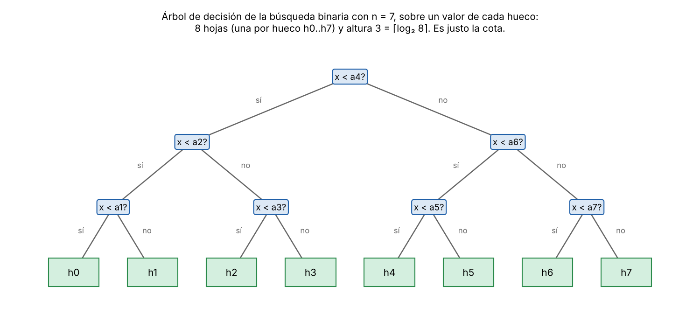
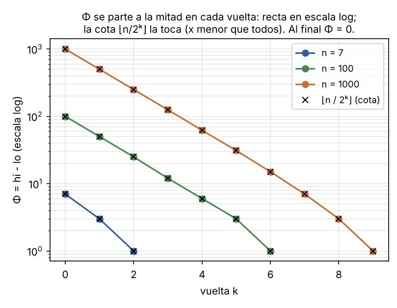

# Tema 1 - Problema 2

Da el invariante y el potencial de la búsqueda binaria, y la cota de información que la hace óptima.

## El Problema 

Un algoritmo es correcto únicamente respecto a su especificación formal, la cual se compone de una precondición y una postcondición.

* **Precondición:** El arreglo $A$ de tamaño $n$, con $n\geq 0$, está ordenado de forma no decreciente, es decir, $A[i]\leq A[i+1]$ para todo $0\leq i<n-1$.
* **Postcondición:** 
  * Si el elemento $x$ pertenece al arreglo $A$, el algoritmo devuelve `("esta", m)` donde $A[m] = x$.
  * Si el elemento $x$ no pertenece al arreglo $A$, el algoritmo devuelve `("hueco", lo)`, indicando la posición exacta $lo$ ($0 \le lo \le n$) donde debe insertarse $x$ para mantener el arreglo ordenado, cumpliendo que todos los elementos en $A[0 \dots lo-1]$ son menores que $x$ y todos en $A[lo \dots n-1]$ son mayores que $x$.

## Algoritmo e Implementación

Utilizaremos la convención de **intervalo semiabierto** $[lo, hi)$, el cual comprende los índices $lo, lo+1, \dots, hi-1$. El tamaño del espacio de búsqueda restante en todo momento es exactamente $hi - lo$.

* Si $x < A[m]$, el elemento se descarta junto con la mitad derecha $A[m \dots hi-1]$, actualizando `hi = m`.
* Si $x > A[m]$, el elemento se descarta junto con la mitad izquierda $A[lo \dots m]$, actualizando `lo = m + 1`. El `+1` es indispensable para garantizar el avance del algoritmo y evitar ciclos infinitos.

### Implementación en Python

```python
def binary_search(A, x):
    n = len(A)
    lo, hi = 0, n

    while lo < hi:
        m = (lo + hi) // 2

        if x == A[m]:
            return ("esta", m)

        elif x < A[m]:
            hi = m

        else:
            lo = m + 1

    return ("hueco", lo)
```


## Enunciado del Invariante
Al comienzo de cada iteración del bucle while y al finalizar el mismo, se satisfacen simultáneamente las tres afirmaciones:
- $I_0$ (Límites válidos): $0 \le lo \le hi \le n$.
- $I_1$ (Ubicación del elemento): Si $x \in A$, entonces existe un índice $k$ tal que $lo \le k < hi$ y $A[k] = x$.
- $I_2$ (Invariante reforzado): $$\forall p \in [0 \dots lo-1],\, A[p] < x \qquad \text{y} \qquad \forall q \in [hi \dots n-1],\, A[q] > x$$

(Observación: $I_2$ implica directamente a $I_1$, ya que si todos los elementos antes de $lo$ son estrictamente menores que $x$ y todos a partir de $hi$ son estrictamente mayores que $x$, el elemento $x$ solo podría encontrarse dentro del intervalo semiabierto $[lo, hi)$).

### Demostración Formal

**1. Inicialización** (Antes de la primera iteración)

Al iniciar el algoritmo, se establece $lo = 0$ y $hi = n$.
- $I_0$: Se cumple $0 \le 0 \le n \le n$.
- $I_2$: Los rangos $A[0 \dots -1]$ y $A[n \dots n-1]$ están vacíos. Las condiciones universales se satisfacen de manera vacua.
- $I_1$: Al cumplirse $I_2$, si $x \in A$, necesariamente debe estar en el intervalo completo $A[0 \dots n-1]$.

**2. Mantenimiento** (Durante cualquier iteración)

Supongamos que $I_0, I_1, I_2$ se cumplen al inicio de una vuelta con la guarda $lo < hi$. Se calcula $m = \lfloor (lo + hi) / 2 \rfloor$. Puesto que $lo < hi$, se garantiza que $lo \le m < hi$.

Analizamos los tres casos posibles del resultado de la comparación $r = M.cmp(m)$:
- Caso 1: $r == 0$ ($A[m] = x$): El algoritmo ejecuta return ("esta", m). El bucle se interrumpe y la postcondición se satisface inmediatamente.
- Caso 2: $r < 0$ ($x < A[m]$): Dado que el arreglo $A$ está ordenado, para todo $k \ge m$ se cumple $A[k] \ge A[m] > x$. Por la hipótesis de inducción $I_2$, los elementos en $A[hi \dots n-1]$ ya eran estrictamente mayores que $x$. Al actualizar hi' = m, el nuevo rango superior $A[hi' \dots n-1] = A[m \dots n-1]$ contiene únicamente elementos mayores que $x$, preservando $I_2$. El rango inferior $A[0 \dots lo-1]$ no cambia. Como $lo \le m$, se cumple $I_0$ ($0 \le lo \le hi' \le n$).
- Caso 3: $r > 0$ ($x > A[m]$): Dado que el arreglo $A$ está ordenado, para todo $k \le m$ se cumple $A[k] \le A[m] < x$. Por la hipótesis de inducción $I_2$, los elementos en $A[0 \dots lo-1]$ eran estrictamente menores que $x$. Al actualizar lo' = m + 1, el nuevo rango inferior $A[0 \dots lo'-1] = A[0 \dots m]$ contiene únicamente elementos menores que $x$, preservando $I_2$. El rango superior $A[hi \dots n-1]$ no cambia. Como $m < hi$, se cumple $m + 1 \le hi$, preservando $I_0$ ($0 \le lo' \le hi \le n$).

En los tres casos, el invariante reforzado se mantiene invariante para la siguiente vuelta5. 

**3. Conclusión** (Al terminar el bucle)

El bucle while finaliza de dos formas posibles:
1. Por retorno directo (return ("esta", m)): Se ha verificado explícitamente que $A[m] = x$, cumpliendo la postcondición de búsqueda exitosa.
2. Por la guarda ($lo \ge hi$): 

    Por $I_0$, la condición de salida implica $lo = hi$. Al aplicar $I_2$ con $lo = hi$:
    - Todo elemento en $A[0 \dots lo-1]$ es estrictamente menor que $x$.
    - Todo elemento en $A[lo \dots n-1]$ es estrictamente mayor que $x$.
    
De esto se concluye que $x \notin A$ (ningún elemento puede ser igual a $x$) y que la variable lo indica exactamente la posición de inserción o hueco $lo$ que mantiene el ordenamiento del arreglo. El algoritmo devuelve ("hueco", lo), satisfaciendo de forma exacta la postcondición15. $\blacksquare$

### Potencial

Para demostrar que el algoritmo termina, utilizamos el potencial

$$
\Phi=hi-lo.
$$


**Lema** En una vuelta que no retorna, el nuevo $Φ'$ cumple $Φ' ≤ ⌊Φ/2⌋ < Φ$.

*Demostración.* 

Con $m = ⌊(lo+hi)/2⌋$ se tiene $m − lo = ⌊Φ/2⌋$. 
- Si $x < A[m]: Φ' = m − lo = ⌊Φ/2⌋$. 
- Si $x > A[m]: Φ' = hi − (m+1) = ⌈Φ/2⌉ − 1 ≤ ⌊Φ/2⌋$. 

En los dos casos $Φ' ≤ ⌊Φ/2⌋$, y como $Φ ≥ 1, ⌊Φ/2⌋ < Φ.$ ∎

**Terminación.** $Φ$ es un entero ≥ 0 que baja estrictamente en cada vuelta: no puede bajar para siempre, luego el ciclo termina.



## Cota Mínima de Información y Optimicidad 

Para demostrar que la búsqueda binaria es un algoritmo **óptimo en el peor caso**, debemos probar que **ningún** algoritmo basado en comparaciones puede resolver la búsqueda de un elemento en un arreglo ordenado de $n$ elementos realizando menos comparaciones en el peor caso.

### El Modelo de Árboles de Decisión y las Salidas

En el modelo de comparaciones, cada ejecución del algoritmo sobre un arreglo de tamaño $n$ se representa como un camino en un **árbol de decisión**:
* **Nodos internos:** Representan comparaciones entre $x$ y los elementos del arreglo.
* **Hojas:** Representan las salidas devueltas por el algoritmo.
* **Peor caso:** Corresponde a la **altura $h$ del árbol** (el camino más largo desde la raíz hasta una hoja).

Para aplicar el argumento de información debemos determinar cuántas salidas distintas está obligado a distinguir un algoritmo correcto.

### Los $n+1$ huecos

Si el elemento $x$ no pertenece al arreglo ordenado $A[0 \dots n-1]$, su valor debe caer en exactamente uno de los **$n+1$ huecos posibles**:
* $h_0$: antes de $A$ ($x < A$).
* $h_k$: entre $A[k-1]$ y $A[k]$ ($A[k-1] < x < A[k]$), para $1 \le k \le n-1$.
* $h_n$: después de $A[n-1]$ ($x > A[n-1]$).

Cuando $x$ no pertenece al arreglo, ninguna comparación responderá jamás la igualdad ($r = 0$). Por lo tanto, el subárbol que procesa los casos de ausencia es un **árbol estrictamente binario** (con solo 2 ramas por nodo: $<$ o $>$).

### Lema de Distinción de Huecos

**Lema 4 (Conferencia 5 §3).** Si dos valores $x_1$ y $x_2$ caen en huecos distintos $h_i$ y $h_j$ (con $i < j$), un algoritmo de búsqueda correcto debe llevarlos a **hojas distintas** del árbol de decisión.

*Demostración (por contradicción).*
1. Supongamos que $x_1 \in h_i$ y $x_2 \in h_j$ (con $i < j$) recorren el mismo camino y llegan a la **misma hoja** del árbol de decisión.
2. Como están en huecos distintos, existe al menos un elemento del arreglo $A[k]$ ubicado entre ambos huecos ($i \le k < j$).
3. Dado que $x_1$ y $x_2$ recibieron exactamente las mismas respuestas en todas las comparaciones del camino, el algoritmo **jamás comparó $x$ con $A[k]$** (de haberlo hecho, $x_1 < A[k]$ habría respondido "sí" y $x_2 > A[k]$ habría respondido "no", bifurcando sus caminos).
4. Si ahora ejecutamos el algoritmo buscando exactamente la clave $x = A[k]$:
   * Para todos los elementos comparados a la izquierda de $h_i$ o a la derecha de $h_j$, $x = A[k]$ recibe exactamente las mismas respuestas que $x_1$ y $x_2$.
   * Por tanto, $x = A[k]$ recorre el mismo camino y termina en la misma hoja.
5. En esa hoja, el algoritmo devuelve `("hueco", ...)` indicando que el elemento no está presente. Sin embargo, $x = A[k]$ sí pertenece al arreglo.
6. El algoritmo comete un error. Por lo tanto, todo algoritmo correcto debe asignar los $n+1$ huecos a **$n+1$ hojas distintas** del árbol binario de decisión. $\blacksquare$

### Teorema de Optimicidad de la Búsqueda Binaria

**Teorema.** Todo algoritmo de comparaciones que busca un elemento en un arreglo ordenado de tamaño $n$ realiza, en el peor caso, al menos $\lceil \log_2(n+1) \rceil$ comparaciones.

*Demostración.*
1. Por el Lema 4, el árbol de decisión binario debe poseer al menos $L \ge n + 1$ hojas.
2. Por el Lema 1 de árboles binarios, un árbol binario de altura $h$ tiene a lo sumo $2^h$ hojas ($L \le 2^h$).
3. Invirtiendo la relación:
   $$2^h \ge n + 1 \implies h \ge \log_2(n + 1)$$
4. Dado que la altura $h$ es un número entero de comparaciones:
   $$h \ge \lceil \log_2(n + 1) \rceil$$


### Conclusión y Cota Ajustada

* **Cota mínima inferior (Información):** $h \ge \lceil \log_2(n + 1) \rceil$.
* **Costo real de la Búsqueda Binaria:** En el peor caso, la búsqueda binaria realiza exactamente $\lfloor \log_2 n \rfloor + 1$ comparaciones.

Dado que para todo entero $n \ge 1$:
$$\lfloor \log_2 n \rfloor + 1 = \lceil \log_2(n + 1) \rceil$$

La búsqueda binaria **alcanza exactamente la cota mínima de información**, lo que demuestra de forma rigurosa que es un **algoritmo óptimo**. $\blacksquare$

## Archivos

| Archivo | Contenido |
|---|---|
| `ejercicio_02.md` | Este informe |
| `extras_02/fig` | Figuras |


