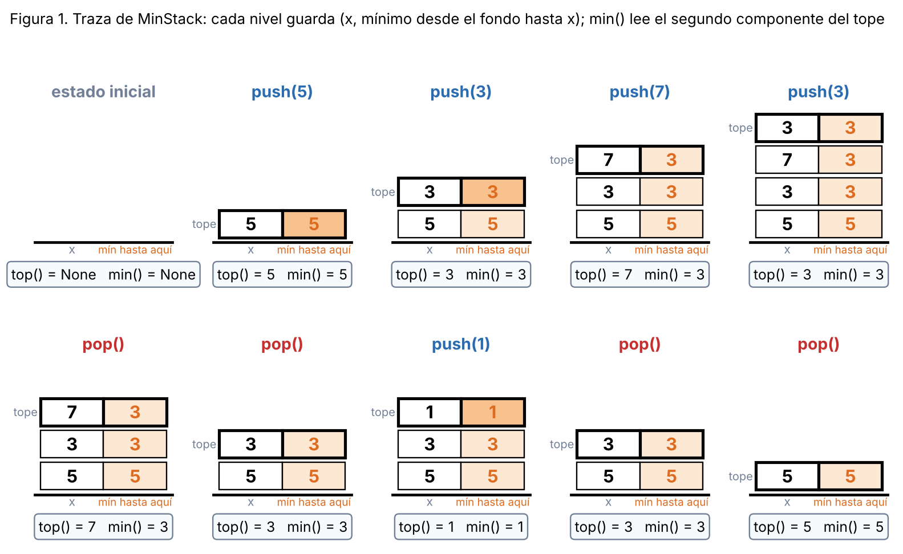

# Tema 1 - Problema 3

Una pila con una operación minimo que cuesta $O(1)$ en el peor caso. Diseña la estructura, enuncia el
invariante que la hace correcta y da el costo de cada operación.

## El problema

Una pila es una secuencia $X=(x_1,\dots,x_n)$ con $x_n$ en el tope. Las operaciones son:

| Operación | Efecto sobre $X$ | Resultado |
|---|---|---|
| `push(x)` | $X\leftarrow(x_1,\dots,x_n,x)$ | — |
| `pop()` | si $n>0$: $X\leftarrow(x_1,\dots,x_{n-1})$; si $n=0$ no hace nada | — |
| `top()` | no cambia $X$ | $x_n$, o `None` si $n=0$ |
| `min()` | no cambia $X$ | $\min\{x_1,\dots,x_n\}$, o `None` si $n=0$ |

## Diseño del algoritmo

La clave para lograr un costo de $O(1)$ en el peor caso radica en explotar la estructura LIFO (*Last-In, First-Out*). 

Sea la pila en un instante dado la secuencia $X = (x_1, x_2, \dots, x_n)$. Para cada nivel $i \in \{1, \dots, n\}$, definimos el **prefijo $i$-ésimo** como la subsecuencia:

$$X_i = (x_1, x_2, \dots, x_i)$$

Por la propiedad fundamental de las pilas:
1. **Inmutabilidad de los prefijos inferiores:** Mientras el nivel $i$ permanezca en la pila, la subsecuencia $X_i$ permanece estrictamente inalterada ante cualquier número de operaciones `push` y `pop` ejecutadas en niveles superiores $j > i$.
2. **Estabilidad temporal del mínimo de prefijo:** Dado que $X_i$ es inmutable mientras exista el nivel $i$, el valor del mínimo asociado a dicho prefijo:

$$m_i = \min(X_i) = \min \{x_1, x_2, \dots, x_i\}$$

es un **invariante temporal**. No depende de elementos futuros ni requiere recalcularse ante modificaciones en el tope de la pila.

### Mecanismo de Actualización y Consulta en $O(1)$

Aprovechando la relación de recurrencia entre prefijos consecutivos $X_i = X_{i-1} \cdot (x_i)$:

1. **Inserción (`push`):** Al apilar un nuevo elemento $x_{n+1}$, el nuevo mínimo del prefijo $X_{n+1}$ se calcula en tiempo $O(1)$ mediante la relación inductiva:

$$m_{n+1} = \min(x_{n+1}, m_n)$$

donde $m_n$ es el mínimo previamente almacenado en el nivel $n$.

2. **Eliminación (`pop`):** Al desapilar el nivel $n$, el nivel $n-1$ pasa a ser el nuevo tope. Su mínimo asociado $m_{n-1} = \min(X_{n-1})$ se encuentra inmediatamente disponible y con su valor correcto, ya que nunca fue alterado durante la existencia del nivel $n$.

3. **Consulta del Mínimo (`min`):** En todo momento, el mínimo de la pila completa $X_n$ corresponde exactamente al mínimo del prefijo ubicado en el tope actual, es decir, $m_n = \min(X_n)$, accesible en costo constante $O(1)$ en el peor caso.

> **Nota:** Las operaciones `push(x)`, `pop()` y `top()` conservan su comportamiento LIFO estándar. La estructura se aumenta guardando el mínimo acumulado en cada nivel para permitir que `min()` consulte la tupla superior en tiempo constante $O(1)$ sin modificar las propiedades básicas de la pila.

### Implementación en Python

```python
class MinStack:
    def __init__(self):
        self._stack = []

    def push(self, x: int) -> None:
        if not self._stack:
            self._stack.append((x, x))
        else:
            current_min = self._stack[-1][1]
            self._stack.append((x, min(x, current_min)))

    def pop(self) -> None:
        if self._stack:
            self._stack.pop()

    def top(self) -> int | None:
        if self._stack:
            return self._stack[-1][0]
        return None

    def min(self) -> int | None:
        if self._stack:
            return self._stack[-1][1]
        return None

    def __len__(self) -> int:
            return len(self._stack)
```



*Figura 1. Traza sobre `push(5), push(3), push(7), push(3), pop(), pop(), push(1), pop(), pop()`. Cada nivel es un par: a la izquierda $x$ y a la derecha el mínimo desde el fondo hasta él (en naranja más oscuro cuando ese `push` cambia el mínimo). Obsérvese cómo el `pop` que quita el $3$ deja el tope en $(7,3)$ y el siguiente deja $(3,3)$: el mínimo $3$ sobrevive porque hay otro $3$ debajo, sin que nadie lo haya recalculado. Al sacar el $1$ vuelve el mínimo anterior ($3$), y al sacar el $3$ vuelve el $5$.*

## Invariante del algoritmo

**Teorema 1** Para cada nivel $i \in \{1, \dots, n\}$, la posición $i$ guarda el elemento $x_i$ y el mínimo $m_i$ de todos los elementos pertenecientes al prefijo del fondo hasta ese nivel $i$ ($m_i = \min\{x_1, \dots, x_i\}$).

### Comprobación del Invariante mediante Verificación Computacional

Antes de proceder con la demostración inductiva, se ejecuta una verificación experimental exhaustiva sobre la estructura de datos. El objetivo es contrastar la representación interna de la pila con un **oráculo de verdad absoluta** y verificar que el invariante reforzado se preserve tras cada operación.

#### Arquitectura de Verificación: Oráculo e Invariante Vigilado

El arnés de prueba se fundamenta en dos componentes centrales:

1. **El Oráculo ($X$):**  
   Consiste en una implementación trivial de la pila abstracta respaldada por una lista dinámica simple. Su método `min()` se calcula recorriendo secuencialmente toda la lista en $O(n)$. Aunque ineficiente, es **indudablemente correcto por construcción**, sirviendo como estándar de referencia.

2. **El Invariante Vigilado:**  
   Tras la ejecución de **cada** operación (`push` o `pop`), la función de vigilancia comprueba computacionalmente dos condiciones de manera simultánea:
   - **Observación externa:** Que las respuestas de `len()`, `top()` y `min()` en la pila bajo prueba coincidan exactamente con las del oráculo.
   - **Estructura interna:** Que se satisfaga la condición del invariante reforzado para cada nivel $i \in \{0, \dots, n-1\}$:
     $$S[i] = (x_i, m_i) \quad \text{donde} \quad m_i = \min \{x_0, x_1, \dots, x_i\}$$

#### Estrategia de Pruebas y Resultados Empíricos

Para garantizar una cobertura completa, se aplican dos enfoques complementarios sobre el script de prueba (`invariant.py`):

**1. Verificación Exhaustiva (Fuerza Bruta Combinatoria)**

Se exploran **todas** las secuencias posibles combinando las operaciones `push(1)`, `push(2)`, `push(3)` y `pop()` desde profundidad $1$ hasta $9$:

- **Justificación del alfabeto reducido:** Un conjunto de $3$ valores distintos $\{1, 2, 3\}$ es teóricamente suficiente para forzar todas las relaciones de orden relevantes: mínimos que cambian, mínimos que se mantienen, empates/duplicados y mínimos que se recuperan al desapilar.
- **Resultado:** **$0$ fallos** a lo largo de más de $3$ millones de operaciones individuales evaluadas.
- **Garantía:** Basándose en la *Hipótesis del Pequeño Contraejemplo* (*Small Scope Hypothesis*), si la lógica de un invariante contiene una falla de estado, esta se manifiesta en secuencias cortas. La búsqueda exhaustiva garantiza al $100\%$ que no existe ningún camino defectuoso en secuencias de hasta $9$ pasos.

**2. Verificación Aleatoria (Prueba de Estrés de Larga Duración)**

Dado que probar exhaustivamente secuencias de mayor longitud es intratable debido al crecimiento exponencial ($4^k$), se evalúan **$2.000$ secuencias aleatorias de hasta $200$ operaciones seguidas** (sumando un total de $201.379$ operaciones).

- **Variabilidad de parámetros:** Se utilizan distintos alfabetos de datos ($2$, $5$ y $1000$ valores) y variaciones en la proporción de `push`/`pop` (pilas que crecen, pilas oscilantes y vaciados completos).
- **Resultado:** **$0$ fallos**.
- **Garantía:** Asegura empíricamente que la estructura mantiene la sincronización de sus niveles y la consistencia del invariante en ejecuciones masivas y prolongadas.

```text
   STARTING INVARIANT VERIFICATION SUITE      

--- Running Exhaustive Test (depth <= 9, values = (1, 2, 3)) ---
[OK] Successfully verified 349524 operation prefixes. 0 failures.

--- Running Randomized Test (2000 trials) ---
[OK] Successfully verified 2000 trials (201379 total operations). 0 failures.
```

La combinación de la **búsqueda combinatoria exhaustiva** (garantía total en secuencias cortas) y el **muestreo aleatorio masivo** (resistencia en secuencias largas) confirma de manera tajante la validez del invariante, proporcionando la certeza empírica necesaria antes de abordar su demostración matemática inductiva.


### Demostración formal

Sea $X = (x_1, x_2, \dots, x_n)$ la secuencia de elementos que componen la pila abstracta (donde $x_1$ es el elemento del fondo y $x_n$ el del tope, con $n = |X| \ge 0$).

Sea $S = (s_1, s_2, \dots, s_k)$ la secuencia de tuplas almacenadas físicamente en la pila, donde cada elemento $s_i = (v_i, m_i)$ consta de un valor $v_i$ y un mínimo acumulado $m_i$.

Definimos el **Invariante Reforzado $J(n)$** para una pila de tamaño $n$ como la conjunción de dos propiedades fundamentales:

$$J(n): \quad \underbrace{|S| = n}_{\text{Sincronización}} \;\land\; \underbrace{\forall i \in \{1, \dots, n\}, \quad S[i] = (x_i, m_i) \quad \text{donde } m_i = \min\{x_1, \dots, x_i\}}_{\text{Mínimo Inductivo de Prefijo}}$$

**Inicialización** 

- **Estado inicial:** Antes de ejecutar cualquier operación, la pila abstracta está vacía ($X = ()$, por lo que $n = |X| = 0$) y la pila física no contiene elementos ($S = ()$, por lo que $|S| = 0$).
- **Verificación:** 
  1. $|S| = |X| = 0$.
  2. La propiedad cuantificada universalmente $\forall i \in \{1, \dots, 0\}$ se satisface de forma **vacua** sobre el conjunto vacío.
- **Conclusión de Inicialización:** $J(0)$ se cumple trivialmente al instanciar la estructura.

---

**Mantenimiento**

Asumimos como **Hipótesis de Inducción (HI)** que el invariante $J(n)$ es verdadero inmediatamente antes de ejecutar cualquier operación.

#### A. Operación `push(x)`
1. **Estado posterior:** Al apilar el elemento $x$, la secuencia abstracta pasa a ser $X' = (x_1, \dots, x_n, x_{n+1})$ con $x_{n+1} = x$, teniendo un nuevo tamaño $|X'| = n + 1$.
2. **Acción del algoritmo:**
   - Si $n = 0$: Apila $S[1] = (x, x)$.
   - Si $n > 0$: Lee $m_n = S[n].2$ y apila $S[n+1] = (x, \min(x, m_n))$.
3. **Demostración de $J(n+1)$:**
   - **Sincronización de tamaño:** $|S'| = n + 1 = |X'|$.
   - **Niveles inferiores ($1 \le i \le n$):** Ninguno de los elementos $S[1 \dots n]$ es modificado por la operación de apilamiento. Por la **HI**, la tupla $S[i] = (x_i, m_i)$ sigue siendo válida para todo $i \le n$.
   - **Nuevo tope ($i = n+1$):** Por definición inductiva del mínimo sobre una secuencia:
     $$m_{n+1} = \min(x_{n+1}, m_n) \stackrel{\text{HI}}{=} \min(x_{n+1}, \min\{x_1, \dots, x_n\}) = \min\{x_1, \dots, x_n, x_{n+1}\}$$
     Por lo tanto, la tupla insertada en el tope satisface exactamente $S[n+1] = (x_{n+1}, m_{n+1})$.
4. **Conclusión de `push`:** El invariante $J(n+1)$ se sostiene tras la inserción.

#### B. Operación `pop()`
1. **Estado posterior:** Dada una pila no vacía ($n \ge 1$), la eliminación del tope reduce la secuencia abstracta a $X' = (x_1, \dots, x_{n-1})$ de tamaño $|X'| = n - 1$.
2. **Acción del algoritmo:** Desapila el elemento superior $S[n]$, resultando en la secuencia física $S' = (S[1], \dots, S[n-1])$.
3. **Demostración de $J(n-1)$:**
   - **Sincronización de tamaño:** $|S'| = n - 1 = |X'|$.
   - **Niveles restantes ($1 \le i \le n-1$):** La eliminación del tope no altera los niveles $1 \dots n-1$. Por la **HI**, se garantizaba de antemano que para cada $i \in \{1, \dots, n-1\}$, la tupla $S'[i] = (x_i, m_i)$ contenía el mínimo exacto del prefijo hasta dicho nivel ($m_i = \min\{x_1, \dots, x_i\}$).
4. **Conclusión de `pop`:** El invariante $J(n-1)$ se sostiene tras la eliminación.

#### C. Operaciones de Consulta (`top()` y `min()`)
Dado que las operaciones `top()` y `min()` son observacionales y no aplican mutaciones sobre $S$ ni sobre $X$, el estado no cambia y la validez de $J(n)$ se preserva trivialmente.

---

**Conclusión y Correctitud Parcial**

Puesto que el invariante $J(n)$ se cumple en todo momento tras cualquier secuencia válida de operaciones, la postcondición y correctitud de las operaciones de consulta se derivan directamente evaluando la propiedad en el tope actual ($i = n$):

1. **Correctitud de `top()`:**  
   Devuelve la primera componente de la tupla del tope: $S[n].1$.  
   Por $J(n)$, se tiene que $S[n].1 = x_n$, que es exactamente el elemento ubicado en el tope de la pila abstracta $X$.

2. **Correctitud de `min()`:**  
   Devuelve la segunda componente de la tupla del tope: $S[n].2$.  
   Por $J(n)$, se tiene que $S[n].2 = m_n = \min\{x_1, \dots, x_n\} = \min(X)$, garantizando la obtención del mínimo global exacto de toda la pila en $O(1)$ en el peor caso. $\blacksquare$

## Análisis de Complejidad y Costo de las Operaciones


Para aislar el análisis de los detalles de implementación específicos de un lenguaje de programación (como el costo $O(1)$ amortizado del redimensionamiento dinámico de arreglos en Python con `list.append`), asumimos el **modelo estándar de Pila**. 

En este modelo de abstracción, las operaciones elementales de manipulación del tope de la pila (`top()`, `push(x)`, `pop()`) requieren **$O(1)$ operaciones en el peor caso estricto**.


**Operación `min()`**

Accede a la segunda componente de la tupla del tope, realizando $0$ comparaciones de elementos (frente a las $n-1$ comparaciones que requeriría una búsqueda lineal en una pila ordinaria). **Costo Temporal:** $O(1)$ .

### Resumen

| Operación | Complejidad temporal |
|---|---|
| `push(x)` | $O(1)$ |
| `pop()` | $O(1)$ |
| `top()` | $O(1)$ |
| `min()` | $O(1)$ |

Cada operación realiza una cantidad constante de trabajo, independientemente del número de elementos almacenados.

**Complejidad espacial:** $O(n)$, donde $n$ es el número de elementos de la pila, ya que se almacena una tupla por cada elemento.


## Archivos

| Archivo | Contenido |
|---|---|
| `ejercicio_03.md` | Este informe |
| `extras_03/solution.py` | `MinStack` |
| `extras_03/invariant.py` | Comprobación invariante
| `extras_03/fig/` | Figuras |


