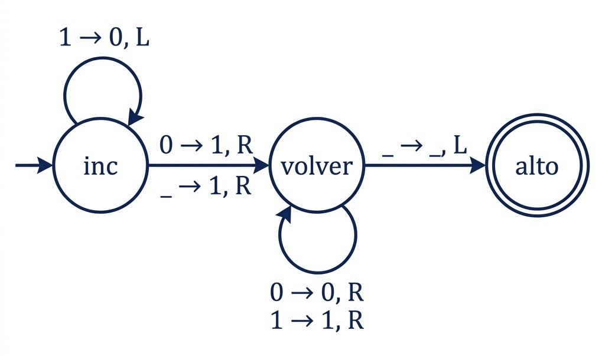
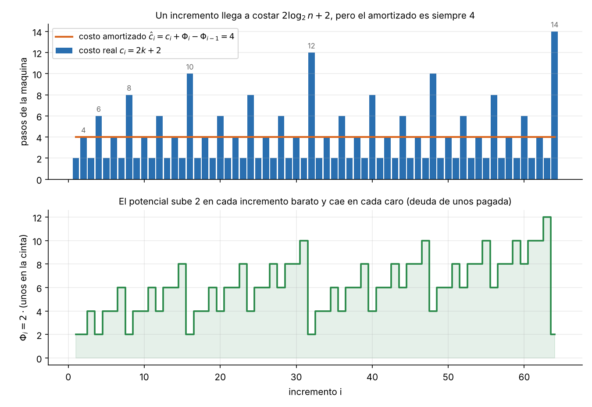
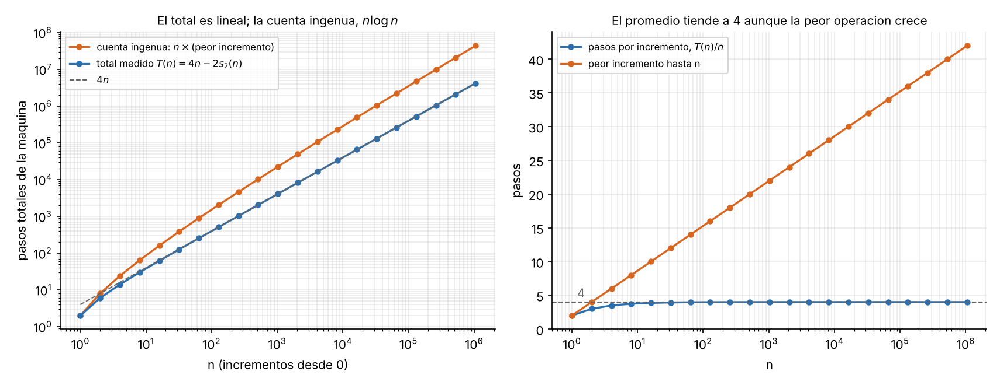

# Tema 1 - Problema 4

Diseña una máquina de Turing de una cinta que sume 1 a un número escrito en binario, con el cabezal empezando en el bit menos significativo y volviendo a él al terminar. ¿Cuántos pasos da en el peor caso? Si se aplica $n$ veces seguidas empezando desde 0, ¿cuántos pasos da en total? (ejercicio 7 de C1). Demuestra con un potencial que $n$ incrementos desde 0 cuestan $O(n)$ pasos en total, aunque uno solo pueda costar $\Theta(\log n)$. 

## Problema y convenciones

**Representación.** El número está escrito en la cinta en binario, con el bit más significativo a la izquierda. La celda $0$ corresponde al bit **menos significativo (LSB)**, que es donde el cabezal inicia y debe finalizar tras cada incremento. Todo lo que se encuentra a la derecha de la celda $0$ y a la izquierda del bit más significativo contiene el símbolo blanco ($\_$). La ejecución comienza desde el número $0$, representado como `0`.

**Costo.** Un paso corresponde a una transición de la máquina (leer, escribir, mover). A diferencia del modelo RAM (donde el acceso a memoria es $O(1)$), en una Máquina de Turing de una sola cinta mover el cabezal cuesta la distancia recorrida. Por ello, **el viaje de regreso al bit menos significativo cuenta dentro del costo real** y no puede omitirse.

**Tamaño de la entrada.** El tamaño de la entrada se mide en la cantidad de bits $b$ del número. Para un número de $b$ bits, su valor cumple $N < 2^b$, por lo que $b \approx \log_2 N$.

## Definición y Transiciones de la Máquina

La máquina se estructura en torno a dos estados principales más el estado de parada:

1. **Estado `inc` (Incremento y Acarreo):** Inicia en el LSB. Mientras lee `1`, lo cambia a `0` y se desplaza a la izquierda (propagación del acarreo). Al leer el primer `0` (o un blanco $\_$), lo cambia a `1`, se mueve a la derecha y conmuta al estado `volver`.
2. **Estado `volver` (Retorno al LSB):** Recorre la cinta hacia la derecha leyendo `0`s y `1`s hasta sobrepasar la palabra al leer el primer blanco ($\_$). En ese momento, se mueve un paso a la izquierda para posicionarse exactamente sobre la celda $0$ (LSB) y pasa al estado `alto`.
3. **Estado `alto` (Parada):** Estado final donde la máquina concluye el incremento lista para la siguiente operación.

### Tabla de Transiciones

| Estado Actual | Símbolo Leído | Símbolo Escrito | Movimiento | Nuevo Estado |
|---|---|---|---|---|
| `inc` | `1` | `0` | Izquierda ($\leftarrow$) | `inc` |
| `inc` | `0` | `1` | Derecha ($\rightarrow$) | `volver` |
| `inc` | $\_$ | `1` | Derecha ($\rightarrow$) | `volver` |
| `volver` | `0` | `0` | Derecha ($\rightarrow$) | `volver` |
| `volver` | `1` | `1` | Derecha ($\rightarrow$) | `volver` |
| `volver` | $\_$ | $\_$ | Izquierda ($\leftarrow$) | `alto` |

## Costo Exacto de un Incremento 
Para analizar el costo real de una operación de incremento $i$, parametrizamos el estado del contador según la cantidad de acarreos consecutivos que debe procesar la máquina.

**Lema** Si la representación binaria del número almacenado en la cinta termina en exactamente $k$ unos consecutivos ($k = 0, 1, 2, \dots$), la Máquina de Turing —iniciando en el estado `inc` con el cabezal en la celda $0$ (LSB)— finaliza en el estado `alto` con el cabezal nuevamente en la celda $0$ tras ejecutar **exactamente $2k + 2$ pasos**, dejando en la cinta la representación del número incrementado en $1$.

**Demostración**

Sea $N$ el valor entero representado en la cinta antes del incremento. Las celdas $0, -1, \dots, -(k-1)$ contienen el símbolo `1`, mientras que la celda $-k$ contiene un `0` o el símbolo blanco ($\_$). La ejecución se divide en cuatro fases:

1. **Fase A (Propagación del acarreo, $s$ pasos con $0 \le s \le k$):**
   - **Estado:** `inc`.
   - **Posición del cabezal:** Celda $-s$.
   - **Contenido de la cinta:** Las celdas $0, \dots, -(s-1)$ han pasado de `1` a `0`. El resto de la cinta permanece inalterado.
   - **Valor en cinta:** $N - (2^s - 1)$.
   - *Justificación:* En cada uno de los $k$ pasos de esta fase, el estado `inc` lee un `1`, lo reemplaza por `0` y mueve el cabezal una posición a la izquierda. Al cabo de $k$ pasos, se consumen **$k$ operaciones**.

2. **Fase B (Escritura del bit de acarreo final, paso $s = k + 1$):**
   - **Estado:** Transición de `inc` a `volver`.
   - **Posición del cabezal:** Celda $-k + 1$.
   - **Contenido de la cinta:** La celda $-k$ (que contenía un `0` o $\_$) se transforma en `1`.
   - **Valor en cinta:** $N + 1$.
   - *Justificación:* El paso $k+1$ lee el primer `0` (o $\_$) en la celda $-k$, escribe un `1`, mueve el cabezal un paso a la derecha y conmuta al estado `volver`. Requiere **$1$ operación**.

3. **Fase C (Retorno del cabezal al LSB, $k + 1 \le s \le 2k + 1$):**
   - **Estado:** `volver`.
   - **Posición del cabezal:** Se desplaza desde la celda $-k + 1$ hasta la celda $+1$.
   - **Contenido de la cinta:** Invariante (solo lee las celdas $-k+1, \dots, 0$ que contienen `0`s).
   - *Justificación:* El cabezal recorre de regreso hacia la derecha la longitud del número hasta leer el símbolo blanco ($\_$) de la celda $+1$. Esta fase requiere exactamente **$k$ operaciones** de movimiento.

4. **Estado Final (Parada, paso $s = 2k + 2$):**
   - **Estado:** Transición de `volver` a `alto`.
   - **Posición del cabezal:** Celda $0$ (LSB).
   - *Justificación:* Al leer el blanco en la celda $+1$, la máquina realiza el último movimiento a la izquierda para situarse sobre el bit menos significativo y se detiene en `alto`. Requiere **$1$ operación**.

### Conteo Total de Pasos

Sumando las operaciones consumidas en cada fase:

$$\text{Costo Real } c_i = \underbrace{k}_{\text{Fase A}} + \underbrace{1}_{\text{Fase B}} + \underbrace{k}_{\text{Fase C}} + \underbrace{1}_{\text{Final}} = 2k + 2$$

Por lo tanto, una operación de incremento que procesa $k$ acarreos requiere **exactamente $c_i = 2k + 2$ transiciones** de la Máquina de Turing. $\blacksquare$

## Análisis de $n$ Incrementos Consecutivos desde 0

### La Cuenta Ingenua (Cota Pesimista $O(n \log n)$)

Para ejecutar el $i$-ésimo incremento (paso del valor $i-1$ al valor $i$), la cantidad de unos finales en la representación binaria equivale a $k = v_2(i)$, donde $v_2(i)$ representa la mayor potencia de 2 que divide exactamente a $i$ (por ejemplo, al pasar de 3 a 4, $i=4$, $v_2(4)=2$, y el número 3 tiene $k=2$ unos finales: `11`).

Por el Lema demostrado en la sección anterior, la operación cuesta $c_i = 2v_2(i) + 2$ pasos.

Si tomamos la cota del peor caso individual para cada una de las $n$ operaciones:
- En el peor caso, un incremento debe modificar a lo sumo $\lfloor\log_2 n\rfloor + 1$ bits.
- El costo máximo de una sola operación es $2\lfloor\log_2 n\rfloor + 2$.

Multiplicando ingenuamente ese peor caso individual por el total de $n$ operaciones, se obtiene:

$$T(n) \le n \cdot (2\lfloor\log_2 n\rfloor + 2) = O(n \log n)$$

**Defecto de la cota ingenua:** Esta aproximación asume erróneamente que **todos** los incrementos pagan el costo del peor caso. 

### El Análisis Amortizado por el Método del Potencial

Para obtener la cota ajustada exacta, aplicamos el **Método del Potencial** .

#### Definición de la Función de Potencial ($\Phi$)

$$\Phi = 2 \cdot (\text{cantidad de unos almacenados en la cinta})$$

**Interpretación como deuda:** Cada símbolo `1` en la cinta representa **trabajo pendiente acumulado**: en algún incremento futuro, un acarreo tendrá que pasar sobre ese bit, transformarlo en `0` y luego realizar el viaje de regreso a la celda 0. 
- Escribir un `1` nuevo acumula potencial (registra crédito para el futuro).
- Propagar un acarreo convirtiendo unos en ceros consume ese potencial guardado para pagar la caminata del cabezal.

#### Verificación de las Condiciones de Validez 

1. **Estado Inicial ($\Phi_0$):** Al comenzar con la cinta en `0` (sin unos), $\Phi_0 = 0$.
2. **No Negatividad ($\Phi \ge 0$):** Puesto que la cantidad de unos en cinta jamás puede ser negativa, $\Phi_i \ge 0$ para todo estado $i$.
3. **Cota Global:** De las dos condiciones anteriores se deriva inmediatamente que **$\Phi_n \ge \Phi_0 = 0$**, lo que garantiza que la suma telescopada de costos amortizados sea una cota superior válida sobre el costo real total acumulado.

#### Cálculo del Costo Amortizado ($\hat{c}_i$)

En el $i$-ésimo incremento con $k$ unos al final:
1. **Costo Real:** $c_i = 2k + 2$ (Lema de la Sección 3).
2. **Cambio de Potencial ($\Delta\Phi_i$):** El incremento convierte $k$ unos en ceros (pierde $2k$ de potencial) y escribe un único `1` nuevo en el primer cero o blanco (gana $+2$ de potencial):
   $$\Delta\Phi_i = 2(1 - k)$$
3. **Costo Amortizado ($\hat{c}_i$):**
   $$\hat{c}_i = c_i + \Delta\Phi_i = (2k + 2) + 2(1 - k) = \mathbf{4}$$

El costo amortizado resulta ser **estrictamente igual a 4 para cualquier incremento**, independientemente de la cantidad de acarreos $k$. Las operaciones costosas ($k$ grande) liberan el potencial almacenado previamente por las operaciones baratas.

#### Costo Total Acumulado ($T(n)$)

Sumando los costos amortizados sobre la secuencia completa, los términos de potencial se telescopian:

$$T(n) = \sum_{i=1}^n c_i = \sum_{i=1}^n \hat{c}_i - (\Phi_n - \Phi_0) = 4n - \Phi_n = \mathbf{4n - 2\,s_2(n)}$$

donde $s_2(n)$ denota la suma de los dígitos binarios (cantidad de unos) del número $n$.

#### Acotación Asintótica Exacta

Puesto que $1 \le s_2(n) \le \lfloor\log_2 n\rfloor + 1$:
- **Cota Superior:** $T(n) \le 4n - 2$
- **Cota Inferior:** $T(n) \ge 4n - 2\log_2(n + 1)$

Por lo tanto, la complejidad del peor caso para la secuencia completa de $n$ incrementos es estrictamente **$T(n) = \Theta(n)$**, lo que representa un costo promedio de **4 pasos por incremento en el límite**.

En la siguiente figura se muestran los primeros 64 incrementos.

## Verificación Empírica y Experimentos

Para validar de forma computacional las cotas teóricas derivadas en las secciones anteriores, se implementó un simulador exacto de la Máquina de Turing de una cinta (`solution.py`) y se ejecutó una batería de experimentos (`experiments.py`).

### Experimento A: 
Se ejecutaron $n = 2^{20} = 1.048.576$ incrementos consecutivos en la cinta. Se comprobó en cada paso $i \le 2^{20}$ que:
1. La fórmula exacta $T(i) = 4i - 2s_2(i)$ se cumple con **0% de error**.
2. La razón $\frac{T(n)}{n}$ converge a $4.0000$.

### Experimento B: 
Se registró el estado del contador, el costo real $c_i$, el potencial $\Phi_i = 2 \cdot s_2(i)$ y el costo amortizado $\hat{c}_i = c_i + \Delta\Phi_i$. 

## Archivos

| Archivo | Contenido |
|---|---|
| `ejercicio_04.md` | Este informe |
| `extras_04/solution.py` | La máquina de Turing, el simulador y las funciones auxiliares |
| `extras_04/experiments.py` | Tablas |
| `extras_04/experiments_output.txt` | Salidas de referencia |
| `extras_04/fig` | Figuras |