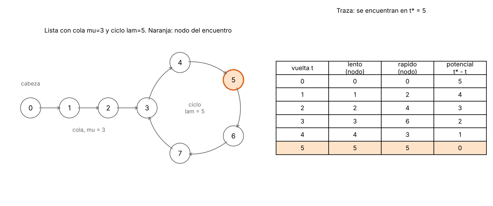

# Tema 1 - Problema 5 

Detección de ciclos en una lista enlazada con dos punteros que avanzan a velocidades 1 y 2 (algoritmo de Floyd). Demuestra que se encuentran si y solo si hay un ciclo, con un invariante, y que termina, con un potencial. Da el costo.

## Definición y supuestos del problema

Una **lista enlazada simple** es una estructura de datos formada por una secuencia de elementos llamados **nodos** (`Node`). Cada nodo consta de dos partes:
- El **valor** o dato almacenado.
- Un puntero o referencia al siguiente nodo de la secuencia, denominado **`next`**.

El punto de acceso a la lista se realiza mediante una referencia al primer nodo, llamada **cabeza** (`head`). Si la lista no contiene elementos (está vacía), `head` vale `None`.

###  Definición del problema

**Entrada:** La cabeza (`head`) de una lista enlazada simple (un `Node` o `None`).

**Salida:** Si existe o no un ciclo.

---

### Forma y topología de la lista

Dado que cada nodo posee a lo sumo un único sucesor `next`, el camino generado desde `head` $(\text{nodo}_0, \text{nodo}_1, \text{nodo}_2, \dots)$ solo puede presentar dos estructuras posibles:

1. **Lista acíclica:** El camino termina en `None`. Consta de $n$ nodos, todos distintos.
2. **Lista cíclica:** El camino es infinito y se divide en dos secciones:
   - Una **cola** (o prefijo) de $\mu \ge 0$ nodos que se recorren una sola vez.
   - Un **ciclo** de $\lambda \ge 1$ nodos que se repiten indefinidamente:
     $$\text{nodo}_k = \text{nodo}_{\mu + ((k - \mu) \bmod \lambda)} \quad \text{para todo } k \ge \mu$$

**Convenio de parámetros $(\mu, \lambda)$:**
- **Con ciclo:** $\mu \ge 0$ es la longitud de la cola y $\lambda \ge 1$ la longitud del ciclo.
- **Sin ciclo:** Convenimos $\lambda = 0$ y $\mu = n$ (la cantidad total de nodos).
- El número total de nodos distintos en la memoria es $N = \mu + \lambda$.

### Supuestos del modelo de cómputo

- **Modelo RAM de palabra (*Word RAM*):** Seguir una referencia (`node.next`) y comparar dos referencias toma tiempo constante $O(1)$.
- **Restricción de memoria $O(1)$:** No está permitido modificar los nodos, marcar visitas ni utilizar estructuras auxiliares (como conjuntos o tablas *hash*). Toda la resolución debe emplear $O(1)$ memoria adicional.

## El algoritmo 

### Idea general
El algoritmo utiliza dos punteros que recorren la lista a distintas velocidades a partir de `head`:
- **Tortuga**: avanza **1 nodo** por iteración (`tortoise = tortoise.next`).
- **Liebre**: avanza **2 nodos** por iteración (`hare = hare.next.next`).

**Comportamiento según la topología de la lista:**
- **Sin ciclo:** La liebre alcanza el final de la lista (`None` o `hare.next is None`), concluyendo de inmediato que la lista es finita y no contiene un ciclo.
- **Con ciclo:** Eventualmente, la tortuga y la liebre entran en la sección cíclica. Una vez dentro, la liebre reduce la distancia relativa con la tortuga en **1 nodo por iteración**, lo que garantiza que terminarán colisionando (`tortoise is hare`) tras un número finito de pasos.

---

### Implementación en Python

```python
def floyd(head):
    tortoise = hare = head
    iterations = 0
    
    while hare is not None and hare.next is not None:
        tortoise = tortoise.next
        hare = hare.next.next
        iterations += 1
        
        if tortoise is hare:
            return True, iterations
            
    return False, iterations
```

### Tres detalles clave de implementación

**Estructura de la guarda del bucle (while):**

La condición consta de dos evaluaciones de seguridad: 
`hare is not None` y `hare.next is not None`. Omitir la segunda provocaría una excepción `AttributeError` al intentar evaluar `hare.next.next` en listas con un número impar de nodos.

**Orden de avance y verificación:**

Ambos punteros comienzan situados en `head`. La comprobación de coincidencia (`tortoise is hare`) debe ejecutarse estrictamente después de hacer avanzar los punteros. Evaluarlos antes del avance retornaría erróneamente `True` en la primera iteración para cualquier lista.

**Comparación por identidad (is):**

Se utiliza la comparación de identidad por dirección de memoria (`is`) en lugar de igualdad por valor (`==`). Usar la segunda generaría falsos positivos en listas acíclicas que contengan nodos distintos con valores duplicados.

La figura 1 muestra un ejemplo completo: μ = 3, λ = 5. Se encuentran en el nodo 5 en la vuelta 5, que no es el nodo donde empieza el ciclo (el 3).



## Notación posicional y Lema del Encuentro

### Notación posicional
Sea $\text{nodo}_k$ el $k$-ésimo nodo alcanzado desde `head` (con $\text{nodo}_k = \text{None}$ si el camino ya terminó, es decir, si $k \ge n$ en una lista acíclica).

Tras $t$ iteraciones completas del bucle `while` ($t \ge 0$):
- **Tortuga (`tortoise`):** Se encuentra ubicada en $\text{nodo}_t$.
- **Liebre (`hare`):** Se encuentra ubicada en $\text{nodo}_{2t}$.

La afirmación *"los punteros se encuentran en la iteración $t$"* equivale algebraicamente a $\text{nodo}_t = \text{nodo}_{2t}$ con $t \ge 1$ (donde ambos representan exactamente la misma referencia por identidad).

### Lema del Encuentro
**Lema.** Supongamos que la lista contiene un ciclo ($\lambda \ge 1$). Para todo $t \ge 1$:
$$\text{nodo}_t = \text{nodo}_{2t} \iff t \ge \mu \quad \land \quad \lambda \mid t$$

*Demostración:*
- $(\Leftarrow)$ Si $t \ge \mu$, tanto $\text{nodo}_t$ como $\text{nodo}_{2t}$ se encuentran dentro del ciclo. Sus posiciones dentro del recorrido distan en $2t - t = t$ pasos. Como $\lambda \mid t$, la diferencia de distancia $t$ es un múltiplo exacto de la longitud del ciclo $\lambda$, por lo que ambos punteros coinciden en el mismo nodo.
- $(\Rightarrow)$ Si $t < \mu$, $\text{nodo}_t$ pertenece a la cola (prefijo acíclico). Puesto que los nodos de la cola aparecen una sola vez en el camino y $2t \neq t$ (ya que $t \ge 1$), $\text{nodo}_{2t}$ es necesariamente un nodo distinto. Si $t \ge \mu$, ambos nodos están en el ciclo de $\lambda$ nodos distintos; por tanto, son iguales únicamente si la distancia entre ellos es un múltiplo de $\lambda$, es decir, $\lambda \mid (2t - t) = t$. $\blacksquare$

---

### Corolario: Iteración del primer encuentro ($t^*$)
El primer encuentro entre la tortuga y la liebre ocurre exactamente en la iteración:
$$t^* = \min \{ t \ge 1 \mid t \ge \mu \;\land\; \lambda \mid t \} = \lambda \cdot \max\left(1, \left\lceil \frac{\mu}{\lambda} \right\rceil\right)$$

**Acotación de $t^*$:**
- Si $\mu = 0$ (ciclo puro desde `head`): $t^* = \lambda = N$.
- Si $\mu \ge 1$: $\max(\mu, \lambda) \le t^* \le \mu + \lambda - 1$.
*(Nota: La cota superior $t^* \le \mu + \lambda - 1 < N$ garantiza que el primer encuentro ocurre siempre antes de completar $N = \mu + \lambda$ pasos dentro de la estructura. El valor máximo $t^* = \mu + \lambda - 1$ se alcanza cuando $\mu = \lambda + 1$, donde $t^* = 2\lambda$.)*

## Invariante y Correctitud Parcial


Definimos el **Invariante $I(t)$** tras $t$ iteraciones completas del bucle `while` ($t \ge 0$), mientras el algoritmo no haya retornado:

- **(a) Posición de los punteros:** `tortoise` está en $\text{nodo}_t$ y `hare` está en $\text{nodo}_{2t}$ (o `None`, si el recorrido alcanzó el final).
- **(b) Ausencia de colisiones previas:** Para todo $s \in \{1, \dots, t\}$, $\text{nodo}_s \neq \text{nodo}_{2s}$ (no se ha producido ningún encuentro en iteraciones anteriores).

### Demostración por Inducción

- **Inicialización ($t = 0$):**  
  Antes de la primera iteración, `tortoise = hare = head = nodo_0 = nodo_{2(0)}`. La propiedad (a) se cumple. La propiedad (b) es vacía ($s \in \{1, \dots, 0\}$), por lo que se satisface vacuamente.

- **Mantenimiento:**  
  Supongamos que $I(t)$ es verdadero y la guarda del bucle se evalúa como `True` (`hare is not None` y `hare.next is not None`).  
  Esto implica que existen los nodos en el camino hasta la posición $2t + 1$, y por ende `tortoise = nodo_t` existe ($t \le 2t$).  
  Al ejecutar el cuerpo del bucle:
  - `tortoise = tortoise.next` pasa a $\text{nodo}_{t+1}$.
  - `hare = hare.next.next` pasa a $\text{nodo}_{2(t+1)} = \text{nodo}_{2t+2}$ (que puede ser un `Node` o `None`).  
  Esto establece la propiedad **(a)** para $t + 1$.  
  A continuación, se evalúa la condición de salida `if tortoise is hare`:
  - Si coinciden (`tortoise is hare`), el algoritmo retorna `True`.
  - Si no coinciden, se confirma que $\text{nodo}_{t+1} \neq \text{nodo}_{2(t+1)}$, extendiendo la propiedad **(b)** para todo $s \in \{1, \dots, t+1\}$.

- **Conclusión:**  
  El bucle finaliza únicamente por una de dos vías:
  1. **Retorna `True` tras $t \ge 1$ iteraciones:** Por (a), $\text{nodo}_t$ y $\text{nodo}_{2t}$ representan la misma referencia física con $t < 2t$. Al tener cada nodo un único sucesor `next`, el camino se repite indefinidamente a partir de esa coincidencia: **existe un ciclo**.
  2. **Sale por la guarda del `while` tras $t$ iteraciones:** Por (a), `hare = nodo_{2t}` es `None` o `hare.next` es `None`. Esto implica que la lista tiene a lo sumo $2t + 1$ nodos y es finita: **no existe ciclo**, devolviendo `False`.

## Función de Potencial y Terminación

Para demostrar que el algoritmo **siempre termina** en un número finito de pasos, definimos una **función de potencial** $\Phi(t) \in \mathbb{Z}_{\ge 0}$ sobre el estado de la ejecución tras $t$ iteraciones. 

Siguiendo la metodología formal de verificación (C3), la función de potencial debe satisfacer:
1. **No negatividad:** $\Phi(t) \ge 0$ para todo estado alcanzable antes de finalizar.
2. **Decrecimiento estricto:** $\Phi(t+1) \le \Phi(t) - 1$ mientras la condición del bucle se mantenga.

Analizamos la función de potencial según la topología de la lista:

### Caso 1: Lista sin ciclo ($n$ nodos)

- **Definición de $\Phi(t)$:** Medimos la cantidad de nodos restantes por delante del puntero rápido `hare`:
  $$\Phi(t) = \max(0, n - 1 - 2t)$$

- **Demostración de terminación:**
  - **No negatividad:** $\Phi(t) \ge 0$ por construcción con el operador máximo.
  - **Valor inicial:** En $t = 0$, $\Phi(0) = n - 1$.
  - **Decrecimiento estricto:** Si la guarda del `while` es verdadera (`hare is not None` y `hare.next is not None`), existen al menos 2 nodos disponibles por delante de `hare`, de modo que $\Phi(t) \ge 1$. Al avanzar `hare` dos posiciones en la iteración $t+1$:
    $$\Phi(t+1) = \max(0, \Phi(t) - 2) \le \Phi(t) - 1 < \Phi(t)$$
  - **Número de vueltas:** Como $\Phi(t)$ es un entero no negativo que disminuye en al menos $1$ unidad por paso, el algoritmo alcanza $\Phi = 0$ en exactamente $t = \lfloor n/2 \rfloor$ iteraciones, momento en el cual la guarda se evalúa como `False` y retorna `False`.

### Caso 2: Lista con ciclo $(\mu, \lambda)$

- **Definición de $\Phi(t)$:** Medimos la distancia en iteraciones que faltan para alcanzar el primer encuentro en $t^*$:
  $$\Phi(t) = t^* - t$$
  donde $t^* = \lambda \cdot \max\left(1, \left\lceil \frac{\mu}{\lambda} \right\rceil\right)$ es la iteración exacta del primer encuentro.

- **Demostración de terminación:**
  - **No negatividad:** Para todo $t < t^*$, el Invariante $I(t)$ garantiza que no se ha producido colisión previa. Por definición de $t^*$ como la primera iteración de choque, $t^* > t$, por lo que $\Phi(t) \ge 1$.
  - **Decrecimiento estricto:** En cada iteración $t \to t + 1$:
    $$\Phi(t+1) = t^* - (t + 1) = \Phi(t) - 1$$
    disminuyendo exactamente en $1$ unidad por vuelta.
  - **Número de vueltas:** Tras exactamente $t = t^*$ iteraciones, se alcanza $\Phi(t^*) = 0$, lo que implica $\text{tortoise} \text{ is } \text{hare}$. La condición de salida se satisface y el algoritmo retorna `True`.

---

### Conclusión de Correctitud Total (Demostración del $\iff$)

Combinando la **Correctitud Parcial** con la **Terminación**:
- Si la lista **no tiene ciclo**, el algoritmo **siempre termina** en $\lfloor n/2 \rfloor$ iteraciones y devuelve `False`.
- Si la lista **tiene ciclo**, el algoritmo **siempre termina** en $t^*$ iteraciones y devuelve `True`.

En consecuencia, el algoritmo de Floyd es **totalmente correcto**: retorna `True` **si y solo si** la lista enlazada contiene un ciclo. $\blacksquare$


## Análisis de Complejidad Temporal y Espacial

### Complejidad Temporal 
- **Listas acíclicas ($n$ nodos):** Ejecuta $\lfloor n/2 \rfloor$ iteraciones. Cada iteración realiza $O(1)$ accesos a memoria y comparaciones. Complejidad: $\Theta(n)$.
- **Listas cíclicas $(\mu, \lambda)$:** Ejecuta $t^*$ iteraciones. Como $t^* \le \mu + \lambda - 1 = N - 1$, la cantidad de iteraciones está acotada por $O(\mu + \lambda) = O(N)$.
- **Complejidad Temporal Global:** **$O(N)$**, donde $N = \mu + \lambda$ es el número total de nodos distintos en memoria.

### Complejidad Espacial Auxiliar
- El algoritmo solo mantiene dos referencias de puntero (`tortoise` y `hare`) y un contador escalar de iteraciones.
- No modifica la lista ni utiliza estructuras auxiliares (como tablas hash o conjuntos).
- **Complejidad Espacial Auxiliar:** **$O(1)$**.


## Archivos

| Archivo | Contenido |
|---|---|
| `ejercicio_05.md` | Este informe |
| `extras_05/fig` | Figuras  |