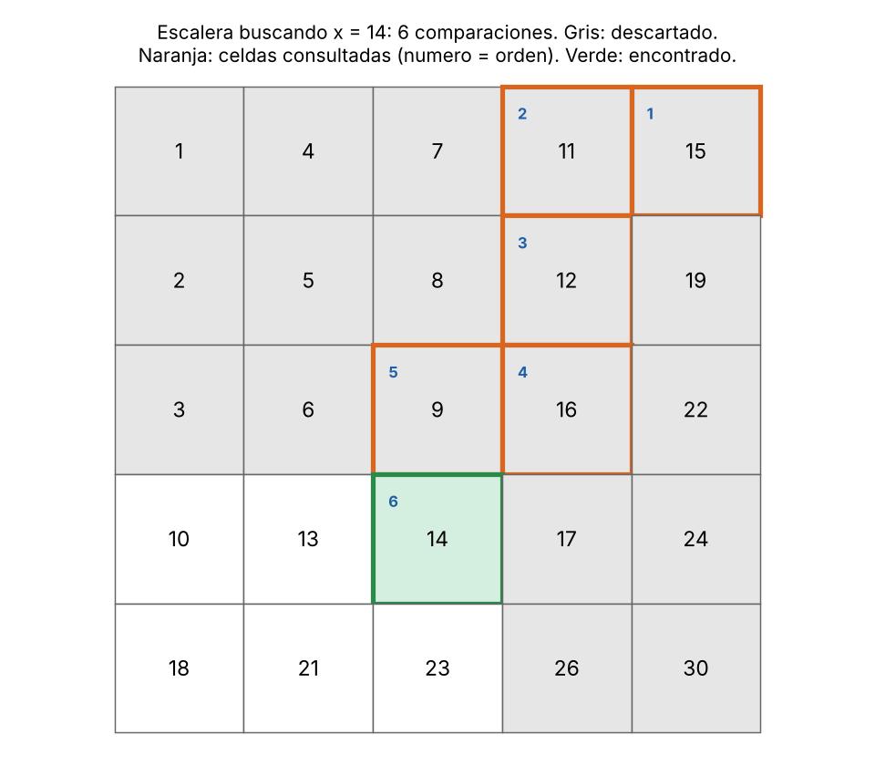
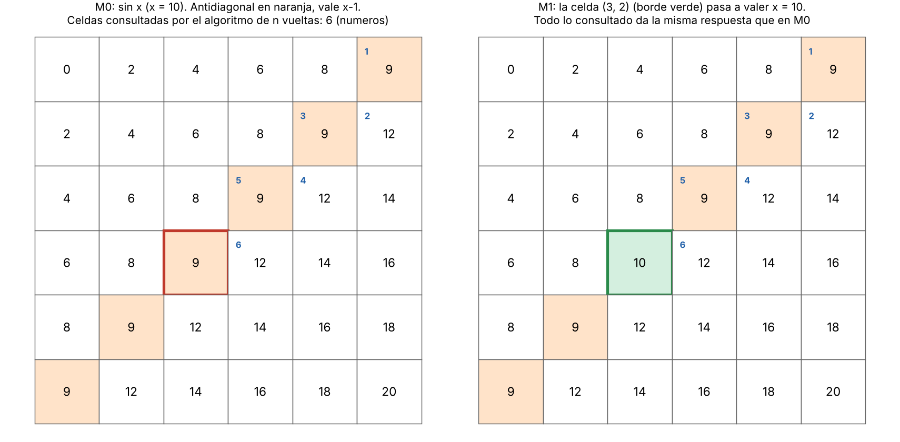

# Tema 1 - Problema 6

Una matriz $n$ x $n$
tiene filas y columnas ordenadas de forma creciente. Diseña un algoritmo que
decida si contiene un valor $O(n)$ en
comparaciones, demuestra su correctitud con un invariante, y
demuestra con un adversario que no se puede en $o(n)$.

## El algoritmo

**Modelo de Cómputo:** El algoritmo opera en el modelo de comparaciones (consultas de 3 vías: $<, =, >$). El algoritmo no puede realizar operaciones aritméticas sobre los datos ni acceder a ellos mediante hashing o indexación directa por valor; su única forma de obtener información sobre la matriz es comparando una casilla $A[i][j]$ contra la clave buscada $x$.


**Idea.** La esquina superior derecha A[0][n−1] es la mayor de su fila y la menor de su columna. La idea es comenzar esta y, en cada iteración, comparar el elemento actual con $x$.

- Si $A[i][j] = x$, hemos encontrado el elemento y terminamos.
- Si $A[i][j] > x$, descartamos la columna $j$, ya que todos sus elementos son mayores que $x$ o iguales a $A[i][j]$.
- Si $A[i][j] < x$, descartamos la fila $i$, ya que todos sus elementos son menores que $x$ o iguales a $A[i][j]$.

Repetimos el proceso hasta encontrar $x$ o hasta que no queden elementos por examinar.

### Código en Python

```python
def find_x(A, x):
    n = len(A)
    i = 0
    j = n - 1

    while i < n and j >= 0:
        if A[i][j] == x:
            return True
        elif A[i][j] > x:
            j -= 1
        else:
            i += 1

    return False
```

La figura 1 muestra una búsqueda de x = 14: 6 comparaciones, y las filas 0, 1 y 2 y las columnas 3 y 4 quedan descartadas.




## Demostración de correctitud mediante una invariante

**Invariante:** Al inicio de cada iteración, si $x$ pertenece a la matriz, debe encontrarse en la región que todavía no ha sido descartada. Ninguna fila o columna descartada puede contener a $x$.

**Inicialización:**

Antes de la primera iteración no se ha descartado ninguna fila ni columna. Por tanto, toda la matriz permanece en la región de búsqueda y la invariante se cumple.

**Mantenimiento:**

Supongamos que la invariante se cumple al inicio de una iteración. Sea $A[i][j]$ el elemento actual.

- Si $A[i][j] = x$, el algoritmo encuentra el elemento y termina correctamente.
- Si $A[i][j] > x$, como la columna está ordenada de forma creciente, todos los elementos situados debajo de $A[i][j]$ son mayores que $x$. Por tanto, $x$ no puede encontrarse en la columna $j$, que puede descartarse.
- Si $A[i][j] < x$, como la fila está ordenada de forma creciente, todos los elementos situados a la izquierda de $A[i][j]$ son menores que $x$. Por tanto, $x$ no puede encontrarse en la fila $i$, que puede descartarse.

En ambos casos, la región descartada no contiene a $x$, por lo que la invariante se mantiene.

**Conclusión:**

El algoritmo termina cuando encuentra $x$ o cuando los índices salen de los límites de la matriz.

Si encuentra $x$, devuelve `True`, por lo que la respuesta es correcta.

Si termina porque no quedan elementos por examinar, la invariante garantiza que ninguna de las regiones descartadas contiene a $x$. Como la región restante está vacía, concluimos que $x$ no pertenece a la matriz y el algoritmo devuelve `False`.


## Terminación

Sea $Φ = (n − i) + (j + 1)$: las filas que quedan más las columnas que quedan. Al empezar, Φ = 2n. 

Como $n − i ≥ 1$ y $j + 1 ≥ 1$, luego **Φ ≥ 2**. 
Cada vuelta que no retorna cambia $i$ en $+1$ o $j$ en $−1$, así que $Φ$ **baja exactamente 1** en cada ejecución del ciclo. Al ser un entero ≥ 0 que baja en cada vuelta, el ciclo termina. 

## Complejidad

En cada iteración se descarta una fila o una columna, por lo que el algoritmo realiza como máximo $2n-1$ comparaciones.

Por tanto, la complejidad temporal en el peor caso es:

$$
T(n) \in O(n)
$$

La complejidad espacial auxiliar es: $O(1)$

## La cota inferior con un adversario: no se puede en $o(n)$

**Teorema.** Todo algoritmo en el modelo de comparaciones que decida correctamente si $x$ está en una matriz $A$ de $n \times n$ con filas y columnas crecientes realiza **al menos $n$ comparaciones** en el peor caso. En particular, ningún algoritmo puede resolver el problema en $o(n)$.

### La Anti-diagonal de Decisión y las Matrices $M_0$ y $M_{1,k}$

Sea el valor buscado **$x = 2(n - 1)$**. Para formalizar las respuestas del adversario, definimos dos familias de matrices válidas sobre la **anti-diagonal principal** $\{(i, n - 1 - i) \mid 0 \le i \le n-1\}$:

1. **Matriz $M_0$ (instancia donde $x \notin M_0$):**
   $$A[i][j] = \begin{cases} 2(i + j) & \text{si } i + j \neq n - 1 \\ x - 1 & \text{si } i + j = n - 1 \end{cases}$$
   * Fuera de la anti-diagonal, si $i + j < n - 1$ los valores son $\le x - 2$, y si $i + j > n - 1$ los valores son $\ge x + 2$.
   * En la anti-diagonal, todas las $n$ celdas valen $x - 1$. Como $x - 2 < x - 1 < x + 2$, la matriz mantiene filas y columnas estrictamente crecientes.
   * La respuesta correcta para $M_0$ es **`False`**.

2. **Matrices $M_{1,k}$ para $k \in \{0, 1, \dots, n-1\}$ (instancias donde $x \in M_{1,k}$):**
   La matriz $M_{1,k}$ es idéntica a $M_0$ en todas sus casillas, excepto en la celda anti-diagonal $(k, n - 1 - k)$, cuyo valor se reemplaza por **$x$**.
   * Mantiene $x - 2 < x < x + 2$, por lo que es una matriz ordenada válida.
   * La respuesta correcta para $M_{1,k}$ es **`True`**.



---

### Construcción de la Contradicción (Lema de Indistinguibilidad)

 Supongamos por contradicción que existe un algoritmo determinista y correcto que realiza menos de $n$ comparaciones (es decir, en tiempo $o(n)$).

1. Ejecutamos el algoritmo contra el adversario respondiendo según la matriz **$M_0$**.
2. Como el algoritmo realiza menos de $n$ comparaciones y hay $n$ casillas independientes en la anti-diagonal, por el principio del palomar existe al menos una casilla $(k^*, n - 1 - k^*)$ que el algoritmo **nunca consultó ni comparó**.
3. Consideremos ahora la matriz **$M_{1,k^*}$**. Dado que $M_0$ y $M_{1,k^*}$ difieren **únicamente** en esa casilla $(k^*, n - 1 - k^*)$ que el algoritmo no miró, todas las respuestas que el algoritmo recibe al ejecutarse sobre $M_{1,k^*}$ son **exactamente identicas** a las que recibió sobre $M_0$.
4. Al ser un algoritmo determinista, producirá exactamente la misma salida en ambos casos.
5. Sin embargo, la respuesta correcta es **`False`** para $M_0$ y **`True`** para $M_{1,k^*}$. El algoritmo se equivoca en al menos una de las dos matrices, lo cual contradice la hipótesis de que es un algoritmo correcto.

---

### Conclusión

Todo algoritmo correcto debe inspeccionar o comparar **las $n$ celdas de la anti-diagonal** en el peor caso para evitar cometer un error entre $M_0$ y $M_{1,k^*}$. Por lo tanto, la cota mínima del problema es:

$$\Omega(n)$$

Esto demuestra que el algoritmo de descartar filas/columnas desde la esquina superior derecha con $2n - 1$ comparaciones es **óptimo** y que el problema cuesta $\Theta(n)$ comparaciones. $\blacksquare$

## Análisis de Resultados Experimentales de la Verificación Ejecutable

Para validar que las demostraciones teóricas (el invariante de bucle, la función de potencial $\Phi$ y la cota superior de $2n - 1$ comparaciones) se sostienen de forma estricta en la práctica, se diseñó e implementó la versión vigilada del algoritmo (`guarded_matrix_search.py`).

El objetivo de esta suite experimental es **someter al algoritmo a control de aserciones en cada iteración** (`assert`), utilizando un oráculo de búsqueda exhaustiva para verificar computacionalmente tres garantías:
1. **Preservación del invariante:** Comprobar que en ningún paso intermedio se descarta por error el elemento buscado.
2. **Monotonía del potencial:** Garantizar que el potencial $\Phi = (n - i) + (j + 1)$ decrece exactamente en $1$ unidad por paso.
3. **Cota de costo:** Confirmar empíricamente que ninguna ejecución excede las $2n - 1$ comparaciones.


La ejecución sobre una matriz de dimensión $N = 5$ (donde la cota teórica en el peor caso es $2N - 1 = 9$ comparaciones) arrojó una verificación exitosa sin fallos de aserción.

### Clasificación por Trayectoria y Casos de Prueba

| Elemento ($x$) | Resultado | Comparaciones | Cota ($2N-1$) | Tipo de Caso | Comportamiento del Algoritmo |
|:---:|:---:|:---:|:---:|:---:|:---|
| **15** | `True` | **1** | 9 | **Mejor Caso** | Se encuentra en la esquina inicial $(0, n-1)$ en la primera comparación. |
| **18** | `True` | **9** | 9 | **Peor Caso (Éxito)** | Recorre la trayectoria máxima por la matriz descartando filas y columnas alternadamente. |
| **20** | `False` | **9** | 9 | **Peor Caso (Fracaso)** | Se agotan las $9$ iteraciones máximas consumiendo toda la región activa sin hallar el valor. |
| **14** | `True` | **6** | 9 | **Caso Intermedio** | Descarte mixto de filas y columnas (6 pasos). |
| **1, 5, 30** | `True` | **5** | 9 | **Casos Promedio** | Encuentra el valor tras vaciar la mitad del espacio de búsqueda. |
| **0, 35** | `False` | **5** | 9 | **Descarte Rápido** | Se descarta tempranamente al salir de los límites de valores mínimos/máximos. |

---

### Verificación Empírica de las Propiedades Teóricas

1. **Correctitud Parcial por Invariante $I(i, j)$:**
   En el $100\%$ de los estados intermedios evaluados, el oráculo de búsqueda exhaustiva confirmó que si $x \in A$, $x$ se mantenía contenido en la submatriz activa $R(i, j) = A[i \dots n-1][0 \dots j]$. Ninguna operación de incremento $i \leftarrow i + 1$ o decremento $j \leftarrow j - 1$ descartó erróneamente al elemento buscado.

2. **Terminación Garantizada por Potencial $\Phi$:**
   Se verificó computacionalmente que la función de potencial $\Phi = (n - i) + (j + 1)$ inició en $\Phi = 2n = 10$, se mantuvo acotada por $\Phi \ge 2$ mientras la guarda del bucle se evaluó como verdadera, y decreció en **estrictamente $1$ unidad por paso** ($\Phi' = \Phi - 1$). Esto valida la terminación determinista en a lo sumo $2n$ pasos.

3. **Validez de la Cota de Complejidad:**
   Ninguna de las ejecuciones superó las $2n - 1 = 9$ comparaciones estipuladas por el modelo de comparaciones. El peor caso medido ($9$ comparaciones) coincide con la cota teórica ajustada del problema.

## Archivos

| Archivo | Contenido |
|---|---|
| `ejercicio_06.md` | Este informe |
| `extras_06/solution.py` | Solución presentada `find_x(A,x)` |
|`extras_06/guarded_matrix_search.py`| Comprobaciones |
| `extras_06/fig/` | Figuras |

