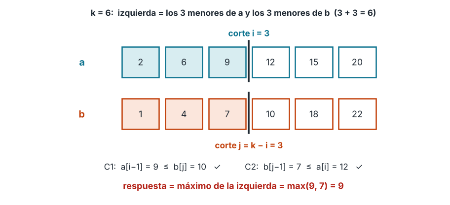
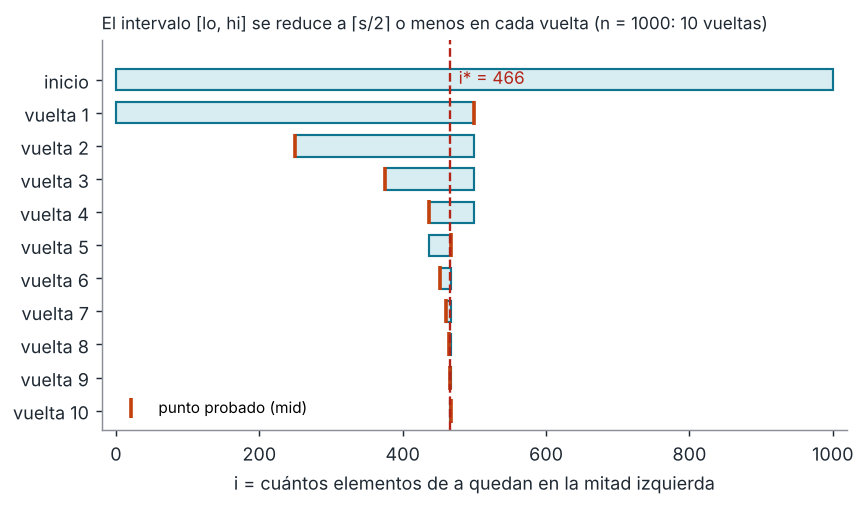
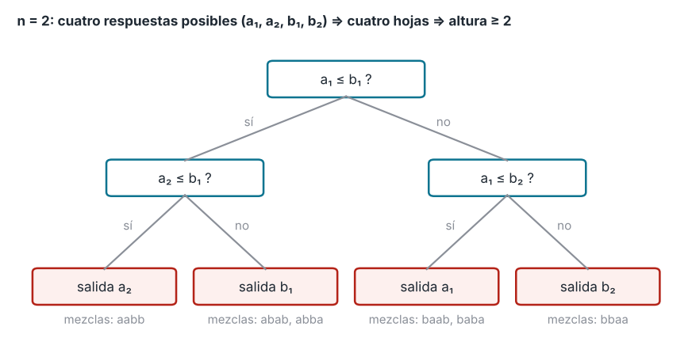

# Tema 1 - Problema 7

Mediana de dos arreglos ordenados de largo : el -ésimo menor de los $2n$
elementos. Diseña un algoritmo $O(logn)$, demuestra su correctitud y da la cota de información.


## Planteamiento del problema

Se tienen dos arreglos $a$ y $b$, ambos ordenados de forma no decreciente y de igual longitud $n$. El objetivo es encontrar la mediana inferior de los $2n$ elementos que contienen, es decir, el elemento que ocuparía la posición $n$ si se combinaran ambos arreglos y se ordenaran.

Se busca diseñar un algoritmo que resuelva este problema en tiempo $O(\log n)$, demostrar su correctitud y establecer una cota inferior mediante el modelo de árbol de decisión.

### Generalización del problema

Para facilitar el diseño del algoritmo, generalizamos el problema: en lugar de buscar únicamente la mediana de dos arreglos del mismo tamaño, buscamos el $k$-ésimo menor elemento de dos arreglos ordenados $a$ y $b$, que pueden tener longitudes diferentes $n$ y $m$.

El problema original se obtiene como un caso particular de esta generalización cuando:

$$
n=m=k
$$

### Especificación del problema general

**Precondición ($\text{Pre}$)**

El algoritmo recibe dos arreglos $a$ y $b$, de longitudes $n$ y $m$, respectivamente, que cumplen las siguientes condiciones:

1. **Arreglos ordenados:** ambos arreglos están ordenados de forma no decreciente:

   $\forall\, 0\le u<v<n,\quad a[u]\le a[v]
   $

   $\forall\, 0\le u<v<m,\quad b[u]\le b[v]
   $

2. **Rango del parámetro $k$:**

   $$
   1\le k\le n+m
   $$

3. **Tipos de datos:** los elementos de ambos arreglos pertenecen a un conjunto con un orden total $(\mathcal{X},\le)$. Se permite que alguno de los arreglos esté vacío.

**Postcondición ($\text{Post}$)**

El algoritmo devuelve un valor $x\in a\cup b$ que ocupa exactamente la posición $k$, indexando desde 1, en la mezcla ordenada de ambos arreglos.

**Modelo de cómputo (Conferencia 5 §1)**

Operamos exclusivamente en el **modelo de comparaciones cruzadas**. Puesto que $a$ y $b$ ya están ordenados internamente, comparar elementos dentro del mismo arreglo no aporta información nueva. Solo se contabilizan las comparaciones entre un elemento de $a$ y uno de $b$, es decir, comparaciones de la forma $a[i]\le b[j]$.

Las verificaciones de límites de índices y centinelas se consideran gratuitas y no cuentan como comparaciones entre claves.
### La idea para construir el algoritmo

Para encontrar el $k$-ésimo menor elemento de dos arreglos ordenados $A$ y $B$, de tamaños $n$ y $m$, respectivamente, nos basamos en la **partición del espacio combinatorio**.

El valor $k$ representa la posición del elemento que buscamos, contando desde 1. Por ejemplo, si $k=3$, queremos encontrar el tercer elemento menor de la unión de ambos arreglos. En particular, si los dos arreglos tienen tamaño $n$ y buscamos la mediana inferior, entonces $k=n$.

La idea consiste en dividir ambos arreglos en dos mitades:

1. **La mitad izquierda (los $k$ elementos menores):** se compone tomando $i$ elementos del arreglo $A$, es decir, $A[0 \dots i-1]$, y los restantes $j=k-i$ elementos del arreglo $B$, es decir, $B[0 \dots j-1]$.

2. **Centinelas de borde:** definimos $A[-1]=B[-1]=-\infty$ y $A[n]=B[m]=+\infty$ para manejar los casos en los que alguna de las mitades queda vacía. De esta forma, podemos expresar las condiciones de la partición sin necesitar comprobaciones especiales en cada caso.

3. **Rango inicial de cortes posibles:** no podemos tomar una cantidad negativa de elementos ni más elementos de los que contiene cada arreglo. Por tanto, el rango inicial para elegir $i$ es:

   $lo_0=\max(0,k-m), \qquad hi_0=\min(n,k)$

   En el caso particular de dos arreglos de tamaño $n$ y $k=n$, este rango se reduce a $[0,n]$.

4. **Condición de corte y propiedad de monotonía:** una partición es válida si todos los elementos de la mitad izquierda son menores o iguales que todos los elementos de la mitad derecha. Como los arreglos están ordenados, basta con comprobar los dos elementos que quedan justo en los límites de la partición:

   $C_1(i): A[i-1]\le B[j]$

   $C_2(i): B[j-1]\le A[i]$

   donde $j=k-i$.

La condición $C_1(i)$ es monótona respecto al índice $i$: si es verdadera para un determinado índice, también lo es para todos los índices menores dentro del intervalo válido. Equivalentemente, una vez que se vuelve falsa, permanece falsa para todos los índices mayores.

Por tanto, no necesitamos buscar una partición que satisfaga ambas condiciones simultáneamente. Basta con encontrar el mayor índice que cumple $C_1$, ya que este garantiza una partición válida.

Esto permite reducir el problema a una búsqueda binaria sobre los posibles cortes de $A$.

### Lo que va haciendo el algoritmo paso a paso

1. **Inicialización:** se define el rango de búsqueda:

   $lo=\max(0,k-m), \qquad hi=\min(n,k)$

   Estos límites garantizan que tanto $i$ como $j=k-i$ sean índices de corte válidos para sus respectivos arreglos.

2. **Cálculo del punto medio por arriba:** en cada iteración del bucle `while lo < hi`, se calcula:

   $mid=\left\lfloor\frac{lo+hi+1}{2}\right\rfloor$

   > Se utiliza el redondeo hacia arriba para asegurar que $mid>lo$. Esto evita que el algoritmo se quede atrapado en un ciclo infinito cuando actualiza $lo=mid$.

3. **Evaluación de $C_1(mid)$:** se calcula $j=k-mid$ y se verifica si:

   $A[mid-1]\le B[j]$

   Se consideran los centinelas cuando alguna de las mitades queda vacía.

   - **Si $C_1(mid)$ es verdadera:** significa que todavía podemos tomar $mid$ elementos de $A$ sin violar la condición. Como buscamos el mayor índice que cumple $C_1$, la solución se encuentra en el intervalo $[mid,hi]$. Se actualiza:

     $lo=mid$

   - **Si $C_1(mid)$ es falsa:** significa que hemos tomado demasiados elementos de $A$. Por la monotonía de la condición, los índices mayores tampoco serán válidos. Por tanto, la solución debe estar en $[lo,mid-1]$. Se actualiza:

     $hi=mid-1$

4. **Terminación del bucle:** el bucle finaliza cuando $lo=hi$. En ese momento, hemos encontrado el mayor índice $i$ para el cual $C_1(i)$ es verdadera. Por la propiedad demostrada anteriormente, este índice también satisface $C_2(i)$, por lo que la partición obtenida es válida.

5. **Retorno del resultado:** como la partición es válida, los $k$ elementos de la mitad izquierda son menores o iguales que los elementos de la mitad derecha. Por tanto, el $k$-ésimo menor elemento es el **máximo de la mitad izquierda**:

   $\boxed{\max(A[i-1],B[j-1])}$

   Si alguna de las dos partes izquierdas está vacía, el resultado corresponde al último elemento de la otra.



---

### Implementación Python

```python
def kesimo_particion(a, b, k=None):
    """
    Encuentra el k-esimo menor elemento de dos arreglos ordenados.
    Para la mediana inferior de dos arreglos de longitud n, k = n.
    """
    n, m = len(a), len(b)

    if k is None:
        k = n

    if not (1 <= k <= n + m):
        raise ValueError("k debe estar entre 1 y n + m")

    lo, hi = max(0, k - m), min(n, k)

    while lo < hi:
        mid = (lo + hi + 1) // 2
        j = k - mid

        # Evaluacion de C1(mid): a[mid - 1] <= b[j]
        if mid == 0 or j >= m or a[mid - 1] <= b[j]:
            lo = mid
        else:
            hi = mid - 1

    # Particion final
    i, j = lo, k - lo

    # El k-esimo menor es el maximo de la mitad izquierda
    if i == 0:
        return b[j - 1]
    if j == 0:
        return a[i - 1]

    return max(a[i - 1], b[j - 1])
```

## Correctitud

Para demostrar la correctitud del algoritmo, utilizaremos un **invariante de ciclo**, verificando su inicialización, mantenimiento y conclusión. Esto permitirá demostrar la correctitud parcial: si el algoritmo termina, devuelve el elemento buscado. Por otra parte, utilizaremos una función potencial para demostrar que el ciclo efectivamente termina.

**Lema 1 (Partición válida implica respuesta correcta).** Si un índice $i\in[lo_0,hi_0]$ satisface $C_1(i)$ y $C_2(i)$, entonces el $k$-ésimo menor elemento es:

$\boxed{\max(A[i-1],B[j(i)-1])}$

*Demostración.*

Consideremos los conjuntos correspondientes a las dos mitades de la partición:

$L=A[0..i)\cup B[0..j)$

$R=A[i..n)\cup B[j..m)$

Por definición, el conjunto izquierdo contiene:

$|L|=i+j=i+(k-i)=k$
elementos.

Como los arreglos están ordenados, todos los elementos de $A[0..i)$ son menores o iguales que $A[i-1]$, y todos los elementos de $B[0..j)$ son menores o iguales que $B[j-1]$.

Además, las condiciones $C_1(i)$ y $C_2(i)$ garantizan que:

$A[i-1]\le B[j]$

$B[j-1]\le A[i]$

Por tanto, todos los elementos de la mitad izquierda son menores o iguales que los de la mitad derecha.

Así, $L$ contiene exactamente los $k$ elementos menores de la unión de ambos arreglos. El mayor elemento de $L$ es:

$\max(A[i-1],B[j-1])$

Este elemento es, por tanto, el $k$-ésimo menor. $\square$

**Lema 2 ($C_1$ es monótona hacia abajo).** Si $C_1(i)$ es verdadera y $i-1\ge lo_0$, entonces $C_1(i-1)$ también es verdadera.

*Demostración.*

Por definición:

$C_1(i): A[i-1]\le B[j(i)]$

Como $j(i-1)=j(i)+1$, la condición $C_1(i-1)$ equivale a:

$A[i-2]\le B[j(i)+1]$

Por el orden de los arreglos y por la hipótesis $C_1(i)$, tenemos:

$A[i-2]\le A[i-1]\le B[j(i)]\le B[j(i)+1]$

Por transitividad:

$A[i-2]\le B[j(i)+1]$

Por tanto, $C_1(i-1)$ es verdadera. Si alguno de los elementos no existe, la desigualdad correspondiente se satisface mediante los centinelas. $\square$

**Lema 3 ($C_1(lo_0)$ es verdadera).**

*Demostración.*

Por definición:

$lo_0=\max(0,k-m)$

Tenemos dos casos:

- Si $lo_0=0$, entonces $A[lo_0-1]=A[-1]=-\infty$, por lo que $C_1(lo_0)$ es verdadera.
- Si $lo_0=k-m>0$, entonces $j(lo_0)=m$. Por tanto, $B[j(lo_0)]=B[m]=+\infty$, y nuevamente $C_1(lo_0)$ es verdadera.

En ambos casos se cumple la condición. $\square$

A partir de estos resultados, podemos definir:

$i^*=\max\{i\in[lo_0,hi_0]:C_1(i)\text{ es verdadera}\}$

Este índice existe por el lema 3, ya que $C_1(lo_0)$ es verdadera.

**Lema 4 ($i^*$ determina una partición válida).**

*Demostración.*

Por definición de $`i^*`$, sabemos que $`C_1(i^*)`$ es verdadera. Solo falta demostrar que también se cumple $C_2(i^*)$.

Consideramos dos casos:

- **Si $`i^*=hi_0=\min(n,k)`$:** tenemos dos posibilidades:
  - Si $`i^*=n`$, entonces $`A[i^*]=A[n]=+\infty`$, por lo que $`C_2(i^*)`$ es verdadera.
  - Si $`i^*=k`$, entonces $`j(i^*)=0`$ y $`B[j(i^*)-1]=B[-1]=-\infty`$, por lo que $`C_2(i^*)`$ también es verdadera.

- **Si $i^*<hi_0$:** por la maximalidad de $`i^*`$, la condición $`C_1(i^*+1)`$ es falsa. Desarrollando esta condición:

  $A[i^*]\le B[j(i^*+1)]$

  Como $`j(i^*+1)=j(i^*)-1`$, su negación implica:

  $A[i^*]>B[j(i^*)-1]$

  Por tanto:

  $B[j(i^*)-1]<A[i^*]$

  lo que garantiza que $C_2(i^*)$ es verdadera.

En ambos casos, $i^*$ satisface $C_1$ y $C_2$, por lo que determina una partición válida. $\square$

### Invariante del ciclo

Definimos el siguiente invariante, que debe cumplirse antes y después de cada iteración del ciclo:

$\boxed{
C_1(lo)\text{ es verdadera}
\quad\land\quad
lo\le i^*\le hi
}$

Es decir, el límite inferior siempre corresponde a un índice que satisface $C_1$, y el índice buscado $i^*$ permanece dentro del intervalo de búsqueda.

**Inicialización.**

Al comenzar el algoritmo:

$lo=lo_0,\qquad hi=hi_0$

Por el lema 3, $C_1(lo_0)$ es verdadera. Además, por definición de $i^*$:

$lo_0\le i^*\le hi_0$

Por tanto, el invariante se cumple inicialmente.

**Mantenimiento.**

Supongamos que el invariante se cumple al comienzo de una iteración y que $lo<hi$.

El algoritmo calcula:

$mid=\left\lceil\frac{lo+hi}{2}\right\rceil$

Por utilizar el redondeo hacia arriba, se cumple:

$lo<mid\le hi$

Ahora analizamos los dos posibles resultados de evaluar $C_1(mid)$:

- **Si $C_1(mid)$ es verdadera:** como $i^*$ es el mayor índice que satisface $C_1$, necesariamente:

  $mid\le i^*$

  El algoritmo actualiza $lo=mid$. Por tanto, $C_1(lo)$ sigue siendo verdadera y se conserva:

  $lo\le i^*\le hi$

- **Si $C_1(mid)$ es falsa:** por el lema 2, todos los índices mayores o iguales que $mid$ tampoco pueden satisfacer $C_1$. Por tanto:

  $i^*<mid$

  El algoritmo actualiza $hi=mid-1$. Así se conserva:

  $lo\le i^*\le hi$

  Además, $lo$ no cambia, por lo que $C_1(lo)$ continúa siendo verdadera.

En ambos casos, el invariante se mantiene después de la iteración.

**Conclusión.**

El ciclo termina cuando:

$lo=hi$

Por el invariante, sabemos que:

$lo\le i^*\le hi$

Como ambos límites coinciden, necesariamente:

$`lo=hi=i^*`$

Por el lema 4, $i^*$ determina una partición válida, ya que satisface tanto $C_1$ como $C_2$.

Finalmente, por el lema 1, el máximo de la mitad izquierda es el $k$-ésimo menor elemento:

$\boxed{\max(A[i^*-1],B[j(i^*)-1])}$

Las condiciones finales del código contemplan los casos en que alguna de las mitades izquierdas está vacía, devolviendo el único elemento disponible.

Por tanto, si el algoritmo termina, devuelve correctamente el $k$-ésimo menor elemento.

### Terminación mediante una función potencial

Para demostrar que el ciclo termina, definimos la siguiente función potencial:

$P=hi-lo$

Esta función cumple dos propiedades:

1. Es un entero no negativo, porque durante la búsqueda siempre se mantiene $lo\le hi$.
2. Disminuye estrictamente en cada iteración.

En efecto, si $C_1(mid)$ es verdadera, el algoritmo actualiza $lo=mid$. Como $mid>lo$ antes de la actualización, el nuevo potencial es estrictamente menor.

Por otro lado, si $C_1(mid)$ es falsa, se actualiza $hi=mid-1$. Como $mid\le hi$ antes de la actualización, también se obtiene una disminución estricta del potencial.

Por tanto, en cada iteración $P$ disminuye y nunca puede ser negativo. Como no existe una secuencia infinita de enteros no negativos estrictamente decrecientes, el ciclo necesariamente termina cuando:

$P=0\iff lo=hi$

### Reducción del intervalo

Además de demostrar la terminación, podemos precisar cuántas iteraciones realiza el algoritmo.

Sea:

$s=hi-lo+1$

el número de posibles cortes dentro del intervalo actual.

Como el punto medio se calcula redondeando hacia arriba, después de cada iteración el nuevo intervalo contiene, como máximo:

$s'\le\left\lceil\frac{s}{2}\right\rceil$

posiciones.

Por tanto, partiendo del tamaño inicial:

$s_0=hi_0-lo_0+1$

el número de iteraciones está acotado por:

$\boxed{r\le\left\lceil\log_2(s_0)\right\rceil}$

Esto confirma que el intervalo de búsqueda se reduce aproximadamente a la mitad en cada iteración, como muestra la figura 2.



## Cota de información

Para determinar si el algoritmo es óptimo, necesitamos establecer una cota inferior para el número de comparaciones que requiere el problema.

Según el resultado estudiado en la conferencia, un árbol de decisión binario de altura $h$ puede tener como máximo $2^h$ hojas. Cada hoja representa un resultado posible del algoritmo.

En este problema tenemos dos arreglos ordenados de tamaño $n$, por lo que existen $2n$ elementos que podrían ocupar la posición $n$-ésima en el arreglo resultante.

Para comprobarlo, podemos considerar que cualquier elemento de ambos arreglos puede ocupar esa posición si se intercala adecuadamente con los elementos del otro arreglo, respetando siempre el orden de cada uno.

Por tanto, el algoritmo debe ser capaz de distinguir al menos $2n$ resultados posibles. Si dos entradas cuyo elemento $n$-ésimo es diferente llegaran a una misma hoja del árbol de decisión, el algoritmo no podría devolver la respuesta correcta para ambas.

De esta forma, el árbol debe tener al menos $2n$ hojas. Como un árbol binario de altura $h$ tiene como máximo $2^h$ hojas, se cumple que:

$$
2^h \geq 2n
$$

Tomando logaritmos en ambos lados:

$$
h \geq \log_2(2n)
$$

Por tanto:

$$
h \geq \lceil \log_2(2n) \rceil
$$

Esto demuestra que cualquier algoritmo basado en comparaciones necesita, en el peor caso, al menos:

$$
\Omega(\log n)
$$

comparaciones.

Por otro lado, el algoritmo presentado realiza una búsqueda binaria y tiene complejidad:

$$
O(\log n)
$$

Como coincide con la cota inferior, su complejidad es:

$$
\boxed{\Theta(\log n)}
$$

Por tanto, el algoritmo es óptimo en cuanto al orden de crecimiento de su complejidad.

### Ejemplo para n = 2

Cuando los arreglos tienen dos elementos cada uno, existen cuatro posibles respuestas para el segundo elemento menor: $a_1$, $a_2$, $b_1$ o $b_2$.

El siguiente árbol de decisión muestra cómo se pueden distinguir esos cuatro resultados:



Como cada respuesta posible necesita una hoja diferente, el árbol debe tener al menos cuatro hojas. Por tanto, su altura debe ser al menos 2.

## Archivos

| Archivo | Contenido |
|---|---|
| `ejercicio_07.md` | Este informe |
| `extras_07/solution.py` | Código solución |
| `extras_07/fig/` | Figuras |