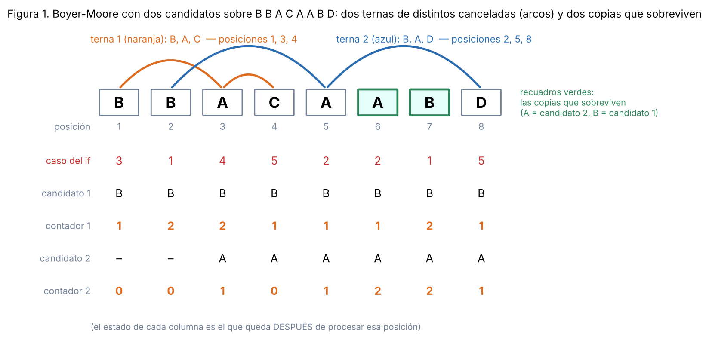
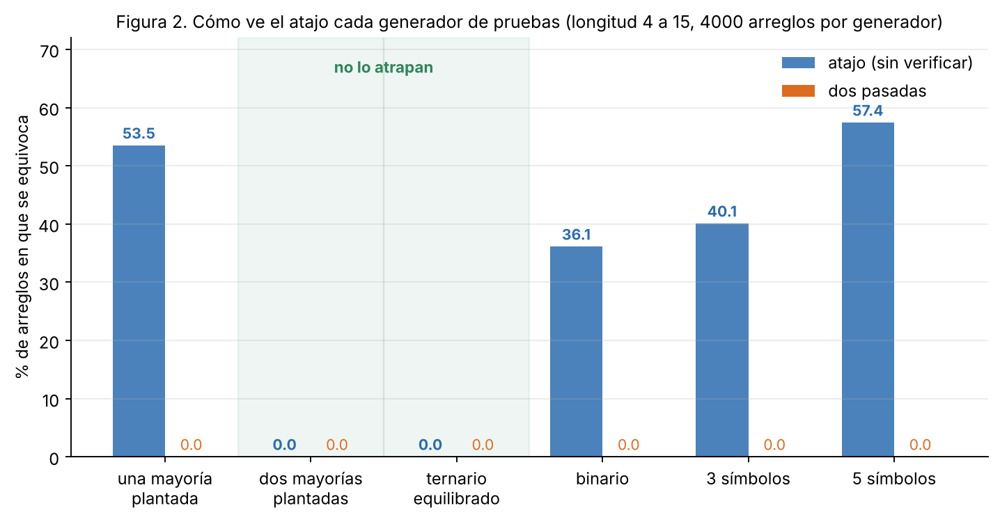
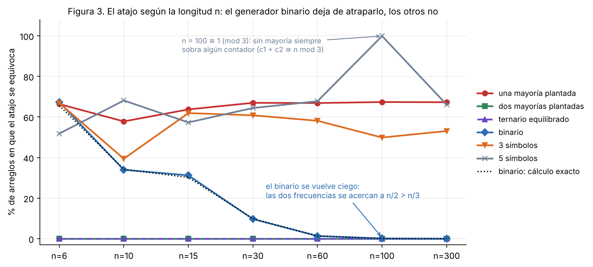

# Tema 1 - Problema 8: 

El elemento que aparece más de $n/3$ veces. Generaliza Boyer-Moore con dos candidatos, enuncia el invariante reforzado y demuéstralo. Después escribe la versión que devuelve los candidatos con contador positivo sin verificarlos, y busca un generador de pruebas que no la atrape. Cuidado: el análogo del generador binario de la Conferencia 3 sí la atrapa. 

## Descripción y especificación del problema

### Formulación matemática
Dado un arreglo $A$ de $n$ elementos, se busca determinar el conjunto $H$ formado por todos los elementos cuya frecuencia en $A$ es **estrictamente mayor a $n/3$**. Formalmente:

$$H = \left\{ x \in A \;\middle|\; \mathrm{cnt}_A(x) > \frac{n}{3} \right\}$$

#### Lema 1 (Acotación del tamaño de la salida):
*El número de elementos que cumplen la condición es a lo sumo 2, es decir, $|H| \le 2$.*

**Demostración (por contradicción):**  
Supongamos que existen al menos 3 elementos distintos $x, y, z \in H$. Por definición de $H$:

$$\mathrm{cnt}_A(x) > \frac{n}{3}, \quad \mathrm{cnt}_A(y) > \frac{n}{3}, \quad \mathrm{cnt}_A(z) > \frac{n}{3}$$

Dado que $x, y, z$ son elementos distintos, las posiciones que ocupan en el arreglo son disjuntas. Por lo tanto, la suma de sus frecuencias no puede exceder el tamaño total del arreglo $n$:

$$n \ge \mathrm{cnt}_A(x) + \mathrm{cnt}_A(y) + \mathrm{cnt}_A(z) > \frac{n}{3} + \frac{n}{3} + \frac{n}{3} = n$$

Llegamos a la contradicción $n > n$. Por lo tanto, $|H| \le 2$, lo que garantiza que la salida contendrá 0, 1 o 2 elementos.

### Especificación formal

- **Precondición:** $A$ es una lista finita de $n \ge 0$ elementos comparables **únicamente por igualdad**.
- **Postcondición:** Se devuelve una lista o conjunto $R$ sin elementos repetidos tal que $x \in R \iff x \in H$.

### Modelo de cómputo y restricciones

El problema debe resolverse bajo el modelo de comparaciones por igualdad en una máquina Word RAM:

1. **Comparación exclusiva por igualdad ($=/ \neq$):** Los elementos representan identificadores opacos o registros sin una relación de orden total predefinida ($\le$ no está disponible).
2. **Memoria extra estricta $O(1)$:** Solo se permite un número constante de variables escalares, independientemente de $n$.
3. **Costo temporal $O(n)$:** Debe realizarse en tiempo lineal en el peor caso.

## Estrategias de solución

### Inviabilidad de enfoques intuitivos
Las soluciones directas quedan descartadas al no cumplir con el modelo de cómputo o con las restricciones de complejidad exigidas:

| Estrategia | Complejidad Temporal | Memoria Auxiliar | Motivo de rechazo |
| :--- | :---: | :---: | :--- |
| **Fuerza bruta** (contar cada elemento contra todos) | $\Theta(n^2)$ | $O(1)$ | No cumple con la cota de tiempo $O(n)$. |
| **Ordenar y consultar posiciones clave** | $O(n \log n)$ | $O(1)$ / $O(n)$ | Exige un orden total ($\le$) que los elementos no poseen. |
| **Tabla de frecuencias / Hash** | $O(n)$ esperado | $O(n)$ | Invalida la restricción de memoria extra $O(1)$. |

---

### Idea central: Cancelación por tríos de elementos distintos
Para resolver el problema en $O(n)$ tiempo y $O(1)$ memoria, extendemos el principio de cancelación del algoritmo de Boyer-Moore. En lugar de descartar parejas de elementos distintos, **descartaremos tríos de elementos mutuamente distintos**. 

Dado que ningún elemento con frecuencia estrictamente mayor a $n/3$ puede ser eliminado por completo al cancelar tríos distintos, los elementos válidos necesariamente sobrevivirán entre los candidatos al finalizar la primera pasada.

## Algoritmo

El algoritmo opera en dos pasadas consecutivas sobre el arreglo de entrada $A$ de tamaño $n$, logrando una complejidad temporal $O(n)$ y memoria auxiliar $O(1)$:

1. **Primera Pasada (Filtrado por cancelación de tríos):** Mantiene dos casillas, cada una con un candidato y un contador $(\text{cand}_1, c_1, \text{cand}_2, c_2)$. El contador representa el número de copias de ese candidato que aún no han sido canceladas. Procesa el arreglo de izquierda a derecha en tiempo constante $O(1)$ por elemento.
2. **Segunda Pasada (Verificación exacta):** Cuenta las apariciones reales en $A$ únicamente de los candidatos cuya casilla final quedó con contador $c > 0$, devolviendo aquellos que satisfacen la condición estricta $3 \cdot \mathrm{cnt}_A(\text{cand}) > n$.

---

### Mecanismo de la primera pasada (Tabla de Casos)

Al leer cada elemento $x \in A$, los casos se evalúan en estricto orden de prioridad. Los casos 3, 4 y 5 solo se alcanzan cuando $x$ no es ninguno de los dos candidatos activos:

| Caso | Condición | Acción | Significado algorítmico |
| :---: | :--- | :--- | :--- |
| **1** | $x == \text{cand}_1$ | $c_1 \leftarrow c_1 + 1$ | Una copia más del candidato 1 sin cancelar. |
| **2** | $x == \text{cand}_2$ | $c_2 \leftarrow c_2 + 1$ | Una copia más del candidato 2 sin cancelar. |
| **3** | $c_1 == 0$ | $\text{cand}_1 \leftarrow x, \; c_1 \leftarrow 1$ | La casilla 1 no tenía copias activas: se asigna a $x$. |
| **4** | $c_1 > 0$ y $c_2 == 0$ | $\text{cand}_2 \leftarrow x, \; c_2 \leftarrow 1$ | La casilla 2 no tenía copias activas: se asigna a $x$. |
| **5** | $c_1 > 0$ y $c_2 > 0$ | $c_1 \leftarrow c_1 - 1, \; c_2 \leftarrow c_2 - 1$ | **Cancelación de trío:** $x$, $\text{cand}_1$ y $\text{cand}_2$ son distintos. Se tacha una unidad de cada uno. |

> **Nota sobre casillas reactivadas:** Una casilla con contador $c = 0$ puede conservar temporalmente la etiqueta de un candidato viejo; si un nuevo elemento $x$ coincide con esa etiqueta, el caso 1 o 2 la reactiva incrementando su contador.



*Figura 1. Traza sobre $B\,B\,A\,C\,A\,A\,B\,D$ mostrando el caso del `if` ejecutado en cada posición. Los arcos unen los elementos de las dos ternas canceladas: $\{B,A,C\}$ en las posiciones 1, 3, 4 y $\{B,A,D\}$ en 2, 5, 8. Sobreviven $A$ (candidato 2) y $B$ (candidato 1), tantas copias como marcan los contadores.*

---

### Implementación en Python

```python
from typing import List, Any

def first_pass(arr: List[Any]):
    """
    First pass: cancels triplets of distinct elements.
    Returns the two potential candidates and their remaining counts.
    """
    cand1, count1 = None, 0
    cand2, count2 = None, 0

    for x in arr:
        if x == cand1:
            count1 += 1
        elif x == cand2:
            count2 += 1
        elif count1 == 0:
            cand1, count1 = x, 1
        elif count2 == 0:
            cand2, count2 = x, 1
        else:
            count1 -= 1
            count2 -= 1

    return cand1, count1, cand2, count2


def solution(arr: List[Any]) -> List[Any]:
    """
    Returns all elements appearing strictly more than n / 3 times in O(n) time and O(1) space.
    """
    n = len(arr)
    if n == 0:
        return []

    # First pass: Candidate selection via triplet cancellation
    cand1, count1, cand2, count2 = first_pass(arr)

    # Second pass: Exact verification of candidates with positive counts
    result = []
    for cand, count in [(cand1, count1), (cand2, count2)]:
        if count > 0 and 3 * arr.count(cand) > n:
            result.append(cand)

    return result
```

## El Invariante Reforzado

### Notación preliminar
Para formalizar el estado del algoritmo tras procesar los primeros $i$ elementos del arreglo ($0 \le i \le n$) definimos:

- **$P_i$:** Multiconjunto que representa el prefijo procesado $A[0 \dots i-1]$ (con $P_0 = \emptyset$).
- **$c \times x$:** Multiconjunto compuesto por $c$ copias del elemento $x$.
- **$\uplus$:** Unión de multiconjuntos (suma las multiplicidades de cada elemento).
- **Terna de elementos distintos:** Multiconjunto $\{u, v, w\}$ con $u, v, w$ mutuamente distintos ($u \neq v$, $u \neq w$, $v \neq w$).
- **Partición en ternas:** Un multiconjunto $T$ *se parte en ternas de distintos* si es unión de ternas mutuamente distintas.

El estado del algoritmo tras procesar $P_i$ se denota por $(\text{cand}_1, c_1, \text{cand}_2, c_2)$, donde $\text{cand}_1$ y $\text{cand}_2$ son los candidatos guardados en las casillas 1 y 2, y $c_1, c_2 \ge 0$ sus respectivos contadores.

### Enunciado del Invariante Reforzado

Tras procesar el prefijo $P_i$ ($0 \le i \le n$), con estado $(\text{cand}_1, c_1, \text{cand}_2, c_2)$, se satisfacen simultáneamente las tres propiedades siguientes:

- **(I1) Estructura de Cancelación:**  
  $P_i = T \;\uplus\; (c_1 \times \text{cand}_1) \;\uplus\; (c_2 \times \text{cand}_2)$ 
  donde $T$ es un multiconjunto que **se parte en ternas de elementos mutuamente distintos**.
- **(I2) Validez de Contadores:**  
  $c_1 \ge 0 \quad \text{y} \quad c_2 \ge 0.$
- **(I3) Distinción de Candidatos Activos:**  
  $\text{Si } c_1 > 0 \text{ y } c_2 > 0, \text{ entonces } \text{cand}_1 \neq \text{cand}_2.$

### Necesidad de las condiciones técnicas (I2) e (I3)

- **(I1)** representa la idea física del algoritmo: todo el prefijo procesado $P_i$ se compone de elementos descartados en tríos distintos ($T$), más las copias de los candidatos sobrevivientes ($c_1$ y $c_2$).
- **(I2)** asegura que no existan contadores negativos.
- **(I3)** es la regla de seguridad esencial para el **Caso 5 (cancelación)**: al leer un elemento $x$ distinto de ambos candidatos, el algoritmo descuenta $1$ a $c_1$ y $c_2$. Esto equivale a tachar la terna $\{x, \text{cand}_1, \text{cand}_2\}$. Para que esta terna sea válida (elementos distintos dos a dos), necesitamos garantizar que $\text{cand}_1 \neq \text{cand}_2$, justo lo que impone **(I3)**.

## Verificación Experimental del Invariante 

Antes de realizar la demostración formal por inducción, es conveniente comprobar empíricamente que el invariante $(I_1, I_2, I_3)$ es correcto. Para ello, construimos un oráculo de verificación que comprueba la validez del invariante tras procesar cada elemento.

### Lema de Caracterización de Partición en Ternas
Para evaluar la condición **(I1)** en el programa, necesitamos decidir si un multiconjunto $S$ se parte en ternas de distintos sin requerir una búsqueda por fuerza bruta.

> **Lema 2 (Caracterización de Partición en Ternas):**  
> *Un multiconjunto $S$ se parte en ternas de elementos mutuamente distintos si y solo si su tamaño $|S|$ es múltiplo de $3$ ($|S| \equiv 0 \pmod 3$) y ningún elemento aparece más de un tercio del total:*
> $max_{x \in S} \mathrm{cnt}_S(x) \le \frac{|S|}{3}$

### Comprobación Exhaustiva Canónica

Aprovechando que el algoritmo solo realiza comparaciones por igualdad, cualquier arreglo puede expresarse en su **forma canónica** (asignando el entero $0$ al primer símbolo visto, $1$ al segundo, etc.). 

Mediante un recorrido en árbol (DFS), generamos y evaluamos **todos los prefijos canónicos posibles hasta longitud $11$**, llamando a la función de verificación en cada paso.

```text
--- Canonical Exhaustive Search ---
Exhaustive search up to length 11: invariant holds across 820987 distinct canonical prefixes.
Branch executions per case: {1: 142417, 2: 142407, 3: 122555, 4: 267264, 5: 146344}

All tests and invariant checks passed successfully!
```

### Análisis de Resultados Experimentales
- **Garantía del $100\%$**: El invariante reforzado $(I_1, I_2, I_3)$ se cumplió sin un solo fallo en los $820\,987$ prefijos canónicos evaluados.
- **Cobertura Completa de Ramas**: Todas las ramas del if/elif/else se ejercitaron ampliamente (cada caso se ejecutó más de $120\,000$ veces), confirmando que ningún caso quedó sin evaluar.

Esta verificación experimental respalda la formulación del invariante y permite detectar posibles errores en su definición o en su implementación. Sin embargo, la garantía general de su validez se obtiene mediante la demostración formal por inducción presentada a continuación.

## Demostración Formal de Correctitud

### Teorema 1: Demostración del Invariante Reforzado

> **Teorema 1.** Para todo $i = 0, 1, \dots, n$, tras procesar el prefijo $P_i$, el estado $(\text{cand}_1, c_1, \text{cand}_2, c_2)$ satisface simultáneamente las condiciones $(I_1)$, $(I_2)$ e $(I_3)$.

#### **Demostración.**
Procedemos por inducción matemática sobre el tamaño del prefijo $i$.

---

#### **Caso Base ($i = 0$)**
- El prefijo es vacío: $P_0 = \emptyset$.
- El estado inicial es $(\text{None}, 0, \text{None}, 0)$.
- Tomando $T = \emptyset$ (que se parte trivialmente en cero ternas):
  - **(I1):** $P_0 = \emptyset \;\uplus\; (0 \times \text{None}) \;\uplus\; (0 \times \text{None}) = \emptyset$.
  - **(I2):** $c_1 = 0 \ge 0$ y $c_2 = 0 \ge 0$.
  - **(I3):** La condición se satisface vacuamente, pues no ocurre $c_1 > 0 \land c_2 > 0$.

---

#### **Paso Inductivo ($i \to i + 1$)**
**Hipótesis de Inducción (H.I.):** Asumimos que para un prefijo $P_i$ ($0 \le i < n$) con estado $(\text{cand}_1, c_1, \text{cand}_2, c_2)$, se cumplen $(I_1)$, $(I_2)$ e $(I_3)$, existiendo un multiconjunto $T$ que se parte en ternas de distintos tal que:
$$P_i = T \;\uplus\; (c_1 \times \text{cand}_1) \;\uplus\; (c_2 \times \text{cand}_2)$$

Sea $x = A[i]$ el elemento procesado en el paso $i+1$. El nuevo prefijo es $P_{i+1} = P_i \uplus \{x\}$. 

Evaluamos los **cinco casos mutuamente excluyentes** del algoritmo:

##### **Caso 1: $x == \text{cand}_1$**
- **Nuevo Estado:** $(\text{cand}_1, c_1 + 1, \text{cand}_2, c_2)$.
- **(I1):** $P_{i+1} = P_i \uplus \{x\} = T \uplus (c_1 \times \text{cand}_1) \uplus \{\text{cand}_1\} \uplus (c_2 \times \text{cand}_2) = T \uplus ((c_1 + 1) \times \text{cand}_1) \uplus (c_2 \times \text{cand}_2)$. Se sostiene $(I1)$ con el mismo $T$.
- **(I2):** $c_1 + 1 \ge 1 \ge 0$, y $c_2 \ge 0$ no cambia.
- **(I3):** Los candidatos no cambian. Si $c_2 > 0$, por H.I. se mantiene $\text{cand}_1 \neq \text{cand}_2$.

##### **Caso 2: $x \neq \text{cand}_1$ y $x == \text{cand}_2$**
- **Nuevo Estado:** $(\text{cand}_1, c_1, \text{cand}_2, c_2 + 1)$.
- **Demostración:** Simétrica al Caso 1, absorbiendo $x$ para incrementar $c_2$ a $c_2 + 1$ manteniendo la misma $T$.

##### **Caso 3: $x \notin \{\text{cand}_1, \text{cand}_2\}$ y $c_1 == 0$**
- **Nuevo Estado:** $(x, 1, \text{cand}_2, c_2)$.
- **(I1):** Como $c_1 = 0$, el término $(c_1 \times \text{cand}_1) = \emptyset$. Por H.I., $P_i = T \uplus (c_2 \times \text{cand}_2)$.  
  Así, $P_{i+1} = P_i \uplus \{x\} = T \uplus (1 \times x) \uplus (c_2 \times \text{cand}_2)$. Sostiene $(I1)$ con el mismo $T$ y nuevo candidato $\text{cand}_1' = x$.
- **(I2):** Contador $c_1' = 1 \ge 0$ y $c_2 \ge 0$.
- **(I3):** Si $c_2 > 0$, debemos verificar $\text{cand}_1' \neq \text{cand}_2$. Como $\text{cand}_1' = x$ y la condición del caso 3 impone $x \notin \{\text{cand}_1, \text{cand}_2\}$, se garantiza que $x \neq \text{cand}_2$.

##### **Caso 4: $x \notin \{\text{cand}_1, \text{cand}_2\}$, $c_1 > 0$ y $c_2 == 0$**
- **Nuevo Estado:** $(\text{cand}_1, c_1, x, 1)$.
- **Demostración:** Simétrica al Caso 3. 

##### **Caso 5: $x \notin \{\text{cand}_1, \text{cand}_2\}$, $c_1 > 0$ y $c_2 > 0$**
- **Nuevo Estado:** $(\text{cand}_1, c_1 - 1, \text{cand}_2, c_2 - 1)$.
- **Demostración de la Terna Válida:**  
  1. Dado que $c_1 > 0$ y $c_2 > 0$, por H.I. de **(I3)** se garantiza que $\text{cand}_1 \neq \text{cand}_2$.
  2. Al haber fallado los Casos 1 y 2, tenemos $x \neq \text{cand}_1$ y $x \neq \text{cand}_2$.
  3. Por lo tanto, el multiconjunto $\{x, \text{cand}_1, \text{cand}_2\}$ es una **terna de elementos mutuamente distintos**.
- **(I1):** Sustituyendo en la H.I.:
  $$P_{i+1} = P_i \uplus \{x\} = T \;\uplus\; (c_1 \times \text{cand}_1) \;\uplus\; (c_2 \times \text{cand}_2) \;\uplus\; \{x\}$$
  Reagrupando una copia de cada uno para formar la terna:
  $$P_{i+1} = \bigl(T \;\uplus\; \{x, \text{cand}_1, \text{cand}_2\}\bigr) \;\uplus\; ((c_1 - 1) \times \text{cand}_1) \;\uplus\; ((c_2 - 1) \times \text{cand}_2)$$
  Definiendo $T' = T \uplus \{x, \text{cand}_1, \text{cand}_2\}$, como $T$ se partía en ternas de distintos y $T'$ agrega una terna válida de distintos, $T'$ se parte en ternas de distintos. Sostiene $(I1)$.
- **(I2):** Como $c_1 > 0$ y $c_2 > 0$, eran enteros $\ge 1$, por lo que $c_1 - 1 \ge 0$ y $c_2 - 1 \ge 0$.
- **(I3):** Si los nuevos contadores continúan siendo positivos ($c_1 - 1 > 0$ y $c_2 - 1 > 0$), los candidatos no han cambiado, conservando $\text{cand}_1 \neq \text{cand}_2$ por H.I.

**Conclusión del Teorema 1:** Por inducción matemática, $(I1)$, $(I2)$ e $(I3)$ se satisfacen para todo $i = 0, \dots, n$. $\blacksquare$

---

### Teorema 2: Garantía del Filtro de Candidatos

> **Teorema 2.** Sea $(\text{cand}_1, c_1, \text{cand}_2, c_2)$ el estado resultante tras procesar el arreglo completo $A$ de longitud $n$. Si un elemento $y \in A$ satisface $3 \cdot \mathrm{cnt}_A(y) > n$, entonces obligado finaliza como candidato activo: $(y = \text{cand}_1 \text{ con } c_1 > 0) \lor (y = \text{cand}_2 \text{ con } c_2 > 0)$.

#### **Demostración (por Contradicción).**
Por el Teorema 1 aplicado a $i = n$, el arreglo completo $A$ se descompone en:
$$A = T \;\uplus\; (c_1 \times \text{cand}_1) \;\uplus\; (c_2 \times \text{cand}_2)$$
donde $T$ se parte en $t$ ternas de elementos mutuamente distintos.
Tomando la cardinalidad total de $A$:
$$n = |A| = |T| + c_1 + c_2 = 3t + c_1 + c_2 \implies 3t \le n$$

Supongamos, por contradicción, que existe un elemento $y$ tal que $3 \cdot \mathrm{cnt}_A(y) > n$, pero $y$ **no** es un candidato activo con contador positivo.
Esto implica que $y$ no aporta ninguna copia a los términos de candidatos activos:
- Si $y = \text{cand}_1$, debe ser $c_1 = 0$, haciendo $(c_1 \times \text{cand}_1) = \emptyset$.
- Si $y = \text{cand}_2$, debe ser $c_2 = 0$, haciendo $(c_2 \times \text{cand}_2) = \emptyset$.
- Si $y \notin \{\text{cand}_1, \text{cand}_2\}$, tampoco aparece en dichos términos.

En consecuencia, **todas las apariciones de $y$ en el arreglo $A$ deben residir exclusivamente dentro de $T$**.

Como $T$ se parte en $t$ ternas de elementos mutuamente distintos, **cada terna puede contener a lo sumo una única copia de $y$**. Por tanto, la cantidad total de copias de $y$ en $T$ está acotada superiormente por el número de ternas $t$:
$$\mathrm{cnt}_A(y) \le t \implies 3 \cdot \mathrm{cnt}_A(y) \le 3t \le n$$

Esta desigualdad **contradice directamente** nuestra hipótesis de que $3 \cdot \mathrm{cnt}_A(y) > n$. 

Por contradicción, si un elemento aparece estrictamente más de $n/3$ veces, es imposible que haya sido completamente descartado en la primera pasada: obligatoriamente debe terminar guardado en una de las dos casillas con contador positivo. $\blacksquare$

---

### Corolario 3 y Correctitud Total

> **Corolario 3 (Correctitud Parcial).** El algoritmo `solution(arr)` devuelve exactamente el conjunto de elementos que aparecen estrictamente más de $n/3$ veces en $A$, sin omitir ninguno y sin emitir duplicados.

*Demostración.* Sea $S$ el conjunto de candidatos con contador positivo: $a\in S$ si $c_1>0$ y $b\in S$ si $c_2>0$. Si $c_1,c_2>0$, por (I2) $a,b\ne\varnothing$ y por (I3) $a\ne b$: no hay repetidos. La segunda pasada devuelve $\{s\in S:3\cdot\mathrm{cuenta}_A(s)>n\}=S\cap H$. Por el Teorema 2, $H\subseteq S$, así que $S\cap H=H$. $\square$

**Terminación.** No hay ciclos `while`. La primera pasada es un `for` sobre los $n$ elementos: el potencial $\Phi=n-i$ es un entero no negativo que baja en 1 en cada vuelta. La segunda pasada recorre $A$ a lo sumo dos veces con `A.count`.

**Correctitud total** = correctitud parcial + terminación: para toda entrada que cumpla la precondición, termina y devuelve exactamente los elementos con más de $n/3$ apariciones. $\blacksquare$

## El atajo: devolver candidatos con contador positivo sin verificar

### Definición de la versión con atajo

Una optimización tentadora para evitar el segundo recorrido sobre el arreglo consiste en omitir la segunda pasada y devolver directamente todos los candidatos cuyo contador haya terminado en positivo:

```python
def shortcut_solution(arr: List[Any]) -> List[Any]:
    """INCORRECT SHORTCUT: returns candidates with count > 0 without second pass."""
    cand1, count1, cand2, count2 = first_pass(arr)
    return [cand for cand, count in [(cand1, count1), (cand2, count2)] if count > 0]
```

Sea $S$ el conjunto de candidatos devueltos por el atajo y $H = \{y \in A \mid 3 \cdot \mathrm{cnt}_A(y) > n\}$ el conjunto real de elementos mayoritarios.

- **Inclusión correcta ($H \subseteq S$):** Por el **Teorema 2**, todo elemento $y \in H$ sobrevive obligatoriamente en una de las dos casillas con contador positivo. Por tanto, el atajo **nunca comete omisiones** ($H \subseteq S$), garantizando que jamás olvida una mayoría real.
- **Inclusión falsa ($S \subseteq H$):** Conservar un contador positivo **no es condición suficiente** para ser mayoría. La inclusión $S \subseteq H$ es falsa porque el atajo retiene candidatos no mayoritarios cuyos contadores no fueron completamente cancelados en la primera pasada.

#### Contraejemplos Mínimos
- **$n = 3$, $A = [\text{'A'}, \text{'B'}, \text{'A'}]$:**  
  'A' y 'B' ocupan las casillas. 'A' tiene $c_1=2$ y 'B' tiene $c_2=1$. El atajo devuelve $S = [\text{'A'}, \text{'B'}]$, pero 'B' aparece $1$ sola vez y $3 \cdot 1 > 3$ es falso. Lo correcto es $H = [\text{'A'}]$.
- **$n = 4$, $A = [\text{'A'}, \text{'B'}, \text{'C'}, \text{'D'}]$:**  
  'A' y 'B' ocupan las casillas. 'C' cancela la terna $\{\text{'A'}, \text{'B'}, \text{'C'}\}$, y 'D' ocupa la casilla 1 con $c_1 = 1$. El atajo devuelve $S = [\text{'D'}]$ cuando la respuesta correcta es $H = []$.

---

### Qué generadores lo atrapan

Los generadores se comparan sobre arreglos de longitud 4 a 15 (con $n\le3$ no caben dos mayorías), 4000 arreglos por generador, contra el oráculo (`generators.py`, salida en `generators_output.txt`):

| Generador | Atajo se equivoca | Dos pasadas se equivocan |
|---|---:|---:|
| una mayoría plantada (el de siempre) | 53.5 % | 0.0 % |
| **dos mayorías plantadas** | **0.0 %** | 0.0 % |
| **ternario equilibrado** | **0.0 %** | 0.0 % |
| binario ($A$ o $B$ al azar) | 36.1 % | 0.0 % |
| 3 símbolos al azar | 40.1 % | 0.0 % |
| 5 símbolos al azar | 57.4 % | 0.0 % |



*Figura 2. Porcentaje de arreglos en que cada versión se equivoca según el generador. Con dos de ellos el atajo es indistinguible del algoritmo correcto.*
#### 

**Los que lo atrapan.**

- **Una mayoría plantada** (un elemento con $\lfloor n/3\rfloor+1$ copias y el resto al azar): atrapa el atajo en más de la mitad de los casos. En la Conferencia 3 el generador análogo (mayoría plantada) *no* atrapaba el atajo, porque con una sola casilla el único candidato era la mayoría. Aquí sobra una segunda casilla, que se llena con basura.
- **3 y 5 símbolos al azar:** el atajo falla en 40 % y 57 % respectivamente.
- **Binario.** en un arreglo binario **nunca se cancela una terna**, así que los contadores son las frecuencias exactas y el atajo devuelve los símbolos presentes. Se equivoca cuando algún símbolo presente tiene a lo sumo $n/3$ copias. 

  Hay un matiz importante: **el poder del generador binario se debe a que $n$ es chico**. La probabilidad exacta de error en un arreglo binario uniforme de longitud $n$ es
  $$\frac{1}{2^n}\sum_{k}\binom nk,\quad\text{sumando los }k\text{ con }1\le k\le n/3\ \text{ o }\ 1\le n-k\le n/3.$$
  Vale 65.6 % con $n=6$, 34.2 % con $n=10$, 9.9 % con $n=30$, 1.3 % con $n=60$ y 0.1 % con $n=100$: al crecer $n$ las dos frecuencias se acercan a $n/2>n/3$, hay dos mayorías y el atajo acierta. Los valores medidos concuerdan con los exactos dentro del error de muestreo (Figura 3).



*Figura 3. Porcentaje de arreglos en que se equivoca el atajo, según la longitud $n$ (2000 arreglos por punto). El binario cae hacia 0 siguiendo la fórmula exacta (línea punteada); los generadores con una sola mayoría o con alfabetos de 3 y 5 símbolos lo siguen atrapando en todas las longitudes probadas. El pico de "5 símbolos" en $n=100$ ocurre porque $100\equiv1\pmod 3$: sin mayoría, $c_1+c_2\equiv n\pmod 3$ obliga a que sobre algún contador.*

**Los dos que no lo atrapan.**

- **Dos mayorías plantadas.** Dos elementos distintos con más de $n/3$ copias cada uno. Se comprobó con 200 000 arreglos de longitud entre 4 y 300: 0 errores, mientras que el generador de una mayoría plantada falla en el 53–67 % (`generators_output.txt`).

- **Ternario equilibrado:** Tres símbolos con exactamente $n/3$ copias cada uno. Por $(I_1)$, el multiconjunto $T$ se descompone en $t$ ternas de elementos distintos. Como solo hay 3 símbolos, cada terna contiene una copia de cada uno. La frecuencia del símbolo fuera de las casillas exige que $t = n/3$, lo que fuerza $c_1 = c_2 = 0$. El atajo devuelve `[]` acertando siempre.

#### **Conclusión**
Un banco de pruebas deficiente formado únicamente por arreglos con $2$ mayorías o distribuciones perfectamente equilibradas será incapaz de detectar el error del atajo. Un conjunto de pruebas riguroso debe estratificar las entradas según el número de mayorías reales $|H| \in \{0, 1, 2\}$.


## Archivos

| Archivo | Contenido |
|---|---|
| `ejercicio_08.md` | Este informe |
| `extras_08/solution.py` | El algoritmo |
| `extras_08/invariant.py` | Invariante ejecutable |
| `extras_08/generators.py` / `extras_08/generators_output.txt` | Generadores de pruebas y experimentos  |
| `extras_08/fig/` | Figuras  |

