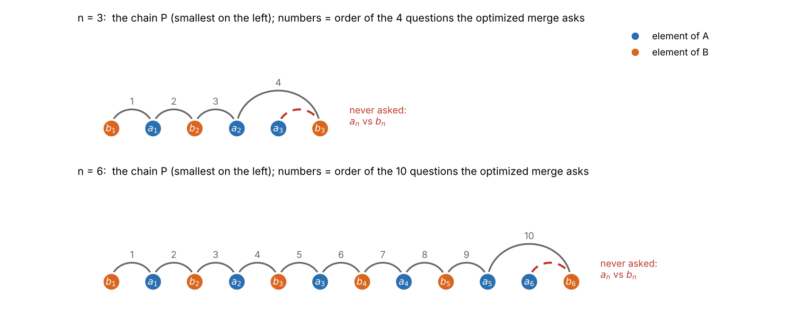
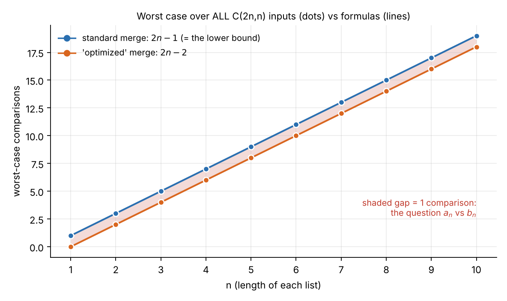
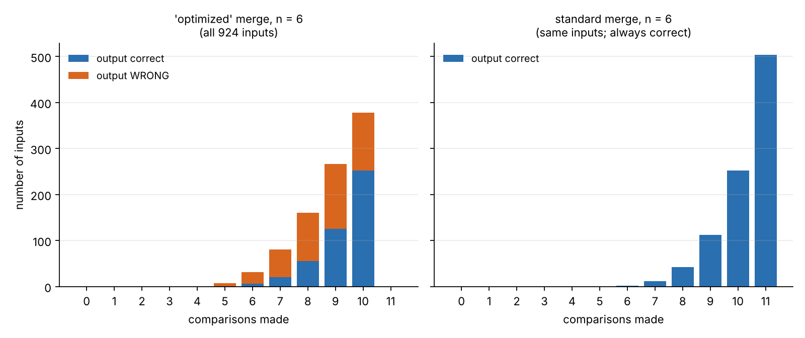

# Tema 1 - Problema 9

Una mezcla "optimizada" de dos listas ordenadas de largo deja de comparar cuando a la primera
lista le queda un solo elemento, y lo pone al final. Cuenta cuántas comparaciones hace en el peor caso.
Sin probarla, usa la sección 6 de la conferencia 5 para decidir si es correcta, y construye con el
adversario la entrada en la que falla.

### Conteo de comparaciones en el peor caso

Para que a la primera lista $A$ (de tamaño $n$) le quede un solo elemento sin comparar ($a_n$), el algoritmo debe haber extraído previamente $n - 1$ elementos de $A$. 

En el peor caso (donde las extracciones se alternan), antes de alcanzar esa condición el algoritmo también habrá extraído $n - 1$ elementos de la segunda lista $B$. Como cada extracción de un elemento requiere realizar exactamente una comparación entre los frentes de ambas listas:

$$\text{Comparaciones en el peor caso} = (n - 1) + (n - 1) = \mathbf{2n - 2 \text{ comparaciones}}$$

### Evaluación de correctitud mediante la Cota Mínima

En la **Conferencia 5 (Sección 6)** se demuestra formalmente mediante un argumento del adversario que mezclar dos listas ordenadas de tamaño $n$ requiere, en el peor caso, **al menos $2n - 1$ comparaciones**.

- **Cota Mínima Demostrada:** $2n - 1$ comparaciones.
- **Comparaciones de la mezcla "optimizada":** $2n - 2$ comparaciones.

Dado que la mezcla "optimizada" realiza estrictamente **una comparación menos que la cota mínima demostrada** ($2n - 2 < 2n - 1$), **sabemos con $100\%$ de certeza teórica que el algoritmo es INCORRECTO**, sin necesidad de ejecutarlo. Una cota mínima funciona como un detector de errores: ningún algoritmo correcto basado en comparaciones puede resolver el problema realizando menos comparaciones en el peor caso que las que exige la cota.

## Formalización Matemática del Adversario

### Marco del Modelo de Cómputo
Trabajamos en el **modelo de comparaciones** sobre un conjunto de elementos pertenecientes a un orden total estricto $(\Omega, <)$. Dado un algoritmo de mezcla, este accede a las entradas únicamente mediante consultas del tipo *"¿es $`x < y`$?"*.

Sean las dos listas de entrada $A = [a_1, a_2, \dots, a_n]$ y $B = [b_1, b_2, \dots, b_n]$, ordenadas individualmente:
$a_1 < a_2 < \dots < a_n \quad \text{y} \quad b_1 < b_2 < \dots < b_n$

---

### Definición del Adversario y la Relación $P$
El **Adversario** no fija una entrada concreta al inicio de la ejecución. En su lugar, responde dinámicamente a cada comparación manteniendo la consistencia con una cadena de ordenamiento total objetivo $P$:

$P: \quad b_1 < a_1 < b_2 < a_2 < \dots < b_{n-1} < a_{n-1} < a_n < b_n$

Para cualquier comparación realizada por $\text{ALG}$ entre un elemento $a_i \in A$ y un elemento $b_j \in B$, la **función de respuesta del Adversario** $f(a_i, b_j)$ se define formalmente como:

$$f(a_i, b_j) = \begin{cases} a_i < b_j & \text{si } i < j \quad \text{o si } (i = j = n) \\ b_j < a_i & \text{si } j \le i \quad \text{con } (i, j) \neq (n, n) \end{cases}$$

> **Lema de Consistencia:** La función $f$ preserva la transitividad y no introduce ciclos con los órdenes parciales preexistentes de $A$ y $B$. Por lo tanto, el conjunto de asignaciones reales de valores numéricos consistentes con $f$ es siempre no vacío.

## Traza del Peor Caso ($2n - 2$ comparaciones) y Punto Ciego

Sea $\text{ALG}$ el algoritmo de mezcla "optimizado" del **Ejercicio 9**, cuya regla de parada interrumpe el bucle de comparaciones en el primer instante en que a la lista $A$ le queda exactamente $1$ solo elemento ($|A| = 1$).

### Lema de Extracción Bajo $f$
En cada paso de comparación $k \in \{1, 2, \dots, 2n - 2\}$, el frente no vaciado de las listas contiene a los elementos $a_m$ y $b_l$:

1. **Paso impar ($k = 2m - 1$):** $\text{ALG}$ compara $a_m$ contra $b_m$. Como $m \le m$, $f(a_m, b_m) = \text{"}b_m < a_m\text{"}$. Se extrae $b_m$ a la salida.
2. **Paso par ($k = 2m$):** $\text{ALG}$ compara $a_m$ contra $b_{m+1}$. Como $m < m+1$, $f(a_m, b_{m+1}) = \text{"}a_m < b_{m+1}\text{"}$. Se extrae $a_m$ a la salida.

### Estado de Parada tras $2n - 2$ Comparaciones
Tras $2n - 2$ comparaciones exactas:
- Se han extraído $n - 1$ elementos de $A$ ($a_1, a_2, \dots, a_{n-1}$).
- Se han extraído $n - 1$ elementos de $B$ ($b_1, b_2, \dots, b_{n-1}$).
- Las listas restantes en memoria son $A = [a_n]$ (longitud $1$) y $B = [b_n]$ (longitud $1$).

## Demostración de Incorrectitud por Contradicción

1. **Requerimiento de la Salida Correcta:** La cadena $P$ del Adversario especifica la relación $a_n < b_n$.
2. **Punto Ciego:** $\text{ALG}$ nunca llegó a realizar la comparación entre $a_n$ y $b_n$.
3. **Acción del Atajo:** $\text{ALG}$ interrumpe las comparaciones, vuelca los elementos restantes de $B$ ($[b_n]$) a la salida y coloca $a_n$ al final de todo.
4. **Contradicción de Salida:** La secuencia producida por $\text{ALG}$ finaliza en $\dots, b_n, a_n$, imponiendo el orden $b_n < a_n$. Esto contradice directamente la relación $a_n < b_n$ exigida por $P$. $\blacksquare$

## Ejemplo ($n = 3$)

Para $n = 3$, el peor caso del algoritmo realiza $2n - 2 = 4$ comparaciones, mientras que la cota mínima exige $2n - 1 = 5$ comparaciones.

### Asignación de Valores Reales
Elegimos valores numéricos que satisfacen la cadena $P$ ($b_1 < a_1 < b_2 < a_2 < a_3 < b_3$):
- **Lista A:** $A = [2, 4, 5]$ (donde $a_1 = 2, a_2 = 4, a_3 = 5$)
- **Lista B:** $B = [1, 3, 6]$ (donde $b_1 = 1, b_2 = 3, b_3 = 6$)

*Comprobación de la cadena:* $1 < 2 < 3 < 4 < 5 < 6$ (satisface $P$).

---

### Tabla Paso a Paso de la Ejecución

| Paso ($k$) | Comparación | Evaluación de $f$ | Resultado | Elemento Extraído | Estado de $A$ y $B$ |
| :---: | :---: | :---: | :---: | :---: | :---: |
| **Inicio** | — | — | — | — | $A=[2, 4, 5], B=[1, 3, 6]$ |
| **$k = 1$** | $a_1 (2)$ vs $b_1 (1)$ | $1 \le 1 \implies b_1 < a_1$ | $1 < 2$ | Sale $b_1 = 1$ | $A=[2, 4, 5], B=[3, 6]$ |
| **$k = 2$** | $a_1 (2)$ vs $b_2 (3)$ | $1 < 2 \implies a_1 < b_2$ | $2 < 3$ | Sale $a_1 = 2$ | $A=[4, 5], B=[3, 6]$ |
| **$k = 3$** | $a_2 (4)$ vs $b_2 (3)$ | $2 \le 2 \implies b_2 < a_2$ | $3 < 4$ | Sale $b_2 = 3$ | $A=[4, 5], B=[6]$ |
| **$k = 4$** | $a_2 (4)$ vs $b_3 (6)$ | $2 < 3 \implies a_2 < b_3$ | $4 < 6$ | Sale $a_2 = 4$ | $A=[5], B=[6]$ |

### Activación del Atajo y Salida Producida
- Al finalizar el paso $k = 4$, a la lista $A$ le queda un solo elemento ($A = [5] \implies |A| = 1$).
- **Se activa la regla de parada:** El algoritmo interrumpe el bucle de comparaciones.
- Vuelca la lista $B$ restante ($[6]$) a la salida y pega el elemento restante de $A$ ($5$) al final.

`Salida producida por el algoritmo:` [1, 2, 3, 4, 6, 5]  (INCORRECTO) 

`Salida real correcta esperada:` [1, 2, 3, 4, 5, 6]

## Experimentos 

Aunque la incorrectitud de la mezcla optimizada ya queda demostrada mediante el argumento del adversario, se realizaron varios experimentos complementarios para visualizar su comportamiento y verificar los resultados obtenidos teóricamente. 

### Experimento 1: Evaluación Exhaustiva sobre Todas las Entradas ($n = 1 \dots 10$)
Se generan y ejecutan todas las $\binom{2n}{n}$ combinaciones posibles de entrelazado de dos listas ordenadas $A$ y $B$ de tamaño $n$ para todo $n \in \{1, 2, \dots, 10\}$.
* **¿Qué se prueba?:** Se evalúa si el atajo de la mezcla optimizada preserva la correctitud general y si logra acotar el peor caso a $2n - 2$ comparaciones sin fallar.
* **Resultados obtenidos:**
  - El peor caso de la mezcla optimizada alcanza efectivamente $2n - 2$ comparaciones (frente a $2n - 1$ de la estándar).
  - La mezcla optimizada **falla exactamente en el 50% de las entradas posibles** ($\text{fracción} = 0.500$) para todos los tamaños probados ($126/252$ en $n=5$, $92.378/184.756$ en $n=10$).

---

### Experimento 2: Traza Paso a Paso y Verificación Manual ($n = 3$)
* **¿Qué se hace?:** Se rastrea el estado interno del atajo paso a paso sobre la entrada manual $A = [2, 4, 5]$ y $B = [1, 3, 6]$.
* **¿Qué se prueba?:** Se identifica el momento exacto de la ejecución donde el algoritmo desvía su lógica y produce una salida errónea.
* **Resultados obtenidos:**
  - **Paso 1 ($k=1$):** Compara $a_1(2)$ vs $b_1(1) \implies b_1 < a_1$. Extrae $1$.
  - **Paso 2 ($k=2$):** Compara $a_1(2)$ vs $b_2(3) \implies a_1 < b_2$. Extrae $2$.
  - **Paso 3 ($k=3$):** Compara $a_2(4)$ vs $b_2(3) \implies b_2 < a_2$. Extrae $3$.
  - **Paso 4 ($k=4$):** Compara $a_2(4)$ vs $b_3(6) \implies a_2 < b_3$. Extrae $4$.
  - **Terminación prematura:** El atajo finaliza tras $4$ comparaciones y emite la salida $[1, 2, 3, 4, 6, 5]$ (**incorrecta**, invierte los dos últimos elementos) en lugar de $[1, 2, 3, 4, 5, 6]$.

---

### Experimento 3: Identificación del Punto Ciego (*Blind Spot*)
* **¿Qué se hace?:** Se analiza el conjunto de $2n - 2$ pares cruzados adyacentes en la secuencia perfectamente intercalada $P$ y se compara con la traza de preguntas efectuadas.
* **¿Qué se prueba?:** Se busca determinar qué par de elementos vecinos en el orden real nunca llega a ser comparado por el algoritmo optimizado.
* **Resultados obtenidos:**
  - El algoritmo optimizado **omite siempre la comparación directa del par $\{a_n, b_n\}$**.

<em>Figura 1. La cadena $P$ ($n=3$ y $n=6$), los elementos de $A$ en azul y los de $B$ en naranja. Los arcos grises numerados son las preguntas que hace la mezcla "optimizada", en orden. El arco rojo discontinuo es la pregunta que nunca hace: $a_n$ contra $b_n$.</em>

---

### Experimento 4: Invisibilidad del Intercambio ante el Adversario
* **¿Qué se hace?:** Se construye la entrada crítica $P$ y una variante $P'$ donde se intercambian de posición únicamente los elementos $a_n$ y $b_n$, ejecutando el atajo sobre ambas.
* **¿Qué se prueba?:** Se comprueba si el atajo es capaz de distinguir dos entradas distintas que solo difieren en su punto ciego.
* **Resultados obtenidos:**
  - La traza de comparaciones generada por el atajo en $P$ y $P'$ es **exactamente idéntica**.
  - En consecuencia, el algoritmo produce exactamente la misma salida para ambas entradas. Al ser la salida correcta para $P'$, resulta **necesariamente incorrecta para $P$**.
  - La mezcla estándar realiza la comparación entre $a_n$ y $b_n$, obteniendo la información que el algoritmo optimizado omite.

---

### Experimento 5: Caracterización Matemática del Criterio de Fallo
* **¿Qué se hace?:** Se probaron las $\binom{2n}{n}$ formas de intercalar $A$ y $B$ .
* **¿Qué se prueba?:** Se busca hallar la condición matemática exacta que determina cuándo el atajo acierta y cuándo falla.

| $n$ | entradas | peor caso "optimizada" | $2n-2$ | peor caso estándar | $2n-1$ | entradas donde falla | fracción |
| :-: | -: | :-: | :-: | :-: | :-: | -: | :-: |
| 1 | 2 | 0 | 0 | 1 | 1 | 1 | 0.500 |
| 2 | 6 | 2 | 2 | 3 | 3 | 3 | 0.500 |
| 3 | 20 | 4 | 4 | 5 | 5 | 10 | 0.500 |
| 4 | 70 | 6 | 6 | 7 | 7 | 35 | 0.500 |
| 5 | 252 | 8 | 8 | 9 | 9 | 126 | 0.500 |
| 6 | 924 | 10 | 10 | 11 | 11 | 462 | 0.500 |
| 7 | 3 432 | 12 | 12 | 13 | 13 | 1 716 | 0.500 |
| 8 | 12 870 | 14 | 14 | 15 | 15 | 6 435 | 0.500 |
| 9 | 48 620 | 16 | 16 | 17 | 17 | 24 310 | 0.500 |
| 10 | 184 756 | 18 | 18 | 19 | 19 | 92 378 | 0.500 |

*Figura 2. Peor caso medido sobre todas las entradas (puntos) y fórmulas (líneas). La zona sombreada es la comparación que le falta a la "optimizada".*

* **Resultados obtenidos:**
  - El atajo funciona correctamente si y solo si el máximo global pertenece a $A$ ($a_n > b_n$).
  - El atajo **falla si y solo si el máximo global pertenece a $B$ ($a_n < b_n$)**.
  - Dado que por simetría el máximo pertenece a $B$ en exactamente la mitad de las permutaciones posibles, esto demuestra teóricamente por qué el error es **del 50%**.

<em>Figura 3. Con $n=6$ (924 entradas): cuántas comparaciones hace cada mezcla y si su salida es correcta. La "optimizada" nunca llega a 11 comparaciones, y en todas las columnas donde hay entradas (de 5 a 10 comparaciones) hay también entradas incorrectas; la estándar es siempre correcta.*</em>

Por ejemplo, con $n=6$ la "optimizada" hace 10 comparaciones en 378 entradas (252 correctas y 126 incorrectas) y la estándar hace 11 comparaciones en 504.

## Conclusiones

El análisis demuestra que la mezcla optimizada realiza como máximo $2n-2$ comparaciones, una menos que la cota mínima de $2n-1$ necesaria en el peor caso para mezclar correctamente dos listas ordenadas de tamaño $n$. Mediante el argumento del adversario se construye una entrada en la que el algoritmo omite la comparación entre los últimos elementos de ambas listas y, como consecuencia, los coloca en el orden incorrecto.

Además, se identifica la condición exacta bajo la cual el atajo falla: ocurre cuando el máximo global pertenece a la lista $B$, es decir, cuando $a_n<b_n$. La enumeración exhaustiva de los entrelazados posibles confirma que esta situación ocurre en exactamente la mitad de los casos evaluados.

Por tanto, aunque el atajo consigue reducir en una comparación el peor caso respecto a la mezcla estándar, lo hace sacrificando la correctitud. Esto demuestra que reducir el número de operaciones no constituye necesariamente una optimización válida: también es imprescindible garantizar que el algoritmo produzca una respuesta correcta para todas las entradas posibles.

## Archivos

| Archivo | Contenido |
|---|---|
| `ejercicio_09.md` | Este informe |
| `extras_09/experiments.py` | Experimentos |
| `extras_09/experiments_output.txt` | Salida experimentos |
| `extras_09/fig/` | Figuras |

