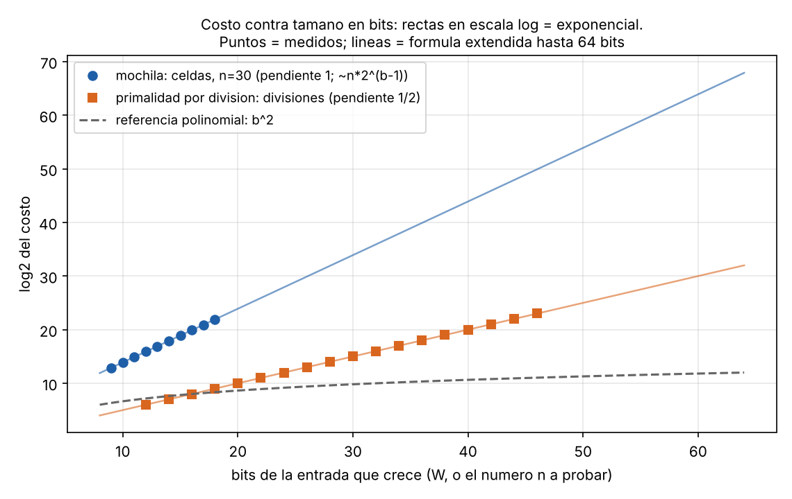

# Tema 1 - Problema 11

La mochila entera se resuelve con programación dinámica en $O(nW)$, donde $W$ es la capacidad de la mochila.

Mide el tamaño de la entrada en bits, como en la sección 8 de la conferencia 1.

1. ¿Es polinomial ese algoritmo?
2. ¿En qué se parece a la primalidad por división?

## Medición del tamaño de la entrada en bits

Para analizar la eficiencia de un algoritmo, debemos considerar el tamaño de la entrada, es decir, la cantidad de bits necesarios para representar todos los datos del problema.

En el problema de la mochila tenemos:

- $n$: cantidad de objetos.
- $W$: capacidad máxima de la mochila.
- $p_i$: peso del objeto $i$.
- $v_i$: valor del objeto $i$.

Por tanto, al representar los números en binario, el tamaño de la entrada es:

$$L = \operatorname{bits}(n)+\operatorname{bits}(W)
+\sum_{i=1}^{n}\operatorname{bits}(p_i)
+\sum_{i=1}^{n}\operatorname{bits}(v_i).$$

Para un entero positivo $x$, la cantidad de bits necesarios para representarlo es:

$$\operatorname{bits}(x)=\lfloor\log_2 x\rfloor+1.$$

El caso $x=0$ requiere un bit para su representación.

Es importante distinguir entre el número de objetos y los valores numéricos que describen cada uno. Al aumentar $n$, también aumenta la cantidad de datos que forman la entrada, pues debemos representar el peso y el valor de cada objeto.

Sin embargo, el parámetro $W$ tiene una particularidad: aunque su representación binaria necesita solamente

$$b_W=\lfloor\log_2 W\rfloor+1$$

bits, el algoritmo de programación dinámica utiliza su **valor numérico** para determinar el tamaño de la tabla.

En efecto, para cada objeto se consideran todas las capacidades desde $0$ hasta $W$. Por tanto, el costo del algoritmo crece proporcionalmente al valor de $W$, no a la cantidad de bits que se necesitan para representarlo.

Esta diferencia es fundamental para determinar si el algoritmo es polinomial respecto al tamaño de la entrada.

## ¿Es polinomial el algoritmo?

**No, el algoritmo no es polinomial respecto al tamaño de la entrada en bits.**

La programación dinámica tiene una complejidad temporal de:

$$T(n,W)=\Theta(n(W+1))=\Theta(nW)$$

para $W\geq 1$, considerando el costo constante de procesar cada celda de la tabla.

Aunque esta complejidad es polinomial en el valor numérico de $W$, no necesariamente lo es respecto a la cantidad de bits utilizados para representarlo.

Para demostrarlo, consideremos una familia de entradas en la que:

$$n=1,\qquad p_1=1,\qquad v_1=1,\qquad W=2^b-1.$$

Como $W=2^b-1$, su representación binaria necesita exactamente $b$ bits.

El tamaño total de esta entrada es:

$$L=\operatorname{bits}(1)+\operatorname{bits}(2^b-1)
+\operatorname{bits}(1)+\operatorname{bits}(1).$$

Por tanto:

$$L=1+b+1+1=b+3.$$

Por otra parte, el algoritmo calcula una tabla con $n(W+1)$ celdas. Para esta familia de entradas:

$$T(1,W)=1\cdot(2^b-1+1)=2^b.$$

Como $b=L-3$, podemos expresar el costo en función del tamaño de la entrada:

$$T(L)=2^{L-3}.$$

Esta función crece exponencialmente respecto a $L$. En particular, para cualquier constante $k$:

$$\lim_{L\to\infty}\frac{2^{L-3}}{L^k}=\infty.$$

Por tanto, no existe un polinomio en el tamaño de la entrada que acote el costo del algoritmo para todas las entradas.

En consecuencia, **el algoritmo no es polinomial respecto al tamaño de la entrada en bits**.

Este tipo de complejidad se denomina **pseudopolinomial**: el algoritmo es polinomial respecto a los valores numéricos de sus parámetros, pero puede ser exponencial respecto a la cantidad de bits necesarios para representarlos.

## ¿En qué se parece a la primalidad por división?

La similitud está en que ambos algoritmos dependen del valor numérico de un entero, cuyo tamaño puede ser exponencial respecto a la cantidad de bits necesarios para representarlo.

En el algoritmo de primalidad por división, para determinar si un número $N$ es primo, basta comprobar posibles divisores hasta $\sqrt{N}$.

Si $N$ necesita $b$ bits para representarse, entonces:

$$
N<2^b.
$$

Por tanto:

$$
\sqrt{N}<2^{b/2}.
$$

Así, en el peor caso, el número de divisiones que realiza el algoritmo puede crecer exponencialmente respecto a la cantidad de bits de la entrada.

De manera análoga, en el problema de la mochila, el algoritmo realiza $O(nW)$ operaciones, aunque la representación binaria de $W$ necesita solamente $\Theta(\log W)$ bits.

En ambos casos, el algoritmo puede parecer eficiente si consideramos el valor numérico del parámetro, pero resultar exponencial cuando medimos el costo respecto al tamaño de su representación en bits.

### Representación gráfica del crecimiento

Para visualizar la diferencia entre el crecimiento del costo de ambos algoritmos y el de una función polinomial, podemos representar el logaritmo del costo en función de la cantidad de bits del parámetro que determina su crecimiento.

En la mochila se mantiene fija la cantidad de objetos $(n=30)$ y se observa cómo aumenta el número de celdas al incrementar los bits de $W$. Para la primalidad por división se considera cómo aumenta el número de divisiones al incrementar los bits de $N$.

La gráfica utiliza una escala logarítmica en el eje vertical, por lo que un crecimiento exponencial se representa mediante una recta.

**De la gráfica podemos observar lo siguiente:**

**Mochila:** la pendiente de 1 indica que el logaritmo del costo crece aproximadamente de forma lineal con los bits de $W$. Esto corresponde a un crecimiento exponencial del costo respecto a dichos bits, ya que el número de celdas es proporcional a $2^b$, manteniendo fijo $n$.

**Primalidad por división:** la pendiente de $1/2$ refleja que el costo crece aproximadamente como $2^{b/2}$, debido a que basta probar divisores hasta $\sqrt N$.

**Referencia polinomial:** la curva correspondiente a $b^2$ crece mucho más lentamente que los costos exponenciales representados.

## Archivos

| Archivo | Contenido |
|---|---|
| `ejercicio_11.md` | Este informe |
| `extras_11/fig` | Figuras |