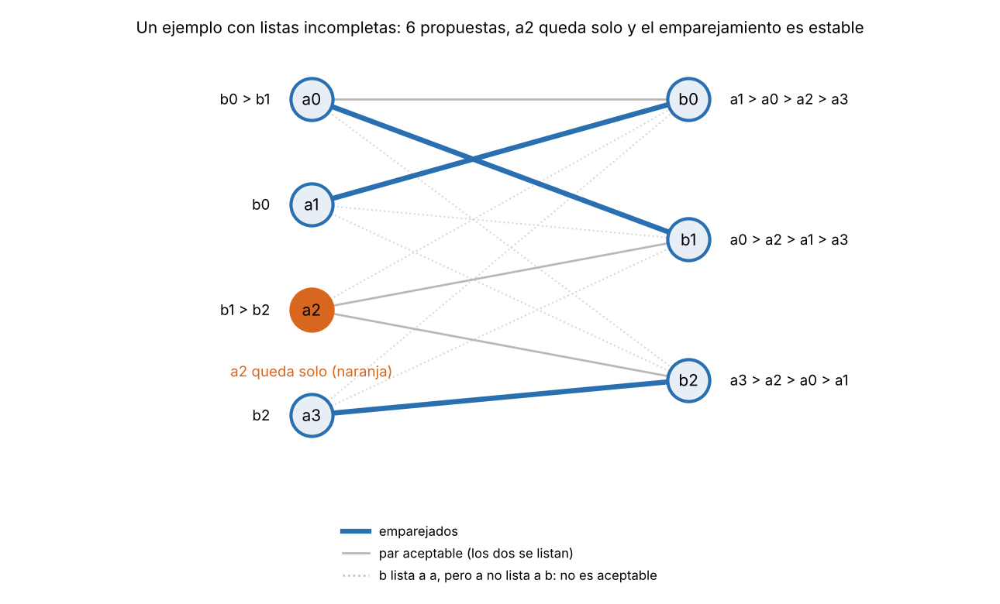

# Tema 1 - Problema 12

Gale-Shapley con listas incompletas: cada proponente lista solo a algunos receptores, y prefiere
quedarse solo antes que con uno que no listó. Adapta el algoritmo, su potencial y la definición de
pareja bloqueante. ¿Sigue siendo estable el resultado? Demuéstralo.

## El Problema 

### Contexto y Preferencias

Tenemos un conjunto $A = \{a_1, \dots, a_n\}$ de proponentes y un conjunto $B = \{b_1, \dots, b_m\}$ de receptores.
1. Listas Incompletas: Cada proponente $a \in A$ posee una lista estricta de preferencias $L(a) \subseteq B$ que contiene únicamente a los receptores que considera aceptables. De igual forma, cada receptor $b \in B$ posee una lista $L(b) \subseteq A$ con los proponentes aceptables para él.

2. Aceptabilidad y Racionalidad Individual: 
  * Para un proponente $a$, si $b \notin L(a)$, se considera que $a$ prefiere quedarse solo antes que estar emparejado con $b$ ($a \succ b$).
  * Una pareja $(a, b)$ es mutuamente aceptable si y solo si $b \in L(a)$ y $a \in L(b)$.
  
3. Emparejamiento $M$: Es un conjunto de parejas $(a, b)$ tal que cada integrante pertenece a lo sumo a una pareja. Un integrante no emparejado se encuentra libre/solo (se representa como $M(a) = a$ o $M(b) = b$).

### Adaptación de la Pareja Bloqueante y Estabilidad

En un escenario con listas incompletas, la estabilidad exige no solo la ausencia de incentivos cruzados entre parejas, sino también la racionalidad individual (nadie debe estar con alguien inaceptable):

**Racionalidad Individual:** Un emparejamiento $M$ es individualmente racional si para toda pareja $(a, b) \in M$, el par es mutuamente aceptable ($b \in L(a)$ y $`a \in L(b)`$).

**Pareja Bloqueante (Adaptada):** Un par $(a, b) \in A \times B$ constituye una pareja bloqueante para un emparejamiento $M$ si cumple las tres condiciones siguientes:
- Aceptabilidad mutua: $b \in L(a)$ y $a \in L(b)$.
- Preferencia de $a$: $a$ está solo ($M(a) = a$) o bien $a$ prefiere a $b$ sobre su pareja actual $M(a)$ ($`b \succ_a M(a)`$).
- Preferencia de $b$: $b$ está solo ($M(b) = b$) o bien $b$ prefiere a $a$ sobre su pareja actual $M(b)$ ($`a \succ_b M(b)`$).

**Estabilidad:** Un emparejamiento $M$ es estable si es individualmente racional y no contiene ninguna pareja bloqueante.

## Adaptación del Algoritmo de Gale-Shapley

### Lógica de la Aceptación Diferida

El algoritmo modifica las propuestas para garantizar que ningún proponente proponga a alguien fuera de su lista y ningún receptor acepte propuestas de personas inaceptables

```python
def gale_shapley_incompleto(pref_a, pref_b, orden="cola", semilla=0):
    rango_b = [{a: lugar for lugar, a in enumerate(l)} for l in pref_b]   # rango_b[b][a]
    siguiente = [0] * len(pref_a)               # a que lugar de su lista propone cada a
    pareja_de_b = [None] * len(pref_b)
    libres = deque(a for a in range(len(pref_a)) if pref_a[a])   # libres con a quien proponerle
    while libres:
        a = ...                                 # cola, pila o al azar
        b = pref_a[a][siguiente[a]]; siguiente[a] += 1
        actual = pareja_de_b[b]
        rechazado = False
        if a not in rango_b[b]:                 # b no lista a a: lo rechaza
            rechazado = True
        elif actual is None:                    # b libre y aceptable: acepta
            pareja_de_b[b] = a
        elif rango_b[b][a] < rango_b[b][actual]:   # b prefiere a a: cambia
            pareja_de_b[b] = a;  si_le_queda(actual) -> libres.append(actual)
        else:
            rechazado = True
        if rechazado and siguiente[a] < len(pref_a[a]): libres.append(a)
```

Cambios respecto a C3:

1. **El proponente propone solo dentro de su lista** (`pref_a[a]` ya es incompleta); un proponente con lista vacía nunca entra a la cola.
2. **El receptor rechaza a quien no lista** (`a not in rango_b[b]`).
3. **Un proponente rechazado, o desplazado, vuelve a la cola solo si le queda a quién proponerle.** Si agotó su lista, sale y **queda solo**: es el único cambio de fondo.

El algoritmo permite distintos órdenes de ejecución, dependiendo de cómo se seleccione al siguiente proponente libre (por ejemplo, mediante una cola, una pila o una elección aleatoria). Sin embargo, la garantía de estabilidad del resultado se mantiene independientemente del orden en que se procesen los proponentes.

**Traza de un ejemplo** ($L(a_0)=[b_0,b_1]$, $L(a_1)=[b_0]$, $L(a_2)=[b_1,b_2]$, $L(a_3)=[b_2]$; receptores con listas completas: $b_0:a_1>a_0>a_2>a_3$, $b_1:a_0>a_2>a_1>a_3$, $b_2:a_3>a_2>a_0>a_1$):

| Paso | Propone | A | Tenía | Resultado |
|---:|---|---|---|---|
| 1 | $a_0$ | $b_0$ | — | acepta |
| 2 | $a_1$ | $b_0$ | $a_0$ | cambia ($b_0$ prefiere a $a_1$); $a_0$ queda libre |
| 3 | $a_2$ | $b_1$ | — | acepta |
| 4 | $a_3$ | $b_2$ | — | acepta |
| 5 | $a_0$ | $b_1$ | $a_2$ | cambia ($b_1$ prefiere a $a_0$); $a_2$ queda libre |
| 6 | $a_2$ | $b_2$ | $a_3$ | rechaza ($b_2$ prefiere a $a_3$); **$a_2$ agotó su lista y queda solo** |

Resultado: $`a_0`$–$`b_1`$, $`a_1`$–$`b_0`$, $`a_3`$–$`b_2`$; $`a_2`$ solo. Son 6 propuestas, y $`\ell=6`$. Es estable, y es el único emparejamiento estable de la instancia. Nótese que $`b_0`$ lista a $`a_2`$, pero $`a_2`$ no lista a $`b_0`$: el par no es aceptable y no puede bloquear (figura 1).



## Demostración de Terminación mediante Función de Potencial

### Definición del Potencial ($\Phi$)

Definimos la función de potencial $\Phi$ como el número total de parejas aceptables $(a, b)$ tales que $b \in L(a)$ y $a$ aún no le ha propuesto a $b$:
$$\Phi = \sum_{a \in A} \Big( |L(a)| - \text{siguiente}[a] \Big)$$

### Propiedades de $\Phi$

1. Acotación Superior Inicial:
$$\Phi_0 = \sum_{a \in A} |L(a)| \le n \cdot m$$

2. Cota Inferior:
$$\Phi \ge 0 \quad \text{en todo momento, pues } 0 \le \text{siguiente}[a] \le |L(a)|$$

3. Decrecimiento Estricto:
En cada iteración del bucle while, un proponente libre $a$ avanza su puntero siguiente[a] en 1 al realizar una propuesta. Por lo tanto, el potencial disminuye en exactamente 1 unidad por vuelta ($\Phi' = \Phi - 1$).

### Conclusión de Terminación

Al ser $\Phi$ una cantidad entera no negativa que decrece estrictamente en cada paso, el algoritmo termina determinísticamente en a lo sumo 

$\sum_{a} |L(a)| \le n \cdot m$ iteraciones. $\blacksquare$


## Lo que se pierde: el emparejamiento ya no es perfecto

En C3, el ciclo termina con un emparejamiento perfecto por un argumento de conteo. Con listas incompletas **no hay que demostrar eso, y es falso**: un proponente que agotó su lista queda solo, y lo único que se sabe es lo siguiente.

> **Lo que queda al terminar:** Si $a$ queda solo, entonces propuso a todos los de $L(a)$ y cada uno lo rechazó: o bien no lista a $a$, o bien terminó comprometido con alguien que prefiere a $a$. 

## Demostración de Estabilidad del Resultado

###  **Teorema** 

El emparejamiento $M$ devuelto por el algoritmo de Gale-Shapley con listas incompletas es estable.

*Demostración* 

La prueba consta de dos partes: Racionalidad Individual y Ausencia de Parejas Bloqueantes

**Parte A: Racionalidad Individual**

1. Para los proponentes: Un proponente $a$ solo realiza propuestas a los receptores contenidos en su lista $L(a)$. Si termina emparejado con $b$, necesariamente $b \in L(a)$.

2. Para los receptores: Un receptor $b$ rechaza inmediatamente cualquier propuesta de un proponente $a \notin L(b)$. Si termina emparejado con $a$, necesariamente $a \in L(b)$. Por lo tanto, todas las parejas formadas en $M$ son mutuamente aceptables y nadie está emparejado con alguien que prefiera evitar antes que quedarse solo.

**Parte B: Ausencia de Parejas Bloqueantes (Demostración por Contradicción)**

Supongamos por contradicción que el emparejamiento final $M$ contiene una pareja bloqueante $(a, b)$:

1. Por definición de pareja bloqueante:

    - $a$ y $b$ son mutuamente aceptables ($b \in L(a)$ y $`a \in L(b)`$).
    - $a$ prefiere a $b$ sobre su asignación en $M$ (es decir, $b \succ_a M(a)$ o $a$ está solo en $M$).
    - $b$ prefiere a $a$ sobre su asignación en $M$ (es decir, $a \succ_b M(b)$ o $b$ está solo en $M$).

2. Analizando la trayectoria del proponente $a$: 

    Como $a$ propone siguiendo su lista $L(a)$ en orden estrictamente decreciente de preferencia, y en $M$ terminó con una pareja inferior a $b$ (o solo), $a$ tuvo que haberle propuesto a $b$ en algún momento de la ejecución antes de terminar.

3. Analizando la respuesta del receptor $b$: 

    Cuando $a$ le propuso a $b$, se presentaron dos escenarios posibles:
    - Caso 1 ($b$ lo rechazó inmediatamente): Imposible, pues $a \in L(b)$ ($a$ es aceptable para $b$).
    - Caso 2 ($b$ lo rechazó en ese momento o más tarde): $b$ rechazó la propuesta de $a$ para quedarse con un proponente $a'$ al que $b$ prefería estrictamente ($a' \succ_b a$).

4. Monotonía del Receptor: 

    Una vez comprometido con alguien aceptable, la pareja de $b$ solo puede mejorar o mantenerse igual en pasos posteriores. Por tanto, la pareja final de $b$ en $M$ cumple: $$M(b) \succeq_b a' \succ_b a \implies M(b) \succ_b a$$

5. Contradicción: 
    
    Llegamos a que $b$ prefiere su pareja final $M(b)$ sobre $a$, lo cual contradice directamente la suposición de que $(a, b)$ es una pareja bloqueante (que exigía $`a \succ_b M(b)`$).
    Por lo tanto, no pueden existir parejas bloqueantes. El emparejamiento final $M$ es estable. $\blacksquare$

## Archivos

| Archivo | Contenido |
|---|---|
| `ejercicio_12.md` | Este informe |
| `extras_12/solution.py` | Solución |
| `extras_12/fig/` | Figuras |

