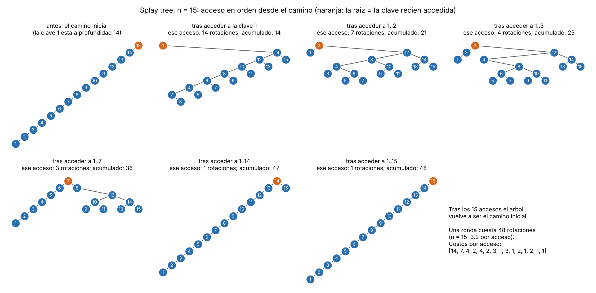

# Tema 1 - Problema 13

En un *splay tree* que empieza como un camino de $n$ nodos se accede a las claves $1,2,\dots,n$ en orden. Acota el costo total con el lema de acceso y la cuenta de la sección 5 de la Conferencia 4, y compáralo con lo que mide la sección 6. ¿Es ajustada la cota?

## Problema y Convenciones

- **Árbol inicial:** Se parte de la estructura `camino(n)` descrita en la Conferencia 4: la clave $n$ está en la raíz y cada clave $i$ es hija izquierda de $i+1$. La clave $1$ queda en la hoja más profunda, a nivel $n-1$.
- **Secuencia de accesos:** Se realiza un acceso a cada clave en orden ascendente: $x_i=i$, para $i=1,2,\dots,n$. Se considera una ronda completa de $m=n$ accesos.
- **Medición del costo:** El costo $c_i$ de una operación equivale al número de rotaciones realizadas en el *splay*, tomando un costo de 1 si el nodo ya se encontraba en la raíz:

$$
c_i=\max(\text{rotaciones},1)
$$

- **Potencial ($\Phi$):** Para cada nodo $x$, sea $s(x)$ el número de nodos de su subárbol, contándose a sí mismo, y $r(x)=\log_2 s(x)$ su rango. El potencial global es:

$$
\Phi=\sum_x r(x)
$$

## Acotación Teórica con el Lema de Acceso (Conferencia 4 §5)

### A. El Lema de Acceso (Sleator y Tarjan)

El costo amortizado $\hat{c}_i$ de realizar la operación *splay* sobre un nodo $x_i$ en un árbol con raíz $t$ satisface:

$$
\hat{c}_i=c_i+\Phi_i-\Phi_{i-1}
\leq 3(r(t)-r(x_i))+1
$$

Dado que el árbol contiene siempre $n$ nodos, se cumple:

$$
r(t)=\log_2 n
$$

Además, como el tamaño de cualquier subárbol es al menos 1:

$$
r(x_i)\geq 0
$$

Por tanto, el costo amortizado de cada acceso queda acotado por:

$$
\boxed{\hat{c}_i\leq 3\log_2 n+1}
$$

### B. El Potencial Inicial ($\Phi_0$)

En la estructura `camino(n)`, el subárbol del nodo $k$ contiene exactamente $k$ nodos, es decir, $s(k)=k$.

Por tanto, los rangos son:

$$
\log_2 1,\log_2 2,\dots,\log_2 n
$$

El potencial inicial resulta:

$$
\Phi_0=\sum_{k=1}^{n}\log_2 k
$$

$$
\boxed{\Phi_0=\log_2(n!)}
$$

Utilizando la desigualdad:

$$
\log_2(n!)\leq n\log_2 n
$$

obtenemos una cota superior para el potencial inicial.

### C. Suma de Costos y Telescopaje (Conferencia 4 §5)

Al sumar los costos amortizados sobre una secuencia de $m$ accesos, los términos de potencial intermedios se cancelan:

$$
\sum_{i=1}^{m}c_i
=
\sum_{i=1}^{m}\hat{c}_i-(\Phi_m-\Phi_0)
$$

Equivalentemente:

$$
\sum_{i=1}^{m}c_i
=
\sum_{i=1}^{m}\hat{c}_i+\Phi_0-\Phi_m
$$

Como el potencial final es no negativo, obtenemos:

$$
\sum_{i=1}^{m}c_i
\leq m(3\log_2 n+1)+\Phi_0
$$

Sustituyendo $m=n$ y el valor del potencial inicial:

$$
C(n)\leq n(3\log_2 n+1)+\log_2(n!)
$$

Finalmente, utilizando $\log_2(n!)\leq n\log_2 n$:

$$
\boxed{
C(n)\leq n(4\log_2 n+1)=O(n\log n)
}
$$

Esta es la cota superior obtenida mediante el lema de acceso para una ronda completa de $n$ operaciones.

## Comportamiento Real Medido (Conferencia 4 §6)

La sección 6 de la conferencia compara dos estrategias de reorganización del árbol:

- **Splay:** Aplica las rotaciones específicas del algoritmo, distinguiendo los casos *zig*, *zig-zig* y *zig-zag*.
- **Subir a la raíz:** Utiliza únicamente rotaciones simples para subir el nodo accedido hasta la raíz, sin aplicar el orden especial de rotaciones del caso *zig-zig*.

Para comparar ambas estrategias, se parte del mismo árbol inicial `camino(n)` y se accede a las claves $1,2,\dots,n$ durante tres rondas completas. Se mide el promedio de rotaciones por acceso.

Los resultados presentados en la conferencia son:

| $n$ | Splay (rotaciones por acceso) | Subir a la raíz (rotaciones por acceso) | $\log_2 n$ |
|:---:|:---:|:---:|:---:|
| 100 | 4.2 | 50.5 | 6.6 |
| 200 | 4.2 | 100.5 | 7.6 |
| 400 | 4.3 | 200.5 | 8.6 |
| 800 | 4.4 | 400.5 | 9.6 |

### Evolución del Árbol Durante los Accesos

Para visualizar cómo se reorganiza el árbol, se muestra a continuación
la evolución de un *splay tree* de 15 nodos al acceder a las claves
en orden ascendente.

**Figura 1.** Evolución del árbol durante los accesos
$1,2,\dots,15$. Se indica la raíz después de cada acceso,
el número de rotaciones realizadas y el costo acumulado.

En este ejemplo se realizan 48 rotaciones durante la ronda completa,
con un promedio de:

$$
\frac{48}{15}=3.2
$$

Se observa que, después de acceder a todas las claves, el árbol
recupera su estructura inicial en forma de camino.

### Observaciones

1. **Comportamiento de Splay:** El costo medio por acceso se mantiene prácticamente constante, alrededor de 4.2–4.4 rotaciones, incluso cuando aumenta el tamaño del árbol.

2. **Comportamiento de subir a la raíz:** El costo medio crece aproximadamente como $n/2$. Al duplicar el tamaño del árbol, el costo por acceso también se duplica.

3. **Importancia del caso zig-zig:** La diferencia entre ambas estrategias está en el orden de las dos rotaciones del caso *zig-zig*. Splay rota primero el padre y después el nodo accedido, mientras que subir a la raíz utiliza rotaciones simples. Este cambio permite que Splay reduzca aproximadamente a la mitad la profundidad de los nodos del camino de acceso, evitando que el árbol permanezca casi tan profundo después de cada operación.

La Figura 3 de la conferencia representa estos resultados en ejes logarítmicos. La curva de Splay permanece prácticamente horizontal, mientras que la de subir a la raíz tiene pendiente 1, mostrando sus respectivos comportamientos:

$$
\text{Splay: costo por acceso } \Theta(1)
$$

$$
\text{Subir a la raíz: costo por acceso } \Theta(n)
$$

## Análisis: ¿Es Ajustada la Cota?

La cota obtenida mediante el lema de acceso es:

$$
C(n)=O(n\log n)
$$

Sin embargo, las mediciones de la sección 6 muestran que el costo por acceso de Splay permanece constante para la secuencia ordenada estudiada.

Por tanto, el costo total de una ronda de $n$ accesos crece linealmente:

$$
C(n)=\Theta(n)
$$

En consecuencia, **la cota $O(n\log n)$ no es ajustada para esta secuencia de accesos**.

La diferencia se debe a que el lema de acceso proporciona una garantía amortizada general, pero no aprovecha completamente el comportamiento particular de la secuencia. En este caso, la reorganización del árbol mediante las rotaciones específicas de Splay permite que los accesos posteriores sean mucho más baratos.

Por otra parte, la comparación de la conferencia muestra que no basta con llevar el nodo accedido hasta la raíz. El orden de las rotaciones es fundamental para conseguir las garantías amortizadas del algoritmo.

## Conclusión

Aplicando el lema de acceso y el potencial inicial del árbol en forma de camino, obtenemos una cota superior de $O(n\log n)$ para una ronda de $n$ accesos.

Sin embargo, las mediciones de la Conferencia 4 §6 muestran que, para la secuencia ordenada, Splay mantiene un costo prácticamente constante por acceso, por lo que el costo total crece linealmente: $\Theta(n)$.

Por tanto, **la cota obtenida mediante el lema de acceso es válida, pero no ajustada para la secuencia estudiada**. Además, la comparación con la estrategia de subir a la raíz evidencia la importancia del orden de las rotaciones, especialmente en el caso *zig-zig*.

## Archivos

| Archivo | Contenido |
|---|---|
| `ejercicio_13.md` | Este informe |
| `extras_13/fig/` | Figuras |
