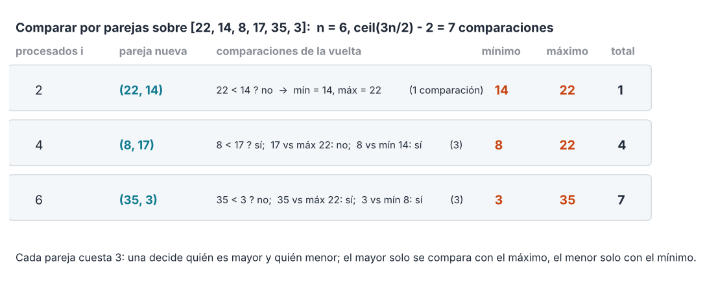

# Tema 1 - Problema 14 

Escoge un problema que no hayamos visto, recorre el ciclo completo de la conferencia 2 sobre él y consigue que el algoritmo y la cota mínima coincidan. 

> **Problema elegido:** encontrar el **máximo y el mínimo de un arreglo** a la vez.


## El Problema: Definición Formal y Modelo de Cómputo

**Entrada:** Un arreglo $A[0..n-1]$ de $n \ge 1$ elementos pertenecientes a un conjunto con un orden total $(\mathcal{X}, \le)$.  
**Salida:** Un par de elementos $(\text{min}, \text{max}) \in A \times A$ tal que:
$\forall\, 0 \le i < n, \quad \text{min} \le A[i] \le \text{max}$

### Especificación del Contrato
* **Precondición ($\text{Pre}$):** $A$ es una secuencia finita no vacía de $n$ elementos comparables bajo $\le$.
* **Postcondición ($\text{Post}$):** Devuelve $(\text{min}, \text{max})$ tal que $\text{min}, \text{max} \in A$, y para todo $x \in A$ se cumple $\text{min} \le x$ y $x \le \text{max}$.
* **Modelo de Cómputo (C5 §1):** **Modelo de comparaciones de elementos**. Solo se contabilizan las comparaciones directas del tipo $A[i] \le A[j]$. Las manipulaciones de índices y controles de bucles tienen costo cero en este modelo.


## El Algoritmo: Búsqueda Optimizada por Parejas

### Idea Algorítmica
Una solución directa consiste en inicializar el mínimo y el máximo con el primer elemento del arreglo y recorrer los restantes. Para cada elemento, se comprueba si es menor que el mínimo actual o, en caso contrario, si es mayor que el máximo actual.

En el peor caso, cada elemento requiere dos comparaciones, por lo que el algoritmo realiza:

$
C_{\text{ingenuo}}(n)=2(n-1)=2n-2.
$

Para optimizar, **procesamos los elementos por parejas no solapadas $(A[i], A[i+1])$**:
1. Comparamos los dos elementos de la pareja entre sí ($1$ comparación).
2. El elemento menor de la pareja compite únicamente contra el candidato a mínimo global ($1$ comparación).
3. El elemento mayor de la pareja compite únicamente contra el candidato a máximo global ($1$ comparación).

De este modo, se procesan **2 elementos con solo 3 comparaciones** (en lugar de 4).



### Implementación en Python

```python
def maximo_y_minimo(A):
    n = len(A)

    if n == 0:
        return None, None

    # Inicialización del primer par o elemento
    if n % 2 == 1:
        min_val = max_val = A[0]
        inicio = 1
    else:
        if A[0] <= A[1]:
            min_val, max_val = A[0], A[1]
        else:
            min_val, max_val = A[1], A[0]
        inicio = 2

    # Procesamiento por parejas
    for i in range(inicio, n, 2):
        x, y = A[i], A[i + 1]

        if x <= y:
            menor, mayor = x, y
        else:
            menor, mayor = y, x

        if menor < min_val:
            min_val = menor

        if mayor > max_val:
            max_val = mayor

    return min_val, max_val
```

## Demostración de Correctitud 

### Correctitud Parcial por Invariante de Bucle
Definimos el subconjunto de elementos procesados hasta la iteración $k$ como $S_k = A[0 \dots \text{idx}_k - 1]$, donde $\text{idx}_k$ es el índice actual en el arreglo.

**Invariante $I(k)$:** En el inicio de la $k$-ésima iteración del bucle, `min_val` es el mínimo elemento del subconjunto $S_k$ y `max_val` es el máximo elemento del subconjunto $S_k$.

1. **Inicialización:**
   - Si $n$ es impar, $S_0 = \{A[0]\}$, `min_val` = `max_val` = $A[0]$, que es trivialmente el mínimo y máximo de $S_0$.
   - Si $n$ es par, $S_0 = \{A[0], A[1]\}$. Tras 1 comparación entre $A[0]$ y $A[1]$, `min_val` = $\min(A[0], A[1])$ y `max_val` = $\max(A[0], A[1])$, cumpliendo $I(0)$.
2. **Mantenimiento:**  
   Supongamos que $I(k)$ vale para $S_k$. En la iteración $k+1$, se toman dos nuevos elementos $\{x, y\}$ formando $S_{k+1} = S_k \cup \{x, y\}$.
   - La primera comparación determina $\text{menor} = \min(x, y)$ y $\text{mayor} = \max(x, y)$.
   - Como ningún elemento mayor que $\text{menor}$ puede ser el mínimo global de $S_{k+1}$, basta comparar $\text{menor}$ con `min_val`. El nuevo `min_val'` será $\min(\text{min\_val}, \text{menor}) = \min(S_{k+1})$.
   - Análogamente, el nuevo `max_val'` será $\max(\text{max\_val}, \text{mayor}) = \max(S_{k+1})$. Por tanto, $I(k+1)$ se mantiene.
3. **Conclusión:**  
   Al terminar el bucle, $\text{idx} = n$, luego $S_{\text{final}} = A[0 \dots n-1] = A$. Por la validez del invariante, `min_val` y `max_val` son el mínimo y máximo de todo el arreglo $A$.

---

### 3.2. Terminación por Función de Potencial ($P = n - i$)

Definimos la función de potencial $P$ como el **número de elementos no procesados en el arreglo**:

$$P = n - i$$

donde $n = |A|$ y el índice $i$ representa la cantidad de elementos procesados hasta el momento.

#### **Propiedades Formales del Potencial**

1. **Invariante de Paridad de $P$:**
   - **Caso $n$ impar:** La inicialización establece $i = 1$, por lo que $P_0 = n - 1$ es un entero **par**.
   - **Caso $n$ par:** La inicialización establece $i = 2$, por lo que $P_0 = n - 2$ es un entero **par**.
   - En cada vuelta del bucle $i$ incrementa en $2$ ($i \gets i + 2$), por lo que $P$ permanece **siempre como un número entero par** ($\forall k, \, P_k \equiv 0 \pmod 2$).

2. **Monotonía Fuerte:**
   - Cada iteración procesa exactamente una pareja de elementos, haciendo que el potencial decrezca estrictamente en $2$ unidades por vuelta:
   $$\Delta P = P' - P = (n - (i + 2)) - (n - i) = -2$$

3. **Cota Inferior y Condición de Salida Exacta:**
   - La guardia del bucle es $i + 1 < n$, lo que equivale algebraicamente a:
   $$n - i > 1 \iff P \ge 2$$
   - Por tanto, el bucle continúa ejecutándose mientras el potencial sea $P \ge 2$.
   - Al terminar el bucle, debe cumplirse la negación de la guardia: $P < 2$. Dado que $P \ge 0$ durante la ejecución y $P$ es **estrictamente par**, la única solución entera posible en el dominio es **$P = 0$**.

#### **Conclusión de Terminación**
Al salir del bucle con $P = 0$, se cumple que $n - i = 0 \implies i = n$. Esto demuestra que, al finalizar, se han procesado todos los elementos del arreglo. En total, el algoritmo procesa exactamente $\lfloor n/2\rfloor$ parejas, contando la pareja inicial cuando $n$ es par. Por tanto, no queda ningún elemento sin considerar.

## Análisis del Costo Exacto de Comparaciones 

Contamos exactamente las comparaciones realizadas entre elementos de $A$:

* **Caso 1: $n$ es par:**
  - Inicialización: $1$ comparación para $A[0] \text{ vs } A[1]$.
  - Bucle: Se procesan $\frac{n-2}{2}$ parejas. Cada pareja realiza exactamente $3$ comparaciones.
  - **Total:** $1 + 3 \cdot \frac{n-2}{2} = 1 + \frac{3n - 6}{2} = \mathbf{\frac{3n}{2} - 2}$ comparaciones.

* **Caso 2: $n$ es impar:**
  - Inicialización: $0$ comparaciones (asignación directa de $A[0]$).
  - Bucle: Se procesan $\frac{n-1}{2}$ parejas. Cada pareja realiza $3$ comparaciones.
  - **Total:** $3 \cdot \frac{n-1}{2} = \mathbf{\frac{3n - 3}{2}} = \mathbf{\left\lceil \frac{3n}{2} \right\rceil - 2}$ comparaciones.

**En resumen:** En todos los casos, el algoritmo realiza exactamente **$\left\lceil \frac{3n}{2} \right\rceil - 2$ comparaciones**.

## Cota Mínima por Adversario (Conferencia 5)

Demostraremos que **ningún algoritmo de comparaciones** puede encontrar el mínimo y el máximo de $n$ elementos en menos de $\left\lceil \frac{3n}{2} \right\rceil - 2$ comparaciones en el peor caso.

### Definición del Estado de un Elemento
Para que un algoritmo declare con certeza que $x_{\text{min}}$ es el mínimo y $x_{\text{max}}$ es el máximo, debe haber obtenido suficiente información para descartar a los otros $n-1$ elementos como candidatos a mínimo y a máximo.

Clasificamos cada elemento $x \in A$ en uno de cuatro estados según las comparaciones realizadas hasta el momento:
- **$N$ (No evaluado):** No ha participado en ninguna comparación. (Candidato a mínimo y a máximo).
- **$W$ (Ganador / Winner):** Ha ganado al menos una comparación y nunca ha perdido. (Candidato a máximo, descartado para mínimo).
- **$L$ (Perdedor / Loser):** Ha perdido al menos una comparación y nunca ha ganado. (Candidato a mínimo, descartado para máximo).
- **$WL$ (Eliminado):** Ha ganado al menos una comparación y ha perdido al menos una. (Descartado tanto para mínimo como para máximo).

### Estado Inicial y Estado Final
* **Estado Inicial:** Los $n$ elementos están en estado $N$. Conteo de estados: $(n, 0, 0, 0)$.
* **Estado Final:** Para concluir correctamente, debe quedar **exactamente 1 elemento en $W$** (el máximo global), **exactamente 1 elemento en $L$** (el mínimo global), y los restantes $n-2$ elementos en estado $WL$. Conteo final: $(0, 1, 1, n-2)$.

### Estrategia del Adversario y Conteo de Unidades de Información
Para obligar al algoritmo a hacer el máximo número de comparaciones, el Adversario responde a las preguntas tratando de **minimizar la cantidad de información útil otorgada en cada comparación**:

| Comparación | Respuesta del Adversario | Cambio de Estado | Ganancia de Información |
|:---:|:---|:---:|:---:|
| **$N \text{ vs } N$** | Hace ganar a uno y perder a otro | $N, N \implies W, L$ | **2 descartes** (1 no-mínimo, 1 no-máximo) |
| **$W \text{ vs } W$** | Hace ganar a uno y perder a otro | $W, W \implies W, WL$ | **1 descarte** (1 no-máximo) |
| **$L \text{ vs } L$** | Hace ganar a uno y perder a otro | $L, L \implies L, WL$ | **1 descarte** (1 no-mínimo) |
| **$W \text{ vs } L$** | Hace ganar al de $W$ y perder al de $L$ | $W, L \implies W, L$ | **0 descartes** (Información redundante) |

### Cálculo del Número Mínimo de Comparaciones
Para pasar del estado inicial a la configuración final, el algoritmo debe acumular un total de **$2n - 2$ descartes de candidaturas**:
- $n-1$ elementos deben ser descartados como candidatos a máximo.
- $n-1$ elementos deben ser descartados como candidatos a mínimo.

1. **Paso 1 (Comparaciones $N \text{ vs } N$):**  
   Para obtener el máximo de descartes dobles (2 descartes por comparación), el algoritmo puede realizar a lo sumo $\lfloor n/2 \rfloor$ comparaciones de tipo $N \text{ vs } N$.  
   Esto consume todos los elementos $N$ y realiza **$\lfloor n/2 \rfloor$ comparaciones**, aportando $2 \lfloor n/2 \rfloor$ descartes.

2. **Paso 2 (Determinación del Máximo en $W$):**  
   Quedan $\lceil n/2 \rceil$ elementos en el conjunto $W$. Para encontrar el máximo entre ellos, se requiere un torneo de eliminación simple de al menos **$\lceil n/2 \rceil - 1$ comparaciones** (cada una reduce en 1 el número de candidatos en $W$).

3. **Paso 3 (Determinación del Mínimo en $L$):**  
   Quedan $\lceil n/2 \rceil$ elementos en el conjunto $L$. Para encontrar el mínimo entre ellos, se requiere un torneo de eliminación simple de al menos **$\lceil n/2 \rceil - 1$ comparaciones** (cada una reduce en 1 el número de candidatos en $L$).

### Suma Total de Comparaciones Exigidas por el Adversario

$$\text{Total} \ge \left\lfloor \frac{n}{2} \right\rfloor + \left( \left\lceil \frac{n}{2} \right\rceil - 1 \right) + \left( \left\lceil \frac{n}{2} \right\rceil - 1 \right) = \left\lfloor \frac{n}{2} \right\rfloor + 2 \left\lceil \frac{n}{2} \right\rceil - 2$$

* **Si $n$ es par ($n = 2k$):**  
  $$\text{Total} \ge k + 2k - 2 = 3k - 2 = \mathbf{\frac{3n}{2} - 2}$$
* **Si $n$ es impar ($n = 2k + 1$):**  
  $$\text{Total} \ge k + 2(k+1) - 2 = 3k = \mathbf{\frac{3n - 3}{2}} = \mathbf{\left\lceil \frac{3n}{2} \right\rceil - 2}$$

## Conclusión

El algoritmo optimizado por parejas realiza exactamente $\left\lceil \frac{3n}{2} \right\rceil - 2$ comparaciones en el peor caso, y la cota mínima demostrada mediante el Adversario de estados establece que ningún algoritmo de comparaciones puede resolver el problema con menos de $\left\lceil \frac{3n}{2} \right\rceil - 2$ comparaciones.

**El algoritmo es estrictamente óptimo en el modelo de comparaciones.** $\blacksquare$

## Archivos

| Archivo | Contenido |
|---|---|
| `ejercicio_14.md` | Este informe |
| `extras_14/solution.py` | Solución propuesta |
| `extras_14/fig/` | Figuras |
