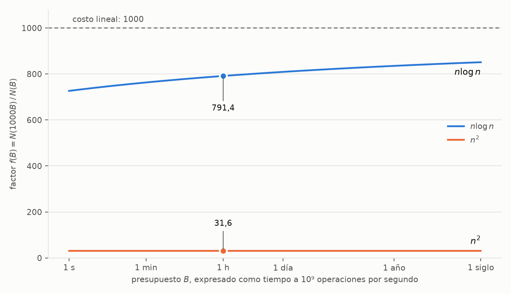

# Ejercicio 1. Tamaño de entrada resoluble ante una mejora del hardware

> ★ Una computadora mil veces más rápida. ¿Cuánto crece el tamaño de entrada que se
> resuelve en una hora con un algoritmo $\Theta(n^2)$? ¿Y con uno $\Theta(n \log n)$?
> Estima los dos factores. (C1)

## Resumen

Se estudia el factor $f$ en que crece la mayor entrada resoluble con un presupuesto fijo
de operaciones cuando el presupuesto se multiplica por 1000. Para costos de la forma
$c\,n^2$ se demuestra que $f = \sqrt{1000} \approx 31{,}62$ salvo un error de redondeo
menor que $\sqrt{1000}/N$, independientemente de $c$ y del presupuesto, y que el mismo
valor se alcanza en el límite para todo costo con $T(n)/n^2 \to c > 0$. Para costos
$c\,n \log n$ se obtiene una ecuación exacta para $f$, de la que se deduce que
$f < 1000$, que $f$ es creciente en el presupuesto y tiende a 1000 con error
$\Theta(1/\log N)$. En el escenario de la sección 7 de la conferencia 1 (una hora a
$10^9$ operaciones por segundo) resulta $f = 791{,}37$. Se comprueba además que, en ese
escenario, el algoritmo $n \log n$ queda limitado por la memoria antes que por el tiempo.
Los resultados se verifican numéricamente en el cuaderno
[`ejercicio-01.ipynb`](ejercicio-01.ipynb).

| costo | $N(B)$, una hora | $N(1000B)$ | factor $f$ | depende de $B$ y de $c$ |
|---|---:|---:|---:|---|
| $\Theta(n^2)$ | 1 897 366 | 60 000 000 | $\sqrt{1000} \approx 31{,}62$ | no |
| $\Theta(n \log n)$ | 98 574 774 544 | 78 008 697 597 778 | $791{,}37$ | sí, logarítmicamente |

## 1. Formulación

Se adopta el modelo de la conferencia 1, sección 7: la computadora de referencia ejecuta
$10^9$ operaciones por segundo, de modo que el presupuesto de una hora es
$B = 3{,}6 \cdot 10^{12}$ operaciones, y la computadora nueva dispone de $1000B$ en el
mismo tiempo.

Sea $T : \mathbb{N} \to \mathbb{R}_{\ge 0}$ el costo del algoritmo, que supondremos no
decreciente. La mayor entrada resoluble con presupuesto $B$ es

$$N(B) = \max\{\, n : T(n) \le B \,\},$$

y el objeto de estudio es

$$f(B) = \frac{N(1000B)}{N(B)}.$$

La notación $\Theta$ determina $T$ solo salvo constantes y términos de orden menor, y
$f$ puede depender de ellos. Por eso se analiza primero el caso en que $T$ es
exactamente $c\,n^2$ o $c\,n \log n$, y después qué parte del resultado se conserva
cuando solo se conoce la clase $\Theta$ de $T$.

## 2. Costo cuadrático

**Proposición 1.** Si $T(n) = c\,n^2$ con $c > 0$, entonces
$\lvert f(B) - \sqrt{1000} \rvert < \sqrt{1000}/N(B)$.

*Demostración.* Sea $b = \sqrt{B/c}$. Entonces $N(B) = \lfloor b \rfloor$ y
$N(1000B) = \lfloor \sqrt{1000}\, b \rfloor$. Escribiendo $N = N(B)$, se tiene
$N \le b < N + 1$, de donde

$$f(B) \le \frac{\sqrt{1000}\, b}{N} < \sqrt{1000}\,\frac{N+1}{N} = \sqrt{1000} + \frac{\sqrt{1000}}{N},
\qquad
f(B) > \frac{\sqrt{1000}\, b - 1}{N} \ge \sqrt{1000} - \frac{1}{N}. \qquad \square$$

Con $c = 1$ y una hora se obtiene $N = 1\,897\,366$ y $N(1000B) = 60\,000\,000$, es decir,
$f = 31{,}62$. El error de redondeo es del orden de $10^{-5}$. El mismo argumento muestra
que para $T(n) = c\,n^a$ el factor es $1000^{1/a}$, lo que reproduce los valores 1000,
31,6 y 10 de la tabla de la conferencia 1 para $a = 1, 2, 3$.

**Proposición 2.** Si $T$ es no decreciente y $T(n)/n^2 \to c > 0$, entonces
$f(B) \to \sqrt{1000}$ cuando $B \to \infty$.

*Demostración.* Sea $\varepsilon \in (0,1)$ y sea $n_0$ tal que
$(1-\varepsilon)\,c\,n^2 \le T(n) \le (1+\varepsilon)\,c\,n^2$ para $n \ge n_0$. Como
$T(n)$ es finito para cada $n$, $N(B) \to \infty$, y para $B$ suficientemente grande
$N = N(B) \ge n_0$. De $T(N) \le B < T(N+1)$ se sigue

$$(1-\varepsilon)\,c\,N^2 \le B < (1+\varepsilon)\,c\,(N+1)^2,$$

y dividiendo por $\sqrt{B/c}$,

$$\frac{1}{\sqrt{1+\varepsilon}} - \sqrt{\frac{c}{B}} < \frac{N(B)}{\sqrt{B/c}} \le \frac{1}{\sqrt{1-\varepsilon}}.$$

Como $\varepsilon$ es arbitrario, $N(B) \sim \sqrt{B/c}$. Aplicando lo mismo a $1000B$ y
dividiendo, $f(B) \to \sqrt{1000}$. $\square$

Si solo se sabe que $c_1 n^2 \le T(n) \le c_2 n^2$, la misma cadena de desigualdades da
$\sqrt{B/c_2} - 1 < N(B) \le \sqrt{B/c_1}$, y el factor queda determinado únicamente
dentro de un intervalo de extremos aproximados $\sqrt{1000\,c_1/c_2}$ y
$\sqrt{1000\,c_2/c_1}$. La Tabla 1 ilustra la convergencia de la Proposición 2 con dos
costos de la clase $\Theta(n^2)$. El primero es el polinomio del ejercicio 1 de la
conferencia 1. En el segundo, el término lineal domina para presupuestos pequeños y el
algoritmo se comporta como uno lineal.

*Tabla 1. Factor $f(B)$ para dos costos en $\Theta(n^2)$.*

| costo | 1 s | 1 min | 1 h | 1 día | 1 año | 1 siglo |
|---|---:|---:|---:|---:|---:|---:|
| $3n^2 + 10\,n \log_2 n + 7$ | 31,66 | 31,63 | 31,62 | 31,62 | 31,62 | 31,62 |
| $n^2 + 10^6\,n$ | 618,65 | 127,91 | 40,70 | 33,31 | 31,71 | 31,63 |

## 3. Costo $n \log n$

En esta sección $T(n) = c\,n \log n$, con logaritmos en base 2. Sean $x$ e $y$ las
soluciones reales de

$$c\,x \log x = B, \qquad c\,y \log y = 1000B.$$

Como $N(B) = \lfloor x \rfloor$ y $N(1000B) = \lfloor y \rfloor$, sustituir $f$ por $y/x$
introduce un error relativo del orden de $1/x$, que para una hora es de $10^{-11}$. En lo
que sigue $f = y/x$ y $L = \log x$.

**Lema 3.** $f$ es la única solución en $(1, \infty)$ de

$$f \,(L + \log f) = 1000\,L. \tag{1}$$

*Demostración.* Dividiendo las dos ecuaciones que definen $x$ e $y$ se obtiene
$f \log(fx) / \log x = 1000$, que es (1). La función $h(t) = t\,(L + \log t)$ es
estrictamente creciente en $[1, \infty)$, con $h(1) = L < 1000L$, de modo que la solución
es única. $\square$

En (1) no intervienen ni $c$ ni la base del logaritmo: $c$ se cancela al dividir, y un
cambio de base multiplica $L$ y $\log f$ por la misma constante, que también se cancela
(conferencia 1, sección 5). El factor depende solo del tamaño $x$ que ya se resolvía.

**Proposición 4.** $\dfrac{1000\,L}{L + \log 1000} < f < 1000$.

*Demostración.* De (1), $f = \varphi(f)$ con $\varphi(t) = 1000L/(L + \log t)$. Como
$f > 1$, $\log f > 0$ y $f < 1000$. Entonces $\log f < \log 1000$, lo que da la cota
inferior. $\square$

Como $\varphi$ es decreciente, si $a \le f \le b$ entonces $\varphi(b) \le f \le \varphi(a)$, y
la iteración de $\varphi$ a partir de 1000 produce cotas alternadas cada vez más
ajustadas.

El valor de $L$ también se obtiene sin computadora. Con $c = 1$, tomando logaritmos en
$x \log x = B$ se tiene $L = \log B - \log L$, y la iteración $L \leftarrow \log B - \log L$
converge rápido porque la derivada de $\log L$ es $1/(L \ln 2) \approx 0{,}04$. Partiendo
de $\log B = 41{,}71$ se obtiene $36{,}33$, $36{,}53$ y $36{,}52$, es decir,
$x = 9{,}86 \cdot 10^{10}$ y $L = 36{,}52$. Con ese valor, dos iteraciones de $\varphi$
dan

$$785{,}6 = \varphi(1000) \le f \le \varphi(785{,}6) = 791{,}5.$$

La sucesión $1000;\ 785{,}6;\ 791{,}5;\ 791{,}4;\ \dots$ converge a $f = 791{,}37$, que
coincide con el valor obtenido por búsqueda directa: $N(B) = 98\,574\,774\,544$ y
$N(1000B) = 78\,008\,697\,597\,778$.

**Proposición 5.** $f$ es estrictamente creciente en $L$, $f \to 1000$ cuando
$L \to \infty$, y

$$1000 - f = \frac{f \log f}{L}. \tag{2}$$

En particular $1000 - f \in \Theta(1/\log N)$.

*Demostración.* La identidad (2) es una reordenación de (1). Para la monotonía, sean
$L_1 < L_2$ y $f_1$ la solución de (1) para $L_1$. Por (2),
$f_1 \log f_1 = (1000 - f_1)\,L_1$, y por tanto

$$f_1 (L_2 + \log f_1) - 1000\,L_2 = (f_1 - 1000)(L_2 - L_1) < 0.$$

Como $h$ es creciente, la solución de (1) para $L_2$ es mayor que $f_1$. Por último, la
cota inferior de la Proposición 4 tiende a 1000 cuando $L \to \infty$, y de (2), con
$f \to 1000$, se obtiene $1000 - f \sim 1000 \log 1000 / L$. $\square$

Como $L = \log x$ y $x$ es función creciente de $B/c$, el factor crece con el presupuesto
y decrece con la constante oculta. A diferencia del caso cuadrático, $f$ no es una
constante. La dependencia es, sin embargo, logarítmica: entre un segundo y un siglo el
presupuesto aumenta en un factor $3 \cdot 10^9$ y $f$ pasa de 726,4 a 851,1 (Tabla 2).
La convergencia a 1000 es muy lenta: despejando $L$ en (2), un factor de 900 requiere
$N \approx 2^{88}$ y uno de 990 requiere $N \approx 2^{985}$.

*Tabla 2. Factor $f$ para $c\,n \log n$ según el presupuesto (con $c = 1$) y según la
constante (con una hora). La última fila es $c\,n^2$, para comparar.*

| presupuesto | 1 s | 1 min | 1 h | 1 día | 1 año | 1 siglo |
|---|---:|---:|---:|---:|---:|---:|
| $n \log n$ | 726,4 | 763,2 | 791,4 | 809,1 | 835,2 | 851,1 |
| $n^2$ | 31,62 | 31,62 | 31,62 | 31,62 | 31,62 | 31,62 |

| constante $c$ | 1 | 10 | 100 | 1000 |
|---|---:|---:|---:|---:|
| $c\,n \log n$ | 791,4 | 776,4 | 759,1 | 739,1 |
| $c\,n^2$ | 31,62 | 31,62 | 31,62 | 31,62 |

**Forma cerrada.** La ecuación $n \ln n = z$ se resuelve con la función $W$ de Lambert
[2], inversa de $w \mapsto w e^w$: con $n = e^w$ queda $w e^w = z$, luego
$n = e^{W(z)} = z/W(z)$. Tomando $z = (B/c) \ln 2$,

$$f = 1000\,\frac{W(z)}{W(1000\,z)},$$

expresión que, evaluada con `scipy.special.lambertw`, da de nuevo 791,37. Como
$W(z) \sim \ln z$, el cociente tiende a 1, en acuerdo con la Proposición 5.

**Interpretación.** El factor por debajo de 1000 se explica por el crecimiento del
logaritmo. Al multiplicar la entrada por 791, $\log N$ pasa de 36,52 a 46,15, de modo que
el costo por elemento aumenta en un factor $46{,}15/36{,}52 \approx 1{,}26$, y
$791{,}4 \times 1{,}26 \approx 1000$.

Para $T$ general con $T(n)/(n \log n) \to c > 0$ el argumento de la Proposición 2 da
$N(B) \sim x(B)$, y por tanto $f(B) \to 1000$. Como en el caso cuadrático, los términos de
orden menor pueden modificar el valor de $f$ para presupuestos pequeños.

## 4. Validez del modelo

El análisis anterior cuenta solo tiempo, en un word RAM. Conviene comprobar que sus
conclusiones son compatibles con las otras dos hipótesis de la conferencia 1: que la
memoria alcanza y que los números del algoritmo caben en una palabra.

**Memoria.** La memoria está acotada por el tiempo (conferencia 1, sección 6), pero
puede agotarse antes. Con 8 bytes por elemento, la entrada de tamaño $N(1000B)$ ocupa
480 MB para el algoritmo cuadrático y $6{,}24 \cdot 10^{14}$ bytes, unos 624 TB, para el
$n \log n$. En el primer caso el recurso escaso es el tiempo y el factor 31,6 se alcanza
en la práctica. En el segundo, la entrada no cabe en la memoria de una computadora
actual, y el factor 791 es una cota superior de lo que permite el tiempo, no de lo que
permite la máquina.

**Tamaño de palabra.** El word RAM supone palabras de $w \ge \log_2 n$ bits (conferencia
1, sección 9). Con una hora en la máquina nueva, los índices del algoritmo $n \log n$
necesitan $\log_2 N(1000B) = 46{,}15$ bits y el contador de operaciones
$\log_2(1000B) = 51{,}68$ bits; ambos caben en una palabra de 64 bits. La hipótesis deja
de cumplirse con presupuestos mayores. Con un año, el contador necesita 64,77 bits, y con
un siglo, también los índices necesitan 65,39. A partir de ahí el costo de cada operación
ya no es constante, y las Tablas 1 y 2 en esas columnas son extrapolaciones del modelo.

## 5. Verificación numérica

El cuaderno [`ejercicio-01.ipynb`](ejercicio-01.ipynb) calcula $N(B)$ por búsqueda
binaria con la función `largest_n` de la conferencia 1, sección 7, con los identificadores en inglés, y
genera todos los valores citados en este informe, en secciones con la misma numeración.
La búsqueda directa no usa ninguna de las fórmulas, de modo que sirve como referencia
independiente. Las aserciones de la sección 5 del cuaderno comprueban cada afirmación:

| afirmación del informe | comprobación |
|---|---|
| Proposición 1 | $N(B) = \lfloor \sqrt{B} \rfloor$ con $c = 1$, y la cota del redondeo con seis presupuestos (de 1 s a 1 siglo) y $c \in \{1, 7, 1000\}$ |
| $1000^{1/a}$ para $T = n^a$ | factor de $n$, $n^2$ y $n^3$ con una hora |
| Lema 3 y forma cerrada | búsqueda directa, iteración de $\varphi$ y $W$ de Lambert coinciden al $10^{-3}$ en los seis presupuestos |
| independencia de la base y de $c$ dado $x$ | la solución de (1) con logaritmos en base $2$, $e$ y $10$ |
| Proposición 4 | las dos cotas en los seis presupuestos |
| Proposición 5 | el factor crece estrictamente con el presupuesto |
| cálculo de $L$ a mano | la iteración $L \leftarrow \log B - \log L$ llega al $\log_2 N(B)$ de la búsqueda en tres pasos, con error menor que $0{,}01$ |
| sección 4 | bytes y bits de $N(1000B)$ y de $1000B$ en cada presupuesto |

El cuaderno se guarda con sus salidas, de modo que puede leerse sin ejecutarlo. Para
reproducirlo hacen falta `numpy`, `scipy` y `matplotlib`.

*Figura 1. Factor $f(B)$ en función del presupuesto, en escala logarítmica, para
$n \log n$ y $n^2$. La recta discontinua corresponde al costo lineal. Los puntos marcan el
presupuesto de una hora.*

## 6. Conclusiones

Con una computadora mil veces más rápida, la mayor entrada resoluble en una hora crece
en un factor $\sqrt{1000} \approx 31{,}6$ para un algoritmo $\Theta(n^2)$ y en un factor
cercano a 791 para uno $\Theta(n \log n)$. El primer valor no depende de la constante ni
del presupuesto, y para costos que no son exactamente $c\,n^2$ se alcanza en el límite.
El segundo depende de ambos, aunque solo logarítmicamente, y está siempre por debajo de
1000.

En términos relativos, el algoritmo $n \log n$ aprovecha el 79 % de la mejora que
aprovecharía uno lineal y el cuadrático solo el 3 %. Visto desde los datos, como en la
sección 7 de la conferencia 1: si el hardware y el tamaño de los datos crecen ambos en un
factor 1000, el algoritmo $n \log n$ tarda $\log(1000N)/\log N = 46{,}49/36{,}52 \approx 1{,}27$
veces lo que tarda hoy, mientras que el cuadrático tarda 1000 veces más.

Por último, el factor de tiempo no es toda la respuesta. Para el algoritmo $n \log n$ la
entrada que el tiempo permite ocupa cientos de terabytes, de modo que con una máquina
mil veces más rápida su límite práctico pasa a ser la memoria.
