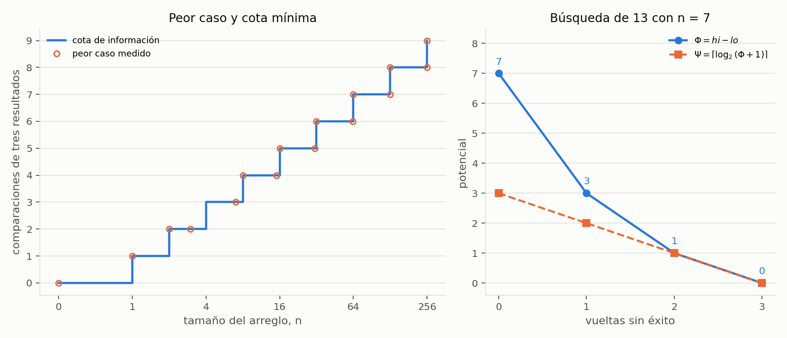

# Ejercicio 2. Correctitud y optimalidad de la búsqueda binaria

> ★ Da el invariante y el potencial de la búsqueda binaria, y la cota de información
> que la hace óptima. (C3, C5)

## Resumen

La búsqueda binaria mantiene un intervalo de posiciones posibles y descarta una mitad
en cada comparación. Su correctitud parcial se demuestra con el invariante «si el
valor buscado aparece, alguna aparición está en el intervalo». El potencial es la
longitud del intervalo: es un entero no negativo y disminuye estrictamente en cada
vuelta que no devuelve el resultado. Además, se reduce al menos a la mitad, lo que da
una cota de $\lceil\log_2(n+1)\rceil$ comparaciones en el peor caso.

La cota de información coincide exactamente: sobre un arreglo de $n$ claves distintas,
los $n+1$ huecos requieren hojas diferentes en un árbol binario de decisiones, incluso
si la salida de todos ellos es «no está». Por tanto, la búsqueda binaria es óptima en el
modelo que cuenta una comparación de tres resultados como una operación. Las trazas,
los casos pequeños y los valores del informe se comprueban en
[`ejercicio-02.ipynb`](ejercicio-02.ipynb).

| aspecto | resultado |
|---|---|
| invariante | $0\le lo\le hi\le n$; si $x$ aparece, aparece en $A[lo:hi]$ |
| potencial de terminación | $\Phi=hi-lo$ |
| reducción por vuelta sin éxito | $\Phi'\le\lfloor\Phi/2\rfloor$ |
| peor caso, comparaciones de tres resultados | $\lceil\log_2(n+1)\rceil$ |
| memoria auxiliar | $\Theta(1)$ palabras |

## 1. Formulación

**Precondición.** $A$ es un arreglo de $n\ge0$ elementos de un orden total, ordenado
de forma no decreciente. El valor $x$ pertenece al mismo orden. Se permiten repetidos.

**Postcondición.** Devolver un índice $i$ tal que $0\le i<n$ y $A[i]=x$, si existe;
devolver $-1$ si $x$ no aparece. Con repetidos basta cualquier aparición.

Se usa acceso aleatorio: consultar $A[i]$ y operar con índices cuesta $O(1)$ en el word
RAM. Para el costo exacto se adopta el modelo de búsqueda de la conferencia 5,
sección 3: solo se obtiene información sobre las claves comparando $x$ con $A[i]$,
y cada consulta responde $<$, $=$ o $>$ a costo 1. Se estudian algoritmos deterministas.

El intervalo es **semiabierto**: $[lo,hi)$ incluye `lo` y excluye `hi`. Tiene $hi-lo$
posiciones y está vacío cuando $lo=hi$. La escritura $A[lo:hi]$ se usa para expresar
el invariante; el algoritmo no crea copias de ese segmento.

## 2. Algoritmo e invariante

Si comparamos con la posición central $m$, el orden permite descartar una mitad:
si $x<A[m]$, ninguna posición desde $m$ en adelante puede contenerlo; si $x>A[m]$,
ninguna posición hasta $m$ puede contenerlo. Si son iguales, ya tenemos la respuesta.

```python
def compare(x, y):
    return (x > y) - (x < y)  # -1, 0 o 1


def binary_search(A, x, compare=compare):
    lo, hi = 0, len(A)
    while lo < hi:
        m = lo + (hi - lo) // 2
        r = compare(x, A[m])
        if r == 0:
            return m
        if r < 0:
            hi = m
        else:
            lo = m + 1
    return -1
```

Esta es la variante de la conferencia 5, sección 3, adaptada a la salida de la
conferencia 3, sección 1: un índice o $-1$. La función `compare` implementa la consulta
del modelo; su código Python evalúa dos predicados sobre claves. El conteo exacto del
informe mide llamadas a esa función. Contar cada predicado por separado cambia ese
conteo, aunque conserva el orden logarítmico.

**Ejemplo.** Para $A=[2,4,6,8,10,12,14]$ y $x=13$, las tres comparaciones dejan:

| vuelta | intervalo antes | $m$ | $A[m]$ | respuesta | intervalo después | $\Phi$ después |
|---|---|---:|---:|---|---|---:|
| 1 | $[0,7)$ | 3 | 8 | $x>A[m]$ | $[4,7)$ | 3 |
| 2 | $[4,7)$ | 5 | 12 | $x>A[m]$ | $[6,7)$ | 1 |
| 3 | $[6,7)$ | 6 | 14 | $x<A[m]$ | $[6,6)$ | 0 |

El intervalo termina vacío y se devuelve $-1$.

**Proposición 1 (invariante).** Al evaluar la condición del ciclo se cumple

$$0\le lo\le hi\le n,\qquad
\bigl(\exists i\in[0,n):A[i]=x\bigr)
\Longrightarrow\bigl(\exists j\in[lo,hi):A[j]=x\bigr).$$

*Inicialización.* Con $lo=0$ y $hi=n$, el intervalo es el arreglo completo, así que
contiene cualquier aparición de $x$ y los límites son válidos.

*Mantenimiento.* Supongamos que $lo<hi$. Entonces $lo\le m<hi$, por lo que el acceso
a $A[m]$ es válido. Hay tres casos:

- Si $x=A[m]$, se devuelve un índice que cumple la postcondición.
- Si $x<A[m]$, para todo $i\ge m$ se tiene $A[i]\ge A[m]>x$. Si $x$ aparece,
  la aparición que garantiza el invariante debe estar en $[lo,m)$. Asignar $hi=m$
  conserva tanto los límites como esa aparición.
- Si $x>A[m]$, para todo $i\le m$ se tiene $A[i]\le A[m]<x$. La aparición
  garantizada debe estar en $[m+1,hi)$. Asignar $lo=m+1$ conserva el invariante.

*Conclusión.* Si se sale del ciclo, $lo\ge hi$; junto con $lo\le hi$, resulta $lo=hi$.
El intervalo está vacío. Por el invariante, $x$ no aparece en el arreglo y devolver
$-1$ es correcto. Esto también cubre la entrada vacía. $\square$

La demostración establece correctitud parcial. Falta probar que el algoritmo termina,
como exige la distinción de la conferencia 3, sección 1.

## 3. Potencial, terminación y costo

**Proposición 2 (potencial).** $\Phi=hi-lo$ es un entero no negativo y, en cada
vuelta que no devuelve un índice, satisface

$$0\le\Phi'\le\left\lfloor\frac{\Phi}{2}\right\rfloor<\Phi.$$

*Demostración.* Por el invariante, $\Phi\ge0$, y dentro del ciclo $\Phi\ge1$.
Escribiendo $d=hi-lo$, el punto medio es $m=lo+\lfloor d/2\rfloor$. Si $hi'=m$,

$$\Phi'=m-lo=\lfloor d/2\rfloor.$$

Si $lo'=m+1$,

$$\Phi'=hi-m-1=d-\lfloor d/2\rfloor-1
=\left\lfloor\frac{d-1}{2}\right\rfloor\le\lfloor d/2\rfloor.$$

Ambos valores son menores que $d$. Un entero no negativo no puede descender
estrictamente para siempre, y la rama de igualdad devuelve inmediatamente. Por tanto,
el algoritmo termina. Junto con la Proposición 1, esto da correctitud total. $\square$

**Proposición 3 (cota superior).** El algoritmo hace como máximo
$\lceil\log_2(n+1)\rceil$ comparaciones.

*Demostración.* Para $n=0$ no entra al ciclo y hace cero comparaciones. Si $n\ge1$,
después de $t$ vueltas sin éxito la longitud satisface

$$\Phi_t\le\left\lfloor\frac{n}{2^t}\right\rfloor.$$

Sea $k=\lceil\log_2(n+1)\rceil$. Como $2^k\ge n+1>n$, después de $k$ vueltas
sin éxito el intervalo ya está vacío. Tampoco puede haber más de $k$ comparaciones
si se encuentra $x$: una eventual comparación número $k+1$ necesitaría un intervalo
no vacío después de $k$ vueltas sin éxito. $\square$

El potencial $\Phi$ basta para terminar; aprovechar que se divide al menos por dos
da la cota logarítmica. También puede usarse el potencial entero
$\Psi=\lceil\log_2(\Phi+1)\rceil$, que vale cero en el intervalo vacío y baja al
menos una unidad en cada vuelta sin éxito.

Cada vuelta hace $O(1)$ trabajo además de la comparación. La versión iterativa usa
$\Theta(1)$ palabras auxiliares. La sección siguiente prueba que el peor caso alcanza
exactamente la cota superior, por lo que el tiempo es $\Theta(\log(n+1))$ para $n\ge1$;
con $n=0$ hay solo trabajo constante. El mejor caso para $n\ge1$ es una comparación:
$x=A[\lfloor n/2\rfloor]$.

## 4. Cota de información y optimalidad

La conferencia 5, sección 3, obtiene cotas contando hojas de un árbol de decisión.
Para demostrar una cota mínima basta considerar arreglos estrictamente crecientes:
cualquier algoritmo que acepte repetidos también debe resolver ese caso particular.
Podemos fijar $A=[2,4,\ldots,2n]$ y permitir consultas reales, de modo que todos los
huecos tengan valores posibles.

Si $x$ no aparece, puede estar en uno de $n+1$ huecos: antes del primer elemento,
entre dos consecutivos o después del último. Ninguna comparación devuelve igualdad,
así que estas ejecuciones solo recorren las ramas $<$ y $>$.

**Lema 4 (huecos distintos).** Dos consultas ausentes que caen en huecos diferentes
no pueden terminar en la misma hoja de un algoritmo correcto.

*Demostración.* Sean $x_1<x_2$ dos consultas en huecos diferentes. Entre ellas hay
alguna clave $a=A[i]$. Si siguieran el mismo camino, el algoritmo no habría comparado
con ninguna clave situada entre $x_1$ y $x_2$, pues esas consultas responderían de
forma distinta. Todas las claves consultadas estarían a la izquierda de ambas o a
la derecha de ambas.

La consulta $x=a$ daría entonces las mismas respuestas que $x_1$ y $x_2$ en cada paso.
Por determinismo seguiría el mismo camino hasta la hoja que dice «no está».
Pero $a$ sí pertenece al arreglo: contradicción. $\square$

El paso esencial es que las hojas deben ser distintas **aunque todas devuelvan
$-1$**. Contar únicamente las dos respuestas «está» y «no está» no alcanza: hay que
contar los caminos que la correctitud obliga a distinguir.

**Proposición 5 (cota mínima).** Todo algoritmo determinista del modelo de búsqueda
por comparaciones necesita, en el peor caso, al menos

$$\left\lceil\log_2(n+1)\right\rceil$$

comparaciones, incluso restringiendo el peor caso a consultas ausentes.

*Demostración.* El árbol restringido a esas consultas es binario y, por el Lema 4,
tiene al menos $n+1$ hojas. Un árbol binario de altura $h$ tiene como máximo $2^h$
hojas; por tanto, $2^h\ge n+1$, es decir, $h\ge\lceil\log_2(n+1)\rceil$. $\square$

Contar tres ramas por nodo daría una cota válida pero más débil,
$\lceil\log_3(n+1)\rceil$. Restringirnos a las consultas ausentes permite recuperar
la base 2 y la cota exacta.

Las Proposiciones 3 y 5 coinciden. En consecuencia, el peor caso de la búsqueda binaria
es **exactamente** $\lceil\log_2(n+1)\rceil$, y ningún algoritmo del modelo puede
mejorarlo. La afirmación cuenta comparaciones con las claves en un arreglo ordenado;
el ordenamiento previo, si hace falta, es otro costo.

## 5. Verificación numérica

El cuaderno [`ejercicio-02.ipynb`](ejercicio-02.ipynb) ejecuta el mismo algoritmo,
cuenta las llamadas al comparador y comprueba el resultado con un recorrido lineal.
Las secciones siguen la numeración del informe y las salidas quedan guardadas.

| afirmación del informe | comprobación |
|---|---|
| Proposición 1 y postcondición | todos los arreglos no decrecientes de longitudes 0 a 9 sobre $\{0,2,4,6\}$, con consultas enteras de $-1$ a 7 |
| Proposición 2 | límites, invariante y reducción de $\Phi$ vigilados en cada comparación de esos casos |
| Proposición 3 | número de comparaciones y descenso de $\Psi$ en esos mismos casos |
| ejemplo de la sección 2 | traza para $n=7$ y $x=13$ |
| Lema 4 | caminos distintos para los $n+1$ huecos de $[2,4,\ldots,2n]$, con $0\le n\le256$ |
| optimalidad | peor caso medido sobre todos esos huecos, igual a $\lceil\log_2(n+1)\rceil$ |

La batería con repetidos contiene **6 435 búsquedas**. La comprobación de huecos
contiene **33 153 búsquedas**. Las pruebas verifican la implementación y los casos
enumerados; las demostraciones establecen los resultados para todo $n$.

*Tabla 1. Peor caso medido y cota de información, en comparaciones de tres resultados.*

| $n$ | huecos $n+1$ | peor caso medido | $\lceil\log_2(n+1)\rceil$ |
|---:|---:|---:|---:|
| 0 | 1 | 0 | 0 |
| 1 | 2 | 1 | 1 |
| 2 | 3 | 2 | 2 |
| 3 | 4 | 2 | 2 |
| 7 | 8 | 3 | 3 |
| 8 | 9 | 4 | 4 |
| 15 | 16 | 4 | 4 |
| 16 | 17 | 5 | 5 |
| 31 | 32 | 5 | 5 |
| 32 | 33 | 6 | 6 |
| 255 | 256 | 8 | 8 |
| 256 | 257 | 9 | 9 |



*Figura 1. A la izquierda, el peor caso medido sobre todos los huecos coincide con
la cota de información. A la derecha, los potenciales de la búsqueda de 13 en
$[2,4,6,8,10,12,14]$: $\Phi$ pasa por $7,3,1,0$ y $\Psi$ por $3,2,1,0$.*

Para reproducir el cuaderno hace falta Python 3 y `matplotlib`; no se necesitan los
PDF de las conferencias durante su ejecución.

## 6. Conclusiones

El invariante conserva una aparición posible dentro de $[lo,hi)$; al quedar vacío,
certifica que el valor no aparece. El potencial $hi-lo$ prueba terminación y su
reducción a la mitad da la cota superior. El árbol binario de los $n+1$ huecos da la
cota mínima de información. Ambas cotas son $\lceil\log_2(n+1)\rceil$, de modo que la
búsqueda binaria es óptima en el modelo de comparaciones de tres resultados y usa
memoria auxiliar constante.
