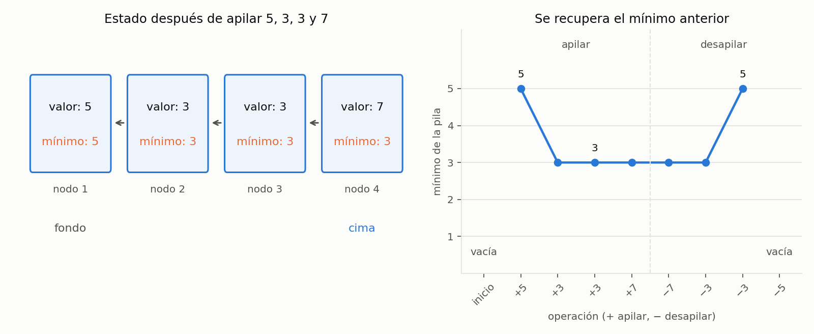

# Ejercicio 3. Una pila con mínimo en tiempo constante

> ★ Una pila con una operación `minimo` que cuesta $O(1)$ en el peor caso. Diseña la
> estructura, enuncia el invariante que la hace correcta y da el costo de cada
> operación. (C3)

## Resumen

Cada nodo de la pila guarda tres campos: su valor, el mínimo de los valores desde
ese nodo hasta el fondo y una referencia al siguiente nodo. Consultar el mínimo
consiste en leer el campo correspondiente de la cima. Al apilar se calcula un nuevo
mínimo con una sola comparación; al desapilar, el nodo que queda como cima ya tiene
guardado el mínimo anterior.

El invariante relaciona **todos** los mínimos guardados con los segmentos de la pila
que representan. Así se demuestra que la información sigue siendo válida después
de cualquier secuencia de operaciones, incluidos los mínimos repetidos. Todas las
operaciones cuestan $\Theta(1)$ en el peor caso en el modelo indicado y la estructura
ocupa $\Theta(n)$ palabras para $n\ge1$. El cuaderno
[`ejercicio-03.ipynb`](ejercicio-03.ipynb) comprueba el invariante, compara con una
pila de referencia y genera la figura del informe.

| operación | resultado | costo en el peor caso |
|---|---|---|
| `push(x)` | agrega $x$ a la cima | $\Theta(1)$ |
| `pop()` | quita y devuelve la cima | $\Theta(1)$ |
| `peek()` | devuelve la cima sin quitarla | $\Theta(1)$ |
| `minimum()` | devuelve el menor valor sin quitarlo | $\Theta(1)$ |
| `is_empty()` | indica si la pila está vacía | $\Theta(1)$ |

## 1. Formulación

La pila almacena elementos de un orden total, con repetidos permitidos. Si su
contenido, del fondo a la cima, es $S=(x_1,\ldots,x_n)$, las operaciones deben cumplir:

- `push(x)` deja $(x_1,\ldots,x_n,x)$.
- `pop()` devuelve $x_n$ y deja $(x_1,\ldots,x_{n-1})$.
- `peek()` devuelve $x_n$ y conserva la pila.
- `minimum()` devuelve $\min\{x_1,\ldots,x_n\}$ y conserva la pila.
- `is_empty()` devuelve si $n=0$ y conserva la pila.

En una pila vacía, `pop`, `peek` y `minimum` lanzan `IndexError` y conservan
el estado. La construcción crea una pila vacía.

Se usa el modelo word RAM: cada valor y cada referencia ocupa una palabra, comparar
valores cuesta $O(1)$ y reservar o liberar un nodo de tamaño fijo cuesta $O(1)$.
Los valores mantienen su orden mientras están almacenados; modificarlos desde fuera
podría invalidar los mínimos guardados. El código Python implementa la estructura
del modelo; los tiempos de su gestor de memoria quedan fuera de esta cuenta.

## 2. Diseño y algoritmo

Recorrer la pila cada vez que se pide el mínimo cuesta $\Theta(n)$ en el peor caso.
Guardar únicamente el mínimo actual tampoco basta para actualizarlo al desapilar:
después de apilar 5 y 3, quitar el 3 debe recuperar el 5. Recalcularlo recorriendo
lo que queda volvería a costar tiempo lineal.

La solución es conservar el mínimo de cada estado anterior. El nodo asociado a $x_i$
guarda

$$m_i=\min\{x_1,\ldots,x_i\}.$$

Al insertar $x$ sobre una pila no vacía basta calcular $\min(x,m_n)$. Al quitar la
cima, $m_{n-1}$ ya está guardado en el nodo siguiente. Para una pila vacía, el primer
valor es también su mínimo; no hace falta ningún valor centinela del orden.

Cada nodo se representa mediante una tupla de **tres campos de tamaño fijo**:
`(value, prefix_minimum, next_node)`. El último campo referencia otra tupla o
`None`; no contiene una copia de la cadena. La referencia `_top` identifica el
primer nodo, o vale `None` en la pila vacía.

```python
class MinStack:
    __slots__ = ("_top",)

    def __init__(self):
        self._top = None

    def is_empty(self):
        return self._top is None

    def push(self, x):
        previous = self._top
        if previous is None or x < previous[1]:
            cached_min = x
        else:
            cached_min = previous[1]
        self._top = (x, cached_min, previous)

    def pop(self):
        node = self._top
        if node is None:
            raise IndexError("desapilar de una pila vacía")
        self._top = node[2]
        return node[0]

    def peek(self):
        if self._top is None:
            raise IndexError("tope de una pila vacía")
        return self._top[0]

    def minimum(self):
        if self._top is None:
            raise IndexError("mínimo de una pila vacía")
        return self._top[1]
```

**Ejemplo.** Después de apilar, en ese orden, 5, 3, 3 y 7, el estado es:

| posición, del fondo a la cima | valor $x_i$ | mínimo guardado $m_i$ |
|---:|---:|---:|
| 1 | 5 | 5 |
| 2 | 3 | 3 |
| 3 | 3 | 3 |
| 4, cima | 7 | 3 |

Los tres primeros `pop()` devuelven 7, 3 y 3. Los mínimos que quedan son,
respectivamente, 3, 3 y 5. La primera copia del 3 sigue estando representada cuando
se elimina la segunda: cada nodo conserva su propio mínimo acumulado.

## 3. Invariante y correctitud

Siguiendo la conferencia 3, sección 1, se separan la conservación del estado válido,
la postcondición de cada operación y su terminación.

**Proposición 1 (invariante de representación).** Si el contenido abstracto de la
pila es $(x_1,\ldots,x_n)$, entonces:

1. Si $n=0$, `_top` es `None`. Si $n>0$, `_top` referencia el nodo de $x_n$.
2. Desde la cima se alcanza una cadena de exactamente $n$ nodos, con valores
   $x_n,x_{n-1},\ldots,x_1$, que termina en `None`.
3. El nodo de $x_i$ guarda $m_i=\min\{x_1,\ldots,x_i\}$ para cada $1\le i\le n$.

*Inicialización.* El constructor asigna `None` a `_top`. La pila y la cadena están
vacías, y no hay mínimos que verificar.

*Mantenimiento al apilar.* Supongamos que el invariante se cumple.
Si $n=0$, se crea el nodo $(x,x,\texttt{None})$: su mínimo es correcto y la cadena
tiene un solo nodo. Si $n>0$, el invariante garantiza que `previous[1]` vale
$m_n=\min\{x_1,\ldots,x_n\}$. El código guarda

$$m=\min(x,m_n)=\min\{x_1,\ldots,x_n,x\}.$$

El nuevo nodo enlaza con la antigua cima y pasa a ser la cima. Los nodos anteriores
no cambian, así que todos sus mínimos siguen siendo correctos. La cadena contiene
exactamente el nuevo contenido, en orden de cima a fondo. Esto también vale cuando
$x=m_n$: se conserva un valor mínimo válido en el nuevo nodo.

*Mantenimiento al desapilar.* Si la pila no está vacía, el primer nodo contiene
$x_n$ y enlaza con el nodo de $x_{n-1}$, o con `None` si $n=1$. Se devuelve $x_n$ y
se mueve `_top` al siguiente nodo. Los nodos restantes no cambian y sus mínimos
siguen siendo los de sus respectivos prefijos. En particular, la nueva cima guarda
el mínimo de toda la pila restante. Si no hay nodos, se lanza la excepción antes
de modificar el estado.

*Operaciones de consulta.* `peek` lee el valor del primer nodo y `minimum` lee su
mínimo acumulado. Por el invariante, son $x_n$ y $m_n$, exactamente los resultados
exigidos. `is_empty` comprueba la equivalencia entre pila vacía y referencia `None`.
Ninguna consulta modifica nodos ni referencias; en vacío, las excepciones tampoco
modifican el estado.

*Conclusión.* El constructor establece el invariante y cada operación lo conserva
y cumple su postcondición. Por inducción sobre la longitud de la secuencia de
operaciones, la estructura responde correctamente después de cualquier secuencia
válida, incluidas las llamadas en vacío con el comportamiento especificado. $\square$

**Terminación.** Cada método ejecuta un número acotado de instrucciones, sin ciclos
ni recursión. Por tanto, termina devolviendo su resultado o lanzando la excepción
especificada. No hace falta un potencial decreciente para estos métodos.

## 4. Costo y espacio

**Proposición 2.** Cada operación cuesta $\Theta(1)$ en el peor caso en el modelo de
la sección 1.

*Demostración.* `push` inspecciona la cima, hace cero comparaciones entre valores
si está vacía o exactamente una si no lo está, crea un nodo de tres campos y cambia
una referencia. `pop` inspecciona un nodo y cambia una referencia. `peek` y
`minimum` consultan un campo; `is_empty` compara una referencia con `None`. Las ramas de
error también tienen longitud constante. Ninguna operación recorre la cadena ni
copia los elementos existentes. Todas realizan al menos una operación del modelo,
por lo que sus costos son $\Theta(1)$. $\square$

| operación | comparaciones entre valores almacenados | nodos nuevos |
|---|---:|---:|
| construir | 0 | 0 |
| `push(x)`, pila vacía | 0 | 1 |
| `push(x)`, pila no vacía | 1 | 1 |
| `pop()` | 0 | 0 |
| `peek()` | 0 | 0 |
| `minimum()` | 0 | 0 |
| `is_empty()` | 0 | 0 |

Con $n$ elementos hay $n$ nodos de tres campos y una referencia a la cima: el
almacenamiento es $\Theta(n)$ palabras para $n\ge1$ y $\Theta(1)$ en vacío. El campo
de mínimo ocupa una palabra adicional por nodo respecto a una pila enlazada
convencional, es decir, $\Theta(n)$ palabras adicionales. Cada llamada necesita
$\Theta(1)$ espacio temporal.

Usar `list.append` para guardar los pares valor-mínimo también permite consultar el
mínimo en tiempo constante, pero una inserción puede redimensionar el arreglo y
mover $\Theta(n)$ referencias. La representación enlazada permite justificar el
tiempo constante **en cada operación**, bajo la hipótesis explícita sobre nodos de
tamaño fijo.

## 5. Verificación numérica

El cuaderno [`ejercicio-03.ipynb`](ejercicio-03.ipynb) ejecuta la misma clase del
informe. Usa una lista como pila de referencia y calcula su mínimo con `min`, sin
utilizar los mínimos acumulados de la implementación. Las inspecciones del
invariante recorren la estructura solo en el código de pruebas; las operaciones
de la pila conservan su costo constante.

| afirmación del informe | comprobación |
|---|---|
| ejemplo de la sección 2 | valores y mínimos guardados al apilar 5, 3, 3 y 7, y mínimos después de desapilar |
| invariante y postcondiciones | todas las secuencias de hasta seis modificaciones elegidas entre `push(-1)`, `push(0)`, `push(1)` y `pop()` |
| consultas y excepciones | `peek`, `minimum` y `is_empty` antes de la primera modificación y después de cada una; las consultas conservan la cima |
| comparaciones de la sección 4 | valores instrumentados, en órdenes creciente, decreciente, constante y alternado, con tamaños de hasta 4096 |

La enumeración cubre **5 461 secuencias**, incluidas secuencias con desapilados en
vacío y con valores repetidos. En cada estado se comprueban la cadena completa, el
mínimo de cada nodo y todas las consultas. La prueba de comparaciones confirma
cero o una por inserción y cero en las demás operaciones; la cota de tiempo se
justifica además con el número acotado de instrucciones de cada método.



*Figura 1. A la izquierda, los valores y los mínimos acumulados de los nodos después
de apilar 5, 3, 3 y 7. A la derecha, la evolución del mínimo al apilar esos valores
y desapilarlos todos. El mínimo vuelve a 5 únicamente después de quitar las dos
copias del 3; en vacío, `minimum` lanza `IndexError`.*

El cuaderno queda guardado con sus salidas y la figura. Para reproducirlo hacen
falta Python 3 y `matplotlib`.

## 6. Conclusiones

Guardar en cada nodo el mínimo desde ese nodo hasta el fondo permite restaurar
el mínimo anterior con solo desapilar. El invariante debe describir todos los
mínimos guardados, porque cualquiera de esos nodos puede convertirse después en
la cima. Con esta representación, `minimum` y las demás operaciones de la pila
cuestan $\Theta(1)$ en el peor caso, a cambio de una palabra de mínimo por nodo.
