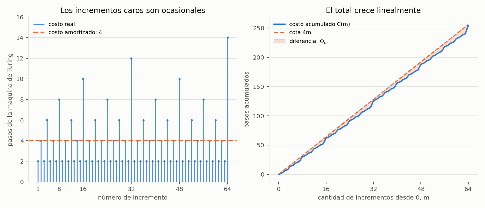

# Ejercicio 4. Análisis amortizado de un contador binario en una máquina de Turing

> ★★ El contador binario en una máquina de Turing, del ejercicio 7 de la conferencia
> 1. Demuestra con un potencial que $m$ incrementos desde 0 cuestan $O(m)$ pasos en
> total, aunque uno solo pueda costar $\Theta(\log m)$. Es la pregunta que la
> conferencia 1 dejó abierta. (C1, C4)

## Resumen

Para incrementar un contador binario se cambian sus unos menos significativos por
ceros, se escribe un uno en el primer cero o blanco y se devuelve la cabeza al bit
menos significativo. Si hay $t$ unos consecutivos al comienzo, la máquina propuesta
hace exactamente $2t+2$ transiciones, incluidos el regreso y la detección de un
marcador de inicio.

El potencial $\Phi=2\,\operatorname{unos}(v)$, donde $v$ es el valor actual, paga el
recorrido de los unos que se borran. El costo amortizado de cada incremento es
exactamente 4. Desde 0, el potencial inicial es cero y nunca se hace negativo;
por tanto, los $m$ incrementos cuestan a lo sumo $4m$ pasos. Para esta máquina se
obtiene además la identidad exacta

$$C(m)=4m-2\,\operatorname{unos}(m),$$

de modo que el total es $\Theta(m)$, aunque una operación aislada pueda costar
$\Theta(\log m)$. El cuaderno [`ejercicio-04.ipynb`](ejercicio-04.ipynb) simula las
transiciones, comprueba las identidades y genera la figura del informe.

| cantidad | resultado para la máquina propuesta |
|---|---|
| costo real de un incremento con $t$ unos de acarreo | $2t+2$ |
| potencial | $2\,\operatorname{unos}(v)$ |
| cambio de potencial | $2(1-t)$ |
| costo amortizado por incremento | 4 |
| costo total desde 0 | $4m-2\,\operatorname{unos}(m)\le4m$ |
| peor incremento entre los primeros $m\ge1$ | $2\lfloor\log_2m\rfloor+2$ |

## 1. Formulación y modelo

La conferencia 1, ejercicio 7, pide una máquina de Turing de una cinta que sume 1
a un número binario, empezando y terminando con la cabeza en el bit menos
significativo. Aquí se aplica esa operación $m\ge0$ veces desde el valor 0.

Cada paso es una transición de la máquina: lee un símbolo, escribe un símbolo,
se mueve **una celda** a la izquierda o a la derecha y cambia de estado. No se
supone acceso aleatorio a los bits. El conteo incluye todos los movimientos de
vuelta; la simulación Python solo sirve para ejecutar y contar esas transiciones.

Se representa el contador de esta forma:

- La celda $-1$ contiene un marcador `#` que nunca se modifica.
- La celda 0 contiene el bit menos significativo; las posiciones crecientes
  contienen bits de peso creciente. Por ejemplo, el valor 6 se escribe `0 1 1`
  en las celdas 0, 1 y 2, respectivamente.
- Más allá de los bits escritos hay blancos, representados por `_`. Un blanco
  encontrado al propagar el acarreo se trata como un cero y permite extender
  el número cuando hace falta.
- El valor inicial 0 se representa con `#` en $-1$, un `0` en 0 y blancos en
  las demás celdas. La cabeza empieza en 0.

Al completar un incremento se conserva esta representación y la cabeza vuelve a
0. La siguiente llamada reinicia el estado de control. Se cuentan los pasos de
los incrementos, sin imprimir ni copiar el contador después de cada llamada;
añadir control de llamada de costo constante mantiene la cota $O(m)$.

## 2. Máquina, correctitud y costo de un incremento

La máquina tiene dos estados de trabajo y uno final:

- `A`: propagar el acarreo hacia los bits de mayor peso.
- `R`: regresar al marcador de inicio sin cambiar los bits.
- `F`: terminar con la cabeza en la celda 0.

| estado | símbolo leído | símbolo escrito | movimiento | estado siguiente |
|---|---|---|---|---|
| `A` | `1` | `0` | derecha | `A` |
| `A` | `0` | `1` | izquierda | `R` |
| `A` | `_` | `1` | izquierda | `R` |
| `R` | `0` | `0` | izquierda | `R` |
| `R` | `1` | `1` | izquierda | `R` |
| `R` | `#` | `#` | derecha | `F` |

El siguiente simulador ejecuta esa tabla. Un diccionario representa la cinta
dispersa: las posiciones ausentes contienen blanco. El costo devuelto es el
número de transiciones, no el tiempo que tarda Python.

```python
TRANSITIONS = {
    ("A", "1"): ("A", "0", 1),
    ("A", "0"): ("R", "1", -1),
    ("A", "_"): ("R", "1", -1),
    ("R", "0"): ("R", "0", -1),
    ("R", "1"): ("R", "1", -1),
    ("R", "#"): ("F", "#", 1),
}


def increment(tape):
    head, state, steps = 0, "A", 0
    while state != "F":
        symbol = tape.get(head, "_")
        state, written, move = TRANSITIONS[state, symbol]
        tape[head] = written
        head += move
        steps += 1
    return steps, head
```

**Proposición 1 (correctitud).** Si la cinta representa $v\ge0$ al comenzar,
`increment` termina representando $v+1$, con la cabeza en 0.

*Demostración.* Sea $t$ la cantidad de unos consecutivos desde el bit menos
significativo. En estado `A`, al llegar a la posición $h$, los $h$ bits inferiores
ya se cambiaron de 1 a 0 y los demás bits mantienen su valor original. Este es
el invariante del recorrido de acarreo: vale con $h=0$ y se conserva al leer un
uno, borrarlo y avanzar.

Al llegar a la posición $t$, se lee el primer cero o un blanco y se escribe un
uno. Los bits borrados sumaban $2^t-1$ y el nuevo uno vale $2^t$, así que el
cambio neto es $2^t-(2^t-1)=1$. La máquina pasa al estado `R`, que conserva los
bits y retrocede hasta `#`; su última transición avanza a 0 y termina.

El recorrido de acarreo es finito porque solo hay una cantidad finita de unos
escritos. El regreso también termina: en cada paso previo al marcador disminuye
en una unidad la distancia a la celda $-1$. Por tanto, la máquina cumple la
postcondición y termina. $\square$

**Proposición 2 (costo real).** Si el acarreo atraviesa $t$ unos, el incremento
cuesta exactamente

$$c=2t+2.$$

*Demostración.* Se hacen $t$ transiciones para borrar esos unos y una para escribir
el nuevo uno. La cabeza queda en $t-1$. Desde allí necesita $t$ movimientos hacia
la izquierda para llegar al marcador en $-1$, y una transición más para reconocerlo
y regresar a 0. El total es $t+1+t+1=2t+2$. Con $t=0$, se escribe el nuevo uno,
se va directamente al marcador y se vuelve: también son dos pasos. $\square$

**Ejemplo.** El incremento de 7 a 8 cambia los bits `1 1 1` por `0 0 0 1`.
Hay $t=3$ unos de acarreo, de modo que cuesta 8 pasos. El incremento siguiente,
de 8 a 9, solo cambia el bit de posición 0 y cuesta 2 pasos.

## 3. Potencial y cota amortizada

La operación cara borra unos. Esto sugiere guardar crédito en cada uno existente,
como en la conferencia 4, sección 2. Cada uno que se borra cuesta un movimiento
de ida y otro de regreso: conviene asignarle dos unidades de crédito.

Definimos, entre incrementos completos,

$$\Phi(v)=2\,\operatorname{unos}(v),$$

donde $\operatorname{unos}(v)$ cuenta los unos de la representación binaria de
$v$, y $\operatorname{unos}(0)=0$. No es un potencial de terminación: puede subir
o bajar. Su función es transferir costo entre operaciones de la secuencia.

**Proposición 3.** Cada incremento tiene costo amortizado exactamente 4.

*Demostración.* El incremento borra $t$ unos y crea uno nuevo, por lo que

$$\operatorname{unos}(v+1)-\operatorname{unos}(v)=1-t,$$

y el cambio de potencial es $\Delta\Phi=2(1-t)$. Por la definición de costo
amortizado de la conferencia 4,

$$\widehat c=c+\Delta\Phi=(2t+2)+2(1-t)=4.\qquad\square$$

En el ejemplo de 7 a 8, el potencial baja de 6 a 2: sus cuatro unidades de caída
pagan la diferencia entre el costo real 8 y el amortizado 4. De 8 a 9, el
potencial sube de 2 a 4: el costo real es 2 y se guardan otras dos unidades.

**Proposición 4.** Los $m$ incrementos desde 0 cuestan $O(m)$ pasos y, para esta
tabla de transiciones,

$$C(m)=4m-2\,\operatorname{unos}(m).$$

*Demostración.* Sea $\Phi_i=2\,\operatorname{unos}(i)$ el potencial después de
$i$ incrementos. Al sumar $\widehat c_i=c_i+\Phi_i-\Phi_{i-1}$, los cambios
intermedios se cancelan:

$$4m=\sum_{i=1}^m\widehat c_i
=\sum_{i=1}^m c_i+\Phi_m-\Phi_0.$$

Como se empieza desde 0, $\Phi_0=0$. Además, $\Phi_m\ge0$. Por tanto,

$$C(m)=4m-\Phi_m=4m-2\,\operatorname{unos}(m)\le4m.$$

Esto incluye $m=0$, cuando ambos lados de la identidad son cero. $\square$

La condición inicial es parte de la demostración: la suma de costos reales queda
acotada por la de costos amortizados porque el potencial final no es menor que
el inicial. No intervienen probabilidades ni hipótesis sobre un caso típico.

## 4. Peor caso individual y alcance de la cota

Cada incremento cuesta al menos dos pasos. Así, para $m\ge1$,

$$2m\le C(m)\le4m,$$

y el total es $\Theta(m)$. El costo medio por operación en esa secuencia es
$C(m)/m=4-2\,\operatorname{unos}(m)/m$; es una cuenta sobre una secuencia
determinista. Como $\operatorname{unos}(m)\le\lfloor\log_2m\rfloor+1$, ese
cociente tiende a 4 al crecer $m$.

**Una operación aislada puede ser cara.** Si el valor actual es $2^k-1$, todos
sus $k$ bits son unos. El incremento siguiente cuesta $2k+2=\Theta(k)$ pasos.
Entre los primeros $m\ge1$ incrementos, el máximo es exactamente

$$\max_{1\le i\le m}c_i=2\lfloor\log_2m\rfloor+2.$$

En efecto, el incremento número $i$ borra tantos unos como factores 2 hay en
$i$: si borra $t$, entonces $i=2^t(2q+1)$ para algún $q\ge0$. De ahí
$t\le\lfloor\log_2m\rfloor$. La igualdad se alcanza con
$i=2^{\lfloor\log_2m\rfloor}$.

*Tabla 1. Pasos de los primeros ocho incrementos. El potencial se mide después
de cada incremento.*

| valor anterior | valor nuevo | unos de acarreo $t$ | costo real $c_i$ | $\Phi_i$ | costo amortizado | acumulado $C(i)$ |
|---:|---:|---:|---:|---:|---:|---:|
| 0 | 1 | 0 | 2 | 2 | 4 | 2 |
| 1 | 2 | 1 | 4 | 2 | 4 | 6 |
| 2 | 3 | 0 | 2 | 4 | 4 | 8 |
| 3 | 4 | 2 | 6 | 2 | 4 | 14 |
| 4 | 5 | 0 | 2 | 4 | 4 | 16 |
| 5 | 6 | 1 | 4 | 4 | 4 | 20 |
| 6 | 7 | 0 | 2 | 6 | 4 | 22 |
| 7 | 8 | 3 | 8 | 2 | 4 | 30 |

Multiplicar el peor costo individual por $m$ daría $O(m\log m)$, una cota válida
pero poco ajustada. Los incrementos caros consumen unos acumulados en operaciones
anteriores; no pueden repetirse indefinidamente sin reconstruir ese crédito.

**Por qué se especifica «desde 0».** Si se empieza en un valor arbitrario $a$,
el mismo argumento da

$$C_a(m)=4m+2\,\operatorname{unos}(a)-2\,\operatorname{unos}(a+m).$$

La cota resultante es $O(m+\operatorname{unos}(a))$. No se puede quitar sin más
el término inicial: desde $a=2^k-1$, un solo incremento cuesta $2k+2$, aunque
$m=1$. Desde 0 ese crédito inicial es cero.

Las constantes 2 y 4 y las identidades exactas corresponden a la tabla de la
sección 2. Otras implementaciones pueden añadir pasos constantes por llamada
y conservar el resultado asintótico.

## 5. Verificación numérica

El cuaderno [`ejercicio-04.ipynb`](ejercicio-04.ipynb) ejecuta la misma tabla de
transiciones y el mismo simulador del informe. Lee la cinta después de cada
incremento y compara su valor con un contador entero de referencia. Los cálculos
del oráculo, la inspección de la cinta y los gráficos quedan fuera del costo
de la máquina simulada.

| afirmación del informe | comprobación |
|---|---|
| correctitud y regreso de la cabeza | 4096 incrementos consecutivos desde 0; valor, marcador, alfabeto y posición final de la cabeza |
| costo real | $c_i=2t_i+2$, con $t_i$ calculado independientemente desde el valor anterior |
| potencial y amortizado | potencial leído de la cinta, cambio $2(1-t_i)$ y $\widehat c_i=4$ en cada incremento |
| total y peor caso | identidades exactas y cotas para cada prefijo de los 4096 incrementos |
| Tabla 1 y ejemplos | ocho primeras filas; transiciones de 7 a 8 y de 8 a 9 |
| estado inicial arbitrario | 33 incrementos desde cada valor inicial entre 0 y 255 |
| extensión del contador | acarreos completos desde $2^k-1$, para $1\le k\le32$ |

Los casos iniciales arbitrarios suman **8448 incrementos** adicionales. En cada
caso se comprueba también la identidad con potencial inicial no nulo. Estas
pruebas verifican la implementación y los tamaños enumerados; la demostración
por potencial cubre cualquier cantidad de incrementos.



*Figura 1. A la izquierda, los costos reales de los primeros 64 incrementos y
el costo amortizado constante 4. A la derecha, el costo acumulado y la recta
$4m$; la distancia vertical entre ambos es exactamente el potencial final.*

El cuaderno queda guardado con sus salidas y la figura. Para reproducirlo hacen
falta Python 3 y `matplotlib`.

## 6. Conclusiones

El potencial adecuado es dos veces la cantidad de unos: cada uno borrado libera
crédito para la ida del acarreo y el regreso de la cabeza. El costo amortizado
es constante y el potencial inicial es cero, por lo que los $m$ incrementos
desde 0 cuestan $\Theta(m)$ pasos en total. Los picos individuales de
$\Theta(\log m)$ son compatibles con esa garantía sobre toda la secuencia.
