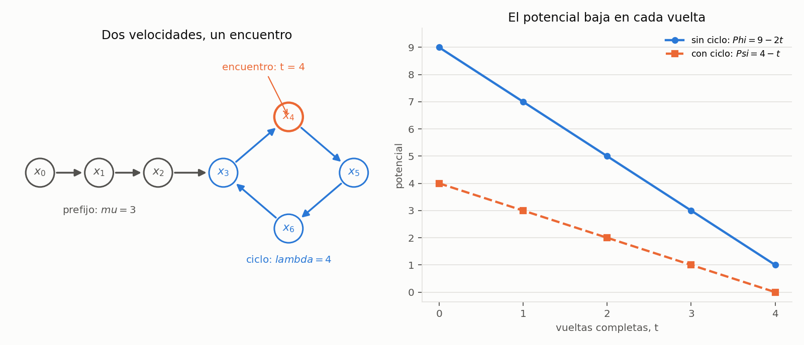

# Ejercicio 5. Detección de ciclos en una lista enlazada con el algoritmo de Floyd

> ★★ Detección de ciclos en una lista enlazada con dos punteros que avanzan a
> velocidades 1 y 2 (algoritmo de Floyd). Demuestra que se encuentran si y solo si
> hay un ciclo, con un invariante, y que termina, con un potencial. Da el costo. (C3)

## Resumen

El algoritmo mantiene dos punteros que parten de la cabeza: uno avanza un enlace
por vuelta y el otro, dos. Se comparan **después de avanzar**, por identidad de
nodos. Si el rápido llega al final, no hay ciclo; si ambos coinciden en un nodo,
hay uno. La coincidencia inicial no cuenta y tampoco se comparan los valores
almacenados.

El invariante describe las posiciones después de $t$ vueltas como $x_t$ y $x_{2t}$,
donde $x_i$ es el nodo alcanzado tras seguir $i$ enlaces desde la cabeza. En una
lista con un prefijo de $\mu$ nodos y un ciclo de longitud $\lambda$, el encuentro
ocurre en la primera vuelta positiva que es múltiplo de $\lambda$ y no es menor
que $\mu$. Un potencial entero decreciente demuestra la terminación, tanto si hay
ciclo como si no lo hay. El tiempo es $\Theta(n+1)$ y la memoria auxiliar,
$\Theta(1)$, donde $n$ cuenta los nodos distintos alcanzables desde la cabeza.

El cuaderno [`ejercicio-05.ipynb`](ejercicio-05.ipynb) comprueba el resultado,
el invariante, los potenciales y los costos, y genera la figura del informe.

| tipo de lista | vueltas del ciclo `while` | resultado | potencial |
|---|---:|---|---|
| sin ciclo, $n\ge0$ nodos | $\lfloor n/2\rfloor$ | `False` | $n-2t$ |
| con ciclo, $n=\mu+\lambda$ | $T=\lambda\max\{1,\lceil\mu/\lambda\rceil\}$ | `True` | $T-t$ |

## 1. Formulación y modelo

La entrada es una referencia `head`, que puede ser `None`. Cada nodo tiene un
campo `next` que referencia otro nodo o vale `None`. Hay una cantidad finita de
nodos alcanzables y los enlaces no cambian durante la ejecución. La salida debe
ser `True` si y solo si, al seguir enlaces desde `head`, se alcanza un ciclo.
Los ciclos de componentes inaccesibles desde la cabeza no forman parte del
problema.

Se usa el modelo word RAM: un nodo, sus campos y las referencias ocupan un número
constante de palabras; seguir un enlace, comparar referencias y comprobar `None`
cuestan $O(1)$. La lista ya está construida y no se modifica. Los valores pueden
repetirse: dos nodos distintos con el mismo valor siguen siendo nodos distintos.

Para el análisis, sea $x_0=\texttt{head}$ y $x_{i+1}=x_i.\texttt{next}$. Extendemos
esta notación con $x_i=\texttt{None}$ para todos los índices posteriores al final
de una lista sin ciclo. Esta extensión es matemática: el programa nunca intenta
leer `None.next`.

Al seguir un único enlace desde cada nodo, solo hay dos posibilidades:

- **Sin ciclo:** $x_0,\ldots,x_{n-1}$ son nodos distintos y $x_n=\texttt{None}$.
  Para $n=0$, la cabeza ya es `None`.
- **Con ciclo:** hay un prefijo de longitud $\mu\ge0$ y un ciclo de longitud
  $\lambda\ge1$. Los $n=\mu+\lambda$ primeros nodos son distintos y
  $x_{\mu+\lambda}=x_\mu$. A partir de $\mu$, las posiciones se repiten cada
  $\lambda$ enlaces. Ningún nodo del prefijo vuelve a aparecer.

Estas cantidades se usan en la demostración; el algoritmo no necesita conocerlas.

## 2. Algoritmo

```python
def has_cycle(head):
    slow = fast = head
    while fast is not None and fast.next is not None:
        slow = slow.next
        fast = fast.next.next
        if slow is fast:
            return True
    return False
```

La evaluación de `and` evita leer el sucesor de `None`. La condición del `while` garantiza que
el rápido puede dar dos pasos; su segundo paso sí puede dejarlo en `None`.
La seguridad del avance de `slow` se justifica con el invariante de la sección 3.

Se usa `is` para comparar la identidad de los nodos. Comparar sus valores daría
falsos positivos, por ejemplo en una cadena sin ciclo cuyos nodos almacenan todos
el mismo valor. Comprobar la igualdad antes del primer avance también sería
incorrecto: los dos punteros parten de la misma cabeza en cualquier entrada.

**Ejemplo.** Sea la lista

$$x_0\to x_1\to x_2\to x_3\to x_4\to x_5\to x_6\to x_3.$$

Aquí $\mu=3$, $\lambda=4$ y $n=7$. La primera coincidencia después de avanzar
ocurre en $t=4$, en el nodo $x_4$; no tiene por qué ocurrir en la entrada del ciclo.

*Tabla 1. Posiciones en el ejemplo. La fila inicial no se usa para detectar un ciclo.*

| vueltas $t$ | lento $x_t$ | rápido $x_{2t}$ | ¿encuentro válido? | potencial $T-t$ |
|---:|---|---|---|---:|
| 0 | $x_0$ | $x_0$ | no se comprueba | 4 |
| 1 | $x_1$ | $x_2$ | no | 3 |
| 2 | $x_2$ | $x_4$ | no | 2 |
| 3 | $x_3$ | $x_6$ | no | 1 |
| 4 | $x_4$ | $x_4$ | sí | 0 |

## 3. Invariante y correctitud parcial

Como en la conferencia 3, sección 1, se separan la correctitud parcial y la
terminación. Primero se relacionan las variables del programa con el recorrido
de la lista.

**Proposición 1 (invariante).** Después de $t$ vueltas completas, antes de comprobar
la igualdad o de volver a evaluar la condición del `while`,

$$\texttt{slow}=x_t,\qquad\texttt{fast}=x_{2t}.$$

Si la ejecución continúa a otra vuelta, no hubo coincidencia en ninguna de las
vueltas $1,\ldots,t$. En el estado inicial se cumple la misma relación con $t=0$.

*Demostración.* **Inicialización.** Ambos punteros se asignan a la cabeza, que
es $x_0$; todavía no se ha comprobado ninguna coincidencia.

**Mantenimiento.** Supongamos la relación antes de una vuelta y que la condición del `while` se
cumple. Entonces $x_{2t}$ y $x_{2t+1}$ son nodos. También $x_t$ es un nodo:
en una cadena finita, $t\le2t<n$; en una lista con ciclo, todos los $x_i$ son
nodos. Los avances son, por tanto, seguros y dejan

$$\texttt{slow}=x_{t+1},\qquad\texttt{fast}=x_{2t+2}=x_{2(t+1)}.$$

Si coinciden, se devuelve `True`. Si no, queda registrada una nueva vuelta sin
encuentro y el invariante vale para la siguiente evaluación de la condición del `while`.

**Conclusión.** Las dos formas de devolver un resultado se analizan a
continuación. $\square$

**Proposición 2 (no hay falsos positivos).** Si el algoritmo devuelve `True`, la
lista tiene un ciclo alcanzable.

*Demostración.* El retorno ocurre después de una vuelta $t\ge1$, con
$x_t=x_{2t}$ por el invariante. En una lista sin ciclo, la condición del `while` que permitió
esta vuelta implica $2t\le n$. Como $t\ge1$, se tiene $t<n$, así que $x_t$ es
un nodo. Si $2t<n$, las posiciones distintas $t$ y $2t$ contienen nodos distintos;
si $2t=n$, el rápido es `None` y el lento sigue siendo un nodo. Ningún caso
permite la igualdad. Por tanto, devolver `True` implica que hay ciclo. $\square$

**Proposición 3 (el retorno negativo es correcto).** Si el algoritmo devuelve
`False`, no hay ciclo alcanzable.

*Demostración.* Solo devuelve `False` cuando `fast` o `fast.next` es `None`.
Si hubiera un ciclo alcanzable, toda la sucesión $x_i$ estaría formada por
nodos con sucesor, incluidos los del prefijo, y el invariante haría imposible
esa salida. $\square$

Para probar que un ciclo siempre produce un encuentro, falta demostrar que el
programa termina. La aritmética del ciclo permite construir el potencial.

## 4. Potenciales y terminación

### 4.1. Lista sin ciclo

**Proposición 4.** En una lista sin ciclo, el potencial

$$\Phi(t)=n-2t$$

es entero no negativo en cada evaluación de la condición del `while` y disminuye en 2 por
vuelta. El algoritmo termina después de $\lfloor n/2\rfloor$ vueltas.

*Demostración.* Inicialmente $\Phi(0)=n\ge0$. Por el invariante, la condición del `while` se
cumple exactamente cuando $2t+1<n$, es decir, cuando $\Phi(t)\ge2$. Una vuelta
deja $\Phi(t+1)=\Phi(t)-2\ge0$. El potencial no puede disminuir de esa manera
indefinidamente. No hay retorno positivo por la Proposición 2, por lo que se
sale al quedar $\Phi=0$ o $\Phi=1$, después de $\lfloor n/2\rfloor$ vueltas.
Esto incluye $n=0$ y $n=1$, con cero vueltas. $\square$

### 4.2. Lista con ciclo

**Lema 5 (condición de encuentro).** Para una vuelta hipotética $t\ge1$ en una
lista con parámetros $\mu,\lambda$,

$$x_t=x_{2t}\quad\Longleftrightarrow\quad t\ge\mu
\ \text{ y }\ \lambda\mid t.$$

*Demostración.* Si $t<\mu$, el lento está en el prefijo y ese nodo no aparece
en ninguna posición posterior; como $2t>t$, no hay igualdad. Si $t\ge\mu$,
ambos están dentro del ciclo. Sus posiciones respecto a la entrada son
$(t-\mu)\bmod\lambda$ y $(2t-\mu)\bmod\lambda$. Son iguales si y solo si
su diferencia $t$ es múltiplo de $\lambda$. $\square$

Dentro del ciclo, la diferencia de posiciones avanza una unidad módulo
$\lambda$ por vuelta. No puede saltarse para siempre el residuo cero.

**Proposición 6.** Sea

$$T=\lambda\max\left\{1,\left\lceil\frac{\mu}{\lambda}\right\rceil\right\}.$$

El potencial $\Psi(t)=T-t$ demuestra la terminación: el algoritmo devuelve
`True` exactamente en la vuelta $T$.

*Demostración.* $T$ se define aritméticamente como el menor múltiplo positivo de
$\lambda$ que es al menos $\mu$. No se supone de antemano que el programa llegue
a esa vuelta: los $x_i$ del lema son posiciones del recorrido matemático.

Inicialmente $\Psi(0)=T\ge1$. En una lista con ciclo, la condición del `while` siempre se
cumple. Si el programa sigue activo tras $t$ vueltas, entonces $t<T$:
para $t<T$ el lema descarta encuentros, y al ejecutar la vuelta $T$ obliga a
devolver `True`. Cada vuelta aumenta $t$ en 1 y disminuye $\Psi$ exactamente en
1, conservando su no negatividad hasta ese retorno. Un entero no negativo no
puede bajar indefinidamente, y al llegar a cero ambos punteros coinciden.
$\square$

El potencial puede usar parámetros desconocidos para el programa: es una
herramienta de la demostración y no ocupa memoria durante la ejecución.
Si $\mu=0$, la fórmula da $T=\lambda$, incluso cuando la cabeza ya pertenece
al ciclo. En particular, un solo nodo que apunta a sí mismo se detecta en una
vuelta. Esto explica por qué no se puede aceptar el encuentro de la vuelta 0.

Las Proposiciones 2, 3, 4 y 6 prueban la correctitud total: la ejecución siempre
termina y los punteros se encuentran después de avanzar si y solo si hay un
ciclo alcanzable.

## 5. Costo y verificación numérica

Cada vuelta hace un número constante de lecturas de enlaces y comparaciones
de referencias. Si no hay ciclo, se hacen $\lfloor n/2\rfloor$ vueltas.
Si hay ciclo, se hacen $T$ vueltas y

$$\max\{\mu,\lambda\}\le T\le\mu+\lambda=n.$$

La cota inferior se debe a que $T\ge\mu$ y es un múltiplo positivo de $\lambda$.
Para la superior, si $\mu=0$, $T=\lambda$; si $\mu>0$, el primer múltiplo de
$\lambda$ no menor que $\mu$ es menor que $\mu+\lambda$. Así, con ciclo se
cumple también $n/2\le T\le n$.

El tiempo es **$\Theta(n+1)$** en ambos casos: $\Theta(n)$ para $n\ge1$, y
constante para la lista vacía. Solo se guardan las referencias `slow` y `fast`,
por lo que la memoria auxiliar es **$\Theta(1)$**. No se incluyen la construcción
de la entrada ni los instrumentos de prueba. En particular, el algoritmo no
usa un conjunto de visitados, no calcula $\mu$ ni $\lambda$ y no almacena $t$.

El cuaderno usa un recorrido independiente con un diccionario de nodos visitados
como oráculo. Ese recorrido sí ocupa memoria lineal, pero pertenece únicamente
a las pruebas. Una versión vigilada de Floyd comprueba las posiciones y el
descenso del potencial en cada vuelta, y compara su resultado con el código
del informe.

| afirmación del informe | comprobación |
|---|---|
| cadenas sin ciclo, incluidos vacío y un nodo | los 129 largos entre 0 y 128; resultado, invariante, potencial y $\lfloor n/2\rfloor$ vueltas |
| ciclos con y sin prefijo | los 4160 pares $0\le\mu\le64$, $1\le\lambda\le64$; encuentro, potencial y fórmula exacta de $T$ |
| Tabla 1 | traza de $\mu=3$, $\lambda=4$, con encuentro en $x_4$ |
| comparación por identidad | todos los nodos de esas listas tienen el mismo valor |
| estructuras con nodos inaccesibles y cualquier sucesor | todos los grafos de sucesor sobre 0 a 5 nodos, con todas las cabezas posibles, incluida `None`: 50 069 casos |

En la última batería, cada uno de los $k$ nodos puede apuntar a cualquiera de
los $k$ nodos o a `None`; también hay $k+1$ cabezas posibles. El total es
$\sum_{k=0}^{5}(k+1)^{k+1}=50\,069$. Se compara el algoritmo del informe con
el oráculo y se comprueba que conserva todos los enlaces.

Las verificaciones cubren los tamaños enumerados; el invariante y los potenciales
demuestran el resultado para cualquier entrada que cumpla el modelo.



*Figura 1. A la izquierda, la lista del ejemplo, con el encuentro en $x_4$ tras
cuatro vueltas. A la derecha, los potenciales de ese ejemplo y de una cadena de
nueve nodos. El primero llega a cero al encontrarse los punteros; el segundo
termina en 1 porque el rápido queda en el último nodo y la condición del `while` falla.*

El cuaderno se guarda con sus salidas y la figura. Para reproducirlo hacen falta
Python 3, `matplotlib` e `IPython`.

## 6. Conclusiones

El invariante $\texttt{slow}=x_t$, $\texttt{fast}=x_{2t}$ permite descartar los
falsos positivos y expresar el encuentro mediante congruencias. En un ciclo,
la primera vuelta positiva múltiplo de $\lambda$ y no menor que $\mu$ fuerza la
coincidencia. Los potenciales $n-2t$ y $T-t$ prueban la terminación en las dos
formas posibles de la lista. Floyd detecta exactamente los ciclos alcanzables,
en tiempo lineal y con memoria auxiliar constante.
