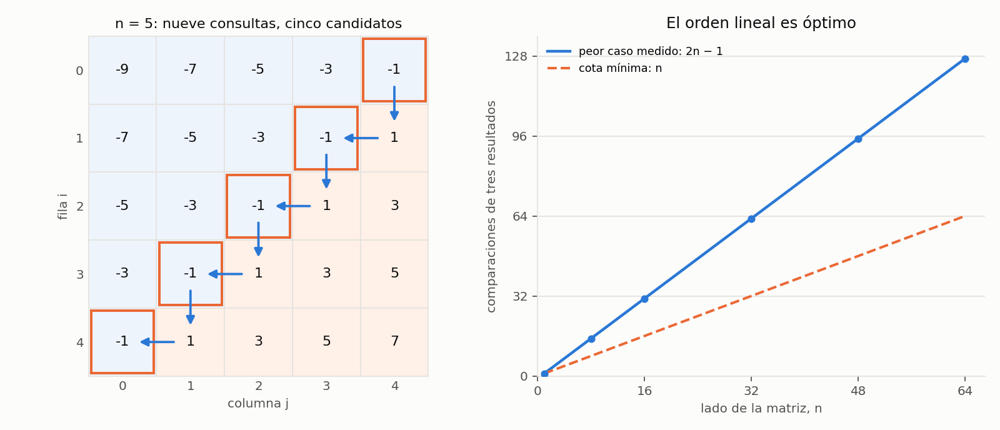

# Ejercicio 6. Búsqueda en una matriz ordenada por filas y columnas

> ★★ Una matriz $n \times n$ tiene filas y columnas ordenadas de forma creciente.
> Diseña un algoritmo que decida si contiene un valor $x$ en $O(n)$ comparaciones,
> demuestra su correctitud con un invariante, y demuestra con un adversario que no
> se puede en $o(n)$. (C3, C5)

## Resumen

Se empieza en la esquina superior derecha. Si el valor buscado es menor que el
de esa celda, se descarta su columna; si es mayor, se descarta su fila. Cada
comparación elimina una fila o una columna del rectángulo donde todavía puede
estar la respuesta. El invariante conserva todas las apariciones posibles y el
potencial suma la cantidad de filas y columnas restantes.

Para $n\ge1$, el recorrido usa a lo sumo $2n-1$ comparaciones de tres resultados
y memoria auxiliar $\Theta(1)$. Hay matrices que alcanzan ese costo. Un adversario
mantiene $n$ candidatos independientes en una antidiagonal y obliga a consultar
todos para certificar que $x$ no aparece. La cota mínima es $\Omega(n)$, así que
el algoritmo es óptimo en orden asintótico en el modelo indicado.

El cuaderno [`ejercicio-06.ipynb`](ejercicio-06.ipynb) comprueba el algoritmo,
el invariante, el potencial y las familias usadas en las demostraciones, y genera
la figura del informe.

| aspecto | resultado |
|---|---|
| región candidata | filas $i,\ldots,n-1$ y columnas $0,\ldots,j$ |
| invariante | toda aparición de $x$ está en la región candidata |
| potencial | $\Phi=(n-i)+(j+1)$ |
| comparaciones del recorrido, peor caso | $2n-1$ si $n\ge1$; 0 si $n=0$ |
| cota mínima, comparando $x$ con celdas | al menos $n$ en el peor caso |
| tiempo y memoria auxiliar | $\Theta(n+1)$ en el peor caso; $\Theta(1)$ palabras |

## 1. Formulación y modelo

**Precondición.** $A$ es una matriz cuadrada de lado $n\ge0$, con elementos de un
orden total, y $x$ pertenece al mismo orden. Para todos los índices válidos,

$$A[r][c]\le A[r][c+1],\qquad A[r][c]\le A[r+1][c].$$

Se permiten repetidos; el algoritmo también sirve si todas estas desigualdades
son estrictas. La matriz no cambia durante la búsqueda.

**Postcondición.** Devolver `True` si existe una celda cuyo valor es $x$, y
`False` en caso contrario. Para $n=0$, la salida es `False`.

Como en el ejercicio 2, se usa acceso aleatorio a las celdas y una comparación
de tres resultados entre $x$ y $A[r][c]$ cuesta una unidad. El acceso y las
operaciones con índices cuestan $O(1)$ en el word RAM. Se estudia una consulta
sobre una matriz sin preprocesamiento; construir un índice de todas sus claves
sería otro problema y tendría su propio costo.

El tamaño $n$ es el lado, no la cantidad de celdas, que es $n^2$. Verificar que
la entrada es cuadrada y está ordenada no forma parte de la consulta: son sus
precondiciones. Las claves solo aportan información mediante comparaciones.

## 2. Algoritmo

En la esquina superior derecha del rectángulo candidato, todas las celdas a la
izquierda son menores o iguales y todas las celdas de abajo son mayores o iguales.
Por eso una comparación permite elegir qué borde descartar.

```python
def compare(x, y):
    return (x > y) - (x < y)  # -1, 0 o 1


def matrix_contains(A, x, compare=compare):
    n = len(A)
    i, j = 0, n - 1
    while i < n and j >= 0:
        r = compare(x, A[i][j])
        if r == 0:
            return True
        if r < 0:
            j -= 1
        else:
            i += 1
    return False
```

La función `compare` implementa la consulta del modelo. Su código Python evalúa
dos predicados sobre claves; el conteo exacto mide llamadas a esa función.
Si se cobran ambos predicados por separado, la cota pasa a $4n-2$ para $n\ge1$
y sigue siendo $O(n)$. Las comprobaciones sobre índices o sobre el resultado
de la consulta no son nuevas comparaciones de claves.

No se crean submatrices ni se copian filas: $i$ y $j$ describen la región que queda.

**Ejemplo.** Para $n=3$, $x=0$ y

$$A=\begin{pmatrix}-5&-3&-1\\-3&-1&1\\-1&1&3\end{pmatrix},$$

la búsqueda termina sin encontrar el valor tras cinco comparaciones.

*Tabla 1. Traza del ejemplo; los índices comienzan en 0.*

| vuelta | celda $(i,j)$ | valor | respuesta | acción | $\Phi$ antes | $\Phi$ después |
|---:|---|---:|---|---|---:|---:|
| 1 | $(0,2)$ | $-1$ | $x>A[0][2]$ | descartar fila 0 | 6 | 5 |
| 2 | $(1,2)$ | $1$ | $x<A[1][2]$ | descartar columna 2 | 5 | 4 |
| 3 | $(1,1)$ | $-1$ | $x>A[1][1]$ | descartar fila 1 | 4 | 3 |
| 4 | $(2,1)$ | $1$ | $x<A[2][1]$ | descartar columna 1 | 3 | 2 |
| 5 | $(2,0)$ | $-1$ | $x>A[2][0]$ | descartar fila 2 | 2 | 1 |

La región queda vacía con $i=3$. No hace falta que el potencial llegue a cero.

## 3. Invariante y correctitud

Sea

$$R(i,j)=\{(r,c):i\le r<n,\ 0\le c\le j\}.$$

Si $i=n$ o $j=-1$, este conjunto es vacío.

**Proposición 1 (invariante).** Cada vez que se evalúa la condición del `while`, se cumple

$$0\le i\le n,\qquad -1\le j\le n-1,$$

y toda celda de $A$ cuyo valor es $x$ pertenece a $R(i,j)$. Equivalentemente,
ninguna celda ya descartada contiene $x$.

*Demostración.* **Inicialización.** Con $i=0$, $j=n-1$, la región es toda la
matriz y los límites son válidos. Para $n=0$ ya está vacía.

**Mantenimiento.** Si la condición del `while` se cumple, $(i,j)$ es una celda válida y
está en la esquina superior derecha de $R(i,j)$. Hay tres casos:

- Si $x=A[i][j]$, se devuelve `True` y la celda comparada certifica la salida.
- Si $x<A[i][j]$, para cada $r\ge i$ se cumple
  $A[r][j]\ge A[i][j]>x$. La columna $j$ de la región no contiene el valor
  buscado. Disminuir $j$ en 1 descarta solo esas celdas y conserva el invariante.
- Si $x>A[i][j]$, para cada $c\le j$ se cumple
  $A[i][c]\le A[i][j]<x$. La fila $i$ de la región no contiene el valor buscado.
  Aumentar $i$ en 1 descarta solo esas celdas y conserva el invariante.

En ambas ramas sin igualdad también se conservan los límites.

**Conclusión.** Si se devuelve `True`, se ha encontrado una aparición. Si la
condición del `while` falla, los límites implican $i=n$ o $j=-1$, por lo que $R(i,j)$ está
vacío. El invariante asegura entonces que no existe ninguna aparición de $x$,
y devolver `False` es correcto. $\square$

**Proposición 2 (terminación).** El potencial

$$\Phi(i,j)=(n-i)+(j+1)$$

es un entero no negativo y disminuye en una unidad en cada vuelta que no devuelve
`True`.

*Demostración.* Los dos sumandos son no negativos por los límites del invariante.
Dentro del ciclo ambos son al menos 1. Si no hay igualdad, se incrementa $i$ o
se decrementa $j$, y por tanto $\Phi'=\Phi-1\ge0$. Un entero no negativo no puede
disminuir estrictamente indefinidamente. La rama de igualdad devuelve de inmediato,
así que toda ejecución termina. Junto con la Proposición 1, esto demuestra la
correctitud total, en el sentido de la conferencia 3, sección 1. $\square$

## 4. Costo y cota mínima por adversario

### 4.1. Cota superior y peor caso del recorrido

**Proposición 3.** Para $n\ge1$, el algoritmo hace como máximo $2n-1$
comparaciones de tres resultados.

*Demostración.* Inicialmente $\Phi=2n$. Antes de la comparación número $q$,
las $q-1$ anteriores no encontraron el valor y disminuyeron el potencial en
una unidad cada una. Como la condición del `while` se sigue cumpliendo,

$$2\le\Phi=2n-(q-1),$$

de donde $q\le2n-1$. El argumento incluye la comparación que pudiera devolver
`True`. Si $n=0$, no se entra al ciclo y se hacen cero comparaciones. $\square$

La cota se alcanza. Para $n\ge1$, considérese $x=0$ y la matriz

$$B[r][c]=2(r+c-(n-1))-1.$$

Cada paso a la derecha o hacia abajo aumenta el valor en 2, así que las filas
y las columnas son estrictamente crecientes. Todos los valores son impares y
0 no aparece. En la antidiagonal $r+c=n-1$ el valor es $-1$; en la siguiente,
$r+c=n$, es 1.

Desde $(0,n-1)$ se alternan un paso hacia abajo y uno hacia la izquierda hasta
llegar a $(n-1,0)$. Se comparan las $n$ celdas de valor $-1$ de la antidiagonal
y $n-1$ celdas de valor 1, para un total de $2n-1$. Tras la última comparación
se descarta la última fila.

El tiempo en el peor caso es $\Theta(n)$ para $n\ge1$, o $\Theta(n+1)$ si se
incluye la matriz vacía. La memoria auxiliar es $\Theta(1)$ palabras: solo se
guardan $n$, $i$, $j$ y el resultado de una comparación. La matriz de entrada
ocupa $n^2$ celdas y no se incluye en esa memoria auxiliar.

### 4.2. Adversario: una antidiagonal de candidatos independientes

La conferencia 5, sección 5, exige que las respuestas del adversario sean
consistentes y que, antes de terminar, no queden dos entradas compatibles con
salidas distintas. Aquí basta responder siempre como la matriz $B$ anterior.

**Lema 4 (candidato que puede ocultar el valor).** Sea

$$D=\{(r,n-1-r):0\le r<n\}.$$

Para cualquier $p\in D$, cambiar solo $B[p]=-1$ por 0 produce una matriz $B^p$
con filas y columnas estrictamente crecientes, que sí contiene $x=0$.

*Demostración.* En la fila y la columna de $p$, el vecino anterior, si existe,
vale $-3$, y el siguiente, si existe, vale 1. Reemplazar $-1$ por 0 conserva
las desigualdades $-3<0<1$. El resto de las filas y columnas no cambia.
El valor 0 pasa a estar precisamente en $p$. $\square$

Las $n$ posiciones de $D$ son incomparables por el orden de la matriz: al
aumentar la fila disminuye la columna. Consultar una de ellas no descarta otra.

**Proposición 5 (cota mínima).** Todo algoritmo determinista que solo obtiene
información comparando $x$ con una celda de $A$ necesita al menos $n$
comparaciones en el peor caso.

*Demostración.* El adversario contesta cada consulta como $B$, con $x=0$.
Estas respuestas siempre son consistentes, pues $B$ es una entrada válida.

Supongamos que el algoritmo termina sin comparar alguna posición $p\in D$.
En $B$ la salida correcta es `False`. Pero, por el lema, $B^p$ es una entrada
válida cuya salida correcta es `True`. Como solo cambia la celda no consultada,
todas las respuestas recibidas son idénticas en ambas entradas. Por determinismo,
el algoritmo sigue la misma ejecución y devuelve lo mismo en las dos: se
equivoca en una de ellas. Por tanto, debe consultar las $n$ posiciones de $D$.
Cada comparación consulta solo una celda, de modo que hacen falta al menos
$n$ comparaciones. $\square$

La imposibilidad de $o(n)$ también se mantiene si se permiten comparaciones
entre dos celdas. Tras $q$ comparaciones se han involucrado a lo sumo $2q$
posiciones de $D$. Si $2q<n$, queda alguna que no participó y el mismo cambio
de $-1$ a 0 conserva todas las respuestas. En ese modelo más amplio se obtiene
al menos $\lceil n/2\rceil$ comparaciones, que sigue siendo $\Omega(n)$.

Las cotas $n$ y $2n-1$ prueban **optimalidad en orden asintótico** para el
modelo principal. No afirman que $2n-1$ sea la mejor constante exacta entre
todos los algoritmos. Contar únicamente las dos salidas posibles, «sí» y «no»,
no daría la cota lineal: el adversario cuenta el trabajo necesario para
descartar las apariciones que todavía son compatibles con las respuestas.

## 5. Verificación numérica

El cuaderno ejecuta el mismo código del informe y lo compara con un recorrido
completo de la matriz. Una versión vigilada comprueba el invariante y el
descenso del potencial en cada paso. El recorrido de referencia, la validación
de las precondiciones y las aserciones quedan fuera del costo del algoritmo.

| afirmación del informe | comprobación |
|---|---|
| correctitud con repetidos y matriz vacía | todas las matrices no decrecientes de lados 0 a 3 sobre $\{0,2,4\}$; consultas enteras de $-1$ a 5 |
| invariante, potencial y conteo | comprobaciones en cada paso de esas búsquedas y comparación con el número de llamadas reales a `compare` |
| matrices de mayor tamaño | 280 búsquedas reproducibles sobre matrices de lados 1, 2, 3, 4, 8, 16 y 32 |
| Tabla 1 | traza sobre $B$ de lado 3, buscando 0 |
| cota superior ajustada para este recorrido | $B$ de cada lado entre 0 y 128; 0 o $2n-1$ comparaciones según corresponda |
| consistencia de los candidatos del adversario | las 511 matrices obtenidas al cambiar a 0 cualquier subconjunto de la antidiagonal de $B$, para lados 0 a 8 |

La última batería comprueba filas y columnas estrictamente crecientes en cada
matriz. Solo las posiciones elegidas cambian, y 0 aparece si y solo si el
subconjunto es no vacío. Así se verifica en casos pequeños que los candidatos
pueden variar independientemente sin violar el orden.

*Tabla 2. Comparaciones medidas en $B$ y cota mínima del modelo principal.*

| lado $n$ | recorrido medido | $2n-1$ para $n\ge1$ | cota mínima $n$ |
|---:|---:|---:|---:|
| 0 | 0 | — | 0 |
| 1 | 1 | 1 | 1 |
| 2 | 3 | 3 | 2 |
| 4 | 7 | 7 | 4 |
| 8 | 15 | 15 | 8 |
| 16 | 31 | 31 | 16 |
| 32 | 63 | 63 | 32 |
| 64 | 127 | 127 | 64 |

Las pruebas verifican el código y los tamaños enumerados; el invariante, el
potencial y el adversario demuestran los resultados para todo $n$.



*Figura 1. A la izquierda, el recorrido sobre $B$ de lado 5: nueve comparaciones
que visitan todos los candidatos de la antidiagonal. A la derecha, el peor
caso del recorrido y la cota mínima del modelo principal, ambos lineales.*

El cuaderno se guarda con sus salidas y la figura. Para reproducirlo hacen falta
Python 3, `matplotlib` e `IPython`.

## 6. Conclusiones

El orden por filas y columnas permite descartar un borde completo por
comparación. El invariante conserva todas las apariciones dentro del rectángulo
restante y el potencial de filas más columnas prueba terminación y costo
lineal. El adversario mantiene $n$ posiciones independientes donde puede
ocultarse el valor y prueba que no se puede resolver en $o(n)$ comparaciones.
El recorrido usa memoria auxiliar constante y alcanza el orden óptimo.
