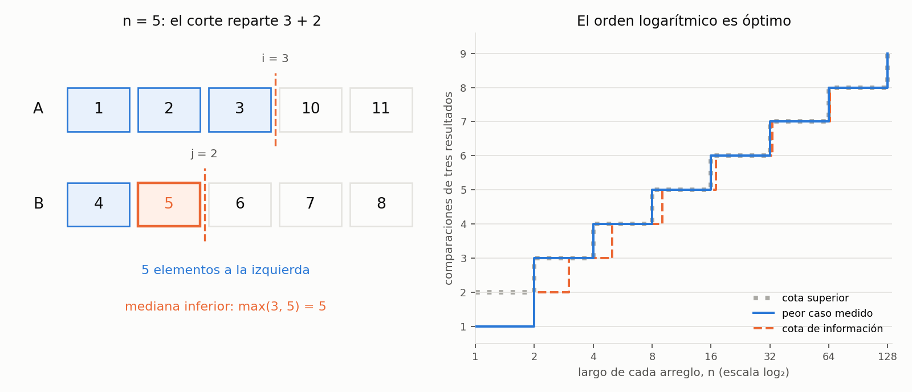

# Ejercicio 7. Mediana de dos arreglos ordenados

> ★★★ Mediana de dos arreglos ordenados de largo $n$: el $n$-ésimo menor de los
> $2n$ elementos. Diseña un algoritmo $O(\log n)$, demuestra su correctitud y
> da la cota de información. (C2, C3, C5)

## Resumen

Se busca una partición que deje exactamente $n$ elementos a la izquierda:
$i$ del primer arreglo y $n-i$ del segundo. Si todos los elementos de esa parte
son menores o iguales que los de la derecha, su máximo es el $n$-ésimo menor.
No hace falta mezclar los arreglos: basta encontrar el corte correcto.

El algoritmo hace búsqueda binaria sobre $i\in\{0,\ldots,n\}$ usando una
condición monótona. El invariante conserva el primer corte que cumple esa
condición; al encontrarlo, se prueban las dos desigualdades necesarias para la
partición. El potencial es la distancia entre los extremos del intervalo de
cortes y se reduce al menos a la mitad.

Para $n\ge1$, se usan a lo sumo $\lceil\log_2(n+1)\rceil+1$ comparaciones de
tres resultados y $\Theta(1)$ palabras auxiliares. Una cota de información de
$\lceil\log_2(2n)\rceil$ comparaciones prueba que el orden logarítmico es óptimo.
El cuaderno [`ejercicio-07.ipynb`](ejercicio-07.ipynb) comprueba el algoritmo,
las demostraciones en casos pequeños y las cifras del informe, y genera la figura.

| aspecto | resultado |
|---|---|
| mediana pedida | el $n$-ésimo menor, contando repeticiones |
| corte | $i$ elementos de $A$ y $j=n-i$ de $B$ a la izquierda |
| búsqueda binaria | primer $i$ con $i=n$ o $B[n-i-1]\le A[i]$ |
| potencial | $\Phi=hi-lo$, con $\Phi'\le\lfloor\Phi/2\rfloor$ |
| comparaciones del algoritmo | a lo sumo $\lceil\log_2(n+1)\rceil+1$ |
| cota de información | $\lceil\log_2(2n)\rceil$ en el peor caso |
| tiempo y memoria auxiliar | $\Theta(\log(n+1))$ en el peor caso; $\Theta(1)$ palabras |

## 1. Formulación y modelo

**Precondición.** $A$ y $B$ tienen el mismo largo $n\ge1$, están ordenados de
forma no decreciente y contienen claves de un mismo orden total. Se permiten
valores repetidos y las entradas no se modifican durante la ejecución.

**Postcondición.** Devolver el elemento de posición $n$ al ordenar conjuntamente
los $2n$ elementos, contando desde 1 y conservando las multiplicidades. Esta es
la **mediana inferior**. No se pide el promedio entre las posiciones $n$ y $n+1$;
el problema solo requiere un orden, no operaciones aritméticas sobre las claves.

Se usa acceso aleatorio: leer una posición y operar con índices cuesta $O(1)$
en el word RAM. Como en el ejercicio 2, una comparación de tres resultados
entre claves cuesta una unidad. Para la cota mínima, las claves son opacas:
solo se comparan y se puede devolver alguna de las recibidas. No se permite
deducir un valor por operaciones aritméticas con su representación.

El algoritmo comprueba en tiempo constante que los largos sean iguales y no
nulos. Si no lo son, lanza `ValueError`: una entrada vacía no tiene la mediana
pedida. Verificar el orden de los arreglos no forma parte de la consulta.

## 2. Partición y algoritmo

Un corte $i$ determina $j=n-i$ y dos partes, sin copiar sus elementos:

$$L=A[0:i]\cup B[0:j],\qquad R=A[i:n]\cup B[j:n].$$

Se trata de multiconjuntos: cada aparición cuenta. En $L$ hay exactamente $n$
elementos y en $R$, otros $n$. Como cada arreglo ya está ordenado, para que
todo $L$ sea menor o igual que todo $R$ solo faltan las desigualdades cruzadas:

$$A[i-1]\le B[j]\quad\text{si }i>0,\ j<n,$$
$$B[j-1]\le A[i]\quad\text{si }j>0,\ i<n.$$

Cuando un lado de una desigualdad no existe, no hay nada que comprobar.
Si ambas condiciones se cumplen, la respuesta es el máximo de las claves a la
izquierda del corte: $A[i-1]$, $B[j-1]$, o la única existente en un corte extremo.

Para buscar el corte, definimos

$$P(i)=\begin{cases}
B[n-i-1]\le A[i],&0\le i<n,\\
\text{verdadero},&i=n.
\end{cases}$$

**Lema 1 (monotonía).** $P$ pasa de falso a verdadero como máximo una vez.

*Demostración.* Al aumentar $i$, $A[i]$ no disminuye y $B[n-i-1]$ no aumenta.
Por tanto, una desigualdad verdadera sigue siendo verdadera en cualquier
posición posterior menor que $n$. Además, $P(n)$ es verdadero por definición.
$\square$

Existe, pues, un primer índice $p$ con $P(p)$ verdadero. El algoritmo lo encuentra
por búsqueda binaria y toma el máximo izquierdo.

```python
def compare(x, y):
    return (x > y) - (x < y)  # -1, 0 o 1


def lower_median(A, B, compare=compare):
    n = len(A)
    if n == 0 or len(B) != n:
        raise ValueError("se requieren dos arreglos del mismo largo positivo")
    lo, hi = 0, n
    while lo < hi:
        i = (lo + hi) // 2
        j = n - i
        if compare(A[i], B[j - 1]) < 0:
            lo = i + 1
        else:
            hi = i
    i, j = lo, n - lo
    if i == 0:
        return B[j - 1]
    if j == 0:
        return A[i - 1]
    if compare(A[i - 1], B[j - 1]) >= 0:
        return A[i - 1]
    return B[j - 1]
```

El punto medio siempre satisface $i<n$ dentro del ciclo, de modo que $j\ge1$:
ambos accesos de la comparación son válidos. Los casos finales evitan índices
negativos y no requieren centinelas como $-\infty$ o $+\infty$.

El conteo exacto mide llamadas a `compare`. Su implementación Python evalúa
dos predicados sobre claves; cobrar ambos por separado duplica la cota superior
y conserva el orden logarítmico. No se crean segmentos ni arreglos auxiliares.

**Ejemplo.** Sean

$$A=[1,2,3,10,11],\qquad B=[4,5,6,7,8].$$

Se busca la posición 5 de los diez elementos. El corte final es $i=3$, $j=2$:
los cinco menores son $[1,2,3]$ y $[4,5]$, y la respuesta es 5.

*Tabla 1. Búsqueda del primer corte válido en el ejemplo.*

| vuelta | $[lo,hi]$ antes | $i$ | $j$ | comparación | $[lo,hi]$ después | $\Phi$ después |
|---:|---|---:|---:|---|---|---:|
| 1 | $[0,5]$ | 2 | 3 | $A[2]=3<B[2]=6$ | $[3,5]$ | 2 |
| 2 | $[3,5]$ | 4 | 1 | $A[4]=11>B[0]=4$ | $[3,4]$ | 1 |
| 3 | $[3,4]$ | 3 | 2 | $A[3]=10>B[1]=5$ | $[3,3]$ | 0 |

Una comparación final entre $A[2]=3$ y $B[1]=5$ devuelve 5. En total son cuatro
comparaciones. Los cortes satisfacen $3\le6$ y $5\le10$, como exige la partición.

## 3. Invariante, correctitud y terminación

**Proposición 2 (invariante de búsqueda).** Cada vez que se evalúa la condición del `while`,

$$0\le lo\le hi\le n,\qquad P(hi)=\text{verdadero},$$

y $P(k)$ es falso para todo $0\le k<lo$. En particular, el primer índice
verdadero $p$ pertenece a $[lo,hi]$.

*Demostración.* **Inicialización.** $lo=0$, $hi=n$; no hay índices menores que
$lo$, y $P(n)$ es verdadero por definición.

**Mantenimiento.** Si $lo<hi$, el punto medio cumple $lo\le i<hi\le n$.
La comparación evalúa exactamente $P(i)$.

- Si $A[i]<B[n-i-1]$, $P(i)$ es falso. Por monotonía, todos los índices hasta
  $i$ también son falsos. Asignar $lo=i+1$ conserva el invariante.
- En otro caso, $P(i)$ es verdadero. Asignar $hi=i$ conserva un extremo
  verdadero y no cambia la propiedad sobre los índices menores que $lo$.

En ambas ramas se conservan los límites y no se descarta $p$.

**Conclusión.** Al salir, $lo=hi=p$: esa posición es verdadera y todas las
anteriores son falsas. $\square$

**Proposición 3 (el corte encontrado da la mediana).** Con $i=p$ y $j=n-p$,
todos los elementos de $L$ son menores o iguales que todos los de $R$.
El máximo de $L$ es, por tanto, el $n$-ésimo menor.

*Demostración.* Dentro de cada arreglo ya se cumple el orden entre sus partes.
Para las dos condiciones cruzadas:

- Si $j>0$ e $i<n$, $P(i)$ verdadero da $B[j-1]\le A[i]$.
- Si $i>0$ y $j<n$, la minimalidad de $p$ implica que $P(i-1)$ es falso.
  Como $n-(i-1)-1=j$, esto da $A[i-1]<B[j]$, que implica la desigualdad pedida.

Así, todo elemento de la parte izquierda precede o iguala a cualquiera de la
derecha. La izquierda tiene exactamente $n$ elementos contando repeticiones,
y su máximo ocupa la posición $n$ en una ordenación conjunta. Las ramas
finales devuelven precisamente ese máximo. La prueba también cubre los cortes
$i=0$ y $i=n$, donde una parte izquierda de un arreglo está vacía. $\square$

**Proposición 4 (potencial).** $\Phi=hi-lo$ es un entero no negativo y, en cada
vuelta, satisface

$$0\le\Phi'\le\lfloor\Phi/2\rfloor<\Phi.$$

*Demostración.* Escribamos $d=hi-lo>0$, de modo que $i=lo+\lfloor d/2\rfloor$.
Si se asigna $hi=i$, la nueva distancia es $\lfloor d/2\rfloor$.
Si se asigna $lo=i+1$, es $d-\lfloor d/2\rfloor-1\le\lfloor d/2\rfloor$.
Ambas son no negativas y menores que $d$. Por tanto, el ciclo termina; las
Proposiciones 2 y 3 prueban la correctitud total. $\square$

## 4. Costo y cota de información

### 4.1. Cota superior

Inicialmente $\Phi=n$. Tras $t$ vueltas,

$$\Phi_t\le\left\lfloor\frac{n}{2^t}\right\rfloor.$$

Con $t=\lceil\log_2(n+1)\rceil$, esta cantidad es cero y la búsqueda ya terminó.
Cada vuelta usa una comparación; elegir el máximo izquierdo necesita como
mucho una más, y ninguna si $i=0$ o $j=0$. La cota total es

$$C(n)\le\lceil\log_2(n+1)\rceil+1.$$

Para $n=1$, se hace una sola comparación y se devuelve el menor de las dos
claves. En general, cada vuelta cuesta $O(1)$ además de la comparación y se
usan $\Theta(1)$ palabras auxiliares. La siguiente cota prueba que el tiempo
en el peor caso es $\Theta(\log(n+1))$; para $n\ge2$ se escribe también
$\Theta(\log n)$.

### 4.2. Información: $2n$ posiciones de salida posibles

La conferencia 5, sección 3, acota la altura de un árbol de decisión contando
sus hojas. Basta restringirse a entradas con las $2n$ claves distintas.

**Lema 5.** Cualquiera de las $2n$ posiciones de entrada puede contener la
mediana inferior en una instancia válida.

*Demostración.* Para que la respuesta sea $A[k-1]$, con $1\le k\le n$,
construimos un orden conjunto cuyos primeros $n$ elementos sean

$$B[0],\ldots,B[n-k-1],\ A[0],\ldots,A[k-1].$$

El primer bloque tiene $n-k$ elementos y puede estar vacío. Después se colocan
los elementos restantes de $A$ y luego los restantes de $B$, respetando el
orden interno de ambos arreglos. Se asignan claves distintas crecientes en
ese orden. La posición $n$ es $A[k-1]$. Intercambiando los papeles de $A$ y
$B$ se obtiene cualquier posición de $B$ como respuesta. $\square$

**Proposición 6 (cota mínima).** Todo algoritmo determinista de comparaciones
que resuelve el problema hace, en el peor caso, al menos

$$\left\lceil\log_2(2n)\right\rceil$$

comparaciones.

*Demostración.* En el modelo de claves opacas, una hoja del árbol indica qué
posición de entrada devolver. Por el lema, se necesitan al menos $2n$ hojas:
dos casos con distinta posición correcta no pueden compartir hoja.

Como las claves son distintas, comparar dos posiciones diferentes solo puede
dar $<$ o $>$; comparar una posición consigo misma da una respuesta fija y
no aporta ramificación. Aunque el comparador admita igualdad, en esta familia
el árbol tiene a lo sumo dos ramas relevantes por comparación. Un árbol de
altura $h$ tiene como máximo $2^h$ hojas, luego $2^h\ge2n$ y
$h\ge\lceil\log_2(2n)\rceil$. $\square$

Lo que se cuenta son **posiciones de salida**, no valores numéricos entre
instancias. Por ejemplo, si se asignan los rangos de 0 a $2n-1$ en cada orden,
la mediana tiene siempre rango $n-1$, pero corresponde a posiciones distintas.
El modelo obliga a identificar y devolver esa clave de entrada.

Las cotas inferior y superior son logarítmicas y difieren a lo sumo en una
comparación. Esto prueba optimalidad asintótica, sin afirmar una constante
exacta óptima para todos los largos.

## 5. Verificación numérica

El cuaderno compara el mismo código del informe con la referencia
`sorted(list(A) + list(B))[n - 1]`. Una versión vigilada verifica el invariante,
el primer corte verdadero, las condiciones de partición y la reducción del
potencial. El comparador instrumentado confirma las consultas del código real.
La ordenación de referencia y las aserciones no forman parte del costo analizado.

| afirmación del informe | comprobación |
|---|---|
| correctitud con repetidos | todos los pares de arreglos no decrecientes de largos 1 a 8 sobre $\{0,1,2\}$ |
| claves distintas y posiciones de salida | todas las intercalaciones de dos arreglos de largos 1 a 8, con claves distintas |
| invariante, partición y potencial | comprobaciones paso a paso en las dos baterías anteriores y en 900 pares adicionales reproducibles |
| Tabla 1 | traza de $A=[1,2,3,10,11]$, $B=[4,5,6,7,8]$ |
| Tabla 2 y cota superior | todos los primeros cortes posibles para cada largo entre 1 y 128 |
| construcción del Lema 5 | cada una de las $2n$ posiciones como mediana, para $1\le n\le64$, usando claves con identidad y etiqueta |
| entradas fuera del contrato de largos | arreglos vacíos o de largos distintos producen `ValueError` |

En la familia de cortes se construye, para cada $p\in\{0,\ldots,n\}$, una
entrada cuyo primer índice verdadero es precisamente $p$. El camino de la
búsqueda y su número de comparaciones dependen solo de ese índice; la
comparación final se hace exactamente cuando $0<p<n$. Por tanto, enumerar
todos esos cortes permite medir el peor conteo para cada largo.

*Tabla 2. Peor caso medido del algoritmo y cotas de comparaciones de tres resultados.*

| $n$ | peor caso medido | cota superior $\lceil\log_2(n+1)\rceil+1$ | información $\lceil\log_2(2n)\rceil$ |
|---:|---:|---:|---:|
| 1 | 1 | 2 | 1 |
| 2 | 3 | 3 | 2 |
| 3 | 3 | 3 | 3 |
| 4 | 4 | 4 | 3 |
| 8 | 5 | 5 | 4 |
| 16 | 6 | 6 | 5 |
| 32 | 7 | 7 | 6 |
| 64 | 8 | 8 | 7 |
| 128 | 9 | 9 | 8 |

Las pruebas verifican la implementación y los tamaños enumerados; las
demostraciones establecen los resultados para cualquier largo positivo.



*Figura 1. A la izquierda, los cortes del ejemplo: tres elementos de $A$ y dos
de $B$ forman los cinco menores, y la mediana inferior es 5. A la derecha, el
peor caso medido, la cota superior y la cota de información, de orden logarítmico.*

El cuaderno se guarda con sus salidas y la figura. Para reproducirlo hacen falta
Python 3, `matplotlib` e `IPython`.

## 6. Conclusiones

La búsqueda binaria se aplica al número de elementos que aporta cada arreglo a
la mitad izquierda. La monotonía permite localizar el primer corte verdadero
y su minimalidad garantiza las dos desigualdades cruzadas. El potencial prueba
terminación y costo logarítmico; las $2n$ posiciones posibles de la mediana dan
una cota de información del mismo orden. El algoritmo admite repetidos, conserva
los arreglos y usa memoria auxiliar constante.
