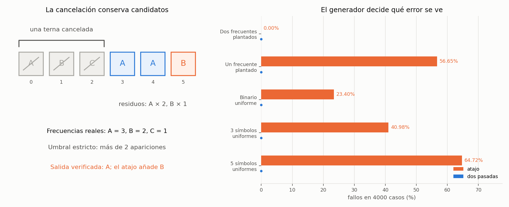

# Ejercicio 8. Elementos que aparecen más de n/3 veces

> ★★ El elemento que aparece más de $n/3$ veces. Generaliza Boyer-Moore con dos
> candidatos, enuncia el invariante reforzado y demuéstralo. Después escribe la
> versión que devuelve los candidatos con contador positivo sin verificarlos, y
> busca un generador de pruebas que no la atrape. Cuidado: el análogo del generador
> binario de la conferencia 3 sí la atrapa. (C3)

## Resumen

Se mantienen dos candidatos distintos con contadores positivos. Cuando llega un
valor diferente de ambos y los dos lugares están ocupados, se cancela una copia
de cada candidato junto con el valor nuevo: una terna de valores distintos.
El invariante reforzado dice que el prefijo procesado se puede partir en esas
ternas más las copias que describen los dos contadores.

Cualquier valor que aparezca más de $n/3$ veces debe sobrevivir entre los
candidatos, pero un superviviente puede no superar ese umbral. Una segunda
pasada cuenta las frecuencias reales y elimina los falsos positivos. El algoritmo
usa tiempo $\Theta(n+1)$ y memoria auxiliar $\Theta(1)$ palabras.

El atajo sin verificación ya falla en `A A B`: devuelve `A` y `B`, pero `B`
aparece exactamente $n/3$ veces. Por tanto, las pruebas binarias sí pueden
atraparlo. En cambio, un generador que garantice **dos** valores por encima del
umbral nunca lo detecta: ambos deben sobrevivir y no queda lugar para un tercero.

El cuaderno [`ejercicio-08.ipynb`](ejercicio-08.ipynb) ejecuta el mismo código,
comprueba la partición del invariante, busca contraejemplos y compara generadores.
También genera la figura del informe.

| aspecto | resultado |
|---|---|
| salida | todos los valores con frecuencia estrictamente mayor que $n/3$ |
| cantidad de respuestas | 0, 1 o 2 |
| cancelación | una terna de tres valores distintos |
| invariante | ternas canceladas más $c_1$ copias de $a$ y $c_2$ copias de $b$ |
| primera pasada | no pierde respuestas, pero puede conservar falsos positivos |
| segunda pasada | cuenta y verifica cada candidato activo |
| costo | $\Theta(n+1)$ tiempo; $\Theta(1)$ palabras auxiliares |
| generador que oculta el error | dos valores frecuentes plantados |

## 1. Formulación y modelo

**Precondición.** $A$ es un arreglo finito de largo $n\ge0$ que puede recorrerse
dos veces y no cambia durante la ejecución. Sus valores admiten igualdad, una
relación de equivalencia, y cada comparación cuesta $O(1)$. No se necesita orden
total ni una función hash. Guardar una referencia y operar con índices y
contadores de hasta $n$ cuesta $O(1)$ en el word RAM.

**Postcondición.** Devolver, sin duplicados y en cualquier orden, los valores de

$$H(A)=\{x:f_A(x)>n/3\},\qquad f_A(x)=|\{i:A[i]=x\}|.$$

La salida es una lista de representantes de esas clases de igualdad. La
comparación es estricta: aparecer exactamente $n/3$ veces no basta. Se comprueba
como $3f_A(x)>n$, sin división en punto flotante. Para el arreglo vacío se
devuelve `[]`. Aunque el enunciado use el singular, puede haber **dos** respuestas.
No puede haber tres: sus frecuencias sumarían más de $n$.

Un contador nulo significa que ese lugar está libre; el candidato que haya
quedado guardado allí no está activo. `None` sirve como valor inicial y también
puede ser un dato válido, porque la ocupación se decide por el contador.

## 2. Cancelación y algoritmo

La cancelación de parejas de Boyer-Moore, en la conferencia 3, se cambia por
cancelación de ternas. Si $x$ supera un tercio de las posiciones, quitar tres
valores distintos borra a lo sumo una copia de $x$. Así,

$$f_A(x)-1>\frac{n-3}{3}.$$

Esta observación sugiere la primera pasada. Antes de ocupar un lugar libre,
se comprueba si el valor coincide con algún candidato activo. Ese orden evita
guardar el mismo valor en los dos lugares.

```python
def third_candidates(A):
    a, b = None, None
    ca, cb = 0, 0
    for x in A:
        if ca > 0 and x == a:
            ca += 1
        elif cb > 0 and x == b:
            cb += 1
        elif ca == 0:
            a, ca = x, 1
        elif cb == 0:
            b, cb = x, 1
        else:
            ca -= 1
            cb -= 1
    return [(x, c) for x, c in ((a, ca), (b, cb)) if c > 0]


def frequent_thirds(A):
    candidates = [x for x, c in third_candidates(A)]
    frequencies = [0] * len(candidates)
    for x in A:
        for i, candidate in enumerate(candidates):
            if x == candidate:
                frequencies[i] += 1
    return [x for x, f in zip(candidates, frequencies) if 3 * f > len(A)]
```

La primera función devuelve a lo sumo dos pares de candidato y contador
residual. La segunda cuenta sus frecuencias originales; no reutiliza los
contadores residuales como si fueran frecuencias. Ambas conservan la entrada.

**Ejemplo.** Para `A B C A A B`, la terna inicial se cancela. Quedan dos
copias de `A` y una de `B`, pero las frecuencias reales son 3 y 2. Como
$n/3=2$, la respuesta es únicamente `A`.

*Tabla 1. Primera pasada del ejemplo. Un guion indica un lugar libre.*

| prefijo procesado | acción | $(a,c_1)$ activo | $(b,c_2)$ activo | ternas $q$ |
|---|---|---|---|---:|
| vacío | inicializar | — | — | 0 |
| `A` | ocupar primer lugar | `(A,1)` | — | 0 |
| `AB` | ocupar segundo lugar | `(A,1)` | `(B,1)` | 0 |
| `ABC` | cancelar `A,B,C` | — | — | 1 |
| `ABCA` | ocupar primer lugar | `(A,1)` | — | 1 |
| `ABCAA` | incrementar primer contador | `(A,2)` | — | 1 |
| `ABCAAB` | ocupar segundo lugar | `(A,2)` | `(B,1)` | 1 |

Se cumple $6=3\cdot1+2+1$. El atajo devolvería también `B`, un falso positivo
en el borde exacto del umbral.

## 3. Invariante reforzado, correctitud y terminación

### 3.1. Partición del prefijo

**Proposición 1 (invariante).** Después de procesar $i$ posiciones:

- Los contadores $c_1,c_2$ son enteros no negativos. Si ambos son positivos,
  los candidatos activos $a,b$ son distintos.
- Las posiciones del prefijo $A[0:i]$ se pueden partir en $q$ ternas, cada una
  con tres valores distintos, más $c_1$ posiciones de valor $a$ y $c_2$
  posiciones de valor $b$. Las partes son disjuntas y cubren el prefijo.

En particular,

$$i=3q+c_1+c_2.$$

Las ternas no tienen por qué ocupar posiciones consecutivas. La partición es
un testigo de la demostración; el algoritmo no la almacena.

*Demostración.* **Inicialización.** Para $i=0$, los contadores y $q$ valen 0.
La partición vacía cumple todas las condiciones.

**Mantenimiento.** Sea $x=A[i]$ el siguiente valor.

- Si coincide con un candidato activo, se añade su posición al grupo de copias
  de ese candidato y se incrementa el contador correspondiente.
- Si no coincide con ningún candidato activo y hay un lugar libre, se ocupa
  con $x$ y contador 1. Se añade una copia residual; los candidatos activos
  siguen siendo distintos.
- Si no coincide con ninguno y ambos lugares están ocupados, se toma una
  posición de cada grupo residual y se une con la posición nueva. Sus valores
  son distintos dos a dos. Se agrega esa terna y se resta 1 a cada contador.
  No quedan contadores negativos y las posiciones siguen formando una partición.

Estas son todas las ramas del código. En las dos primeras, $i$ y la suma de
residuos aumentan en 1. En la última, $q$ aumenta en 1 y los residuos disminuyen
en 2, por lo que también se conserva la identidad de tamaños. $\square$

### 3.2. Qué garantiza la primera pasada

Para cualquier valor $x$, sea $r_i(x)$ su número de copias residuales: $c_1$
si es $a$ activo, $c_2$ si es $b$ activo, y 0 en otro caso. Cada terna aporta
a lo sumo una copia de $x$, luego el invariante da

$$r_i(x)\le f_{A[0:i]}(x)\le r_i(x)+q.$$

**Proposición 2 (no se pierde ningún valor frecuente).** Si
$f_{A[0:i]}(x)>i/3$, entonces $x$ es un candidato activo.

*Demostración.* Si no lo fuera, $r_i(x)=0$ y

$$f_{A[0:i]}(x)\le q=\frac{i-c_1-c_2}{3}\le i/3,$$

una contradicción. Vale para todos los prefijos y, en particular, para $i=n$.
$\square$

Esta consecuencia por sí sola no describe suficientemente el estado para
probar el mantenimiento; la partición sí permite justificar cada rama.
Además, la proposición es una implicación: ser candidato activo **no** implica
superar el umbral. Los contadores miden supervivientes de cancelaciones.

### 3.3. Segunda pasada y terminación

**Proposición 3 (correctitud total).** `frequent_thirds(A)` devuelve exactamente
$H(A)$, sin duplicados.

*Demostración.* Por la Proposición 2, todos los valores de $H(A)$ están entre
los candidatos que se van a verificar. Estos son distintos por la Proposición 1.
Durante la segunda pasada, después de $j$ posiciones, `frequencies[k]` es
exactamente la cantidad de apariciones del candidato $k$ en $A[0:j]$.
Inicialmente todas las cuentas son 0; cada nueva posición incrementa precisamente
las cuentas de los candidatos iguales a su valor. Al terminar, son las
frecuencias originales. El filtro $3f>n$ acepta todos y solo los valores
pedidos.

En cada pasada, $\Phi=n-i$ es un entero no negativo que disminuye en una unidad
por posición procesada. El ciclo interior visita a lo sumo dos candidatos y
también es finito. Por tanto, ambas pasadas y el filtro final terminan, incluso
cuando $n=0$. $\square$

## 4. Costo y versión sin verificación

### 4.1. Costo del algoritmo correcto

La primera pasada realiza a lo sumo dos comparaciones de igualdad por elemento.
La segunda compara cada elemento con a lo sumo dos candidatos. Se hacen como
máximo $4n$ comparaciones entre datos, además de $O(n+1)$ operaciones con
contadores y referencias. No se afirma que esa constante sea ajustada.

El tiempo del código es $\Theta(n+1)$, pues recorre la entrada y realiza trabajo
constante por posición. La memoria auxiliar es $\Theta(1)$ palabras: los dos
candidatos, dos contadores y listas de largo a lo sumo 2. La salida también
tiene largo a lo sumo 2. Las particiones y las tablas de frecuencias completas
del cuaderno pertenecen a las comprobaciones, no a la implementación analizada.

### 4.2. El atajo y su contraejemplo mínimo

La variante pedida conserva solo la primera pasada:

```python
def frequent_thirds_shortcut(A):
    return [x for x, c in third_candidates(A)]
```

Por la Proposición 2, nunca omite un valor que supere $n/3$. Sus posibles
errores son **falsos positivos**.

En `A A B`, no se cancela ninguna terna. Quedan `A` con contador 2 y `B` con
contador 1. El atajo devuelve ambos, pero solo `A` aparece más de $3/3=1$ vez.
Es un contraejemplo de largo mínimo: para $n=0$ la salida es vacía; para
$n=1$ o $n=2$ todos los valores presentes superan $n/3$ y caben en los dos
lugares. El cuaderno busca el primer fallo por largo y encuentra `A A B`.

Tampoco hace falta que haya alguna respuesta verdadera. En `A B C D`, la
primera terna se cancela y `D` sobrevive, pero ningún valor aparece más de $4/3$
veces. Los dos ejemplos muestran por qué hay que verificar aun con contador
positivo.

### 4.3. Un generador que nunca atrapa el error

No basta con plantar **un** valor frecuente: `A A B` ya tiene uno y el atajo
falla. En cambio, podemos garantizar **dos** valores frecuentes.

Se elige $m\ge0$, se ponen $m+1$ copias de un valor $u$ y $m+1$ de otro valor
$v\ne u$, se añaden $m$ valores de ruido y se baraja. El largo es $n=3m+2$ y

$$m+1>\frac{3m+2}{3}.$$

Así, $u$ y $v$ son frecuentes. Cualquier otro valor aparece a lo sumo $m$
veces y no lo es. Por la Proposición 2, ambos deben estar en la salida de la
primera pasada. Como solo hay dos lugares, el atajo devuelve exactamente
$\{u,v\}$ para **cualquier** orden y cualquier elección del ruido. El generador
no puede revelar el error, por muchas pruebas que produzca.

```python
def two_planted(nblocks, rng):
    u, v = rng.sample(list("ABCDE"), 2)
    noise = [x for x in "ABCDE" if x not in (u, v)]
    A = [u] * (nblocks + 1) + [v] * (nblocks + 1)
    A += rng.choices(noise, k=nblocks)
    rng.shuffle(A)
    return A
```

La función usa $m=\texttt{nblocks}$; el ruido puede repetir valores.
Este generador es útil para comprobar que no se pierden respuestas, pero no
pone a prueba la necesidad de filtrar candidatos sobrantes.

### 4.4. Por qué el análogo binario sí lo atrapa

Con alfabeto binario nunca se ejecuta la rama de cancelación de ternas. El
atajo devuelve todos los valores presentes. Por ello falla si uno aparece
entre 1 y $\lfloor n/3\rfloor$ veces. `A A B` es el ejemplo mínimo.

En la conferencia 3, para mayoría estricta y un candidato, el atajo era
correcto sobre alfabetos binarios. Esa propiedad no se traslada al nuevo
umbral. Tampoco extender el alfabeto a tres símbolos resuelve el problema:
el contraejemplo binario sigue siendo una entrada posible, y `A B C D`
aporta otro fallo al permitir cuatro símbolos.

## 5. Verificación numérica

El cuaderno compara las dos versiones con un oráculo que cuenta todas las
frecuencias. Compara las salidas como conjuntos, porque su orden no está
especificado. Una versión vigilada almacena las posiciones de las ternas
canceladas y de las copias residuales, y verifica la partición después de cada
paso. También contrasta los candidatos y contadores con el código del informe.

| afirmación del informe | comprobación |
|---|---|
| correctitud, incluido el umbral estricto y el arreglo vacío | todos los arreglos de largos 0 a 7 sobre cuatro símbolos |
| invariante reforzado | partición explícita en posiciones disjuntas, ternas distintas y grupos residuales en cada prefijo de esos arreglos |
| no se pierden respuestas | todos los valores frecuentes de cada prefijo están activos |
| Tabla 1 | traza de `A B C A A B`, con frecuencias reales 3 y 2 |
| contraejemplo mínimo | búsqueda por largos 0 a 3 sobre `A,B,C` |
| generador que oculta el error | dos frecuentes plantados, contrastados con el oráculo |
| valores especiales y modelo de igualdad | `None` como dato y listas sin función hash |
| cota de comparaciones | igualdad instrumentada en los casos exhaustivos y experimentales |

Se comparan cinco generadores, con 4000 casos cada uno y semillas fijas. El
primero elige $m$ entre 0 y 15 y usa la construcción de dos frecuentes. Los
otros eligen $n$ entre 1 y 30. El de un frecuente plantado pone
$\lfloor n/3\rfloor+1$ copias de un valor y completa con otros símbolos; los
tres restantes eligen cada posición uniformemente de alfabetos de 2, 3 y 5
símbolos. Las cuentas y porcentajes se imprimen en el cuaderno y en la figura.

*Tabla 2. Fallos medidos en 4000 casos por generador.*

| generador | semilla | fallos del atajo | porcentaje | fallos con dos pasadas |
|---|---:|---:|---:|---:|
| Dos frecuentes plantados | 2026 | 0 | 0.00 % | 0 |
| Un frecuente plantado | 2027 | 2266 | 56.65 % | 0 |
| Binario uniforme | 2028 | 936 | 23.40 % | 0 |
| 3 símbolos uniformes | 2029 | 1639 | 40.98 % | 0 |
| 5 símbolos uniformes | 2030 | 2589 | 64.72 % | 0 |

El cero de errores con dos frecuentes plantados está garantizado por la
demostración. Los porcentajes de los otros generadores son mediciones sobre
esas muestras, no probabilidades exactas ni garantías sobre otras distribuciones.
Las pruebas comprueban la implementación y los casos enumerados; las
demostraciones establecen los resultados para todo largo.



*Figura 1. A la izquierda, la terna cancelada y las copias residuales de
`A B C A A B`: `B` sobrevive pero no supera el umbral. A la derecha, porcentaje
de fallos de las dos versiones para cada generador. Plantar dos frecuentes
oculta el error; los demás generadores sí lo detectan en la muestra reproducible.*

El cuaderno se guarda con sus salidas y la figura. Para reproducirlo hacen falta
Python 3, `matplotlib` e `IPython`.

## 6. Conclusiones

Dos candidatos permiten conservar todos los valores con frecuencia mayor que
$n/3$, cancelando ternas de valores distintos. La partición del prefijo es el
invariante inductivo que justifica esa garantía. La segunda pasada convierte
los candidatos en respuestas verificadas, en tiempo lineal y memoria constante.

Omitirla produce falsos positivos, incluso con solo dos símbolos y aunque
haya un valor frecuente plantado. Si el generador garantiza dos frecuentes,
los dos lugares quedan ocupados por respuestas verdaderas y el error permanece
invisible. La hipótesis de la demostración indica qué casos deben variar las
pruebas: hay que incluir entradas con menos de dos respuestas verdaderas.
