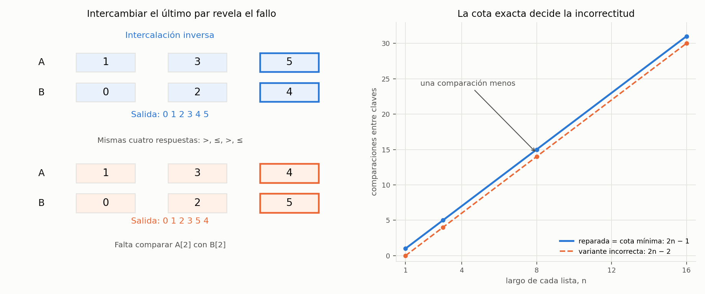

# Ejercicio 9. Una mezcla que deja de comparar antes de tiempo

> ★★ Una mezcla "optimizada" de dos listas ordenadas de largo $n$ deja de comparar
> cuando a la primera lista le queda un solo elemento, y lo pone al final. Cuenta
> cuántas comparaciones hace en el peor caso. Sin probarla, usa la sección 6 de la
> conferencia 5 para decidir si es correcta, y construye con el adversario la entrada
> en la que falla. (C5)

## Resumen

La variante compara las cabezas mientras a la primera lista le queden al menos
dos elementos y la segunda no esté vacía. Después copia el resto de la segunda
y coloca al final lo que quede de la primera. Para $n\ge1$ hace como máximo
$2n-2$ comparaciones, y hay entradas que alcanzan esa cantidad.

La conferencia 5, sección 6, demuestra que cualquier algoritmo correcto de mezcla
necesita al menos $2n-1$ comparaciones en el peor caso. Por tanto, la variante
es incorrecta: la decisión se obtiene de la cota, antes de ejecutar pruebas.

El adversario responde como una intercalación perfecta y deja sin comparar
los dos últimos elementos. Intercambiar sus valores conserva el orden de ambas
listas y todas las respuestas recibidas, pero cambia su orden correcto. Así se
construye una entrada donde la comparación ahorrada es precisamente la necesaria.

El cuaderno [`ejercicio-09.ipynb`](ejercicio-09.ipynb) verifica los conteos,
las entradas indistinguibles y el contraejemplo, y genera la figura del informe.

| aspecto | resultado |
|---|---|
| peor caso de la variante, $n\ge1$ | $2n-2$ comparaciones |
| cota mínima para una mezcla correcta, $n\ge1$ | $2n-1$ comparaciones |
| decisión sin ejecutar la variante | es incorrecta, por contradicción con la cota mínima |
| dato que falta | orden relativo del último elemento de cada lista |
| contraejemplo mínimo | $A=[0]$, $B=[1]$: devuelve $[1,0]$ |
| arreglo vacío | cero comparaciones y salida vacía |
| reparación | comparar mientras ambas listas tengan elementos |

## 1. Formulación y modelo

**Precondición.** $A$ y $B$ tienen el mismo largo $n\ge0$ y están ordenadas de
forma no decreciente. Sus elementos pertenecen a un mismo orden total y pueden
repetirse. Las entradas no cambian durante la ejecución.

**Postcondición pretendida.** Devolver una lista no decreciente que contenga
exactamente las apariciones de ambas entradas, conservando sus multiplicidades.
No basta con devolver los mismos elementos: deben quedar ordenados.

El modelo cobra una unidad por comparación entre claves. Se usa una consulta
binaria $x\le y$; también se podría cobrar una comparación de tres resultados.
Los accesos, las operaciones con índices y agregar una referencia a la salida
cuestan $O(1)$ en el word RAM, con el costo amortizado habitual de `append` en
la implementación Python. Las claves se tratan como datos opacos; sus valores
numéricos en los ejemplos solo sirven para representar un orden.

La cota mínima se demuestra sobre claves distintas. Admitir repetidos no la
debilita: un algoritmo que resuelve el problema general también debe resolver
esas entradas. El orden previo de cada lista es conocido y no se vuelve a
comprobar como parte de la mezcla.

## 2. La variante y su peor caso exacto

Se interpreta «lo pone al final» de forma literal: al quedar un elemento en $A$,
se copia primero el sufijo pendiente de $B$ y después ese último elemento.
Si $B$ se agota antes, se copia el resto de $A$, como en la mezcla habitual.

```python
def leq(x, y):
    return x <= y


def merge_shortcut(A, B, leq=leq):
    n = len(A)
    if len(B) != n:
        raise ValueError("se requieren dos listas del mismo largo")
    result = []
    i, j = 0, 0
    while i < n - 1 and j < n:
        if leq(A[i], B[j]):
            result.append(A[i])
            i += 1
        else:
            result.append(B[j])
            j += 1
    for k in range(j, n):
        result.append(B[k])
    for k in range(i, n):
        result.append(A[k])
    return result
```

No hay comparaciones entre claves al copiar los sufijos. Las condiciones sobre
índices y el chequeo de largos no se cuentan como comparaciones de claves.

**Proposición 1 (cota superior).** Para $n\ge1$, la variante hace a lo sumo
$2n-2$ comparaciones.

*Demostración.* Cada comparación incrementa exactamente uno de los índices,
así que, después de $t$ comparaciones, $t=i+j$. Hay dos maneras de salir:

- Si se alcanza $i=n-1$, la última comparación incrementó $i$ y antes de ella
  se tenía $j<n$. Por tanto, $j\le n-1$ y
  $t=(n-1)+j\le2n-2$.
- Si se alcanza $j=n$, la última comparación incrementó $j$ mientras
  $i<n-1$. Por tanto, $i\le n-2$ y $t=i+n\le2n-2$.

Para $n=1$ no se entra al ciclo y $t=0=2n-2$. Para $n=0$ también se hacen
cero comparaciones; en ese caso no se aplica la fórmula $2n-2$. $\square$

La cota se alcanza: si el orden conjunto es

$$b_1<a_1<b_2<a_2<\cdots<b_n<a_n,$$

para $n\ge2$ se comparan y sacan alternativamente
$b_1,a_1,\ldots,b_{n-1},a_{n-1}$. Son $2n-2$ comparaciones, y quedan $b_n,a_n$
para copiar sin comparar. Para $n=1$ la misma familia alcanza el máximo 0.
Se ha contado una ejecución de la variante; que esta entrada particular salga
bien no demuestra que el algoritmo sea correcto.

## 3. Decisión sin pruebas: contradicción con la cota mínima

La conferencia 5, sección 6, establece que mezclar dos listas ordenadas de
largo $n\ge1$ requiere al menos $2n-1$ comparaciones en el peor caso. Su
argumento permite entender por qué esa última comparación no se puede quitar.

**Proposición 2 (cota mínima).** Todo algoritmo determinista de comparaciones
que mezcle correctamente las dos listas necesita $2n-1$ comparaciones en el
peor caso.

*Demostración.* El adversario responde según el orden estricto intercalado

$$b_1<a_1<b_2<a_2<\cdots<b_n<a_n.$$

Este es el orden de la conferencia con los nombres de las listas intercambiados.
Sus $2n-1$ pares de vecinos pertenecen a listas distintas. Si alguno no se
compara directamente, intercambiamos los valores de esas dos posiciones.
Ambas listas siguen ordenadas, porque eran vecinos y pertenecen a listas
distintas. La relación de cada una con cualquier otra posición no cambia;
solo cambia la comparación entre esas dos.

Por tanto, todas las respuestas a las consultas realizadas permanecen iguales.
El algoritmo sigue la misma ejecución y devuelve la misma secuencia de
posiciones de entrada. Pero esas dos posiciones deben aparecer en el orden
opuesto en la mezcla correcta. No puede acertar en las dos entradas. Debe,
pues, comparar directamente cada uno de los $2n-1$ pares de vecinos.
$\square$

El argumento cuenta posiciones con identidad, no solo los rangos numéricos
usados para ilustrarlas. Comparar otros pares no permite deducir el orden de
dos vecinos que se pueden intercambiar sin cambiar las respuestas recibidas.

**Conclusión antes de ejecutar pruebas.** Si `merge_shortcut` fuera correcto,
su peor caso tendría que ser al menos $2n-1$. La Proposición 1 lo acota por
$2n-2<2n-1$. Esta contradicción decide que es incorrecto. No hace falta buscar
un fallo experimental para llegar a esa decisión.

Las dos cotas se refieren al mismo modelo y a los mismos largos. Cambiar de
modelo, por ejemplo usando las representaciones de las claves como índices,
impediría aplicar directamente la cota de comparaciones.

## 4. El adversario construye el fallo y señala la reparación

### 4.1. Dos entradas con las mismas respuestas

En la intercalación inversa de la Proposición 2, la variante se detiene tras
$2n-2$ comparaciones. Solo quedan $a_n$ y $b_n$; no los compara y copia siempre
primero $b_n$ y después $a_n$. En esa entrada el orden es correcto.

Ahora el adversario intercambia **solo los valores de esas dos posiciones**.
Las listas siguen ordenadas y ninguna respuesta anterior cambia. Sin embargo,
ahora $a_n<b_n$, y la salida termina en $b_n,a_n$: una inversión.

Una realización numérica, con índices de Python desde 0, es

$$A[k]=2k+1,\quad B[k]=2k\qquad(0\le k<n).$$

Tras intercambiar los valores de $A[n-1]$ y $B[n-1]$, la entrada que falla es

$$A=[1,3,\ldots,2n-3,\ 2n-2],$$
$$B=[0,2,\ldots,2n-4,\ 2n-1].$$

Los prefijos indicados son vacíos para $n=1$, de modo que en ese caso
$A=[0]$ y $B=[1]$. Para todo $n\ge1$ la variante produce

$$[0,1,\ldots,2n-3,\ 2n-1,\ 2n-2],$$

con el prefijo también vacío para $n=1$. Conserva todos los elementos, pero
invierte los dos mayores. Esta familia falla y alcanza el peor conteo exacto.

**Ejemplo.** Para $n=3$, partimos de $A=[1,3,5]$, $B=[0,2,4]$ e
intercambiamos sus últimos valores. Queda $A=[1,3,4]$, $B=[0,2,5]$.

*Tabla 1. Comparaciones de la variante en la entrada que falla.*

| vuelta | $(i,j)$ antes | comparación | elemento agregado | $(i,j)$ después |
|---:|---|---|---:|---|
| 1 | $(0,0)$ | $1\le0$: falso | 0 | $(0,1)$ |
| 2 | $(0,1)$ | $1\le2$: verdadero | 1 | $(1,1)$ |
| 3 | $(1,1)$ | $3\le2$: falso | 2 | $(1,2)$ |
| 4 | $(1,2)$ | $3\le5$: verdadero | 3 | $(2,2)$ |

Con $i=n-1=2$ se deja de comparar. Se agrega primero 5 y después 4, por lo
que la salida es $[0,1,2,3,5,4]$. En la entrada anterior al intercambio,
la cuarta consulta era $3\le4$, también verdadera: la secuencia de consultas
a posiciones y de respuestas es idéntica. La consulta ausente es entre
$A[2]$ y $B[2]$.

### 4.2. El caso mínimo y cuándo acierta el atajo

El contraejemplo mínimo tiene $n=1$: no hay comparaciones y siempre se
devuelve $[B[0],A[0]]$. Con $A=[0]$, $B=[1]$ eso da $[1,0]$. Para $n=0$
la salida vacía es correcta, por lo que no hay un contraejemplo menor.

En general, para $n\ge1$, la variante acierta **si y solo si**
$B[n-1]\le A[n-1]$.

*Justificación.* Durante el ciclo, el prefijo producido es el correcto de la
mezcla habitual. Si se agota $B$, su último valor se sacó antes que algún
valor pendiente de $A$, y por tanto $B[n-1]\le A[n-1]$; copiar $A$ completa
la mezcla correctamente. Si se llega a $i=n-1$, el sufijo de salida es
$B[j:n]$ seguido de $A[n-1]$, y queda ordenado exactamente cuando el máximo
de $B$ no supera ese último valor. Además, el último elemento de la salida
siempre es $A[n-1]$; si $B[n-1]>A[n-1]$, la salida no puede estar ordenada.

Sobre intercalaciones de claves distintas, exactamente la mitad tiene su
máximo en $B$. Por simetría al intercambiar los nombres de las listas, hay
$\frac12\binom{2n}{n}$ fallos entre las $\binom{2n}{n}$ intercalaciones.
Este 50 % describe la enumeración uniforme de intercalaciones, no cualquier
generador de valores.

### 4.3. Reparación, invariante y costo

Basta cambiar la condición del ciclo por `i < n and j < n`. Solo se copian
sufijos sin comparar cuando alguna lista ya está vacía.

```python
def merge_standard(A, B, leq=leq):
    n = len(A)
    if len(B) != n:
        raise ValueError("se requieren dos listas del mismo largo")
    result = []
    i, j = 0, 0
    while i < n and j < n:
        if leq(A[i], B[j]):
            result.append(A[i])
            i += 1
        else:
            result.append(B[j])
            j += 1
    for k in range(j, n):
        result.append(B[k])
    for k in range(i, n):
        result.append(A[k])
    return result
```

**Invariante.** Cada vez que se evalúa la condición del `while`, $0\le i,j\le n$, la salida contiene
exactamente las apariciones de $A[0:i]$ y $B[0:j]$, está ordenada y cada
elemento emitido es menor o igual que cualquiera pendiente.

**Inicialización.** La salida es vacía e $i=j=0$. **Mantenimiento.** Las cabezas
son los mínimos de sus respectivos sufijos; agregar la menor conserva el
orden, la cobertura de posiciones y la relación con todo lo pendiente.
**Conclusión.** Cuando se agota una lista, el único sufijo pendiente ya está
ordenado y no es menor que la salida. Copiarlo completa una mezcla correcta.
La variante también mantiene este invariante durante sus comparaciones, pero
la condición de su `while` permite salir con dos sufijos cuyo orden relativo todavía no conoce.

En ambos ciclos, $\Phi=2n-i-j$ es un entero no negativo que disminuye en una
unidad por comparación, así que terminan. Las copias finales también son
finitas. En el algoritmo reparado, antes de comparar se tiene $\Phi\ge2$;
por tanto hace a lo sumo $2n-1$ comparaciones para $n\ge1$. La intercalación
perfecta alcanza la cota, así que esta mezcla es óptima en el modelo.

Ambas implementaciones copian $2n$ referencias y usan tiempo $\Theta(n+1)$,
aunque la variante pueda entregar una salida incorrecta. Usan $\Theta(1)$
palabras auxiliares **sin contar la salida**, que ocupa $\Theta(n+1)$ palabras
incluida la estructura vacía. No crean copias de los sufijos de entrada.

## 5. Verificación numérica

La decisión de incorrectitud y la construcción anterior preceden a las pruebas.
El cuaderno las comprueba ejecutando el mismo código del informe. Un comparador
instrumentado registra cada consulta. En las entradas del adversario se usan
claves con identidad para verificar que la secuencia de posiciones comparadas
y las respuestas coinciden antes y después del intercambio final.

| afirmación del informe | comprobación |
|---|---|
| peor caso de ambos algoritmos | todas las intercalaciones de dos listas de largos 0 a 8 con claves distintas |
| errores del atajo | exactamente la mitad de las intercalaciones para cada largo positivo |
| repetidos y condición exacta de acierto | todos los pares de listas no decrecientes de largos 0 a 8 sobre $\{0,1,2\}$ |
| invariante del prefijo y potencial | versión vigilada en cada caso de las dos enumeraciones |
| adversario consistente y fallo construido | familias antes y después del intercambio para cada largo de 1 a 128 |
| Tabla 1 | traza de $A=[1,3,4]$, $B=[0,2,5]$ |
| tamaños mayores | 900 pares reproducibles con semilla fija, con repetidos |
| contrato de largos | largos diferentes producen `ValueError` |

*Tabla 2. Peor conteo medido sobre las familias del adversario y cota mínima.*

| largo $n$ de cada lista | variante | mezcla reparada | cota mínima para una mezcla correcta |
|---:|---:|---:|---:|
| 0 | 0 | 0 | 0 |
| 1 | 0 | 1 | 1 |
| 2 | 2 | 3 | 3 |
| 3 | 4 | 5 | 5 |
| 4 | 6 | 7 | 7 |
| 8 | 14 | 15 | 15 |
| 16 | 30 | 31 | 31 |
| 32 | 62 | 63 | 63 |
| 64 | 126 | 127 | 127 |

Para $n\le8$, la enumeración completa confirma que estos son los máximos de
ambas implementaciones con claves distintas. Las demostraciones de las cotas
y las familias que las alcanzan establecen el peor caso para todo $n$.
Las pruebas comprueban el código y los casos enumerados; no sustituyen esos
argumentos.



*Figura 1. A la izquierda, dos entradas del adversario que producen las mismas
cuatro respuestas con $n=3$: intercambiar los últimos valores hace fallar la
variante. A la derecha, su peor conteo queda una comparación por debajo de la
cota mínima que alcanza la mezcla reparada.*

El cuaderno se guarda con sus salidas y la figura. Para reproducirlo hacen falta
Python 3, `matplotlib` e `IPython`.

## 6. Conclusiones

El peor caso de la variante es $2n-2$ para $n\ge1$. La cota mínima $2n-1$
permite decidir que es incorrecta antes de probarla. El adversario explica la
contradicción: quedan dos elementos que pueden intercambiarse sin alterar
ninguna respuesta recibida, pero la variante los coloca siempre en el mismo
orden de posiciones.

Comparar mientras ambas listas tengan elementos restaura la correctitud y
alcanza exactamente la cota óptima. La comparación que se había ahorrado
resuelve una incertidumbre que todavía existe.
