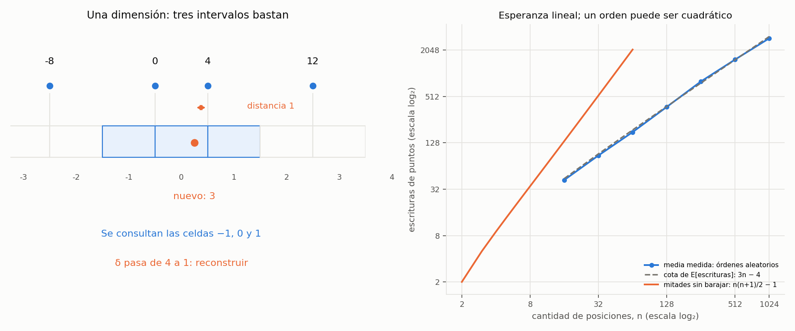

# Ejercicio 10. Par más cercano en una dimensión

> ★★ Par más cercano en una dimensión. Demuestra $\Omega(n\log n)$ en árboles de
> decisión algebraicos por reducción desde distinción de elementos. Después di qué
> algoritmo de la conferencia 2 rompe la cota, en qué modelo, y adáptalo a una
> dimensión. (C2, C5)

## Resumen

Dados $n$ números, hay dos iguales si y solo si la distancia del par más cercano
es cero. Por tanto, un algoritmo para el par más cercano permite resolver
distinción de elementos con una consulta adicional. La cota
$\Omega(n\log n)$ de este último problema se transfiere al primero en árboles
de decisión algebraicos de grado acotado. Ordenar y revisar pares consecutivos
alcanza esa cota.

El algoritmo que la supera es el incremental aleatorio con rejilla de la
conferencia 2, sección 9. En la recta, la rejilla se vuelve una tabla hash de
intervalos. Si $\delta$ es la distancia mínima actual, cada intervalo de largo
$\delta$ contiene a lo sumo un punto y basta consultar tres intervalos para
insertar el siguiente. Si la distancia baja, se reconstruye la tabla.

El tiempo esperado es $O(n)$, con memoria $O(n)$, en una RAM con aritmética
exacta, parte entera y operaciones hash de costo esperado constante. La
esperanza se toma sobre el orden aleatorio y el hashing; la entrada puede estar
fijada de antemano. Un orden particular puede provocar tiempo cuadrático.

El cuaderno [`ejercicio-10.ipynb`](ejercicio-10.ipynb) comprueba la reducción,
el algoritmo, la rejilla y el análisis hacia atrás, y genera la figura.

| aspecto | resultado |
|---|---|
| salida | distancia mínima y dos posiciones distintas que la alcanzan |
| reducción | hay repetidos si y solo si $\delta=0$ |
| cota mínima | $\Omega(n\log n)$ en árboles algebraicos de grado constante |
| algoritmo óptimo en ese modelo | ordenar y revisar vecinos, $O(n\log n)$ |
| adaptación aleatoria | intervalos de largo $\delta$; tres consultas por inserción |
| probabilidad de reconstruir en el paso $k$ | a lo sumo $2/k$ |
| costo con parte entera y hash | $O(n)$ esperado; $O(n)$ memoria |
| operaciones que cambian el modelo | parte entera y direccionamiento mediante la tabla hash |

## 1. Formulación y modelos

**Entrada.** Una lista $X=(x_0,\ldots,x_{n-1})$ de $n\ge2$ números reales,
con posibles repeticiones. Las posiciones son distintas aunque los valores
coincidan. La entrada no se modifica.

**Salida.** Una distancia $\delta$ y un par de índices distintos $(i,j)$ tales que

$$\delta=|x_i-x_j|=\min_{0\le r<s<n}|x_r-x_s|.$$

Si hay empates se devuelve cualquier par mínimo. Si hay repetidos, la respuesta
es 0 y debe darse un par de apariciones distintas del mismo valor. Con menos
de dos posiciones no existe el par pedido; el código lanza `ValueError`.

Se comparan dos modelos:

- En un **árbol de decisión algebraico de grado acotado**, cada consulta pregunta
  el signo de un polinomio de las entradas, de grado limitado por una constante
  independiente de $n$. El costo es la profundidad en el peor caso.
- Para la rejilla se permite aritmética exacta, comparación, valor absoluto y
  $\lfloor x/\delta\rfloor$ en costo constante, además de una tabla hash con
  consultas e inserciones de costo esperado $O(1)$ y una permutación uniforme.
  Es una RAM con esas operaciones, no una afirmación de costo en bits para
  reales arbitrarios ni para racionales de longitud ilimitada.

El código ejecutable usa enteros o `Fraction`, para que la división entera de
las celdas sea exacta, también con negativos. En Python, `x // delta` representa
$\lfloor x/\delta\rfloor$ en ese dominio. Los costos en bits de enteros y
fracciones grandes no son constantes; el análisis cuenta operaciones del modelo.
El diccionario implementa la tabla del experimento, y la garantía teórica de
hashing supone una implementación con costo esperado constante por operación.

## 2. Reducción y cota algebraica

### 2.1. Distinción de elementos se reduce al par más cercano

Usamos el teorema de Ben-Or que se cita en la conferencia 2, sección 8:
decidir si $n$ reales son todos distintos requiere $\Omega(n\log n)$ en
árboles de decisión algebraicos de grado constante. El resultado y su aplicación
a distinción de elementos aparecen en las secciones 5 y 6 del artículo
[Lower Bounds for Algebraic Computation Trees](https://ic.unicamp.br/~rezende/ensino/mo619/Ben-Or%2CAlgebraicComputationTrees1983.pdf).

**Proposición 1 (reducción).** La misma cota vale para hallar el par más cercano
en una dimensión.

*Demostración.* Dada la instancia $(x_0,\ldots,x_{n-1})$ de distinción de
elementos, entregamos **la misma lista** al algoritmo de par más cercano.
No se eliminan repeticiones ni se ordena la entrada como parte de la reducción.
Si devuelve las posiciones $(i,j)$, comprobamos si $x_i-x_j=0$.

- Si hay dos valores iguales, existe una distancia 0. Como ninguna distancia
  es negativa, cualquier par mínimo tiene distancia 0.
- Si la distancia mínima es 0, las dos posiciones distintas del par devuelto
  contienen el mismo valor, así que hay una repetición.

Por tanto, la respuesta a la consulta final decide distinción de elementos.
Para cada hoja del árbol de búsqueda, los índices devueltos están fijados y
la consulta final tiene grado 1. Si el algoritmo tiene profundidad $T(n)$,
el árbol compuesto tiene profundidad a lo sumo $T(n)+1$. Si existiera
$T(n)=o(n\log n)$, contradiría el teorema citado. Luego
$T(n)=\Omega(n\log n)$. $\square$

En tiempo RAM, copiar o presentar la lista cuesta a lo sumo $O(n)$; en el
conteo de pruebas algebraicas no se añade ninguna consulta durante la
transformación. Si el algoritmo devuelve directamente la distancia, basta
comprobar si es cero. La dirección es
**distinción de elementos $\le$ par más cercano**: un algoritmo para el segundo
resolvería el primero.

No basta con contar las posibles parejas de salida: son $\binom n2$, cuyo
logaritmo solo es $O(\log n)$. Tampoco se obtiene la cota contando las dos
respuestas de distinción. Se usa el teorema algebraico y la reducción.
La restricción de grado importa: no se permite preguntar en un solo paso si
$\prod_{r<s}(x_r-x_s)$ es cero, pues su grado crece con $n$.

### 2.2. La cota se alcanza ordenando

Si $y_0\le\cdots\le y_{n-1}$ son los valores ordenados, existe un par mínimo
consecutivo. Para cualquier $r<s$,

$$y_s-y_r=\sum_{t=r}^{s-1}(y_{t+1}-y_t),$$

y cada sumando es no negativo y no supera la suma. Por ello, algún hueco
consecutivo tiene distancia menor o igual que cualquier par considerado.
El argumento también vale con empates y repeticiones.

```python
def closest_pair_sorted(X):
    if len(X) < 2:
        raise ValueError("se requieren al menos dos posiciones")
    order = sorted(range(len(X)), key=X.__getitem__)
    pair = (order[0], order[1])
    delta = X[pair[1]] - X[pair[0]]
    for k in range(1, len(order) - 1):
        i, j = order[k], order[k + 1]
        distance = X[j] - X[i]
        if distance < delta:
            delta, pair = distance, (i, j)
    return delta, pair
```

Ordenar cuesta $O(n\log n)$ y revisar los huecos, $O(n)$. Las comparaciones
entre valores y entre huecos son pruebas de polinomios de grado 1. La cota
inferior demuestra optimalidad asintótica en el modelo algebraico indicado.

## 3. Adaptación del algoritmo incremental aleatorio

### 3.1. De cuadrados a intervalos

Se barajan las **posiciones**, se inicializa el par con las dos primeras y se
inserta el resto una a una. Mientras $\delta>0$, la celda del valor $x$ es

$$c_\delta(x)=\left\lfloor\frac{x}{\delta}\right\rfloor.$$

La celda $c$ representa el intervalo semiabierto $[c\delta,(c+1)\delta)$.
En el plano, la conferencia usa cuadrados de lado $\delta/2$. En la recta
podemos usar directamente largo $\delta$ y reducir la búsqueda a tres celdas.

**Lema 2 (ocupación).** Si $\delta$ es la distancia mínima entre las posiciones
ya insertadas, cada celda contiene a lo sumo una de ellas.

*Demostración.* Dos valores de la misma celda distarían estrictamente menos
que $\delta$, porque el intervalo es semiabierto. Contradirían la definición
de distancia mínima. $\square$

**Lema 3 (vecindad).** Si $|x-y|<\delta$, entonces
$|c_\delta(x)-c_\delta(y)|\le1$.

*Demostración.* Si las celdas difieren en al menos 2, el punto de la celda
derecha está al menos en su extremo izquierdo y el de la izquierda está
estrictamente antes del extremo derecho de su celda. Su distancia es mayor
que $\delta$. Por contraposición, una mejora del mínimo está en la misma
celda o en una de las dos vecinas. $\square$

### 3.2. Inserción y reconstrucción

Se consultan las celdas $c-1,c,c+1$ de la rejilla **anterior** y se compara
el punto nuevo con las posiciones encontradas. Si $\delta$ no baja, basta
insertarlo en esa rejilla. Si baja, se reconstruye con el nuevo largo y todos
los puntos del prefijo. Una mejora a cero termina inmediatamente: ya es el
mínimo global y no se puede dividir por cero para formar otra rejilla.

El código siguiente separa el núcleo con un orden dado de la función que lo
baraja. El núcleo presupone que `order` es una permutación de los índices.
Las estadísticas ocupan espacio constante y cuentan consultas de celdas,
distancias evaluadas, escrituras de puntos en tablas y reconstrucciones.

```python
from random import Random


def _closest_pair_order(X, order):
    if len(X) < 2:
        raise ValueError("se requieren al menos dos posiciones")
    i, j = order[0], order[1]
    pair = (i, j)
    delta = abs(X[i] - X[j])
    stats = dict(probes=0, distances=1, placements=0, rebuilds=0)
    if delta == 0:
        return delta, pair, stats
    grid = {}
    for index in order[:2]:
        grid[X[index] // delta] = index
        stats["placements"] += 1
    for t in range(2, len(order)):
        index = order[t]
        old_delta = delta
        c = X[index] // old_delta
        for cell in (c - 1, c, c + 1):
            stats["probes"] += 1
            other = grid.get(cell)
            if other is not None:
                distance = abs(X[index] - X[other])
                stats["distances"] += 1
                if distance < delta:
                    delta, pair = distance, (index, other)
                    if delta == 0:
                        return delta, pair, stats
        if delta < old_delta:
            stats["rebuilds"] += 1
            grid = {}
            for s in range(t + 1):
                other = order[s]
                grid[X[other] // delta] = other
                stats["placements"] += 1
        else:
            grid[c] = index
            stats["placements"] += 1
    return delta, pair, stats


def closest_pair_grid(X, seed=0):
    order = list(range(len(X)))
    Random(seed).shuffle(order)
    return _closest_pair_order(X, order)
```

Las claves del diccionario son índices enteros de celda y sus valores son
índices de entrada. El índice 0 es válido: se comprueba `other is not None`,
no su valor de verdad. Las celdas se calculan con el mismo $\delta$ anterior
durante toda la consulta; la nueva escala se usa al reconstruir.

**Ejemplo.** Con $X=[-8,0,4,12,3]$ y ese orden de inserción:

*Tabla 1. Traza de la rejilla. Las escrituras incluyen cada punto recolocado.*

| paso | valor agregado | $\delta$ antes | $\delta$ después | acción | escrituras del paso |
|---:|---|---:|---:|---|---:|
| 2 | $-8,0$ | — | 8 | inicializar | 2 |
| 3 | 4 | 8 | 4 | reconstruir | 3 |
| 4 | 12 | 4 | 4 | insertar | 1 |
| 5 | 3 | 4 | 1 | reconstruir | 5 |

La distancia final es 1, entre las posiciones de valores 3 y 4. Se hacen
9 consultas de celdas, 5 evaluaciones de distancia, 11 escrituras y 2
reconstrucciones. Antes del último paso, los valores $-8,0,4,12$ ocupan las
celdas $-2,0,1,3$ de largo 4. El valor nuevo, 3, consulta las celdas
$-1,0,1$ y encuentra las dos posibles mejoras, 0 y 4.

## 4. Correctitud, costo esperado y cambio de modelo

### 4.1. Invariante y terminación

**Proposición 4 (invariante).** Después de procesar un prefijo de $k\ge2$
posiciones, si el algoritmo no ha terminado con distancia cero:

- $\delta>0$ es su distancia mínima y `pair` es un par del prefijo que la alcanza.
- `grid` contiene exactamente una entrada por posición procesada, en su celda
  $\lfloor x/\delta\rfloor$; no hay colisiones geométricas entre puntos.

*Demostración.* **Inicialización.** Para dos posiciones, su distancia es el
mínimo. Si es cero se devuelve de inmediato; si no, el Lema 2 permite guardar
ambas en celdas distintas.

**Mantenimiento.** Al insertar una posición, los pares antiguos ya tienen
distancia al menos $\delta$ anterior. Solo un par con el nuevo punto puede
mejorar ese valor. Los Lemas 2 y 3 garantizan que se examinan todos esos
posibles pares mediante a lo sumo tres accesos. Si no hay mejora, el nuevo
punto se inserta sin ocupar una celda ya ocupada, pues eso daría una mejora.
Si hay mejora positiva, se reconstruye la tabla; el Lema 2 vuelve a justificar
la ocupación única. El par guardado alcanza el nuevo mínimo.

**Conclusión.** Al terminar las inserciones, el prefijo es toda la entrada.
Si se termina antes con cero, el par de posiciones distintas encontrado es
óptimo también para el resto de la entrada. Cada paso procesa una posición
nueva, y el número de posiciones pendientes disminuye hasta 0; cada búsqueda
tiene tres celdas y cada reconstrucción recorre un prefijo finito. $\square$

La correctitud vale para **cualquier** permutación, con empates, repetidos y
coordenadas negativas. El azar interviene en el costo, no en la validez de la
respuesta: es un algoritmo de tipo Las Vegas.

### 4.2. Análisis hacia atrás, sin suponer un mínimo único

Sea $R_k$ el indicador de reconstrucción al insertar la posición número $k$,
para $3\le k\le n$. Fijemos el conjunto de las primeras $k$ posiciones,
olvidando su orden, y elijamos un par mínimo de forma canónica, por ejemplo
el menor par de índices originales entre los empatados.

Si la nueva posición no pertenece a ese par, el par ya estaba en el prefijo
anterior y la distancia mínima no puede bajar. Por tanto, para que se
reconstruya es necesario que la posición insertada sea uno de sus dos extremos.
En una permutación uniforme, el último elemento del conjunto fijado es uniforme:

$$\Pr(R_k=1)\le\frac2k.$$

Esto sigue valiendo con varios pares mínimos. No se afirma que los eventos
de reconstrucción sean independientes. Si se encontró antes una repetición,
no hay más trabajo; si aparece ahora una distancia cero, se termina sin
reconstruir. Esas salidas anticipadas solo reducen el costo.

Cada inserción ordinaria cuesta $O(1)$ y una reconstrucción en el paso $k$
cuesta $O(k)$ esperado bajo el supuesto de hashing. Por linealidad de la esperanza,

$$\mathbb E[T(n)]\le O(n)+\sum_{k=3}^{n}\frac2k\,O(k)=O(n).$$

La permutación también cuesta $O(n)$ y la tabla y la lista de índices usan
$O(n)$ memoria. La esperanza se refiere a una entrada fija y al azar del
algoritmo, no a que las coordenadas se distribuyan de forma favorable.

Si $W$ cuenta escrituras de puntos en las tablas, la implementación satisface

$$W\le n+\sum_{k=3}^{n}(k-1)R_k,\qquad
\mathbb E[W]\le3n-4.$$

Para entradas sin salida anticipada, la primera desigualdad es igualdad: cada
paso escribiría un punto, pero una reconstrucción escribe $k$ en su lugar.
Además,

$$\mathbb E[\text{reconstrucciones}]\le2\sum_{k=3}^n\frac1k=2H_n-3.$$

Es una **cota superior**, no una predicción exacta para cualquier entrada;
por ejemplo, los empates pueden reducir el número de mejoras estrictas.
Se hacen a lo sumo $3(n-2)$ consultas de celdas y $1+3(n-2)$ distancias.
Las escrituras cuentan el costo variable de reconstruir, no todas las operaciones.

### 4.3. Un orden que cuesta cuadrático

Sin barajar, el orden

$$0,1,\tfrac12,\tfrac14,\ldots,2^{-(n-2)}$$

reduce la distancia a la mitad con cada punto después de los dos primeros.
Hay $n-2$ reconstrucciones y exactamente

$$W=2+\sum_{k=3}^n k=\frac{n(n+1)}2-1$$

escrituras. Es $\Theta(n^2)$ trabajo en el modelo de operaciones; el espacio
sigue siendo $O(n)$. Una permutación particular puede producir ese orden
también en la versión aleatoria. El resultado lineal es esperado, no una
garantía lineal para cada ejecución.

### 4.4. Por qué no contradice la cota

El algoritmo de la conferencia 2 que se adapta aquí es el de la **sección 9**,
incremental aleatorio con rejilla, no el de divide y vencerás. Usa la parte
entera para convertir una coordenada en un índice de celda y después consulta
la tabla por ese índice. Estas operaciones no son consultas del signo de un
polinomio de grado acotado. El cambio de modelo es lo que permite superar la
cota; barajar controla la frecuencia de las reconstrucciones.

| algoritmo | garantía de tiempo | operaciones del modelo |
|---|---|---|
| ordenar y revisar vecinos | $\Theta(n\log n)$ en el peor caso | consultas algebraicas de grado acotado |
| rejilla con orden aleatorio | $O(n)$ esperado | aritmética, parte entera y hashing esperado constante |
| rejilla con un orden desfavorable | $\Theta(n^2)$ en la familia anterior | las mismas operaciones, muchas reconstrucciones |

## 5. Verificación numérica

El cuaderno usa fuerza bruta como oráculo independiente y devuelve índices,
para distinguir dos apariciones iguales. Ejecuta el mismo código del informe.
Una versión vigilada comprueba el mínimo del prefijo, el par testigo, la
ocupación de la rejilla, la cobertura de todos los candidatos que pueden
mejorar y las estadísticas del código real.

| afirmación del informe | comprobación |
|---|---|
| reducción y repetidos | todos los arreglos de largos 2 a 7 sobre $\{-1,0,1\}$ |
| correctitud para órdenes de inserción | tres semillas por arreglo exhaustivo |
| empates, negativos y celdas semiabiertas | comprobaciones del invariante en los casos exhaustivos y en casos racionales |
| Tabla 1 | traza exacta de $[-8,0,4,12,3]$ sin barajar |
| análisis hacia atrás | todas las permutaciones de $[1,2,4,\ldots,2^{n-1}]$, para $2\le n\le7$ |
| caso cuadrático | la familia de mitades para cada largo de 2 a 64 |
| mediciones de tamaños mayores | 64 permutaciones por cada largo de la Tabla 2, con semillas fijas |
| entradas fuera del contrato de largo | listas de largo 0 o 1 producen `ValueError` |

En la familia de potencias de dos todos los subconjuntos de al menos dos posiciones
tienen un par mínimo único. Al enumerar todas las permutaciones, el cuaderno comprueba la frecuencia
exacta $2/k$ de reconstrucción en cada paso $k$, así como la media exacta
$2H_n-3$ de reconstrucciones y $3n-1-2H_n$ de escrituras. Estos valores exactos
se refieren a esa familia, no a todas las entradas.

En los tamaños mayores se fija una muestra de enteros distintos y se varía
solo el orden mediante 64 semillas. La referencia ordenada comprueba el resultado
en cada ejecución. Se miden escrituras y reconstrucciones, sin usar tiempos de
reloj como evidencia de las cotas.

*Tabla 2. Medias sobre 64 órdenes aleatorios por entrada fija.*

| $n$ | escrituras medias | reconstrucciones medias | cota de $\mathbb E[W]$: $3n-4$ |
|---:|---:|---:|---:|
| 16 | 42.14 | 4.06 | 44 |
| 32 | 87.75 | 5.25 | 92 |
| 64 | 176.23 | 6.08 | 188 |
| 128 | 374.42 | 7.89 | 380 |
| 256 | 801.50 | 9.33 | 764 |
| 512 | 1543.30 | 10.55 | 1532 |
| 1024 | 2911.61 | 11.83 | 3068 |

Las medias de la tabla son mediciones reproducibles, no valores exactos de la
esperanza. Por ejemplo, para $n=256$ la media muestral es 801.50, mayor que la
cota 764 de la esperanza. No es una contradicción: una media de 64 ejecuciones
puede superar la esperanza verdadera, igual que una ejecución individual.
La cota de la última columna procede de la demostración. Las pruebas verifican
las familias y tamaños enumerados; los argumentos anteriores establecen la
correctitud y los costos en el modelo indicado.



*Figura 1. A la izquierda, el último paso de la Tabla 1: el valor 3 consulta
tres intervalos de largo 4 y encuentra el valor 4 a distancia 1, lo que exige
reconstruir. A la derecha, las escrituras medias de la rejilla en órdenes
aleatorios y la cota lineal de su esperanza, frente a las escrituras cuadráticas
de la familia de mitades sin barajar.*

El cuaderno se guarda con sus salidas y la figura. Para reproducirlo hacen falta
Python 3, `matplotlib` e `IPython`.

## 6. Conclusiones

Distinción de elementos se reduce al par más cercano en la recta sin transformar
las coordenadas: basta decidir si el mínimo es cero. Esto demuestra
$\Omega(n\log n)$ en árboles algebraicos de grado acotado, y ordenar alcanza
la cota.

Con parte entera y hashing, la adaptación incremental usa tres consultas por
inserción y reconstruye con probabilidad a lo sumo $2/k$. Su tiempo esperado
es lineal y su memoria, lineal. La corrección vale para cualquier orden; el
azar controla el costo. La aparente contradicción se resuelve al especificar
las operaciones permitidas por cada modelo.
