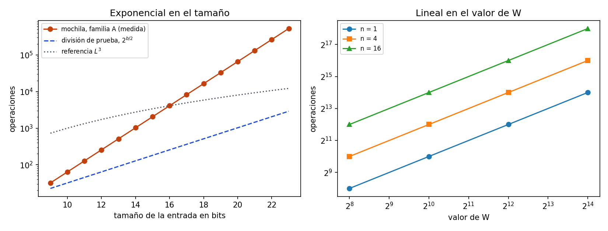

# Ejercicio 11. La mochila entera, el tamaño de la entrada y la primalidad

> ★★ La mochila entera se resuelve con programación dinámica en $O(nW)$, donde $W$
> es la capacidad (lo vieron en Estructuras de Datos). Mide el tamaño de la entrada
> en bits, como en la sección 8 de la conferencia 1. ¿Es polinomial ese algoritmo?
> ¿En qué se parece a la primalidad por división? (C1)

## Resumen

El tamaño de una instancia de la mochila es el número de bits de sus $2n+1$ números,
$L=\sum_i(\mathrm{bits}(w_i)+\mathrm{bits}(v_i))+\mathrm{bits}(W)$. La tabla hace
exactamente $\sum_i\max(0,W-w_i+1)\le nW$ actualizaciones. Eso es lineal en $n$ y en
el **valor** de $W$, pero $W$ ocupa solo $\lfloor\log_2W\rfloor+1$ bits, así que el
costo es exponencial en el **tamaño** de la entrada. Con dos objetos de peso 1 y
$W=2^k$ el tamaño es $L=k+5$ y el costo, $2^{L-4}$: cada bit adicional lo duplica.
Por tanto el algoritmo **no es polinomial**; es pseudopolinomial. El caso es el mismo
de la primalidad por división (conferencia 1, sección 8): un ciclo cuya cantidad de
vueltas es polinomial en el valor de un número de la entrada. Cambian el exponente
($2^{b/2}$ contra $n\cdot2^b$) y lo que se sabe del problema: la primalidad tiene
algoritmos polinomiales, y para la mochila no se conoce ninguno.

El cuaderno [`ejercicio-11.ipynb`](ejercicio-11.ipynb) comprueba la tabla contra
fuerza bruta, la fórmula exacta del costo, las dos familias de entradas y la
comparación con la división de prueba, y genera la figura.

| aspecto | resultado |
|---|---|
| tamaño de la entrada | $L=\sum_i(\mathrm{bits}(w_i)+\mathrm{bits}(v_i))+\mathrm{bits}(W)$ |
| costo en operaciones | $\sum_i\max(0,W-w_i+1)\le nW$; memoria $W+1$ celdas |
| en función de $L$ | $2^{L-4}$ para $n=2$ y $W=2^k$: exponencial |
| ¿polinomial? | no; pseudopolinomial |
| cuándo sí lo es | $W$ acotado por un polinomio en $L$, o $W$ en unario |
| parecido con la primalidad | el costo es polinomial en un valor y exponencial en sus bits |
| diferencia | $2^{b/2}$ contra $n\cdot2^{b}$; la primalidad sí tiene algoritmos polinomiales |

## 1. Formulación y modelo

**Entrada.** Pesos enteros $w_1,\ldots,w_n\ge1$, valores enteros $v_1,\ldots,v_n\ge0$
y una capacidad entera $W\ge0$.

**Salida.** El valor máximo $\max\{\sum_{i\in S}v_i:\ S\subseteq\{1,\ldots,n\},\
\sum_{i\in S}w_i\le W\}$. Cada objeto se usa a lo sumo una vez. El conjunto vacío
es válido, así que el máximo existe.

**Modelo.** El de la conferencia 1: una RAM donde cada operación sobre enteros cuesta
1. Se cuentan las actualizaciones de la tabla. Cobrar cada operación por sus bits solo
puede aumentar el costo, así que la conclusión de la sección 4 no depende de esa
elección.

**Tamaño de la entrada.** Un entero $x\ge1$ ocupa $\lfloor\log_2x\rfloor+1$ bits, y
el cero ocupa 1. La entrada son $2n+1$ números, así que su tamaño es

$$L=\sum_{i=1}^n\bigl(\mathrm{bits}(w_i)+\mathrm{bits}(v_i)\bigr)+\mathrm{bits}(W).$$

Los separadores entre números cambian $L$ en un factor constante y no afectan a
nada de lo que sigue. Un algoritmo es **polinomial** si existen $c,d$ tales que su
costo en el peor caso sobre las entradas de tamaño $L$ es a lo sumo $c\,L^d$. Si el
costo es polinomial en el valor de un número de la entrada pero no en su cantidad de
bits, se dice **pseudopolinomial** (conferencia 1, sección 8).

## 2. El algoritmo y su correctitud

`best[c]` guarda el valor máximo con capacidad $c$ usando los objetos procesados.
Para cada objeto, `c` se recorre de mayor a menor.

```python
def knapsack(weights, values, capacity):
    """Valor máximo de un subconjunto de peso total <= capacity.
    Devuelve (valor, ops): ops cuenta las actualizaciones de la tabla."""
    if len(weights) != len(values):
        raise ValueError("pesos y valores deben tener el mismo largo")
    if capacity < 0 or any(w < 1 for w in weights) or any(v < 0 for v in values):
        raise ValueError("se requieren pesos >= 1, valores >= 0 y capacidad >= 0")
    best = [0] * (capacity + 1)  # best[c]: valor máximo con capacidad c
    ops = 0
    for w, v in zip(weights, values):
        for c in range(capacity, w - 1, -1):  # de mayor a menor: cada objeto, una vez
            ops += 1
            if best[c - w] + v > best[c]:
                best[c] = best[c - w] + v
    return best[capacity], ops


def bits(x):
    return max(x, 1).bit_length()


def input_bits(weights, values, capacity):
    return sum(bits(w) + bits(v) for w, v in zip(weights, values)) + bits(capacity)
```

Sea $V_i(c)$ el valor máximo de un subconjunto de los primeros $i$ objetos con peso
total a lo sumo $c$.

**Invariante.** Al terminar de procesar el objeto $i$, `best[c]` $=V_i(c)$ para todo
$0\le c\le W$.

*Inicialización.* Con $i=0$ solo existe el conjunto vacío: $V_0(c)=0$.

*Mantenimiento.* Se procesa el objeto $i$ con peso $w$ y valor $v$. Una solución
óptima para $(i,c)$ no usa el objeto $i$, y vale $V_{i-1}(c)$, o lo usa, y entonces
el resto es una solución para $(i-1,c-w)$ y vale $V_{i-1}(c-w)+v$. Por tanto
$V_i(c)=\max(V_{i-1}(c),\,V_{i-1}(c-w)+v)$ si $c\ge w$, y $V_i(c)=V_{i-1}(c)$ si
$c<w$. Como `c` baja, al actualizar la posición $c$ la posición $c-w<c$ todavía no
fue tocada en esta ronda y contiene $V_{i-1}(c-w)$. Las posiciones $c<w$ no se
actualizan. Así se cumple la recurrencia.

*Conclusión.* Con $i=n$, `best[W]` $=V_n(W)$, que es la salida pedida.

*Terminación.* Los dos ciclos recorren rangos finitos: el número de actualizaciones
que faltan baja en 1 en cada vuelta y es no negativo.

## 3. Costo: polinomial en $n$ y en $W$

Para el objeto $i$ el ciclo interior recorre $c=W,W-1,\ldots,w_i$. Son $W-w_i+1$
vueltas si $w_i\le W$ y ninguna si no. Por tanto

$$\text{ops}=\sum_{i=1}^n\max(0,\,W-w_i+1)\le nW,$$

con igualdad cuando todos los pesos son 1. Con la inicialización de `best` y el
recorrido de la entrada, el tiempo es $O(n+nW)$ y la memoria, $W+1$ celdas más la
entrada. Es polinomial en **dos números de la entrada**: la cantidad $n$ de objetos
y el valor numérico $W$.

*Tabla 1. Con objetos de peso 1, ops $=nW$ exactamente.*

| $n$ | $W=2^8$ | $W=2^{10}$ | $W=2^{12}$ | $W=2^{14}$ |
|---:|---:|---:|---:|---:|
| 1 | 256 | 1 024 | 4 096 | 16 384 |
| 4 | 1 024 | 4 096 | 16 384 | 65 536 |
| 16 | 4 096 | 16 384 | 65 536 | 262 144 |

## 4. ¿Es polinomial?

No. $W$ ocupa $b=\mathrm{bits}(W)$ bits y cumple $2^{b-1}\le W<2^b$: su valor es
exponencial en lo que ocupa. Un $W$ de $b$ bits puede valer cerca de $2^b$, y el
costo $nW$ es entonces del orden de $n\,2^b$.

**Proposición 1.** El algoritmo no es polinomial en $L$.

*Demostración.* Sea la familia A: dos objetos con $w_1=w_2=1$ y $v_1=v_2=1$, y
$W=2^k$ con $k\ge1$. Su tamaño es $L=2\cdot(1+1)+(k+1)=k+5$. Como
$w_i=1\le W$, ops $=2W=2^{k+1}=2^{L-4}$. Si existieran $c,d$ con costo $\le cL^d$
para todo $L$, valdría $2^{L-4}\le cL^d$ para todo $L$ de la familia. Pero
$2^{L-4}/L^d\to\infty$ cuando $L\to\infty$, para cualquier $d$ fijo. Contradicción.
$\square$

*Tabla 2. Familia A. Cada bit adicional duplica las operaciones.*

| $k$ | $L$ | ops |
|---:|---:|---:|
| 4 | 9 | 32 |
| 8 | 13 | 512 |
| 12 | 17 | 8 192 |
| 16 | 21 | 131 072 |
| 18 | 23 | 524 288 |

**La familia no es un artificio de un $W$ absurdo.** Una idea natural es recortar
$W$ a $\min(W,\sum_iw_i)$, porque con más capacidad que el peso total todos los
objetos caben. No arregla nada: en la familia B, dos objetos de peso $2^{k-1}$ y
valor 1 con $W=2^k=\sum_iw_i$, el tamaño es $L=3k+3$ y ops $=2^k+2$, que sigue
siendo exponencial en $L$. El costo exponencial aparece cuando los pesos y la
capacidad son números grandes en binario.

**Cuándo sí es polinomial.**

- Si los números se dan en **unario**, el tamaño es al menos $n+W$ y
  $nW\le L^2$.
- Si $W\le L^c$ para una constante $c$, el costo es $O(L^{c+1})$. En particular,
  si $W$ está acotado por un polinomio en $n$.

Es la definición de pseudopolinomial: polinomial en el valor de $W$, no en su
cantidad de bits. La memoria $\Theta(W)$ tiene el mismo problema: con $W=2^{64}$ la
tabla no cabe en ninguna máquina.

## 5. En qué se parece a la primalidad por división

La conferencia 1, sección 8, mide la división de prueba en $b=\lfloor\log_2N\rfloor+1$
bits y obtiene $\sqrt N\le2^{b/2}$ divisiones: un ciclo que parece uno solo y es
exponencial en el tamaño de la entrada. El esquema es el mismo.

| | primalidad por división | mochila con tabla |
|---|---|---|
| número que manda el costo | $N$ | $W$ |
| sus bits | $b=\lfloor\log_2N\rfloor+1$ | $b=\lfloor\log_2W\rfloor+1$ |
| vueltas | $\sqrt N\le2^{b/2}$ | $\le nW<n\,2^{b}$ |
| polinomial en el valor | sí | sí |
| polinomial en los bits | no | no |

**Lo que comparten.** La cantidad de vueltas depende del **valor** de un número de la
entrada, y el valor es exponencial en el tamaño de su escritura binaria. Los dos
algoritmos se vuelven viables si el número es pequeño, y dejan de serlo
cuando es de 64 bits o más. Con $10^9$ operaciones por segundo:

*Tabla 3. Un número de $b$ bits. Mochila con $n=2$ objetos de peso 1 y $W=2^{b-1}$:
$2^b$ actualizaciones.*

| $b$ | mochila | tiempo | división de prueba $2^{b/2}$ | tiempo |
|---:|---:|---|---:|---|
| 32 | $4{,}29\cdot10^{9}$ | 4,29 segundos | $6{,}55\cdot10^{4}$ | $6{,}55\cdot10^{-5}$ segundos |
| 64 | $1{,}84\cdot10^{19}$ | 585 años | $4{,}29\cdot10^{9}$ | 4,29 segundos |
| 128 | $3{,}4\cdot10^{38}$ | $1{,}08\cdot10^{22}$ años | $1{,}84\cdot10^{19}$ | 585 años |

**Lo que las separa.**

1. *El exponente.* La división cuesta $2^{b/2}$ y la mochila, $n\cdot2^{b}$. En la
   tabla, la mochila con $b=64$ tarda lo que la división con $b=128$.
2. *Cuánto se sabe del problema.* La primalidad tiene algoritmos polinomiales en $b$:
   Miller-Rabin, aleatorio, y Agrawal-Kayal-Saxena, determinista (conferencia 1). La
   división de prueba es un mal algoritmo para un problema fácil. Para la mochila no
   se conoce un algoritmo polinomial en $L$. Su versión de decisión es NP-completa
   (Karp, 1972). El curso demuestra ese tipo de resultados en el Tema 3; aquí se
   cita, sin demostrarlo. Si $\mathrm P\ne\mathrm{NP}$, no existe ninguno; la tabla
   no es un mal algoritmo para un problema fácil.
3. *Qué parte de la entrada pesa.* En la mochila el costo es lineal en $n$ y solo los
   números grandes lo hacen exponencial. Con valores y pesos pequeños es práctico,
   y por eso se usa.

## 6. Verificación numérica

El cuaderno ejecuta el mismo código del informe. Usa fuerza bruta como oráculo
independiente de la tabla, y las fórmulas del informe como oráculo del costo.

| afirmación del informe | comprobación |
|---|---|
| correctitud de la tabla (sección 2) | 500 instancias aleatorias con $n\le8$, contra la enumeración de los $2^n$ subconjuntos |
| ops $=\sum_i\max(0,W-w_i+1)\le nW$ (sección 3) | las mismas 500 instancias |
| objeto que no cabe, $W=0$, entradas inválidas | casos explícitos con `assert`; las entradas inválidas lanzan `ValueError` |
| Tabla 1, ops $=nW$ | $n\in\{1,4,16\}$, $W\in\{2^8,2^{10},2^{12},2^{14}\}$ |
| Proposición 1 y Tabla 2 | familia A, $L=k+5$ y ops $=2^{L-4}$, para $4\le k\le18$ |
| familia B | $L=3k+3$ y ops $=2^k+2$, para $4\le k\le18$ |
| Tabla 3 | cuenta exacta a $10^9$ operaciones por segundo; el caso $b=32$ se comprueba con `exact_ops` |

La tabla no se ejecuta con $W=2^{64}$: el costo sería de siglos, que es lo que la
sección 4 demuestra. Esos casos se calculan con la fórmula, que el cuaderno verifica
exactamente en los tamaños que sí se pueden ejecutar.



*Figura 1. A la izquierda, las operaciones de la familia A frente al tamaño de la
entrada en bits, en escala logarítmica vertical: la recta de la mochila es una
exponencial, y queda por encima de la referencia polinomial $L^3$ desde $L=17$; la
división de prueba, $2^{b/2}$, es también una recta, de pendiente menor. A la derecha,
las operaciones frente al valor de $W$ en ejes logarítmicos, para $n=1,4,16$: rectas
de pendiente 1, es decir, lineal en el valor.*

El cuaderno se guarda con sus salidas y la figura. Para reproducirlo hacen falta
Python 3, `matplotlib` e `IPython`.

## 7. Conclusiones

La mochila por programación dinámica es correcta por el invariante
$\texttt{best}[c]=V_i(c)$ y cuesta exactamente $\sum_i\max(0,W-w_i+1)\le nW$
operaciones. Medida contra el tamaño de la entrada, en bits, no es polinomial: con
dos objetos y $W=2^k$ cuesta $2^{L-4}$ con $L=k+5$, y recortar $W$ a la suma de
los pesos no lo evita. Es pseudopolinomial: polinomial en $n$ y en el valor de $W$,
y polinomial en $L$ solo si $W$ es polinomial en $L$ o está en unario. Se parece a
la primalidad por división en que el ciclo depende del valor de un número y no de
su cantidad de bits. Se distingue en que la primalidad sí tiene algoritmos
polinomiales, y la versión de decisión de la mochila es NP-completa.
