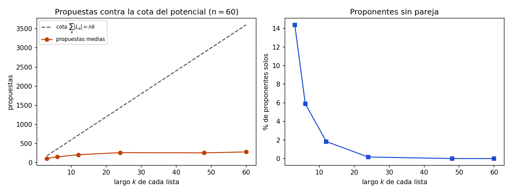

# Ejercicio 12. Gale-Shapley con listas incompletas

> ★★★ Gale-Shapley con listas incompletas: cada proponente lista solo a algunos
> receptores, y prefiere quedarse solo antes que con uno que no listó. Adapta el
> algoritmo, su potencial y la definición de pareja bloqueante. ¿Sigue siendo estable
> el resultado? Demuéstralo. (C3)

## Resumen

Se mantiene el algoritmo de la conferencia 3 con dos cambios: un proponente solo
propone a los receptores de su lista, y si lo rechazan todos se queda solo. El potencial
pasa a ser $\Phi=\sum_a(|L_a|-\texttt{next}[a])$, el número de pares (proponente,
receptor listado) a los que todavía no se ha propuesto. Baja exactamente 1 por
propuesta, así que hay a lo sumo $\sum_a|L_a|\le n^2$ propuestas. La pareja bloqueante
se redefine contando que quedar solo es peor que cualquier receptor de la lista, y el
resultado **sigue siendo estable**, con la misma demostración de la conferencia: el
primer invariante de los receptores y el orden decreciente de los proponentes. Lo que
**no** sobrevive es la perfección: el emparejamiento puede dejar proponentes solos, y
el argumento de la conferencia que la probaba usa que las listas son completas.

El cuaderno [`ejercicio-12.ipynb`](ejercicio-12.ipynb) comprueba la estabilidad con un
oráculo que mira todos los pares, el potencial paso a paso, la existencia por
enumeración, y genera la figura.

| aspecto | resultado |
|---|---|
| lista de un proponente | receptores distintos, de mejor a peor; puede ser vacía |
| ser soltero | peor que cualquier receptor listado, para ambos lados |
| potencial | $\Phi=\sum_a(\lvert L_a\rvert-\texttt{next}[a])\ge0$, baja 1 por propuesta |
| propuestas | a lo sumo $\sum_a\lvert L_a\rvert\le n^2$ |
| ¿estable? | sí, para cualquier orden de ejecución |
| ¿perfecto? | no: con las listas $[0],[0]$ uno queda solo |
| existencia | toda instancia tiene un emparejamiento estable |
| tiempo y memoria | $O(n^2)$ |

## 1. Formulación

**Instancia.** $n$ proponentes y $n$ receptores. El proponente $a$ tiene una lista
$L_a$ de receptores distintos, ordenada de mejor a peor, de largo entre 0 y $n$. Cada
receptor $b$ tiene una lista completa y estricta de todos los proponentes, como en la
conferencia 3. No se estudia el caso en que también los receptores omiten a algunos
proponentes.

**Emparejamiento.** Un conjunto $M$ de pares $(a,b)$ con $b\in L_a$, donde cada
proponente y cada receptor aparece en a lo sumo un par. Se escribe $M(a)$ y $M(b)$
para la pareja, o "solo". Un proponente nunca queda emparejado con un receptor que no
listó, porque prefiere quedarse solo.

**Preferencias con soltería.** Para $a$, todo $b\in L_a$ es mejor que quedar solo, y
quedar solo es mejor que cualquier receptor no listado. Para un receptor, cualquier
proponente es mejor que quedar solo, porque su lista es completa.

**Pareja bloqueante.** Un par $(a,b)\notin M$ es bloqueante si

1. $b\in L_a$,
2. $a$ está solo en $M$, o prefiere $b$ a $M(a)$, y
3. $b$ está solo en $M$, o prefiere $a$ a $M(b)$.

Dos cambios respecto de la conferencia 3: la condición 1, y que "solo" cuenta como la
peor situación. Un par con $b\notin L_a$ no bloquea nunca, porque $a$ no lo prefiere a
nada. Un emparejamiento es **estable** si no tiene parejas bloqueantes.

La definición con soltería es necesaria. Sin ella, el emparejamiento vacío no tendría
parejas bloqueantes y sería "estable", aunque cualquier par listado ganaría
juntándose. Con ella, el emparejamiento vacío tiene una pareja bloqueante por cada par
listado.

## 2. El algoritmo y su potencial

Los proponentes proponen en orden de su lista. Un receptor se queda con la mejor
propuesta recibida. Un proponente que queda libre vuelve a proponer, salvo que haya
agotado su lista: entonces se queda solo para siempre.

```python
def gale_shapley_incomplete(lists, pref_b, order="cola", seed=0, trace=None):
    n = len(lists)
    if any(len(L) != len(set(L)) or any(not 0 <= b < n for b in L) for L in lists):
        raise ValueError("cada lista debe tener receptores distintos y válidos")
    rank = [[0] * n for _ in range(n)]       # rank[b][a]: lugar de a en la lista de b
    for b in range(n):
        for place, a in enumerate(pref_b[b]):
            rank[b][a] = place
    nxt = [0] * n                            # a qué lugar de su lista va a proponer a
    partner_of_b = [None] * n
    free = deque(a for a in range(n) if lists[a])
    rng = Random(seed)
    proposals = 0
    while free:
        if order == "azar":
            free.rotate(rng.randrange(len(free)))
        a = free.popleft() if order == "cola" else free.pop()
        b = lists[a][nxt[a]]
        nxt[a] += 1
        proposals += 1
        current = partner_of_b[b]
        if current is None:
            partner_of_b[b], loser = a, None
        elif rank[b][a] < rank[b][current]:
            partner_of_b[b], loser = a, current
        else:
            loser = a
        if loser is not None and nxt[loser] < len(lists[loser]):
            free.append(loser)               # si su lista se agotó, queda solo
        if trace is not None:
            phi = sum(len(L) - p for L, p in zip(lists, nxt))
            trace.append((a, b, current, partner_of_b[b], phi))
    M = [None] * n
    for b, a in enumerate(partner_of_b):
        if a is not None:
            M[a] = b
    return M, proposals
```

La cola `free` contiene exactamente a los proponentes libres con alguna propuesta
pendiente. Ese es el cambio de fondo: el original repetía "mientras haya un proponente
libre" y la lista nunca se agotaba. Aquí un proponente libre con lista agotada sale de
la cola.

**Ejemplo.** Con $L_0=[1,0]$, $L_1=[1]$, $L_2=[1,2]$, $L_3=[0]$ y las listas de
receptores $b_0:\ a_3>a_0>a_1>a_2$, $b_1:\ a_2>a_0>a_1>a_3$, $b_2,b_3:\
a_0>a_1>a_2>a_3$:

*Tabla 1. Traza con la estrategia de cola. $\Phi$ es el potencial después del paso.*

| paso | proponente | receptor | tenía | queda con | $\Phi$ |
|---:|---|---|---|---|---:|
| 0 | | | | | 6 |
| 1 | $a_0$ | $b_1$ | — | $a_0$ | 5 |
| 2 | $a_1$ | $b_1$ | $a_0$ | $a_0$ | 4 |
| 3 | $a_2$ | $b_1$ | $a_0$ | $a_2$ | 3 |
| 4 | $a_3$ | $b_0$ | — | $a_3$ | 2 |
| 5 | $a_0$ | $b_0$ | $a_3$ | $a_3$ | 1 |

El resultado es $\{(a_2,b_1),(a_3,b_0)\}$. $a_1$ se quedó solo en el paso 2 porque su
lista tenía un solo receptor. $a_0$ quedó libre en el paso 3, propuso a $b_0$ en el
paso 5 y lo rechazaron; con su lista agotada, también queda solo. Los receptores $b_2$
y $b_3$ no reciben ninguna propuesta porque nadie los lista. Nótese que el algoritmo
termina con $\Phi=1>0$: $a_2$ conserva a $b_2$ sin proponer porque ya está emparejado.

### 2.1. Los invariantes de la conferencia siguen valiendo

- **(I1) Un receptor, una vez emparejado, no vuelve a quedar libre, y su pareja solo
  mejora.** Un receptor libre acepta la primera propuesta. Uno emparejado solo cambia
  si llega alguien que prefiere. Nunca suelta a su pareja sin reemplazo.
- **(I2) Un proponente propone en orden y su pareja solo empeora.** `nxt[a]` solo
  avanza. Si $a$ está emparejado con $b'$, la última propuesta que hizo fue a $b'$ y
  no fue rechazado después, así que propuso a todos los receptores de $L_a$ anteriores
  a $b'$.
- **(I3, nuevo) Al terminar, cada proponente está emparejado, o propuso a todos los de
  su lista y fue rechazado por todos.** Un proponente sale de la cola solo si su
  propuesta se acepta o si su lista se agotó tras un rechazo.

### 2.2. Terminación

**Potencial.** $\Phi=\sum_a(|L_a|-\texttt{next}[a])$ es el número de pares $(a,b)$ con
$b\in L_a$ a los que $a$ todavía no ha propuesto. Al principio vale
$\Phi_0=\sum_a|L_a|\le n^2$.

Cada vuelta del ciclo es exactamente una propuesta. Nunca se repite una propuesta,
porque `nxt[a]` solo avanza, y siempre hay una pendiente, porque los proponentes en la
cola tienen `nxt[a]` $<|L_a|$. Así que $\Phi$ baja en 1 por vuelta, y $\Phi\ge0$
siempre. El ciclo termina después de a lo sumo $\sum_a|L_a|$ vueltas.

**Diferencia con la conferencia.** Allí hacía falta un argumento aparte para ver que
`nxt[a]` nunca se sale de la lista: un proponente libre con la lista agotada
contradecía que los $n$ receptores estuvieran comprometidos. Aquí ese caso se
trata con la cola, que solo admite proponentes con propuestas pendientes, y no
requiere demostrar nada.

## 3. Estabilidad

**Teorema.** El emparejamiento que devuelve el algoritmo es estable, para cualquier
orden de ejecución.

*Demostración.* Por contradicción. Sea $M$ el resultado y supongamos que $(a,b)$ es una
pareja bloqueante. Se cumple $b\in L_a$, $(a,b)\notin M$, $a$ prefiere $b$ a su
situación en $M$ y $b$ la prefiere a su situación en $M$.

*$a$ propuso a $b$.* Hay dos casos.

- Si $a$ está emparejado con $b'$, prefiere $b$ a $b'$, así que $b$ está antes que $b'$
  en $L_a$. Por (I2), $a$ propuso a $b$ antes de proponer a $b'$.
- Si $a$ está solo, por (I3) agotó su lista y propuso a todos los receptores de ella,
  entre ellos $b$.

*$b$ no pudo preferir a $a$.* Cuando $a$ le propuso, $b$ quedó emparejado con $a$ o con
alguien que prefería a $a$: si estaba libre aceptó, y si no, se quedó con la mejor de
las dos. Por (I1), desde ese momento $b$ estuvo emparejado, con una pareja siempre
al menos tan buena. Así que al final $b$ tiene pareja $M(b)$, y $M(b)=a$ o $b$ prefiere
$M(b)$ a $a$. Como $(a,b)\notin M$, es la segunda opción. Esto contradice la condición
3 de la pareja bloqueante. $\square$

**Corolario.** Toda instancia, con listas incompletas de los proponentes, tiene un
emparejamiento estable. El algoritmo lo construye.

La demostración es la de la conferencia 3, sección 8, con dos ajustes: el caso "$a$
está solo" usa (I3), y el invariante de los receptores se usa tal cual. No se usó en
ningún punto que las listas fueran completas. Tampoco se demostró que el resultado sea
independiente del orden de ejecución; la estabilidad sí vale para cualquiera.

## 4. Lo que no sobrevive: la perfección

El resultado puede dejar proponentes solos, y esto **no** es un fallo del algoritmo.

**Ejemplo.** Con $L_0=L_1=[0]$ y dos receptores, solo uno de los proponentes puede
quedarse con $b_0$. Todo emparejamiento tiene a alguien solo, y $\{(a_0,b_0)\}$ o
$\{(a_1,b_0)\}$ (el que $b_0$ prefiera) es estable.

En la conferencia 3, sección 7, "termina con un emparejamiento perfecto" se demostraba
con un argumento que usa dos hechos: un proponente libre le propuso a los $n$
receptores, y los $n$ receptores comprometidos están con $n$ proponentes distintos,
que no pueden ser solo $n-1$. Con listas incompletas, un proponente libre solo
propuso a los de su lista, no a los $n$, y el argumento no se aplica. El corolario
que sigue siendo cierto es el de la sección 3: existencia de un emparejamiento
**estable**, no perfecto.

## 5. Costo y verificación numérica

Las propuestas son a lo sumo $\sum_a|L_a|\le n^2$, y cada una cuesta $O(1)$ con
`nxt` y `rank`, que invierte la lista de cada receptor en $O(n^2)$. Tiempo y memoria
son $O(n^2)$, lineales en el tamaño de la entrada, porque las listas completas de los
receptores ya ocupan $\Theta(n^2)$.

El cuaderno ejecuta el mismo código del informe. El oráculo de estabilidad mira todos
los pares listados con la definición de la sección 1, y no comparte código con el
algoritmo.

| afirmación del informe | comprobación |
|---|---|
| definición con soltería (sección 1) | casos explícitos: el emparejamiento vacío tiene una pareja bloqueante por cada par listado; un par no listado nunca bloquea |
| Tabla 1 | traza exacta, con $\Phi$ calculado desde cero en cada paso |
| validez del resultado y estabilidad (sección 3) | 600 instancias con $1\le n\le12$, listas de largo aleatorio (incluida la vacía), y 4 ejecuciones por instancia: cola, pila y dos semillas al azar; 2 400 ejecuciones |
| potencial (sección 2.2) | en las mismas 2 400 ejecuciones, $\Phi$ baja exactamente 1 por propuesta y las propuestas son a lo sumo $\sum_a\lvert L_a\rvert$ |
| existencia y que el resultado es uno de los estables (sección 3) | 400 instancias con $n\le5$: se enumeran todos los emparejamientos válidos, hay al menos uno estable y el resultado es uno de ellos |
| no perfección (sección 4) | en 292 de esas 400 instancias queda algún proponente solo; $L_0=L_1=[0]$ da $M=[0,\text{solo}]$ |
| con listas completas, perfecto | 100 instancias con $n\le10$ |
| listas con repetidos o fuera de rango | lanzan `ValueError` |

En las 600 instancias aleatorias el 20,2 % de los proponentes queda solo; ese valor
depende de cómo se generan las listas y no es una propiedad del algoritmo.

*Tabla 2. $n=60$, listas de largo $k$ para todos los proponentes, 30 instancias por
fila.*

| $k$ | propuestas medias | cota $nk$ | proponentes solos |
|---:|---:|---:|---:|
| 3 | 109,1 | 180 | 14,4 % |
| 6 | 153,7 | 360 | 5,9 % |
| 12 | 207,9 | 720 | 1,8 % |
| 24 | 263,2 | 1 440 | 0,2 % |
| 48 | 257,8 | 2 880 | 0,0 % |
| 60 | 282,1 | 3 600 | 0,0 % |



*Figura 1. A la izquierda, las propuestas medias frente a la cota del potencial
$\sum_a|L_a|=nk$. Como en la conferencia 3, el caso típico queda muy por debajo de la
garantía: la cota es de peor caso. A la derecha, el porcentaje medio de proponentes que
quedan solos baja deprisa cuando las listas se alargan.*

El cuaderno se guarda con sus salidas y la figura. Para reproducirlo hacen falta
Python 3, `matplotlib` e `IPython`.

## 6. Conclusiones

La adaptación cambia tres cosas: el algoritmo propone solo a los de la lista y suelta
a los proponentes con la lista agotada, el potencial cuenta los pares listados sin
proponer, y la pareja bloqueante exige $b\in L_a$ y cuenta quedar solo como lo peor.
El resultado sigue siendo estable para cualquier orden, por la misma demostración de
la conferencia 3 basada en los invariantes (I1) y (I2). Se pierde la perfección: con
listas incompletas puede haber proponentes sin pareja, y el argumento que la
demostraba supone listas completas. Cuesta $O(n^2)$ en tiempo y memoria.
