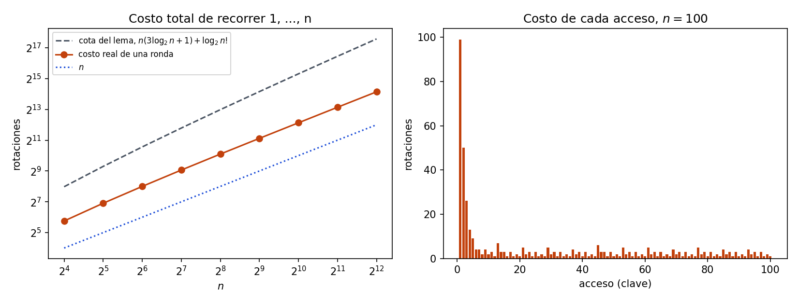

# Ejercicio 13. Accesos en orden a un splay tree que empieza como un camino

> ★★ En un splay tree que empieza como un camino de $n$ nodos se accede a las claves
> $1,\ldots,n$ en orden. Acota el costo total con el lema de acceso y la cuenta de la
> sección 5 de la conferencia 4, y compáralo con lo que mide la sección 6. ¿Es ajustada
> la cota? (C4)

## Resumen

Con el lema de acceso, $n$ accesos desde el camino cuestan en total a lo sumo
$n(3\log_2n+1)+\log_2n!\le n(4\log_2n+1)=O(n\log n)$. La sección 6 mide otra cosa:
alrededor de 4,2 a 4,4 rotaciones por acceso para $n=100,\ldots,800$, es decir, un
total lineal. La cota **no es ajustada**: se pasa por un factor que crece como $\log n$
(de 6,3 a 8,7 veces el costo real entre $n=100$ y $n=800$). El costo real de esta
secuencia es $\Theta(n)$: la cota inferior $n$ es inmediata, y el teorema de acceso
secuencial de Tarjan (1985) da la superior; aquí se cita, sin demostrarlo, y las
mediciones lo confirman.

Hay dos fuentes de holgura, que el cuaderno mide. Primero, en esta secuencia el árbol
vuelve a ser **el mismo camino** al terminar la ronda, así que $\Phi_m=\Phi_0$ y el
término $\Phi_0-\Phi_m\le\Phi_0\approx n\log_2n$ de la cota no se gasta. Segundo, aun sin
ese término, el lema acota cada acceso por $3(\log_2n-r(x))+1$, que es el peor caso
sobre todos los árboles y secuencias, y aquí el costo amortizado de cada acceso es
unas cuatro unidades.

El cuaderno [`ejercicio-13.ipynb`](ejercicio-13.ipynb) comprueba el lema y la suma
amortizada en cada acceso, reproduce la tabla de la sección 6, mide el costo y genera
la figura.

| aspecto | resultado |
|---|---|
| cota del lema, una ronda | $n(3\log_2n+1)+\log_2n!=O(n\log n)$ |
| costo real, una ronda | 416, 840, 1 732, 3 490 para $n=100,200,400,800$ |
| por acceso | 4,16; 4,20; 4,33; 4,36 (sección 6: 4,2; 4,2; 4,3; 4,4) |
| cota / costo real | 6,29; 7,18; 7,89; 8,74 |
| $\Phi_m$ frente a $\Phi_0$ | iguales: el árbol vuelve al camino inicial |
| ¿ajustada? | no; el costo real es $\Theta(n)$ y la cota pierde un factor $\Theta(\log n)$ |

## 1. Formulación

**Árbol inicial.** `camino(n)`, el de la sección 4 de la conferencia: la clave $n$ en
la raíz y cada clave $k$ es hija izquierda de $k+1$. Tiene profundidad $n-1$ y el nodo
$k$ tiene un subárbol de tamaño $k$.

**Secuencia.** $m=n$ accesos, a las claves $1,2,\ldots,n$ en ese orden. Cada acceso
busca la clave y hace splay del nodo.

**Costo.** El de la conferencia: el número de rotaciones del splay, y 1 si el nodo ya
es la raíz, $c_i=\max(\text{rotaciones},1)$. Es proporcional a la profundidad del nodo.

**Potencial.** $\Phi=\sum_x\log_2s(x)$, con $s(x)$ el tamaño del subárbol de $x$. En el
camino los tamaños son $1,2,\ldots,n$, así que

$$\Phi_0=\sum_{k=1}^n\log_2k=\log_2n!\le n\log_2n.$$

## 2. La cota del lema de acceso

El lema (sección 5): el costo amortizado de hacer splay de $x$ en un árbol de raíz $t$ es
$\hat c\le3(r(t)-r(x))+1$. Aquí $r(t)=\log_2n$ siempre, porque la raíz contiene el
árbol entero, y $r(x)\ge0$. Por tanto cada acceso cumple

$$\hat c_i\le3\log_2n+1.$$

Sumando los costos amortizados, el potencial se telescopa:

$$\sum_{i=1}^nc_i=\sum_{i=1}^n\hat c_i+\Phi_0-\Phi_n\le n(3\log_2n+1)+\Phi_0,$$

porque $\Phi_n\ge0$. Con $\Phi_0=\log_2n!\le n\log_2n$,

$$\boxed{\sum_{i=1}^nc_i\le n(3\log_2n+1)+\log_2n!\le n(4\log_2n+1)=O(n\log n).}$$

Es la cuenta de la conferencia con $m=n$. La condición $\Phi_n\ge\Phi_0$ que pedía la
sección 2 no se cumple aquí, y por eso aparece el sumando $\Phi_0$ pagado aparte, una
sola vez.

*Tabla 1. La cota para una ronda.*

| $n$ | $n(3\log_2n+1)+\log_2n!$ |
|---:|---:|
| 100 | 2 618 |
| 200 | 6 032 |
| 400 | 13 659 |
| 800 | 30 512 |

## 3. Lo que mide la sección 6

La sección 6 recorre tres rondas completas, $1,\ldots,n$ tres veces, y mide el costo
medio por acceso: 4,2; 4,2; 4,3 y 4,4 para $n=100,200,400,800$, con un decimal.

El cuaderno ejecuta la misma función `costo_por_acceso` y reproduce esos valores. Mide
además una sola ronda, que es lo que pide el ejercicio, y el resultado es **el mismo**
con tres rondas que con una: 4,16; 4,20; 4,33; 4,36. Hay una razón: al terminar la
ronda, el árbol es otra vez el camino inicial.

**Observación.** Para todo $1\le n\le200$, tras recorrer $1,\ldots,n$ el árbol tiene
exactamente la estructura de `camino(n)` (se comprueban los hijos de cada clave, no solo
el potencial), y las tres rondas cuestan lo mismo. Se verifica para esos tamaños; no se
demuestra aquí que ocurra para todo $n$.

*Tabla 2. Una ronda desde el camino.*

| $n$ | costo real | por acceso | cota | cota / real |
|---:|---:|---:|---:|---:|
| 100 | 416 | 4,16 | 2 618 | 6,29 |
| 200 | 840 | 4,20 | 6 032 | 7,18 |
| 400 | 1 732 | 4,33 | 13 659 | 7,89 |
| 800 | 3 490 | 4,36 | 30 512 | 8,74 |
| 1 024 | 4 478 | 4,37 | 40 513 | 9,05 |
| 4 096 | 18 044 | 4,41 | 194 802 | 10,80 |

El costo por acceso crece muy despacio, de 3,38 con $n=16$ a 4,41 con $n=4\,096$, y para
$n$ grande queda muy por debajo de $3\log_2n+1$, que es lo que la cota promedia. La
cota por acceso sale de dividir la de la sección 2 entre $n$:
$3\log_2n+1+\tfrac1n\log_2n!\approx4\log_2n$.

## 4. ¿Es ajustada la cota?

No. Ni siquiera en el sentido más débil de acertar el orden de crecimiento.

**El costo real es $\Theta(n)$.** Hay un mínimo evidente: cada acceso cuesta al menos 1,
así que el total es al menos $n$. El teorema de acceso secuencial de Tarjan (1985) dice
que acceder a todas las claves en orden cuesta $O(n)$ en un splay tree, desde cualquier
árbol inicial. No se demuestra aquí; la tabla 2 es coherente con él, con un costo por
acceso casi constante entre $n=16$ y $n=4\,096$. La cota del lema pierde un factor
$\Theta(\log n)$: el cociente cota/real crece de 4,67 con $n=16$ a 10,80 con
$n=4\,096$, y se ve en la figura como una separación creciente entre dos rectas casi
paralelas en ejes logarítmicos.

**Dónde se pierde.** El cuaderno comprueba que la identidad
$\sum c_i=\sum\hat c_i+\Phi_0-\Phi_n$ y la desigualdad $\hat c_i\le3(\log_2n-r(x_i))+1$
valen en cada acceso, y mide cada término.

*Tabla 3. Los términos de la suma para una ronda.*

| $n$ | $\sum c_i$ | $\sum\hat c_i$ | $\Phi_0$ | $\Phi_n$ | $\sum_i\bigl[3(\log_2n-r(x_i))+1\bigr]$ |
|---:|---:|---:|---:|---:|---:|
| 60 | 242 | 242,0 | 272,1 | 272,1 | 787,3 |
| 100 | 416 | 416,0 | 524,8 | 524,8 | 1 441,6 |
| 200 | 840 | 840,0 | 1 245,4 | 1 245,4 | 3 240,1 |

1. $\Phi_n=\Phi_0$. El término $\Phi_0-\Phi_n$ vale 0 y la cota de la sección 2 lo
   reemplaza por $\Phi_0$, que es alrededor de una quinta parte de la cota (524,8 de 2 618 con $n=100$).
2. Aun así, la suma de los límites del lema, $\sum_i[3(\log_2n-r(x_i))+1]$, vale
   1 441,6 con $n=100$, unos 14,4 por acceso, contra 416 de costo amortizado real, unos
   4,2 por acceso. El lema vale para **todo** árbol y toda secuencia. Aquí el rango
   $r(x_i)$ del nodo accedido es en promedio pequeño, así que el límite del lema es grande,
   y el costo amortizado real no lo es.

**Los accesos caros existen, y el potencial los paga.** El costo por acceso no es
uniforme. Con $n=800$ el primero cuesta 799 rotaciones, el segundo 400, y los siguientes
más caros 201, 100, 53, 26 y 15: aproximadamente la mitad del anterior cada vez. Del
segundo al último hay 799 accesos: 793 cuestan entre 1 y 10 rotaciones, y seis cuestan
15, 26, 53, 100, 201 y 400.

| costo | 1 | 2 | 3 | 4 | 5 | 6 | 7 | 8 | 9 | 10 |
|---|---:|---:|---:|---:|---:|---:|---:|---:|---:|---:|
| accesos, del 2.º al último | 287 | 168 | 223 | 34 | 45 | 18 | 13 | 2 | 2 | 1 |

Eso es exactamente lo que el análisis amortizado afirma y lo que la sección 10 de la
conferencia advertía: una operación suelta puede costar $\Theta(n)$, y la garantía es
sobre la secuencia. El potencial baja en esos accesos y paga la diferencia.

**Qué sí dice la cota.** Es correcta, y es la garantía que da el lema a **cualquier**
secuencia de $n$ accesos. Para esta secuencia concreta, en cambio, no es la mejor cota
posible. El lema es una cota general; el teorema de acceso secuencial usa más
información de la secuencia.

## 5. Verificación numérica

El cuaderno ejecuta el mismo código de la conferencia 4 para `Nodo`, `rotar`, `splay`,
`buscar` y `camino`. El cuaderno tiene dos versiones del potencial: las funciones recursivas de la
conferencia (`tamano_subarbol` y `potencial_recursivo`) y una iterativa. Un camino de $n$
nodos tiene profundidad $n$ y la versión recursiva recalcula el tamaño de cada
subárbol, así que se usa la iterativa en los recorridos con $n$ grande; las dos se
comparan entre sí en árboles pequeños.

| afirmación del informe | comprobación |
|---|---|
| el splay conserva el orden y los punteros al padre | 500 accesos aleatorios en un árbol de 50 nodos; recorrido en orden $=1..50$ |
| potencial iterativo igual al recursivo de la conferencia | 200 árboles: el camino con $n\in\{1,2,7,30,100\}$ y los que resultan de 40 accesos aleatorios en cada uno; coinciden el potencial y el tamaño de cada subárbol |
| $\Phi_0=\log_2n!$ en el camino | $n\in\{1,2,7,60\}$ |
| lema de acceso, $\hat c_i\le3(\log_2n-r(x_i))+1$ | en cada acceso de los recorridos con $n=60,100,200$ |
| identidad $\sum c_i=\sum\hat c_i+\Phi_0-\Phi_n$ | en esos tres recorridos |
| cota de la sección 2 | el costo real es a lo sumo la cota en esos tres recorridos |
| Tabla de la sección 6 | `costo_por_acceso` con 3 rondas da 4,2; 4,2; 4,3; 4,4, igual que con 1 ronda |
| el árbol vuelve al camino | forma completa e igualdad de costos en las rondas, $1\le n\le200$ |
| Tablas 2 y 3, perfil de costos | ejecución directa del código |

*Figura 1. A la izquierda, el costo total de recorrer $1,\ldots,n$ para
$n=2^4,\ldots,2^{12}$, en ejes logarítmicos, frente a la cota del lema y a la
referencia $n$. La cota y el costo real son casi paralelos, y la separación entre ellos
crece despacio, como $\log n$. A la derecha, el costo de cada acceso para $n=100$:
unos pocos accesos caros al principio, con costos aproximadamente a la mitad del
anterior, y después unas pocas rotaciones por acceso.*

El cuaderno se guarda con sus salidas y la figura. Para reproducirlo hacen falta
Python 3, `matplotlib` e `IPython`.

## 6. Conclusiones

El lema de acceso con la cuenta de la sección 5 da, para $n$ accesos en orden desde el
camino, un costo total de a lo sumo $n(3\log_2n+1)+\log_2n!=O(n\log n)$. La sección 6
mide unas 4,2 a 4,4 rotaciones por acceso, un total lineal, y la cota no es ajustada: se
pasa por un factor que crece como $\log n$. La holgura tiene dos orígenes comprobados: el
árbol termina la ronda donde empezó, así que el potencial inicial que la cota paga no se
gasta, y el lema acota cada acceso con el peor caso de cualquier árbol. El costo real de
esta secuencia es $\Theta(n)$, por el teorema de acceso secuencial, que se cita y no se
demuestra. Unos pocos accesos individuales cuestan $\Theta(n)$ y el potencial los paga,
como corresponde a una garantía amortizada.
