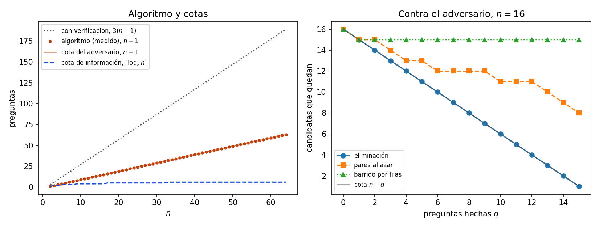

# Ejercicio 14. El ciclo completo sobre el problema de la celebridad

> ★★★ Escoge un problema que no hayamos visto, recorre el ciclo completo de la
> conferencia 2 sobre él y consigue que el algoritmo y la cota mínima coincidan. Es el
> formato de la pregunta larga del examen final. (C2 a C5)

## Resumen

El problema elegido es el de la **celebridad**: entre $n$ personas, hallar a la que todos
conocen y que no conoce a nadie, preguntando "¿$a$ conoce a $b$?". Se supone, como se
dice en el enunciado clásico, que existe una. El ciclo de la conferencia 2 sale así:

| etapa | resultado |
|---|---|
| 1. problema | hallar la celebridad con la promesa de que existe; costo = preguntas |
| 2. algoritmo | un candidato y una pasada: cada pregunta elimina a una persona |
| 3. correctitud | invariante "la celebridad nunca queda eliminada"; termina por un potencial |
| 4. costo | exactamente $n-1$ preguntas, memoria $O(1)$ |
| 5. cota mínima | $n-1$, por un adversario; la información solo da $\lceil\log_2n\rceil$ |

Algoritmo y cota **coinciden**: $n-1$ preguntas, ni una menos. La información no
sirve aquí, como con el máximo en la conferencia 5: cuenta salidas, no el trabajo de
descartar a las demás personas. La promesa es una hipótesis del teorema de
correctitud, igual que el "si hay mayoría" de Boyer-Moore: sin ella el algoritmo
devuelve a alguien aunque no haya celebridad, y verificar cuesta hasta $3(n-1)$
preguntas.

El cuaderno [`ejercicio-14.ipynb`](ejercicio-14.ipynb) comprueba el algoritmo y su
costo, implementa el adversario y lo prueba contra tres estrategias, busca por
fuerza bruta el número exacto de preguntas para $n\le4$ y genera la figura.

## 1. El problema

**Entrada.** Un conjunto de $n\ge1$ personas y una relación "$a$ conoce a $b$", con
$a\ne b$, que solo se puede consultar con la pregunta $\mathrm{knows}(a,b)$. Si la
relación está guardada como una matriz $n\times n$, la pregunta es leer una entrada.

**Celebridad.** Una persona $c$ tal que todos los demás la conocen y ella no conoce a
nadie.

**Promesa.** Existe una celebridad. Salida: esa persona.

**Costo.** El número de preguntas. Todo el resto del cómputo es gratis en este modelo.

**Unicidad.** A lo sumo hay una celebridad. Si $c_1\ne c_2$ lo fueran, $c_1$ conocería a
$c_2$, porque todos conocen a una celebridad, y $c_1$ no conoce a nadie. Contradicción.
Por eso la salida está bien definida.

El caso $n=1$ no necesita preguntas.

## 2. El algoritmo

**Cómo se le ocurre a uno.** Una sola pregunta $\mathrm{knows}(a,b)$ siempre descarta a
alguien:

- si $a$ conoce a $b$, $a$ no es la celebridad, porque la celebridad no conoce a nadie;
- si $a$ no conoce a $b$, $b$ no es la celebridad, porque la celebridad es conocida por
  todos.

Entre $n$ personas hay que descartar a $n-1$. Se mantiene un candidato y se lo compara
con cada persona nueva.

```python
def find_celebrity(n, knows):
    """Con la promesa de que existe una celebridad, devuelve (c, preguntas)."""
    if n < 1:
        raise ValueError("se requiere al menos una persona")
    candidate, asked = 0, 0
    for other in range(1, n):
        asked += 1
        if knows(candidate, other):
            candidate = other
    return candidate, asked
```

## 3. Correctitud

Es correctitud total: la parcial con un invariante, la terminación con un potencial.

**Invariante.** Después de procesar a las personas $1,\ldots,i$, ninguna de las
personas $0,\ldots,i$ distinta de `candidate` es la celebridad.

*Inicialización.* Con $i=0$ solo está la persona 0, que es el candidato: no hay nadie
distinto.

*Mantenimiento.* Se procesa a `other`$=i+1$.

- Si `candidate` conoce a `other`, `candidate` no es la celebridad. Pasa a ser
  `other`, y los que ya estaban descartados siguen descartados.
- Si no lo conoce, `other` no es la celebridad, y `candidate` no cambia.

En los dos casos, todas las personas de $0..i+1$ salvo el nuevo candidato quedan
descartadas.

*Conclusión.* Con $i=n-1$, todos salvo `candidate` están descartados. Por la promesa
hay una celebridad, así que es `candidate`.

**Terminación.** El potencial es el número de personas que faltan por procesar,
$n-1-i$. Es no negativo y baja 1 por vuelta. El ciclo da exactamente $n-1$ vueltas.

La conclusión usa la promesa. El teorema que se demostró es: *si hay celebridad, es
`candidate`*. Es la misma forma de "si hay mayoría, es el candidato" de la conferencia 3,
y la sección 6 la explota.

## 4. Costo

Cada vuelta hace exactamente una pregunta, así que son **exactamente $n-1$ preguntas**,
en todos los casos. El tiempo es $O(n)$ y la memoria extra, $O(1)$: un candidato y un
contador. No hay operaciones caras que amortizar.

## 5. ¿Se puede hacer mejor?

### 5.1. La información no alcanza

Hay $n$ respuestas posibles. Cada pregunta tiene dos respuestas, así que un árbol de
decisión de altura $h$ tiene a lo sumo $2^h$ hojas y hacen falta $\lceil\log_2n\rceil$
preguntas (conferencia 5, lema 1). Con $n=1024$ son 10, contra 1 023 del algoritmo. Como
con el máximo, la información cuenta salidas y no el trabajo de descartar.

### 5.2. El adversario

**Teorema.** Todo algoritmo determinista que halla la celebridad hace, en el peor caso,
al menos $n-1$ preguntas.

El adversario mantiene el conjunto `alive` de personas que todavía pueden ser la
celebridad, inicialmente todas. Contesta $\mathrm{knows}(a,b)$ así, y repite su
respuesta si la pregunta se repite:

1. si $a$ y $b$ están en `alive`: **sí**, y quita a $a$ de `alive`;
2. si $a$ está en `alive` y $b$ no: **no**;
3. si $a$ no está en `alive`: **sí**.

```python
class Adversary:
    def __init__(self, n):
        self.n, self.alive, self.log, self.memo = n, set(range(n)), [], {}

    def knows(self, a, b):
        if a == b:
            raise ValueError("no se pregunta por una persona consigo misma")
        if (a, b) in self.memo:             # una pregunta repetida se contesta igual
            return self.memo[(a, b)]
        if a in self.alive and b in self.alive:
            answer = True                   # a conoce a alguien: deja de ser candidata
            self.alive.discard(a)
        elif a in self.alive:               # b ya no es candidata: a no la conoce
            answer = False
        else:                               # a ya no es candidata
            answer = True
        self.memo[(a, b)] = answer
        self.log.append((a, b, answer))
        return answer
```

**Lema A.** Cada pregunta nueva quita a lo sumo a una persona de `alive`.

Solo el caso 1 quita a alguien, y es exactamente a $a$.

**Lema B (consistencia).** En todo momento, para cada $c\in$ `alive` existe una
instancia $I_c$ en la que $c$ es la celebridad y que da todas las respuestas ya
dadas.

*Demostración.* Se define $I_c$ así: todos conocen a $c$, $c$ no conoce a nadie, cada
par preguntado que no involucra a $c$ tiene la respuesta dada, y el resto es "no". Hay
que ver que toda respuesta dada que involucra a $c$ coincide con $I_c$. Sea $(a,b)$ una
pregunta respondida cuando $c$ estaba en `alive`; como $c$ sigue en `alive`, nunca
fue quitado.

- Caso 1. $c\ne a$, porque $a$ fue quitado. Si $c=b$, $I_c$ dice que $a$ conoce a $c$:
  la respuesta fue sí.
- Caso 2. $c\ne b$, porque $b$ no estaba en `alive`. Si $c=a$, $I_c$ dice que $c$ no
  conoce a $b$: la respuesta fue no.
- Caso 3. $c\ne a$, porque $a$ no estaba en `alive`. Si $c=b$, $I_c$ dice que $a$
  conoce a $c$: la respuesta fue sí.

Si $c\notin\{a,b\}$ la respuesta coincide por definición. $\square$

*Demostración del teorema.* Se ejecuta el algoritmo contra el adversario. Si termina
tras $q\le n-2$ preguntas distintas, por el Lema A quedan en `alive` al menos
$n-q\ge2$ personas, $c_1\ne c_2$. Por el Lema B, $I_{c_1}$ e $I_{c_2}$ son consistentes
con las mismas respuestas, así que el algoritmo, determinista, daría la misma salida
en las dos instancias, pero sus celebridades son distintas: se equivoca en una. Por
tanto hace al menos $n-1$ preguntas distintas. $\square$

El cuaderno implementa `instance_for` para construir $I_c$ y comprueba que es consistente
con el registro del adversario, y que tiene a $c$ como celebridad.

### 5.3. Una comprobación independiente

Para $n=2,3,4$ se enumeran **todas** las instancias con celebridad ($2$, $12$ y $256$) y
se busca, con un juego mínimo-máximo sobre estrategias adaptativas, el menor número de
preguntas que basta en el peor caso. No usa ni el algoritmo ni el adversario.

| $n$ | instancias | mínimo exacto | $n-1$ | $\lceil\log_2n\rceil$ |
|---:|---:|---:|---:|---:|
| 2 | 2 | 1 | 1 | 1 |
| 3 | 12 | 2 | 2 | 2 |
| 4 | 256 | 3 | 3 | 2 |

Coincide con $n-1$ y no con la cota de información en $n=4$. La búsqueda exhaustiva
no pasa de $n=4$: el número de instancias crece como $n\,2^{(n-1)(n-2)}$.

### 5.4. Conclusión del ciclo

El algoritmo hace $n-1$ preguntas y ninguno puede hacer menos: **el costo del
problema, en este modelo, es exactamente $n-1$**. La búsqueda terminó.

## 6. Qué modelo y qué promesa

**El modelo.** La cota es sobre algoritmos deterministas que solo acceden a la relación
con preguntas "¿$a$ conoce a $b$?". Deja fuera dos cosas. Un algoritmo aleatorio: aquí no
se demuestra nada sobre él. Y una representación donde otras operaciones valgan, por
ejemplo si se guardara además, para cada persona, a cuántas conoce: entonces la
celebridad se halla sin preguntar por pares, mirando esos números. Es la regla de la
conferencia 2: toda cota viene con su modelo.

**Sin la promesa.** El algoritmo de la sección 2 devuelve a alguien siempre, también si
no hay celebridad: lo único que demostramos fue "si hay celebridad, es `candidate`".
Para decidir si existe, se verifica al candidato.

```python
def find_celebrity_or_none(n, knows):
    c, asked = find_celebrity(n, knows)
    for other in range(n):
        if other != c:
            asked += 2
            if knows(c, other) or not knows(other, c):
                return None, asked
    return c, asked
```

Cuesta a lo sumo $(n-1)+2(n-1)=3(n-1)$ preguntas, y exactamente eso si hay celebridad.
La cota inferior $n-1$ sigue valiendo para este problema más general: un algoritmo que
decide con o sin celebridad resuelve en particular las instancias con celebridad, y
contra el adversario las dos instancias $I_{c_1}$ e $I_{c_2}$ tienen celebridad. Entre
$n-1$ y $3(n-1)$ queda una brecha que **no se cierra aquí**: la versión sin promesa no
tiene algoritmo y cota que coincidan en este análisis, y por eso el problema elegido
lleva la promesa.

Es el mismo error de la conferencia 3, sección 5: una conclusión que empieza con "si".
Las pruebas que solo generan instancias con celebridad no lo ven nunca.

## 7. Verificación numérica

| afirmación del informe | comprobación |
|---|---|
| unicidad y generador (sección 1) | $1\le n\le7$, cada $c$; una instancia sin celebridad |
| correctitud y costo exacto (secciones 3 y 4) | 266 instancias, $n$ de 1 a 12, y 50, 200, 1 000; siempre $n-1$ preguntas, tanto contadas por el algoritmo como por el oráculo |
| invariante (sección 3) | 300 instancias, 1 810 pasos: la celebridad nunca queda descartada |
| Lemas A y B y teorema (sección 5.2) | tres estrategias (eliminación, pares al azar, barrido por filas), $n=10$, cortadas tras $q=0,\ldots,8$ preguntas: 27 cortes; en todos quedan al menos $n-q\ge2$ candidatas y se construyen dos matrices con celebridades distintas, consistentes con el mismo registro |
| el algoritmo contra el adversario | exactamente $n-1$ preguntas y una sola candidata, que es su respuesta |
| mínimo exacto (sección 5.3) | juego mínimo-máximo para $n=2,3,4$ |
| sin promesa (sección 6) | 1 000 pares de instancias: con celebridad, verificación correcta y $3(n-1)$ preguntas; con una relación quitada a la celebridad, el algoritmo sin verificar devuelve a alguien en las 1 000 y el verificado responde "ninguna" |
| costo medido | $n=2,\ldots,64$, siempre $n-1$ |

*Tabla 1. Preguntas.*

| $n$ | algoritmo | cota del adversario | $\lceil\log_2n\rceil$ | con verificación |
|---:|---:|---:|---:|---:|
| 2 | 1 | 1 | 1 | 3 |
| 4 | 3 | 3 | 2 | 9 |
| 16 | 15 | 15 | 4 | 45 |
| 64 | 63 | 63 | 6 | 189 |
| 256 | 255 | 255 | 8 | 765 |
| 1 024 | 1 023 | 1 023 | 10 | 3 069 |

*Tabla 2. Personas que siguen siendo candidatas tras $q$ preguntas, $n=16$.*

| estrategia | $q=0$ | 2 | 4 | 6 | 8 | 10 | 12 | 14 | 15 |
|---|---:|---:|---:|---:|---:|---:|---:|---:|---:|
| eliminación | 16 | 14 | 12 | 10 | 8 | 6 | 4 | 2 | 1 |
| pares al azar | 16 | 15 | 13 | 12 | 12 | 11 | 11 | 9 | 8 |
| barrido por filas | 16 | 15 | 15 | 15 | 15 | 15 | 15 | 15 | 15 |



*Figura 1. A la izquierda, las preguntas del algoritmo para $n=2,\ldots,64$, que caen
sobre la recta $n-1$ de la cota del adversario, la cota de información
$\lceil\log_2n\rceil$, mucho más baja, y el algoritmo con verificación, $3(n-1)$. A la
derecha, las personas que el adversario deja como candidatas tras $q$ preguntas, para
tres estrategias: ninguna baja más rápido que la cota $n-q$, y la eliminación la
alcanza, por lo que su curva tapa a la cota.*

El cuaderno se guarda con sus salidas y la figura. Para reproducirlo hacen falta
Python 3, `matplotlib` e `IPython`.

## 8. Conclusiones

Las cinco etapas del ciclo dieron: un problema bien enunciado, con su modelo y su
promesa; un algoritmo de una pasada que descarta a una persona por pregunta; una
demostración de correctitud con invariante y potencial; un costo exacto de $n-1$
preguntas; y una cota mínima de $n-1$, por un adversario cuya consistencia se
demuestra construyendo, para cada candidata, una instancia compatible. La cota de
información, $\lceil\log_2n\rceil$, no alcanza: cuenta salidas y no trabajo. Algoritmo
y cota coinciden, y la búsqueda exhaustiva para $n\le4$ lo confirma sin usar ninguno
de los dos. La cota vale para algoritmos deterministas que solo hacen esas preguntas.
Sin la promesa el algoritmo falla y la versión verificada cuesta hasta $3(n-1)$, con
una brecha que este ejercicio no cierra.
