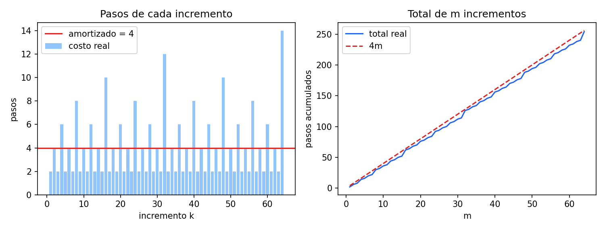

# Ejercicio 4: el contador binario en una máquina de Turing

> ★★ El contador binario en una máquina de Turing, del ejercicio 7 de la conferencia 1.
> Demuestra con un potencial que $m$ incrementos desde 0 cuestan $O(m)$ pasos en
> total, aunque uno solo pueda costar $\Theta(\log m)$. Es la pregunta que la
> conferencia 1 dejó abierta. (C1, C4)

**Código:** [`ejercicio-04.py`](ejercicio-04.py). Tiene un simulador de máquinas de
Turing de una cinta, la máquina que incrementa, 5000 incrementos con el potencial
vigilado en cada uno, la comparación con una versión que deja el cabezal en el otro
extremo y la figura.

**Resultado:** $m$ incrementos desde 0 cuestan exactamente $4m - 2u(m)$ pasos, donde
$u(m)$ es la cantidad de unos de $m$ en binario. Eso es menos que $4m$. Con el
potencial $\Phi = 2 \cdot (\text{cantidad de unos en la cinta})$, cada incremento
cuesta exactamente 4 amortizado.

## El modelo

Es la máquina de Turing de la sección 3 de la conferencia 1: una cinta infinita de celdas, un
cabezal que lee y escribe una celda y se mueve una posición a la izquierda o a la
derecha, y una cantidad finita de estados. **Cada transición es un paso**, y el costo
es la cantidad de pasos.

El número se escribe en binario de la forma habitual, con el bit más significativo
(MSB) a la izquierda y el menos significativo (LSB) a la derecha. El resto de la cinta
está en blanco. El 0 se escribe como un solo `0`. Como pide el ejercicio 7 de la
conferencia 1, el cabezal **empieza sobre el LSB y vuelve a él al terminar**, así que
el siguiente incremento puede empezar enseguida.

## La máquina

Sumar 1 en binario es propagar un acarreo: los unos del final se vuelven ceros, y el
primer 0 (o el blanco, si el número era todo unos) se vuelve 1. Después hay que
regresar al LSB. Son dos estados de trabajo, `acarreo` y `volver`:

| estado | lee | escribe | se mueve | pasa a |
|---|---|---|---|---|
| acarreo | 1 | 0 | izquierda | acarreo |
| acarreo | 0 | 1 | derecha | volver |
| acarreo | blanco | 1 | derecha | volver |
| volver | 0 | 0 | derecha | volver |
| volver | 1 | 1 | derecha | volver |
| volver | blanco | blanco | izquierda | fin |

En `volver` el cabezal camina a la derecha hasta encontrar el blanco que está después
del LSB, y da un paso atrás para quedar sobre él.

**Ejemplo: de 11 a 12.** La cinta tiene `1011` y el cabezal está sobre el último 1.

| paso | estado | lee | qué hace | cinta después |
|---|---|---|---|---|
| 1 | acarreo | 1 (LSB) | escribe 0, izquierda | 1010 |
| 2 | acarreo | 1 | escribe 0, izquierda | 1000 |
| 3 | acarreo | 0 | escribe 1, derecha | 1100 |
| 4 | volver | 0 | derecha | 1100 |
| 5 | volver | 0 (LSB) | derecha | 1100 |
| 6 | volver | blanco | izquierda, fin | 1100 |

Termina con `1100` = 12 y el cabezal sobre el LSB, en 6 pasos.

## Correctitud de un incremento

Sea $v$ el número en la cinta al empezar. Durante el acarreo, llamamos $s$ a la
distancia entre el cabezal y el LSB y $N$ al número que está escrito en la cinta.

**Invariante del acarreo.** En el estado `acarreo`, las celdas entre el cabezal (sin
incluirlo) y el LSB valen 0, y $N + 2^s = v + 1$.

En palabras: lo que falta sumar es un 1 en la posición del cabezal, que vale $2^s$.

- **Inicialización.** Al empezar, el cabezal está sobre el LSB, así que $s = 0$, no hay
  celdas entre él y el LSB y $N = v$. Entonces $N + 2^0 = v + 1$.
- **Mantenimiento, leyendo 1.** Escribir 0 en la posición $s$ le resta $2^s$ a $N$, y
  moverse a la izquierda cambia $s$ por $s + 1$. Queda
  $(N - 2^s) + 2^{s+1} = N + 2^s = v + 1$. La celda que se acaba de poner en 0 queda
  ahora entre el cabezal y el LSB, así que la primera parte también se conserva.
- **Salida, leyendo 0 o blanco.** Escribir 1 en la posición $s$ le suma $2^s$ a $N$, y
  queda $N + 2^s = v + 1$. El acarreo se absorbió, y la cinta tiene $v + 1$.

**El regreso no cambia nada.** En `volver` la máquina reescribe lo que lee, así que la
cinta sigue teniendo $v + 1$. Además nunca se escribe nada a la derecha del LSB, así
que el primer blanco a la derecha está justo después del LSB, y el último paso deja el
cabezal sobre él.

**Termina.** En el acarreo, $s$ crece en cada paso y no puede pasar de la cantidad de
bits, porque a la izquierda del MSB hay un blanco. En el regreso, la distancia al
blanco de la derecha baja en cada paso.

El script lo comprueba en 5000 incrementos seguidos: después de cada uno, la cinta
tiene el número correcto y el cabezal está sobre el LSB.

## Costo de un incremento

Sea $t$ la cantidad de unos al final de $v$ en binario: son los bits que el acarreo
pone en 0. Contando los pasos:

- **Acarreo:** $t$ pasos leyendo 1, más 1 paso leyendo el 0 o el blanco. En total,
  $t + 1$.
- **Regreso:** después del último paso del acarreo el cabezal quedó a $t - 1$ celdas a
  la izquierda del LSB (una a la derecha de donde escribió el 1). Camina las $t$ celdas
  hasta el LSB inclusive y lee el blanco: $t + 1$ pasos.

$$\text{costo del incremento} = 2(t + 1) = 2t + 2.$$

En el ejemplo de 11 a 12, $t = 2$ y el costo fue 6.

**Un incremento puede costar $\Theta(\log m)$.** El peor es el que pasa de $2^j - 1$ a
$2^j$, porque $2^j - 1$ son $j$ unos y entonces $t = j$. Entre los primeros $m$
incrementos aparece con $j = \lfloor \log_2 m \rfloor$, y cuesta
$2\lfloor \log_2 m \rfloor + 2$. Si se multiplica ese peor caso por $m$ se obtiene solo
la cota $O(m \log m)$. La pregunta que dejó abierta la conferencia 1 es si el total es
realmente tan grande, y la respuesta es que no.

## El potencial: $m$ incrementos cuestan $O(m)$

Usamos el método del potencial de la sección 2 de la conferencia 4. El costo amortizado del
incremento $i$ es $\hat c_i = c_i + \Phi_i - \Phi_{i-1}$, y sumando

$$\sum_{i=1}^{m} c_i = \sum_{i=1}^{m} \hat c_i - (\Phi_m - \Phi_0).$$

**Elegimos** $\Phi = 2 \cdot (\text{cantidad de unos en la cinta})$.

**El costo amortizado es 4.** Un incremento con $t$ unos finales pone $t$ unos en 0 y
un 0 en 1. La cantidad de unos cambia en $1 - t$, así que $\Delta\Phi = 2(1 - t)$, y

$$\hat c = (2t + 2) + 2(1 - t) = 4.$$

El término $2t$ del costo real se cancela con el $-2t$ del potencial. Cada 1 que hay en
la cinta tiene guardados 2 pasos: uno para que el acarreo lo ponga en 0 y otro para
el paso del regreso que lo cruza.

**El potencial no termina por debajo de donde empezó.** Al principio la cinta tiene
`0`, así que $\Phi_0 = 0$, y la cantidad de unos nunca es negativa, así que
$\Phi_m \ge 0$. Este es el paso que la conferencia 4 dice que todo el mundo olvida.
Entonces

$$\sum_{i=1}^{m} c_i = 4m - \Phi_m \le 4m = O(m).$$

**Un dato más: el total exacto.** Después de $m$ incrementos la cinta tiene $m$, así
que $\Phi_m = 2u(m)$, donde $u(m)$ es la cantidad de unos de $m$ en binario. Por la
igualdad de arriba, el total es **exactamente** $4m - 2u(m)$.

## Comprobación

En cada uno de los 5000 incrementos el script verifica con `assert` que la cinta tiene
el número correcto, que el cabezal volvió al LSB, que el costo real es $2t + 2$ y que
el costo amortizado es exactamente 4. Después compara el total con la fórmula exacta:

```
      m    total  4m - 2·unos(m)  total/m  peor incremento  2·⌊log2 m⌋ + 2
      1        2               2    2.000                2              2
      2        6               6    3.000                4              4
      7       22              22    3.143                6              6
      8       30              30    3.750                8              8
    100      394             394    3.940               14             14
   1000     3988            3988    3.988               20             20
   1024     4094            4094    3.998               22             22
   5000    19990           19990    3.998               26             26
```

El total por incremento se acerca a 4, mientras el peor incremento sigue creciendo
como $2\log_2 m$.



A la izquierda están los pasos de cada uno de los primeros 64 incrementos. Los picos
son los que pasan de $2^j - 1$ a $2^j$ (en $k = 8, 16, 32, 64$), y la mayoría cuesta 2
o 4. La recta roja es el amortizado, 4. A la derecha está el total, que queda siempre
por debajo de $4m$.

## Por qué importa dónde se deja el cabezal

El argumento depende de que el cabezal **viva en el LSB**, que es donde empieza el
acarreo. Para verlo, el script tiene la misma suma con el cabezal empezando y
terminando en el MSB. Ahora cada incremento tiene que caminar hasta el LSB, hacer el
acarreo y volver al MSB, así que recorre el número entero dos veces sin importar
cuántos unos haya al final:

```
      m  total LSB  total MSB  MSB / m  log2 m
      8         30         55     6.88       3
     64        254        778    12.16       6
    512       2046       9229    18.03       9
   4096      16382      98320    24.00      12
```

Con el cabezal en el LSB el costo por incremento se queda en 4. Con el cabezal en el
MSB crece como $2\log_2 m$, y el total es $\Theta(m \log m)$. El script verifica que
cada incremento desde el MSB cuesta al menos el doble de la cantidad de bits.

Ningún potencial puede arreglar eso. El potencial solo redistribuye el costo entre
operaciones, y aquí **todas** las operaciones son caras: el incremento que pasa de
$k$ a $k + 1$ cuesta al menos $2\log_2 k$, así que la suma es al menos
$2(\log_2 1 + \dots + \log_2 (m-1)) = 2\log_2 (m-1)!$, que es $\Theta(m \log m)$.
El potencial de los unos funciona en la versión del LSB porque ahí el costo de cada
incremento es proporcional a los unos que borra, y no al largo del número.

## Resumen

| | |
|---|---|
| Máquina | dos estados, acarreo hacia la izquierda y regreso al LSB |
| Correctitud | invariante del acarreo: N + 2^s = v + 1 |
| Costo de un incremento | 2t + 2, con t los unos finales; el peor es 2⌊log2 m⌋ + 2 |
| Potencial | Φ = 2 · (unos en la cinta), amortizado exactamente 4 |
| Total de m incrementos | exactamente 4m − 2·u(m), menos que 4m |
| Cabezal en el MSB | Θ(log m) por incremento: el potencial no ayuda |
