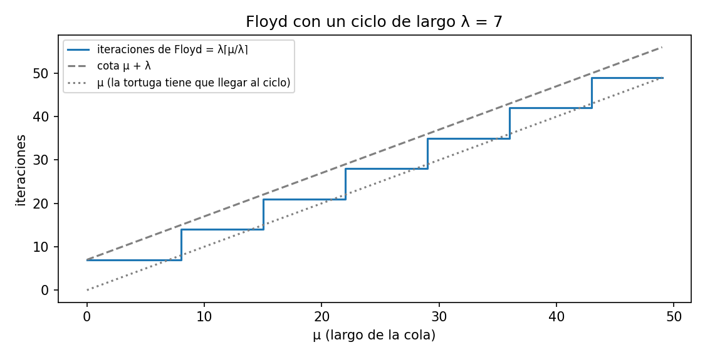

# Ejercicio 5: detección de ciclos de Floyd

> ★★ Detección de ciclos en una lista enlazada con dos punteros que avanzan a
> velocidades 1 y 2 (algoritmo de Floyd). Demuestra que se encuentran si y solo si hay
> un ciclo, con un invariante, y que termina, con un potencial. Da el costo. (C3)

**Código:** [`ejercicio-05.py`](ejercicio-05.py). Prueba todas las formas de lista con
cola y ciclo de largo hasta 40, con el invariante y el potencial vigilados en cada
iteración, compara variantes de velocidad y genera la figura.

## Modelo y notación

Una lista enlazada es una cabeza más un puntero `sig` en cada nodo. Llamamos
$x_0 =$ cabeza y $x_{i+1} = x_i.\text{sig}$. Puede pasar una de dos cosas:

- **Sin ciclo:** hay $L$ nodos $x_0, \dots, x_{L-1}$ y $x_L =$ `None`.
- **Con ciclo:** la lista tiene forma de **ρ**. Tiene una cola de $\mu \ge 0$ nodos y
  un ciclo de $\lambda \ge 1$ nodos, en total $n = \mu + \lambda$, con
  $x_{\mu+\lambda} = x_\mu$.

```
 x0 → x1 → … → x(μ-1) → xμ → x(μ+1) → …
                         ↑                ↓
                         x(μ+λ-1) ←  …  ←
```

**Modelo:** puntero RAM. Seguir un `sig` y comparar dos punteros con `is` cuestan
$O(1)$. Solo se permite memoria $O(1)$: nada de guardar los nodos visitados, porque
eso costaría $\Theta(n)$ de memoria.

## Algoritmo

```python
def floyd(cabeza):
    t = h = cabeza                     # tortuga y liebre
    while h is not None and h.sig is not None:
        t, h = t.sig, h.sig.sig        # velocidades 1 y 2
        if t is h:
            return True                # se encontraron: hay ciclo
    return False                       # la liebre llegó al final: no hay ciclo
```

Primero hay que saber cuándo se repiten los nodos. En los dos casos los nodos de la
lista son distintos entre sí: $x_0, \dots, x_{L-1}$ sin ciclo, y $x_0, \dots, x_{n-1}$
con ciclo.

**Sin ciclo** no hay repeticiones: los índices $0, \dots, L-1$ nombran $L$ nodos
distintos, y $x_L$ es `None`, que no es un nodo.

**Hecho A (repeticiones con ciclo).** Si hay ciclo, para $i, j \ge 0$:

$$
x_i = x_j \iff i = j \ \text{ o bien } \ \big(i, j \ge \mu \ \text{ y } \ i \equiv j \pmod{\lambda}\big).
$$

*Demostración.* Primero un paso previo: para todo $m \ge \mu$ se cumple
$x_{m+\lambda} = x_m$. Para $m = \mu$ es la definición del ciclo. Si vale para $m$,
entonces $x_{m+1+\lambda} = x_{m+\lambda}.\text{sig} = x_m.\text{sig} = x_{m+1}$, así
que vale para $m + 1$ por inducción.

- **(⇐)** Si $i = j$ no hay nada que probar. Si $i, j \ge \mu$ y
  $i \equiv j \pmod{\lambda}$, supongamos $i \le j$ y escribamos $j = i + q\lambda$ con
  $q \ge 0$. Aplicando el paso previo $q$ veces (siempre con índices $\ge \mu$) queda
  $x_j = x_{i + q\lambda} = x_i$.
- **(⇒)** A cada índice le asignamos un representante $r(i) \in \lbrace 0, \dots, n-1 \rbrace$:
  $r(i) = i$ si $i < \mu$, y $r(i) = \mu + ((i - \mu) \bmod \lambda)$ si $i \ge \mu$.
  En el segundo caso $r(i) \ge \mu$ y $r(i) \equiv i \pmod{\lambda}$, así que por (⇐)
  $x_{r(i)} = x_i$. Lo mismo vale en el primer caso, porque $r(i) = i$. Si $x_i = x_j$,
  entonces $x_{r(i)} = x_{r(j)}$, y como los nodos $x_0, \dots, x_{n-1}$ son distintos,
  $r(i) = r(j)$. Hay dos posibilidades:
  - $r(i) < \mu$: por la definición de $r$, eso solo pasa si $i < \mu$ y $r(i) = i$. Lo
    mismo para $j$. Así que $i = r(i) = r(j) = j$.
  - $r(i) \ge \mu$: entonces $i, j \ge \mu$ y $(i - \mu) \bmod \lambda = (j - \mu) \bmod \lambda$,
    es decir, $i \equiv j \pmod{\lambda}$. $\square$

**Lema.** Sea $k \ge 1$ tal que $x_k$ es un nodo y $x_{2k}$ es un nodo o `None` (esas
son las únicas iteraciones que el algoritmo llega a ejecutar). Entonces:

$$
x_k = x_{2k} \iff \text{hay ciclo}, \ k \ge \mu \ \text{ y } \ \lambda \mid k .
$$

*Demostración.*

- **(⇒)** Supongamos $x_k = x_{2k}$. Primero, tiene que haber ciclo: si no lo hubiera,
  como $x_k$ es un nodo, $x_{2k}$ también lo sería, así que $2k < L$. Pero entonces
  $k$ y $2k$ son dos índices distintos (porque $k \ge 1$) de nodos de una lista sin
  ciclo, que son distintos entre sí. Eso contradice $x_k = x_{2k}$. Con ciclo, aplicamos
  el Hecho A (⇒) con $i = k$ y $j = 2k$. Como $k \ne 2k$, la primera opción no vale,
  así que $k, 2k \ge \mu$ y $k \equiv 2k \pmod{\lambda}$. Lo segundo dice que
  $\lambda \mid 2k - k = k$. De lo primero sale $k \ge \mu$.
- **(⇐)** Supongamos que hay ciclo, $k \ge \mu$ y $\lambda \mid k$. Entonces
  $2k \ge k \ge \mu$, y $2k - k = k \equiv 0 \pmod{\lambda}$, o sea
  $2k \equiv k \pmod{\lambda}$. Por el Hecho A (⇐), $x_k = x_{2k}$. $\square$

## Correctitud: el invariante

> **Invariante.** Al terminar la iteración $k$ (y al empezar, con $k = 0$):
> $t = x_k$ (que no es `None`), $h = x_{2k}$ (que solo puede ser `None` si la guarda
> está por cortar el ciclo), y $x_j \ne x_{2j}$ para $1 \le j < k$.

**Inicialización.** Con $k = 0$, $t = h = x_0$. La lista no es vacía; si lo fuera, el
ciclo no se ejecuta y se responde `False`, que es correcto. La última condición no
exige nada para $k = 0$.

**Mantenimiento.** La guarda del ciclo asegura que $x_{2k+1} = h.\text{sig}$ no es
`None`. Después de la asignación, $t = x_{k+1}$ y $h = x_{2k+2}$. Si $h$ fuera `None`,
la comparación `t is h` daría falso, porque $t = x_{k+1}$ con $k+1 \le 2k+1$ no es
`None`, y en la siguiente vuelta la guarda terminaría el ciclo. Si la iteración no devuelve nada es porque
$x_{k+1} \ne x_{2(k+1)}$, y eso extiende la última condición.

**Conclusión.** Se responde una cosa u otra según cómo termine el ciclo:

- **Devuelve `True`:** pasó porque $x_k = x_{2k}$ con $k \ge 1$. Por el lema hay
  ciclo, así que la respuesta es correcta.
- **Devuelve `False`:** pasó porque la guarda encontró $h = x_{2k}$ o $h.\text{sig} = x_{2k+1}$ igual a `None`. En una lista
  con ciclo ningún $x_i$ es `None`, así que no hay ciclo y la respuesta es correcta.

**Se encuentran si y solo si hay ciclo.**

- **(⇒)** Si se encuentran, es porque en alguna iteración $k \ge 1$ el `t is h` dio
  verdadero. Por el invariante eso es $x_k = x_{2k}$, y el lema (⇒) dice que hay ciclo.
- **(⇐)** Si hay ciclo, ningún $x_i$ es `None`, así que la guarda nunca corta el ciclo:
  el algoritmo ejecuta las iteraciones $k = 1, 2, \dots$ hasta que devuelve `True`. Sea

$$
k^* = \text{el menor múltiplo de } \lambda \text{ que es } \ge \max(\mu, 1) \;=\; \lambda \cdot \max\!\left(1, \left\lceil \mu/\lambda \right\rceil\right).
$$

  Ese $k^*$ cumple $k^* \ge 1$, $k^* \ge \mu$ y $\lambda \mid k^*$, así que por el lema
  (⇐) $x_{k^*} = x_{2k^*}$: si el algoritmo llega a la iteración $k^*$, devuelve
  `True` ahí. Y no devuelve antes: para $1 \le k < k^*$, $k$ no es un múltiplo de
  $\lambda$ que sea $\ge \mu$ (por ser $k^*$ el menor), así que por el lema (⇒)
  $x_k \ne x_{2k}$. Se encuentran exactamente en la iteración $k^*$.

## Terminación: el potencial

**Sin ciclo:** $\Phi = L - 2k$, que es la cantidad de nodos que le quedan por delante
a la liebre. Es un entero, baja 2 por iteración, y el ciclo solo sigue mientras
$\Phi \ge 2$.

**Con ciclo** la liebre no llega nunca al final, así que la cantidad que baja tiene
que ser otra.

$$
\Phi_k =
\begin{cases}
n - k & \text{si } k < \max(\mu, 1) \quad \text{(fase 1)} \\
g_k = (-k) \bmod \lambda & \text{si } k \ge \max(\mu, 1) \quad \text{(fase 2)}
\end{cases}
$$

- **Fase 1: la tortuga todavía no entró al ciclo** (o es la situación inicial, $k = 0$).
  $\Phi_k = n - k$ es natural porque $k < \mu \le n$ (o $k = 0$), y baja 1 por
  iteración. Además, en esta fase $\Phi_k \ge \lambda$: si $\mu \ge 1$, entonces
  $k \le \mu - 1$ y $n - k \ge \lambda + 1$; si $\mu = 0$, la fase es solo $k = 0$ y
  $\Phi_0 = n = \lambda$.
- **Fase 2: los dos están en el ciclo.** $g_k$ es la distancia, medida a lo largo del
  ciclo, que tiene que recorrer la liebre (en $x_{2k}$) para alcanzar a la tortuga (en
  $x_k$): $(k - 2k) \bmod \lambda$. Es un natural entre $0$ y $\lambda - 1$. En cada
  iteración la tortuga avanza 1 y la liebre 2, así que la distancia baja
  **exactamente 1**. Cuando llega a 0 se encuentran y el ciclo termina, así que nunca
  hace falta bajar de 0.
- **El paso de la fase 1 a la 2 también baja:** el último valor de la fase 1 es al
  menos $\lambda$, y el primero de la fase 2 es como máximo $\lambda - 1$.

Entonces $\Phi$ es un natural que baja estrictamente en cada iteración, y eso no puede
pasar infinitas veces: el ciclo termina. El script comprueba en cada iteración que
$\Phi \ge 0$ y que baja estrictamente.

## Costo

| caso                   | iteraciones                                                                | pasos de puntero              |
| ---------------------- | -------------------------------------------------------------------------- | ----------------------------- |
| sin ciclo, L nodos     | ⌊L/2⌋                                                                      | ≤ 3⌊L/2⌋                      |
| con ciclo              | k* = λ·max(1, ⌈μ/λ⌉) ≤ μ + λ = n                                           | ≤ 3n                          |

La memoria es $O(1)$: dos punteros. La desigualdad $k^* \le \mu + \lambda$ sale de que
entre $\max(\mu, 1)$ y $\max(\mu, 1) + \lambda - 1$ hay $\lambda$ enteros seguidos, y uno
de ellos es múltiplo de $\lambda$. Entonces $k^* \le \max(\mu, 1) + \lambda - 1 \le \mu + \lambda$.
Con $\mu = 0$ la cota se alcanza: $k^* = \lambda = n$.

```
  mu  lam  iteraciones  mu+lam
   0   10           10      10
   9   10           10      19
  10   10           10      20
  11   10           20      21      ← un nodo más de cola: el doble de iteraciones
 500  500          500    1000
```



La figura muestra la forma de escalera de $k^*$. La tortuga tiene que llegar al ciclo
($k \ge \mu$, la línea punteada), y después se espera hasta el siguiente múltiplo de
$\lambda$. Siempre queda por debajo de la cota $\mu + \lambda$, la línea discontinua.

## Pruebas

Se prueban **todas** las formas de lista con $\mu \le 40$ y $\lambda \le 40$, con y
sin ciclo, que son 1680 listas. En cada iteración se comprueba que $t = x_k$ y
$h = x_{2k}$ y que el potencial bajó. Además se comprueba que el número de
iteraciones es exactamente $k^*$ (o $\lfloor L/2\rfloor$ sin ciclo). No hubo ningún
fallo.

**Extra: hallar $\mu$ y $\lambda$.** Como $k^*$ es múltiplo de $\lambda$, se cumple
$x_{k^* + \mu} = x_\mu$. Si se pone un puntero en la cabeza y otro en el punto de
encuentro, y se los avanza de a 1, después de $m$ pasos están en $x_m$ y $x_{k^* + m}$.
Como $m \ne k^* + m$, el Hecho A dice que son el mismo nodo si y solo si $m \ge \mu$ (la
otra condición, $\lambda \mid k^*$, ya se cumple). Así que se encuentran por primera vez
justo en $m = \mu$, en $x_\mu$. Desde ahí, una vuelta completa
al ciclo da $\lambda$. El script lo comprueba en todas las formas.

## ¿Funcionan otras velocidades? Lo que dice el lema

Generalizando el lema: con velocidades $a \le b$ (la tortuga es la lenta; si no, se
cambian los nombres), en la iteración $k$ la tortuga está en $x_{ak}$ y la liebre en
$x_{bk}$. Como en Floyd, la liebre revisa cada paso, así que el algoritmo devuelve
`False` en cuanto ella encuentra `None`, y `True` en la primera iteración $k \ge 1$ con
$x_{ak} = x_{bk}$.

**Lema general.** Sean $0 \le a < b$ y $k \ge 1$, con $x_{ak}$ un nodo y $x_{bk}$ un
nodo o `None`. Entonces:

$$
x_{ak} = x_{bk} \iff \text{hay ciclo}, \ ak \ge \mu \ \text{ y } \ \lambda \mid (b-a)k .
$$

*Demostración.* Es la misma que la del lema, cambiando $k$ por $ak$ y $2k$ por $bk$.

- **(⇒)** Como $b > a$ y $k \ge 1$, $bk > ak$: son índices distintos. Sin ciclo, dos
  índices distintos de nodos dan nodos distintos (y si $x_{bk}$ es `None` tampoco es
  igual al nodo $x_{ak}$), así que tiene que haber ciclo. Con ciclo, el Hecho A (⇒) con
  $i = ak$, $j = bk$ da $ak, bk \ge \mu$ y $ak \equiv bk \pmod{\lambda}$, es decir,
  $ak \ge \mu$ (el menor de los dos) y $\lambda \mid (b-a)k$.
- **(⇐)** Con ciclo, $ak \ge \mu$ y $\lambda \mid (b-a)k$: como $bk \ge ak \ge \mu$ y
  $bk \equiv ak \pmod{\lambda}$, el Hecho A (⇐) da $x_{ak} = x_{bk}$. $\square$

De ahí salen las dos condiciones para que "se encuentran $\iff$ hay ciclo" siga
valiendo. Las dos juntas son $1 \le a < b$, y con ellas valen los dos sentidos:

- **(⇒) necesita $a < b$.** Si se encuentran en la iteración $k$, entonces
  $x_{ak} = x_{bk}$, y el lema general (⇒) dice que hay ciclo. Si en cambio $a = b$,
  el lema no se aplica: $ak = bk$ es el mismo índice, así que $x_{ak} = x_{bk}$ en
  cuanto se llega a la iteración 1, haya ciclo o no. Sin ciclo, se llega a la
  iteración 1 siempre que la liebre no encuentre `None` en sus primeros $b$ pasos
  (con $a = b = 1$, siempre que $L \ge 2$), y el algoritmo responde `True` sin que haya
  ciclo.
- **(⇐) necesita $a \ge 1$.** Con ciclo ningún $x_i$ es `None`, así que la liebre no
  corta nunca y el algoritmo ejecuta las iteraciones $k = 1, 2, \dots$ hasta encontrarse.
  Tomemos $k = \lambda \max(1, \mu)$. Es $\ge 1$, es múltiplo de $\lambda$ (así que
  $\lambda \mid (b-a)k$) y, como $a \ge 1$, $ak \ge k \ge \max(1, \mu) \ge \mu$. Por el
  lema general (⇐), $x_{ak} = x_{bk}$: a más tardar en esa iteración se encuentran. Si
  en cambio $a = 0$, la condición $ak \ge \mu$ se vuelve $0 \ge \mu$. Cuando $\mu > 0$,
  el lema general (⇒) dice que no se encuentran en ninguna iteración, aunque haya
  ciclo, y como la liebre nunca encuentra `None` el algoritmo no termina nunca.

Probamos con cinco pares de velocidades (930 formas con ciclo de $\mu \le 30$,
$1 \le \lambda \le 30$, y 60 listas sin ciclo):

| velocidades      | fallos con ciclo     | fallos sin ciclo   | qué condición rompe                                                         |
| ---------------- | -------------------- | ------------------ | ----------------------------------------------------------------------------- |
| (1, 2)           | 0                    | 0                  | –                                                                            |
| (1, 3)           | 0                    | 0                  | –                                                                            |
| (2, 3)           | 0                    | 0                  | –                                                                            |
| (0, 1)           | 900 de 930           | 0                  | a ≥ 1: la tortuga no entra al ciclo y la liebre da vueltas para siempre |
| (1, 1)           | 0                    | 59 de 60           | b ≠ a: "se encuentran" en la primera iteración aunque no haya ciclo    |

Cada error solo se ve con una clase de pruebas:

- La variante **(0, 1)** falla exactamente cuando $\mu > 0$. Si uno prueba con listas
  circulares cerrando la última sobre la cabeza ($\mu = 0$), que es el ciclo que se
  escribe primero, nunca falla.
- La variante **(1, 1)** nunca falla en listas que tienen ciclo. Una batería que solo
  pruebe "¿detecta el ciclo?" no la atrapa nunca. Hace falta probar listas **sin**
  ciclo.

El lema dice qué probar: sus dos sentidos son las dos clases de entradas. El sentido
(⇐) da "con ciclo, se encuentran", y para probarlo hacen falta colas largas, $\mu > 0$.
El sentido (⇒) da "si se encuentran, hay ciclo", y para probarlo hacen falta listas
sin ciclo.
