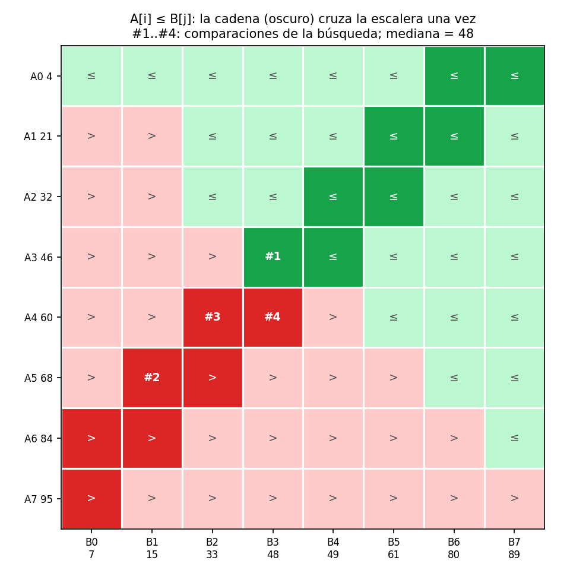

# Ejercicio 7: mediana de dos arreglos ordenados

> ★★★ Mediana de dos arreglos ordenados de largo $n$: el $n$-ésimo menor de los $2n$
> elementos. Diseña un algoritmo $O(\log n)$, demuestra su correctitud y da la cota
> de información. (C2, C3, C5)

**Código:** [`ejercicio-07.py`](ejercicio-07.py). Prueba de forma exhaustiva todas las
entradas con $n \le 10$ (más de 240 000), prueba 20 000 entradas aleatorias con y sin
repetidos y calcula el **óptimo exacto** por fuerza bruta sobre árboles de decisión
para $n \le 7$.

**Resultado:** el algoritmo hace como máximo $\lceil \log_2 2n \rceil$ comparaciones,
y la cota de información es $\lceil \log_2 2n \rceil$. Coinciden **exactamente**, sin
diferencia de constante. La versión de "punto de corte" que se suele enseñar hace
aproximadamente el doble.

Sigo el ciclo de la conferencia 2: problema, primera solución, una solución mejor,
correctitud, costo y cota mínima.

## 1. El problema y el modelo

**Entrada:** $A[0..n-1]$ y $B[0..n-1]$, ordenados de forma creciente. **Salida:** el
$n$-ésimo menor de los $2n$ elementos, es decir, el elemento en la posición $n-1$
(contando desde 0) del arreglo mezclado. **Modelo:** comparaciones entre elementos,
cada una de costo 1, y acceso a cualquier posición en $O(1)$. Para la cota mínima
suponemos que los elementos son distintos. El algoritmo funciona igual con
repetidos.

Comparar dos elementos de $A$ entre sí, o dos de $B$, no sirve de nada, porque el
resultado ya se conoce. Las únicas comparaciones útiles son de la forma
**$A_i$ contra $B_j$**.

## 2. Primera solución: mezclar hasta la posición $n$

Se mezcla como en mergesort y se para cuando han salido $n$ elementos. Son como
máximo $n$ comparaciones, es decir, $\Theta(n)$. Es correcto, pero no aprovecha que
solo nos interesa **una** posición de la mezcla.

## 3. La idea: la matriz de comparaciones es una escalera

Consideremos la matriz $M[i][j] = [A_i \le B_j]$. Al aumentar $j$ el valor de $B_j$
crece, y al aumentar $i$ el valor de $A_i$ crece. Así que en cada fila los "sí" quedan
a la derecha, en cada columna quedan arriba, y la frontera entre "sí" y "no" es una
**escalera**, la misma estructura de la matriz ordenada del ejercicio 6.



La mediana está donde la escalera cruza la antidiagonal $i + j \approx n - 1$. Para
encontrar el cruce con búsqueda binaria hace falta una sucesión **monótona** de
comparaciones. La armamos recorriendo dos antidiagonales en zigzag, que es la parte
oscura de la figura:

$$P_{2i} = (A_i \text{ vs } B_{n-1-i}), \qquad P_{2i+1} = (A_i \text{ vs } B_{n-2-i}), \qquad\text{para } k = 0, \dots, 2n-2.$$

Son $2n - 1$ eslabones, y $P_k$ es verdadero si $A_i \le B_j$.

**Lema 1 (monotonía).** Si $P_k$ es verdadero, entonces $P_{k-1}$ también lo es. La
cadena es una sucesión de verdaderos seguida de una de falsos.

*Demostración.* De $P_{2i}$ a $P_{2i+1}$ el elemento de $A$ es el mismo y el de $B$
baja de $B_{n-1-i}$ a $B_{n-2-i}$. Si $A_i \le B_{n-2-i}$, entonces
$A_i \le B_{n-1-i}$. De $P_{2i+1}$ a $P_{2i+2} = (A_{i+1}, B_{n-2-i})$ el de $B$ es el
mismo y el de $A$ sube. Si $A_{i+1} \le B_{n-2-i}$, entonces
$A_i \le A_{i+1} \le B_{n-2-i}$. $\square$

**Lema 2 (decodificación).** Sea $t \in \lbrace 0, \dots, 2n-1 \rbrace$ el número de eslabones
verdaderos. Entonces

$$\text{mediana} = \begin{cases} A_i & \text{si } t = 2i + 1,\\ B_{n-1-i} & \text{si } t = 2i.\end{cases}$$

*Demostración.* Si $t = 2i + 1$, entonces $P_{2i}$ es verdadero
($A_i \le B_{n-1-i}$), y si existe, $P_{2i+1}$ es falso ($A_i > B_{n-2-i}$). El
conjunto $L = \lbrace A_0..A_i \rbrace \cup \lbrace B_0..B_{n-2-i} \rbrace$ tiene $(i+1) + (n-1-i) = n$
elementos, y todos son $\le A_i$. Todos los demás son $\ge A_i$: los de $A$ porque
vienen después en $A$, y los de $B$ porque son $\ge B_{n-1-i} \ge A_i$. Así que $A_i$
es el mayor de los $n$ menores, es decir, el $n$-ésimo menor.

Si $t = 2i$, el razonamiento es el mismo con
$L = \lbrace A_0..A_{i-1} \rbrace \cup \lbrace B_0..B_{n-1-i} \rbrace$. $P_{2i-1}$ verdadero da
$A_{i-1} \le B_{n-1-i}$, y $P_{2i}$ falso da $A_i > B_{n-1-i}$. Los dos extremos son
casos particulares: con $t = 0$ todo $B$ es menor que todo $A$ y la mediana es
$B_{n-1}$, y con $t = 2n-1$ es al revés y la mediana es $A_{n-1}$. $\square$

En la figura, la búsqueda hace 4 comparaciones (#1 a #4) y encuentra $t = 8$. Los
eslabones $P_0, \dots, P_7$ son verdaderos y $P_8 = (A_4, B_3)$ es falso. Por el lema
2, la mediana es $B_{8-1-4} = B_3 = 48$. Se puede comprobar con la mezcla:
4, 7, 15, 21, 32, 33, 46, **48**.

## 4. El algoritmo

```python
def mediana(A, B):
    n = len(A)
    lo, hi = 0, 2 * n - 1               # t está en [lo, hi]
    while lo < hi:
        m = (lo + hi) // 2
        i, j = par(m, n)                # el eslabón P_m
        if A[i] <= B[j]:
            lo = m + 1
        else:
            hi = m
    t = lo
    return A[t // 2] if t % 2 == 1 else B[n - 1 - t // 2]
```

Es la búsqueda binaria del ejercicio 2, pero sobre los $2n$ valores posibles de $t$.

## 5. Correctitud

**Invariante.** $P_k$ es verdadero para todo $k < lo$, falso para todo $k \ge hi$, y
$0 \le lo \le hi \le 2n - 1$. Por lo tanto $lo \le t \le hi$.

- **Inicialización.** Con $lo = 0$ y $hi = 2n - 1$ las dos condiciones se cumplen sin
  condiciones, porque los eslabones son $P_0..P_{2n-2}$.
- **Mantenimiento.** Si $P_m$ es verdadero, por el lema 1 también lo son todos los
  $P_k$ con $k \le m$, y `lo = m + 1` conserva el invariante. Si $P_m$ es falso,
  también lo son todos los $P_k$ con $k \ge m$, y `hi = m` lo conserva.
- **Conclusión.** Cuando $lo = hi$, el invariante fija $t = lo$, y el lema 2 da la
  mediana.

**Terminación.** El potencial es $\Phi = hi - lo$, la cantidad de candidatos menos
uno. Es entero y no negativo, y baja en cada vuelta: la ventana de $c$ candidatos pasa
a tener $\lfloor c/2 \rfloor$ o $\lceil c/2 \rceil$.

## 6. Costo

Los candidatos para $t$ son $2n$, y cada comparación deja como máximo
$\lceil c/2\rceil$ de $c$. Por lo tanto:

$$\boxed{\text{comparaciones} \le \lceil \log_2 2n \rceil = 1 + \lceil \log_2 n \rceil}$$

El tiempo es $O(\log n)$ y la memoria $O(1)$.

## 7. Cota mínima: el argumento de información

**Hay $2n$ salidas posibles, y todas ocurren.** Con elementos distintos, la mediana
es exactamente uno de $A_0, \dots, A_{n-1}, B_0, \dots, B_{n-1}$, y cada uno de ellos
es la mediana en alguna entrada. Para que $A_k$ sea la mediana, se ponen debajo de él
$A_0..A_{k-1}$ y $B_0..B_{n-2-k}$, y el resto encima. Para $B_k$ es simétrico. El
script verifica que aparecen las $2n$ salidas para todo $n \le 8$.

**Consecuencia.** Un algoritmo correcto tiene que mandar entradas con salidas distintas
a hojas distintas del árbol de decisión. Con elementos distintos cada comparación tiene
dos respuestas, así que el árbol es binario y tiene al menos $2n$ hojas. Por el lema
del árbol de la conferencia 5:

$$\boxed{\text{todo algoritmo de comparaciones necesita} \ge \lceil \log_2 2n \rceil}$$

**La cota y el algoritmo coinciden exactamente.** Además, la cota de información es
**el óptimo real**, y no solo una cota que podría estar lejos. El script lo comprueba
buscando, por fuerza bruta sobre árboles de decisión, el mínimo número de comparaciones
$A_i$ vs $B_j$ que resuelve todas las entradas:

```
  n  óptimo (fuerza bruta)  ⌈log2 2n⌉
  1                      1          1
  2                      2          2
  3                      3          3
  4                      3          3
  5                      4          4
  6                      4          4
  7                      4          4
```

La sección 4 de la conferencia 5 muestra que la información no siempre alcanza: para el máximo
da $\log_2 n$, y el óptimo es $n - 1$. Aquí sí alcanza, porque cada comparación de la
cadena parte el conjunto de salidas posibles casi exactamente por la mitad.

## 8. Pruebas, y la comparación con la versión de "punto de corte"

La versión que más circula hace búsqueda binaria sobre **cuántos elementos aporta
$A$** a los $n$ menores, que son $n+1$ opciones. En cada paso compara
$A_{i-1}$ vs $B_j$ **y además** $B_{j-1}$ vs $A_i$, y al final calcula un `max` más.
También es $O(\log n)$, pero gasta unas dos comparaciones por paso:

```
  n  entradas  peor caso  ⌈log2 2n⌉  partición
  1         2          1          1          2
  4        70          3          3          5
  8     12870          4          4          8
 10    184756          5          5          8
```

Las dos versiones se probaron contra `sorted(A + B)[n-1]` sobre **todas** las
entradas con $n \le 10$, que son 250 952 en total, y sobre 20 000 pares aleatorios con
$n \le 300$. En dos tercios de esos pares hay muchos repetidos (valores en $\lbrace 0..3 \rbrace$ o
$\lbrace 0..10 \rbrace$). No hubo ningún fallo, y la nuestra nunca pasó de
$\lceil\log_2 2n\rceil$ comparaciones.

Con repetidos el lema 2 sigue valiendo, porque usa $\le$ de forma consistente y solo
afirma que el **valor** devuelto es el $n$-ésimo menor. La cota mínima, en cambio,
necesita elementos distintos para que las $2n$ salidas sean distinguibles.

## Resumen

| | |
|---|---|
| **Idea** | los $A_i \le B_j$ forman una escalera, y una cadena monótona de $2n-1$ comparaciones la cruza una sola vez |
| **Algoritmo** | búsqueda binaria del número $t$ de eslabones verdaderos |
| **Correctitud** | lema 1 (monotonía), lema 2 (decodificación) e invariante de la búsqueda binaria |
| **Costo** | $\le \lceil \log_2 2n \rceil$ comparaciones, $O(1)$ memoria |
| **Cota mínima** | $\lceil \log_2 2n \rceil$, porque hay $2n$ salidas posibles |
| **Conclusión** | óptimo exacto, confirmado por fuerza bruta para $n \le 7$ |
