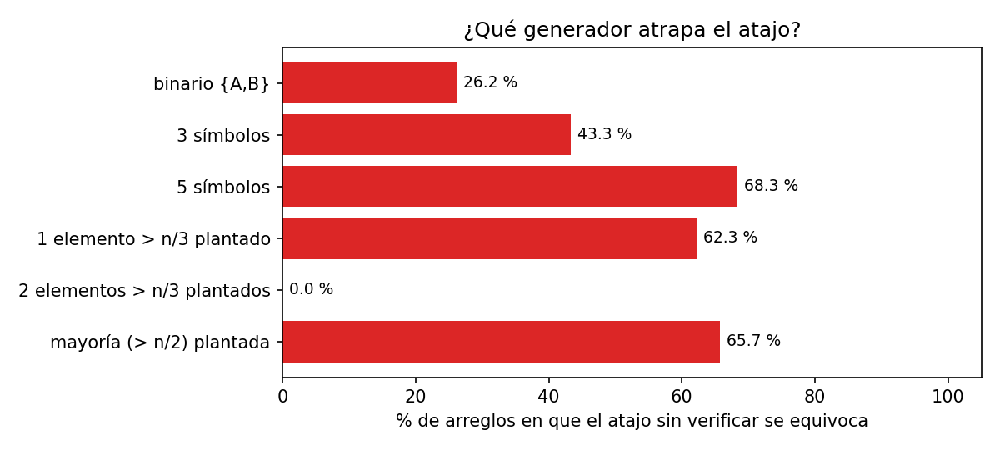

# Ejercicio 8: el elemento que aparece más de $n/3$ veces

> ★★ El elemento que aparece más de $n/3$ veces. Generaliza Boyer-Moore con dos
> candidatos, enuncia el invariante reforzado y demuéstralo. Después escribe la
> versión que devuelve los candidatos con contador positivo sin verificarlos, y busca
> un generador de pruebas que no la atrape. Cuidado: el análogo del generador binario
> de la conferencia 3 sí la atrapa. (C3)

**Código:** [`ejercicio-08.py`](ejercicio-08.py). Prueba de forma exhaustiva 51 369
arreglos chicos con el invariante vigilado en cada prefijo, prueba 3000 arreglos
aleatorios, compara seis generadores contra el atajo y prueba un segundo error
plantado.

## Problema y modelo

**Entrada:** un arreglo $A$ de $n$ elementos en el que solo se pueden comparar por
igualdad. **Salida:** el conjunto de elementos que aparecen **más de $n/3$ veces**.
Puede tener como máximo 2 elementos, porque tres de ellos sumarían más de $n$
apariciones. **Modelo:** comparaciones de igualdad de costo 1, y memoria $O(1)$ además
de la entrada.

## Algoritmo

Es la idea de la conferencia 3 con un candidato más. En lugar de cancelar **parejas**
de elementos distintos, se cancelan **tríos** de elementos distintos.

```python
def primera_pasada(A):
    c1 = c2 = None
    k1 = k2 = 0
    for x in A:
        if k1 > 0 and x == c1:
            k1 += 1
        elif k2 > 0 and x == c2:
            k2 += 1
        elif k1 == 0:
            c1, k1 = x, 1
        elif k2 == 0:
            c2, k2 = x, 1
        else:                     # x, c1, c2 distintos: se cancela un trío
            k1 -= 1; k2 -= 1
    return [(c1, k1), (c2, k2)]

def mas_de_un_tercio(A):
    candidatos = {c for c, k in primera_pasada(A) if k > 0}
    return {c for c in candidatos if 3 * A.count(c) > len(A)}    # verificación
```

**El orden de las ramas importa.** Primero se pregunta si $x$ es igual a alguno de los
candidatos vivos, y solo después si hay un contador libre. En la sección 5 se ve qué
pasa si se invierte ese orden.

## Correctitud: el invariante reforzado

El invariante de la conferencia 3 era "parejas de distintos más $c$ copias del
candidato". Su generalización natural a tríos necesita una condición más, la parte
(a), sin la cual el paso que cancela un trío no se puede justificar.

> **Invariante.** Después de procesar el prefijo $A[1..i]$:
>
> **(a)** si $k_1 > 0$ y $k_2 > 0$, entonces $c_1 \ne c_2$;
>
> **(b)** el prefijo se puede partir en **tríos de elementos distintos dos a dos**, más
> $k_1$ copias de $c_1$ y $k_2$ copias de $c_2$.

**Inicialización.** El prefijo vacío, con $k_1 = k_2 = 0$, tiene cero tríos y cero
copias. (a) se cumple porque los contadores no son positivos.

**Mantenimiento.** Suponemos el invariante para $A[1..i]$ y procesamos $x = A[i+1]$.
Hay un caso por cada rama:

1. **$k_1 > 0$ y $x = c_1$:** $x$ es una copia más de $c_1$ y $k_1$ sube. La partición
   no cambia en lo demás y (a) no se ve afectada.
2. **$k_2 > 0$ y $x = c_2$:** es simétrico al caso 1.
3. **$k_1 = 0$:** el prefijo, quitando las $k_2$ copias de $c_2$, es solo tríos. $x$
   pasa a ser $c_1$ con $k_1 = 1$. Para (a): si $k_2 > 0$, entonces $x \neq c_2$,
   porque si no habría entrado en el caso 2.
4. **$k_1 > 0$, $k_2 = 0$:** $x \ne c_1$, porque si no habría entrado en el caso 1.
   $x$ pasa a ser $c_2$ con $k_2 = 1$, y (a) se cumple porque $c_2 = x \ne c_1$.
5. **$k_1, k_2 > 0$ y $x \ne c_1, c_2$:** **por (a)**, $c_1 \neq c_2$, así que
   $\lbrace x, c_1, c_2 \rbrace$ son tres elementos distintos dos a dos. Ese es un trío nuevo que
   usa una copia de cada candidato, y los dos contadores bajan en 1.

El paso 5 es el único donde se usa (a), y sin ella no se puede dar. Si $c_1 = c_2$, el
"trío" tendría dos elementos iguales.

**Conclusión.** Al terminar, $A$ se parte en $(n - k_1 - k_2)/3$ tríos de distintos,
más $k_1$ copias de $c_1$ y $k_2$ de $c_2$. Sea $m$ un elemento que aparece más de
$n/3$ veces y supongamos que **no** es un candidato con contador positivo. Entonces
$m$ solo aparece en los tríos, y como máximo una vez en cada uno:

$$\#m \le \frac{n - k_1 - k_2}{3} \le \frac{n}{3},$$

lo que es una contradicción. $\square$

**Teorema.** *Todo elemento que aparece más de $n/3$ veces es un candidato con
contador positivo.* Igual que en la conferencia 3, la frase es una implicación en un
solo sentido. Al revés no vale: un candidato con contador positivo no tiene por qué
aparecer más de $n/3$ veces. Por eso hace falta la segunda pasada, que cuenta cada
candidato y se queda con los que de verdad superan $n/3$.

### El invariante, ejecutado

Para comprobar (b) en cada paso hace falta saber cuándo un multiconjunto se puede
partir en tríos de distintos. Es la versión con tríos del lema de la conferencia 3:

> **Lema.** $S$ se parte en tríos de distintos dos a dos $\iff$ $|S| = 3t$ y ningún
> elemento aparece más de $t$ veces.

*Demostración.* (⇒) Hay $t$ tríos y cada elemento aparece como máximo una vez en cada
uno. (⇐) Ordenamos $S$ para que los iguales queden juntos y formamos los tríos
$(S_j, S_{j+t}, S_{j+2t})$ con $j = 0..t-1$. Si dos elementos de un trío fueran
iguales, ese valor ocuparía $t + 1$ posiciones seguidas, por ejemplo de $j$ a $j+t$,
y eso contradice que aparezca como máximo $t$ veces. $\square$

El script comprueba (a) y (b) **en cada prefijo**. Para (b) usa tanto el criterio del
lema como la partición construida explícitamente. Lo hace sobre todos los arreglos de
alfabeto $\lbrace A,B,C \rbrace$ con $n \le 9$ y todos los de alfabeto $\lbrace A,B,C,D \rbrace$ con
$n \le 7$, que son 51 369 arreglos. No hubo ningún fallo, y la versión verificada
coincide siempre con un oráculo que cuenta todo.

## Costo

La primera pasada hace como máximo 2 comparaciones de igualdad por elemento. La
segunda cuenta como máximo 2 candidatos, con $n$ comparaciones cada uno. En total el
tiempo es $O(n)$, como máximo $4n$ comparaciones, y la memoria es $O(1)$: dos
candidatos y dos contadores.

**Cota mínima: $\Omega(n)$.** Es el mismo argumento que la conferencia 3 usa para la
mayoría. Tomamos un arreglo con $\lfloor n/3 \rfloor$ copias de `a`, que no superan
$n/3$, y el resto de elementos distintos entre sí. Si un algoritmo no lee alguna de
las posiciones que no tienen `a`, se puede cambiar esa posición por `a`. Entonces `a`
aparece $\lfloor n/3\rfloor + 1 > n/3$ veces, y el algoritmo responde lo mismo que
antes. Así que tiene que leer las $n - \lfloor n/3 \rfloor$ posiciones restantes, y el
algoritmo es óptimo salvo por la constante.

## El atajo: devolver los candidatos sin verificar

```python
def sin_verificar(A):
    return {c for c, k in primera_pasada(A) if k > 0}
```

El teorema dice que el atajo **nunca deja fuera** a un elemento que aparece más de
$n/3$ veces. Lo que puede hacer es **agregar de más**. Los contraejemplos mínimos son:

```
atajo en 'AAB':  {'B', 'A'}  oráculo: {'A'}
atajo en 'ABCD': {'D'}       oráculo: set()   (A, B, C se cancelan; D sobrevive con contador 1)
```

### ¿Qué generador no lo atrapa?



| generador                      | atajo sin verificar | versión verificada |
|--------------------------------|---------------------|--------------------|
| binario $\lbrace A,B \rbrace$              | 26,2 %              | 0 %                |
| 3 símbolos                     | 43,3 %              | 0 %                |
| 5 símbolos                     | 68,3 %              | 0 %                |
| 1 elemento > $n/3$ plantado    | 62,3 %              | 0 %                |
| **2 elementos > $n/3$ plantados** | **0,0 %**        | 0 %                |
| mayoría (> $n/2$) plantada     | 65,7 %              | 0 %                |

Cada fila son 4000 arreglos con $3 \le n \le 30$.

**El generador binario lo atrapa.** En la conferencia 3 el generador binario no podía
encontrar el error, porque con dos símbolos "contador positivo" era lo mismo que "ser
mayoría". Aquí los candidatos son dos, y con dos símbolos nunca aparece un tercer
elemento distinto, así que nunca se cancela un trío. Los dos símbolos terminan como
candidatos con contador igual a su número de apariciones, y el atajo devuelve los dos
aunque uno aparezca, por ejemplo, una sola vez en `AAAAB`. Lo que hacía ciego al
generador binario en la conferencia 3 era que el alfabeto tenía tantos símbolos como
candidatos había, y el análogo aquí sería un alfabeto de **3** símbolos. Ese también
lo atrapa, en un 43 % de los casos.

**El que no lo atrapa es el que planta dos elementos con más de $n/3$ apariciones.**
Es el análogo del generador de "mayoría plantada" de la conferencia 3, y la razón es
la misma: el teorema dice que los dos elementos plantados **tienen que** ser
candidatos con contador positivo. Como solo hay dos lugares, no queda espacio para un
candidato que sobre, y el atajo devuelve exactamente la respuesta correcta en todos
los arreglos de ese generador. Plantar **un solo** elemento no alcanza, porque el
segundo lugar queda libre para un elemento de relleno, y entonces el atajo falla el
62 % de las veces.

La lección es la misma que en la conferencia 3: la hipótesis del teorema dice qué hay
que probar. El teorema solo habla de los elementos que aparecen más de $n/3$ veces. Lo
que hace el atajo en un lugar que **no** ocupa uno de esos elementos no lo cubre
ninguna demostración, y un generador que llena todos los lugares con esos elementos
nunca mira ahí.

## Segundo error plantado: el orden de las ramas

Supongamos que alguien escribe las ramas en el orden "natural" de primero ocupar los
lugares libres:

```python
if k1 == 0:   c1, k1 = x, 1         # ← primero mira si hay lugar libre
elif k2 == 0: c2, k2 = x, 1
elif x == c1: k1 += 1
elif x == c2: k2 += 1
else:         k1 -= 1; k2 -= 1
```

Esta variante rompe la parte (a) del invariante, y eso la hace fallar **incluso con la
verificación**:

```
orden de ramas equivocado: falla (aun verificando) en 192 arreglos de n <= 6; el menor: AAB
  estado final: [('A', 0), ('A', 0)]  oráculo: {'A'}
```

Esto es lo que pasa con `AAB`: la primera `A` ocupa $c_1$. La segunda `A` encuentra
$k_2 = 0$ y se convierte **también** en $c_2$, así que $c_1 = c_2 = A$, que es
justamente lo que (a) prohíbe. Después llega `B` y se cancela el "trío"
$\lbrace A, A, B \rbrace$. Ese trío no tiene elementos distintos, y el paso 5 de la demostración
no se puede aplicar. Al final la `A`, que aparece 2 > 1 veces, no es candidata, y la
segunda pasada no puede recuperarla.

| generador                      | fallos de la variante (con verificación) |
|--------------------------------|------------------------------------------|
| binario $\lbrace A,B \rbrace$              | 2,9 %                                    |
| 3 símbolos                     | 17,5 %                                   |
| 2 elementos > $n/3$ plantados  | 31,2 %                                   |

La parte (a) del invariante parece un detalle técnico, pero es la que se usa en el
único paso que cancela elementos. La demostración apunta al error, y el contraejemplo
mínimo es precisamente un candidato repetido seguido de un elemento distinto.
