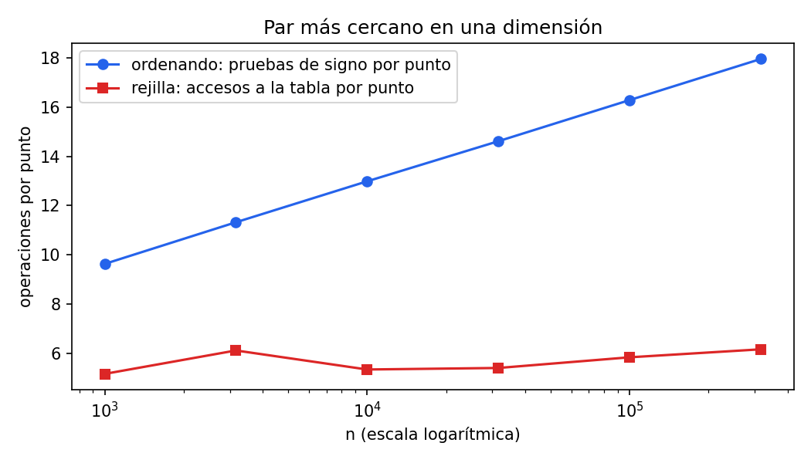

# Ejercicio 10: par más cercano en una dimensión

> ★★ Par más cercano en una dimensión. Demuestra $\Omega(n \log n)$ en árboles de
> decisión algebraicos por reducción desde distinción de elementos. Después di qué
> algoritmo de la conferencia 2 rompe la cota, en qué modelo, y adáptalo a una
> dimensión. (C2, C5)

**Código:** [`ejercicio-10.py`](ejercicio-10.py). Prueba los dos algoritmos y la
reducción contra fuerza bruta en 3000 entradas con y sin repetidos, mide las pruebas
de signo por punto del algoritmo que ordena y los accesos por punto de la rejilla,
cuenta las reconstrucciones y genera la figura.

**Resultado:** en árboles de decisión algebraicos el problema cuesta
$\Theta(n \log n)$: ordenar alcanza la cota, y la reducción desde distinción de
elementos la demuestra. La rejilla aleatoria de Rabin de la sección 9 de la conferencia 2 lo
resuelve en $O(n)$ esperado, porque usa la parte entera y una tabla hash, que el
modelo no tiene.

## El problema y el modelo

**Par más cercano en una dimensión.** Dados $n \ge 2$ números reales
$x_1, \dots, x_n$, encontrar dos índices $i \ne j$ que minimicen $|x_i - x_j|$.

**Distinción de elementos.** Dados $n$ números reales, decidir si hay dos iguales.

**El modelo** es el árbol de decisión algebraico de la sección 8 de la conferencia 2. Cada nodo
interno evalúa el signo de un polinomio de grado acotado en $x_1, \dots, x_n$ y
ramifica en tres según sea negativo, cero o positivo. Cada hoja da una respuesta. El
costo es la profundidad del árbol, es decir, la cantidad de pruebas en el peor caso.
Comparar $x_i$ con $x_j$ es la prueba del signo de $x_i - x_j$, y comparar dos
distancias es la prueba de $(x_j - x_i) - (x_l - x_k)$, de grado 1.

## Un algoritmo dentro del modelo: ordenar

Es el calentamiento de la sección 3 de la conferencia 2. Si $y_1 \le y_2 \le \dots \le y_n$ son
los números ordenados, **el par más cercano es consecutivo**: si $y_i$ y $y_j$ con
$j > i + 1$ fueran el par más cercano, $y_{i+1}$ estaría entre ellos y
$y_{i+1} - y_i \le y_j - y_i$, así que el par consecutivo $(y_i, y_{i+1})$ es al menos
igual de bueno.

```python
def ordenando(xs):
    ys = sorted(xs)
    return min(b - a for a, b in zip(ys, ys[1:]))
```

Ordenar son $O(n \log n)$ comparaciones, y recorrer los consecutivos son $n - 2$
comparaciones más entre diferencias. Todas son pruebas de signo de polinomios de grado
1, así que es un árbol de decisión algebraico de profundidad $O(n \log n)$.

## La cota mínima: reducción desde distinción de elementos

**Teorema (Ben-Or, 1983, citado en la sección 8 de la conferencia 2).** Distinción de elementos
requiere $\Omega(n \log n)$ en árboles de decisión algebraicos.

No lo demostramos. La idea es que las entradas con respuesta "todos distintos" forman
$n!$ regiones separadas de $\mathbb{R}^n$, una por cada orden posible, y un árbol de
profundidad $h$ no puede separar más de $c^h$ regiones.

**Teorema.** Par más cercano en una dimensión requiere $\Omega(n \log n)$ en árboles de
decisión algebraicos.

*Demostración.* Supongamos que hay un árbol $A$ que resuelve par más cercano en una
dimensión con profundidad $T(n)$. Construimos con él un árbol $D$ para distinción de
elementos:

1. **La entrada no cambia.** Una entrada $x_1, \dots, x_n$ de distinción de elementos
   ya es una entrada de par más cercano: $n$ puntos de la recta. La transformación es
   la identidad y no usa ninguna prueba. (En el plano, la conferencia 2 tenía que
   convertir cada $x_i$ en el punto $(x_i, 0)$; en una dimensión ni eso hace falta.)
2. **Se corre $A$.** Llega a una hoja que dice "el par más cercano es $(i, j)$".
3. **Se agrega una prueba.** Debajo de cada hoja de $A$ se cuelga un nodo que prueba el
   signo de $x_i - x_j$, que es un polinomio de grado 1. Si es cero, $D$ responde "hay
   repetidos". Si no, responde "todos distintos".

**$D$ es correcto.** Si hay dos números iguales, la distancia mínima es 0, así que el
par $(i, j)$ que devolvió $A$ también está a distancia 0, es decir, $x_i = x_j$, y $D$
responde "hay repetidos". Si todos son distintos, todas las diferencias son distintas
de 0, en particular $x_i - x_j$, y $D$ responde "todos distintos".

**$D$ es poco profundo.** Su profundidad es $T(n) + 1$: la de $A$ más la prueba final.

**Conclusión.** Si fuera $T(n) = o(n \log n)$, entonces $D$ resolvería distinción de
elementos con profundidad $T(n) + 1 = o(n \log n)$, contra el teorema de Ben-Or. Por lo
tanto $T(n) = \Omega(n \log n)$. $\square$

Junto con el algoritmo que ordena, el problema cuesta exactamente $\Theta(n \log n)$
en este modelo.

**El azar solo no alcanza.** La sección 10 de la conferencia 2 cita a Grigoriev, Karpinski, Meyer
auf der Heide y Smolensky (1996): distinción de elementos sigue requiriendo
$\Omega(n \log n)$ en árboles de decisión algebraicos **aleatorizados**. La misma
reducción pasa esa cota al par más cercano. Para romperla hay que salir del modelo.

## El algoritmo que rompe la cota

Es el algoritmo incremental y aleatorio de la sección 9 de la conferencia 2, por las ideas de Rabin
(1976). **El modelo** es una RAM que puede calcular la parte entera $\lfloor x/\delta \rfloor$ y usar el resultado como dirección en una tabla hash. Esas dos operaciones
son justo las que el árbol de decisión no tiene (sección 10 de la conferencia 2): la parte entera
no es un polinomio, ni siquiera es continua, y el árbol no tiene direccionamiento
indirecto. El costo es **esperado**, sobre el orden aleatorio de los puntos, y supone
que cada operación de la tabla hash cuesta $O(1)$.

En el script los puntos son enteros, así que la parte entera se calcula de forma
exacta. Es el modelo word RAM de la conferencia 1.

### La adaptación a una dimensión

Se barajan los puntos y se insertan de a uno, manteniendo $\delta$, la distancia del par
más cercano entre los ya insertados. Cada punto $x$ va a la celda
$\lfloor x / \delta \rfloor$ de una tabla hash. En el plano las celdas eran cuadrados
de lado $\delta/2$; en una dimensión son intervalos $[k\delta, (k+1)\delta)$ de largo
$\delta$.

**Invariante: cada celda contiene a lo sumo un punto.** Dos puntos del mismo intervalo
$[k\delta, (k+1)\delta)$ están a distancia estrictamente menor que $\delta$, porque
el intervalo no incluye su extremo derecho. Pero $\delta$ es la mínima distancia entre
los puntos insertados, así que no puede haber dos. En el plano hacía falta tomar lado
$\delta/2$ para que la diagonal $\frac{\delta}{2}\sqrt 2$ fuera menor que $\delta$; en
una dimensión el "diámetro" de la celda es su largo, y alcanza con $\delta$.

**Inserción de un punto $p$.** Si un punto $q$ ya insertado está a distancia menor que
$\delta$ de $p$, entonces $|p/\delta - q/\delta| < 1$, y sus partes enteras difieren
en a lo sumo 1. Así que $q$ está en la celda de $p$ o en una de las dos vecinas. Se
consultan **3 celdas**, cada una con a lo sumo un punto: $O(1)$. (En el plano eran 25.)

- Si ningún punto está a menos de $\delta$, $\delta$ no cambia: $p$ se guarda en su
  celda. Costo $O(1)$.
- Si lo hay, $\delta$ baja, el invariante se rompe con las celdas viejas y hay que
  reconstruir la tabla con el nuevo largo. Costo $O(i)$ si hay $i$ puntos.
- Si la nueva distancia es 0, hay dos puntos iguales, y el algoritmo termina: la
  respuesta es 0. Así se evita dividir entre $\delta = 0$.

### El costo esperado: análisis hacia atrás

Es el mismo argumento de la sección 9 de la conferencia 2. Fijamos el conjunto
$S = \lbrace p_1, \dots, p_{i+1} \rbrace$ de los primeros $i + 1$ puntos y preguntamos
cuál fue el último. Insertar $p_{i+1}$ hace bajar $\delta$ solo si $p_{i+1}$ está en
**todos** los pares a distancia mínima de $S$, y en particular en uno fijo de ellos,
que tiene dos puntos. Como el orden es una permutación uniforme, dado $S$ cada uno de
sus $i + 1$ puntos es el último con la misma probabilidad. Entonces

$$\Pr[\text{reconstruir al insertar } p_{i+1}] \le \frac{2}{i + 1}.$$

Una reconstrucción en ese paso cuesta $i + 1$ inserciones. Por linealidad de la
esperanza, el trabajo esperado de todas las reconstrucciones es a lo sumo

$$\sum_{i} \frac{2}{i+1} \cdot (i + 1) = \sum_i 2 \le 2n,$$

y el total esperado es a lo sumo $3n$ consultas, más $n$ inserciones, más $2n$ de
reconstrucciones: $O(n)$. La cantidad esperada de reconstrucciones es
$\sum_i \frac{2}{i+1} \approx 2 \ln n$.

## Comprobación

**Correctitud.** En 3000 entradas de 2 a 40 números, con rangos chicos para que haya
muchos repetidos y rangos grandes para que no los haya, los dos algoritmos dan lo
mismo que la fuerza bruta. La reducción, `hay_repetidos(xs) = (par más cercano == 0)`,
responde distinción de elementos correctamente con cualquiera de los dos. La rejilla
verifica el invariante en cada paso: la tabla tiene tantas celdas ocupadas como
puntos insertados.

**Costo.** Con números distintos, que es el caso más caro, el script cuenta las
pruebas de signo del algoritmo que ordena y los accesos a la tabla de la rejilla
(promedio de 10 órdenes aleatorios):

```
       n  pruebas/n (ordenando)  log2 n  accesos/n (rejilla)  reconstrucciones  2 ln n
   1,000                   9.63    9.97                 5.86              12.9    13.8
  10,000                  12.98   13.29                 6.15              16.6    18.4
 100,000                  16.29   16.61                 6.46              20.4    23.0
 300,000                  17.88   18.19                 5.96              24.9    25.2
```



- **Ordenar** hace unas $\log_2 n$ pruebas por punto. Cada vez que $n$ se multiplica por
  10, sube unas 3,3, que es $\log_2 10$. En la figura, con $n$ en escala
  logarítmica, es una recta que sube.
- **La rejilla** hace unos 6 accesos por punto sin importar $n$, lo que predice el
  análisis: 3 consultas, 1 inserción y unas 2 de reconstrucciones. Fluctúa un poco
  porque una reconstrucción tardía cuesta del orden de $n$, pero no crece.
- **Las reconstrucciones** son pocas, del orden de $2 \ln n$, como en la conferencia 2.

## Resumen

| | |
|---|---|
| Problema | dados n reales, el par a distancia mínima |
| En el modelo | ordenar y mirar los consecutivos: O(n log n) |
| Cota mínima | Ω(n log n): distinción de elementos se reduce con la identidad y una prueba más |
| Sigue valiendo con azar | sí, por la cota aleatorizada de Grigoriev y otros (1996) |
| Lo que la rompe | la rejilla aleatoria de Rabin (sección 9 de la conferencia 2), O(n) esperado |
| En qué modelo | RAM con parte entera y tabla hash; las dos quedan fuera del árbol algebraico |
| Adaptación a 1D | celdas de largo δ en lugar de δ/2, y 3 celdas vecinas en lugar de 25 |
