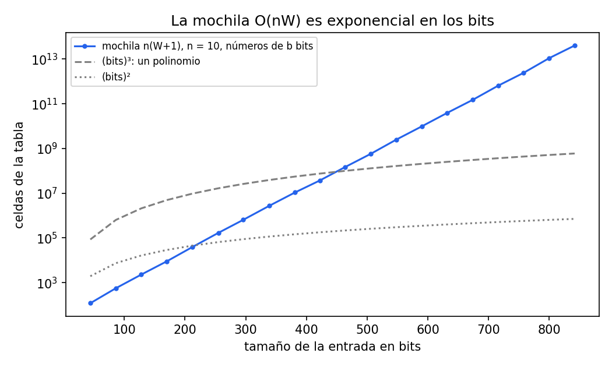

# Ejercicio 11: ¿es polinomial la mochila en $O(nW)$?

> ★★ La mochila entera se resuelve con programación dinámica en $O(nW)$, donde $W$ es
> la capacidad (lo vieron en Estructuras de Datos). Mide el tamaño de la entrada en
> bits, como en la sección 8 de la conferencia 1. ¿Es polinomial ese algoritmo? ¿En
> qué se parece a la primalidad por división? (C1)

**Código:** [`ejercicio-11.py`](ejercicio-11.py). Verifica la programación dinámica
contra fuerza bruta en 3000 instancias, mide su costo en función de los bits de la
entrada con números grandes y con números chicos, cuenta las divisiones de la
primalidad en las mismas unidades y genera la figura.

**Respuesta corta:** no es polinomial. Es **pseudopolinomial**: es polinomial en $n$ y
en el **valor** de $W$, pero $W$ se escribe con unos $\log_2 W$ bits, así que el costo
es exponencial en el tamaño de la entrada. A la primalidad por división le pasa
exactamente lo mismo: $\sqrt{N}$ divisiones son $2^{b/2}$, con $b$ los bits de $N$.

## El problema y el algoritmo

**Entrada:** $n$ objetos con pesos $p_1, \dots, p_n$ y valores $v_1, \dots, v_n$,
enteros positivos, y una capacidad entera $W$. **Salida:** el mayor valor total de un
subconjunto de objetos cuyo peso total no pase de $W$. Cada objeto se toma o no se
toma (mochila 0/1).

La programación dinámica llena una tabla: $\text{mejor}[c]$ es el mayor valor que se
consigue con capacidad $c$ usando los objetos vistos hasta ahora. Para cada objeto se
recorren las $W + 1$ capacidades:

```python
def mochila(pesos, valores, W):
    mejor = [0] * (W + 1)
    for p, v in zip(pesos, valores):
        for c in range(W, -1, -1):      # de arriba abajo: cada objeto se usa a lo sumo una vez
            if p <= c:
                mejor[c] = max(mejor[c], mejor[c - p] + v)
    return mejor[W]
```

Calcula $n(W + 1)$ celdas, y cada una cuesta $O(1)$ en el modelo RAM. El costo es
$\Theta(nW)$. El script compara el resultado con fuerza bruta (probar los $2^n$
subconjuntos) en 3000 instancias con $n \le 8$ y verifica que siempre coinciden y que
la cantidad de celdas es exactamente $n(W + 1)$.

## El tamaño de la entrada en bits

Como dice la sección 8 de la conferencia 1, un algoritmo se mide en función del **tamaño** de su
entrada, es decir, de lo que ocupa escrita, y no del valor de los números que trae.
Un entero $x \ge 1$ se escribe con $\lfloor \log_2 x \rfloor + 1$ bits. La entrada de
la mochila son $2n + 1$ números, así que su tamaño es

$$L = \sum_{i=1}^{n} \big(\text{bits}(p_i) + \text{bits}(v_i)\big) + \text{bits}(W).$$

(Los separadores entre números agregan una constante por número, y no cambian nada de
lo que sigue.)

Lo importante es que $W$ aporta solo unos $\log_2 W$ bits a $L$, pero el algoritmo
hace $W$ veces más trabajo. **Agregar un bit a $W$ casi no agranda la entrada, y
duplica el costo.**

## No es polinomial

Un algoritmo es polinomial si existe un polinomio $q$ tal que, para toda entrada de
tamaño $L$, el costo es a lo sumo $q(L)$. Para ver que la mochila no lo es, basta una
familia de entradas donde el costo crece más rápido que cualquier polinomio.

**La familia.** Fijamos $n = 10$ objetos. Para cada $b \ge 2$, los pesos y los valores
son números de $b$ bits, es decir, entre $2^{b-1}$ y $2^b - 1$, y la capacidad es la
mitad del peso total, $W = \lfloor (p_1 + \dots + p_{10})/2 \rfloor$.

Elegimos $W$ así, menor que el peso total, para que la entrada tenga sentido: con
$W \ge \sum p_i$ caben todos los objetos y el problema es trivial, y un algoritmo
listo podría reducir $W$ a $\sum p_i$ antes de empezar.

**El tamaño crece lineal en $b$.** Cada peso y cada valor tiene $b$ bits, y
$W < 10 \cdot 2^b$, así que tiene a lo sumo $b + 4$ bits. Entonces

$$L \le 20b + b + 4 = 21b + 4 \quad\Longrightarrow\quad b \ge \frac{L - 4}{21}.$$

**El costo crece exponencial en $b$.** Cada peso es al menos $2^{b-1}$, así que
$W \ge \lfloor 10 \cdot 2^{b-1}/2 \rfloor = 5 \cdot 2^{b-1}$, y la tabla tiene

$$n(W+1) > 10 \cdot 5 \cdot 2^{b-1} = 25 \cdot 2^{b} \ge 25 \cdot 2^{(L-4)/21}$$

celdas. La última desigualdad usa la anterior, porque $2^x$ es creciente.

**Conclusión.** En esta familia el costo es al menos $25 \cdot 2^{(L-4)/21}$, una
exponencial en $L$. Una exponencial supera a cualquier polinomio para $L$ grande, así
que ningún polinomio $q(L)$ acota el costo, y el algoritmo **no es polinomial**.

El script lo mide con esa familia. Cada fila agrega 4 bits a cada número:

```
   b  bits entrada   celdas n(W+1)  celdas / bits^3
   4            86             570         0.000896
   8           170            9880          0.00201
  12           254          149470          0.00912
  16           338         2245000           0.0581
  20           422        39998910            0.532
```

La entrada crece en unos 84 bits por fila, siempre lo mismo, y el costo se multiplica
por entre 15 y 18, que es más o menos $2^4 = 16$. La última columna divide entre $L^3$: si el
costo fuera $O(L^3)$, esa columna estaría acotada, y en cambio crece sin parar. Los
`assert` lo comprueban: en cada fila el costo crece más que $(L_2/L_1)^3$ y el cociente
con $L^3$ sube.



En escala logarítmica la mochila es una recta, que es como se ve una exponencial.
Los polinomios $L^2$ y $L^3$ se aplanan, y la mochila los pasa a los 200 y a los 450
bits, respectivamente.

## Pero sí es polinomial en $n$ y $W$: pseudopolinomial

El costo $\Theta(nW)$ es un polinomio en $n$ y en el **valor** de $W$. Un algoritmo así
se llama **pseudopolinomial** (sección 8 de la conferencia 1). Es rápido mientras los números sean
chicos, y en esos casos sí es polinomial en $L$.

Por ejemplo, si los pesos están entre 1 y $n$, entonces $W \le \sum p_i \le n^2$, y como
$L \ge n$ (cada objeto ocupa al menos un bit), el costo es
$n(W+1) \le n(n^2 + 1) = O(L^3)$. El script lo mide con pesos y valores entre 1 y $n$:

```
    n  bits entrada   celdas n(W+1)  celdas / bits^3
   10            68             350          0.00111
   20           156            2040         0.000537
   40           376           14960         0.000281
   80           857          116560         0.000185
  160          2040          938880         0.000111
```

Ahora la columna de la derecha baja: el costo queda por debajo de $L^3$. Es el mismo
algoritmo. Lo que cambió es que los números ya no son exponencialmente más grandes que
la cantidad de bits que ocupan.

Lo mismo pasa si los números se escriben en **unario**, con $W$ palitos en lugar de
$\log_2 W$ bits. Entonces $L \ge W$ y $n(W + 1) = O(L^2)$. El algoritmo es polinomial en
la longitud de esa escritura, pero solo porque la escritura es exponencialmente más
larga.

## El parecido con la primalidad por división

La conferencia 1 prueba si $N$ es primo dividiendo entre $2, 3, \dots, \lfloor\sqrt N\rfloor$,
es decir, haciendo unas $\sqrt N$ divisiones. Si $N$ tiene $b$ bits, $N < 2^b$, así que
son menos de $\sqrt{2^b} = 2^{b/2}$ divisiones, y para un primo de $b$ bits son al menos
$2^{b/2 - 1}$. El script lo cuenta con el mayor primo de 8, 16, 32 y 64 bits:

```
   b   divisiones    2^(b/2)
   8           14         16
  16          254        256
  32     6.55e+04   6.55e+04
  64     4.29e+09   4.29e+09
```

**En qué se parecen.** Los dos algoritmos hacen un trabajo proporcional al **valor** de
un número de la entrada ($\sqrt N$ en uno, $W$ en el otro), y ese número se escribe con
una cantidad logarítmica de bits. Los dos son polinomiales en el valor y exponenciales
en el tamaño. Por eso los dos se ven bien con números chicos y son inútiles con
números de cientos de bits: con 1024 bits, la primalidad por división necesita unas
$2^{512}$ divisiones.

**En qué se diferencian.** Para la primalidad hay algoritmos polinomiales en $b$:
Miller-Rabin, aleatorio, y desde 2002 el de Agrawal, Kayal y Saxena, determinista,
como cuenta la sección 8 de la conferencia 1. Lo exponencial era el algoritmo, no el problema.
Para la mochila no se conoce ningún algoritmo polinomial en $L$: el problema es
NP-difícil, como veremos en el Tema 3, y encontrar uno demostraría $P = NP$. Ahí la
programación dinámica pseudopolinomial es lo mejor que se sabe hacer en general.

## Resumen

| | |
|---|---|
| Costo de la programación dinámica | n(W + 1) celdas, Θ(nW) |
| Tamaño de la entrada | L = bits de los 2n + 1 números; W aporta solo ≈ log2 W bits |
| ¿Polinomial en L? | No: con n = 10 y números de b bits, el costo es al menos 25 · 2^((L−4)/21) |
| ¿Qué es entonces? | Pseudopolinomial: polinomial en n y en el valor de W |
| Con números chicos (W ≤ n²) | Sí es polinomial: O(L³) |
| Parecido con la primalidad | los dos son polinomiales en el valor y exponenciales en los bits |
| Diferencia | la primalidad tiene algoritmos polinomiales; la mochila es NP-difícil |
