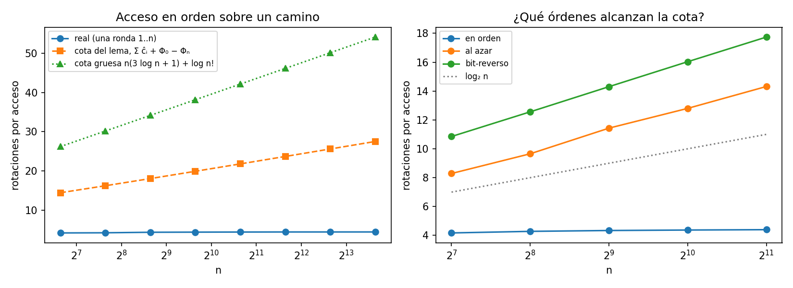

# Ejercicio 13: acceso en orden sobre un splay tree que empieza como camino

> ★★ En un splay tree que empieza como un camino de $n$ nodos se accede a las claves
> $1, \dots, n$ en orden. Acota el costo total con el lema de acceso y la cuenta de la
> sección 5 de la conferencia 4, y compáralo con lo que mide la sección 6. ¿Es
> ajustada la cota? (C4)

**Código:** [`ejercicio-13.py`](ejercicio-13.py). Usa el mismo árbol, `rotar`, `splay`,
`buscar` y `camino` de la sección 4 de la conferencia 4. Vigila el lema de acceso en cada acceso,
mide el costo real hasta $n = 12 800$ y lo compara con otros órdenes de acceso.

**Respuesta corta:** el lema de acceso da $O(n \log n)$. El costo real es
$\approx 4{,}4 n = \Theta(n)$, así que **la cota no es ajustada** para esta secuencia.
El problema no es el potencial inicial, sino el $O(\log n)$ por acceso del lema. Ese
término sí es ajustado para otras secuencias, como el acceso al azar o en orden
bit-reverso, pero no para el acceso en orden.

## Modelo y convenciones

Son los de la conferencia 4. El costo de un acceso es el número de rotaciones del
splay, con un mínimo de 1. `camino(n)` pone la clave $n$ en la raíz y cada clave como
hija izquierda de la siguiente, así que la clave 1 está a profundidad $n - 1$. El
potencial es $\Phi = \sum_x r(x)$ con $r(x) = \log_2 s(x)$.

## La cota con el lema de acceso

**Lema de acceso** (sección 5 de la conferencia 4). El costo amortizado de hacer splay de $x$ en un árbol con
raíz $t$ es $\hat c \le 3(r(t) - r(x)) + 1$.

**La cuenta de la sección 5 de la conferencia 4.** Para $m$ accesos,

$$\sum_{i=1}^{m} c_i \;=\; \sum_{i=1}^{m} \hat c_i \;-\; (\Phi_m - \Phi_0) \;\le\; \sum_{i=1}^{m}\big(3(\log_2 n - r(x_i)) + 1\big) \;+\; \Phi_0 - \Phi_m .$$

**Aplicada a este caso**, con $m = n$:

- $\Phi_0$ es el potencial del camino: los subárboles tienen tamaños $1, 2, \dots, n$,
  así que $\Phi_0 = \sum_{k=1}^{n} \log_2 k = \log_2 n!$. El script comprueba esa
  igualdad.
- $r(x_i) \ge 0$ y $\Phi_n \ge 0$.

Por lo tanto

$$\boxed{\;\sum_{i=1}^{n} c_i \;\le\; n(3\log_2 n + 1) + \log_2 n! \;\le\; 4\,n \log_2 n + n \;=\; O(n \log n).\;}$$

Hay que pagar $\Phi_0$ aparte porque el árbol empieza con la deuda más grande posible.
Es exactamente la situación que la sección 5 de la conferencia 4 menciona: "la condición $\Phi_m \ge \Phi_0$ no
se cumple". El primer acceso, a la clave 1, cuesta por sí solo $n - 1$ rotaciones, y el
script lo comprueba. El lema solo le cobra $3\log_2 n + 1$, así que el resto lo paga la
caída de $\Phi$.

**El lema se cumple en cada acceso.** Para $n \in \lbrace 1, 2, 3, 10, 50, 200 \rbrace$, el script
recalcula $\Phi$ entero antes y después de cada splay y verifica que
$c_i + \Delta\Phi \le 3(\log_2 n - r(x_i)) + 1$. Nunca falla.

## Lo que se mide

Se hace una ronda $1, \dots, n$ sobre el camino. "Cota del lema" es la suma de arriba
con los $r(x_i)$ y el $\Phi_n$ **reales**, que es lo mejor que puede dar la cuenta.
"Cota gruesa" es la fórmula del recuadro.

```
     n     real  real/n  cota lema + Φ0 - Φn  cota gruesa  cota/real
   100      416    4.16                 1442         2618        3.5
   400     1732    4.33                 7211        13659        4.2
  1600     7024    4.39                34835        67419        5.0
  6400    28216    4.41               163716       320857        5.8
 12800    56462    4.41               351924       692907        6.2
```



- **El costo real es lineal.** Las rotaciones por acceso se estabilizan en
  $\approx 4{,}4$, y de eso más o menos 1 por acceso es el primer acceso de $n - 1$
  rotaciones. Es la línea plana de la izquierda.
- **La cota crece como $n \log n$.** Incluso con los rangos reales, la cuenta del lema
  da del orden de $2\log_2 n$ por acceso. El cociente cota/real pasa de 3,5 a 6,2 y
  sigue creciendo como $\log n$.

**Comparación con la sección 6 de la conferencia 4.** La sección 6 de la conferencia 4 mide tres rondas $1..n$ seguidas y encuentra que el
splay cuesta **una constante por acceso**, sin importar $n$. Medido de la misma forma,
la columna "en orden ×3" de la tabla de abajo da entre 4,2 y 4,4 rotaciones por acceso
para $n$ de 128 a 2048, y es plana. Las dos mediciones dicen lo mismo: el acceso
secuencial cuesta $\Theta(n)$ por ronda, aunque el lema solo garantice
$O(n \log n)$.

## ¿Es ajustada la cota?

**Para esta secuencia, no.** La diferencia es un factor $\Theta(\log n)$, y no viene
del $\Phi_0$ que se paga una sola vez. Viene del término $3(\log_2 n - r(x_i))$ que el
lema cobra **en cada acceso**. Aunque se use el valor exacto de $r(x_i)$, ese término
promedia unos $2\log_2 n$, y en realidad cada acceso cuesta una constante.

**Pero el lema no se puede mejorar en general.** Para eso se miden otros órdenes sobre
el mismo árbol. Primero se hace una ronda en orden para deshacer el camino, y después
se miden $n$ accesos:

```
     n       en orden ×3  al azar  bit-reverso  log2 n   (rotaciones por acceso)
   128              4.17     8.29        10.85     7.0
   512              4.34    11.43        14.30     9.0
  2048              4.40    14.32        17.74    11.0
```

Con accesos al azar o en orden bit-reverso ($0, n/2, n/4, 3n/4, \dots$), cada acceso
cuesta $\Theta(\log n)$. Es el panel derecho de la figura, donde esas curvas van
paralelas a $\log_2 n$. Para esas secuencias el lema de acceso es ajustado salvo por
la constante.

El lema solo ve el rango del nodo accedido y no la relación entre un acceso y el
siguiente, así que no puede distinguir estas secuencias del acceso en orden. Para
demostrar el costo lineal del acceso secuencial hace falta otro argumento. Es el
**teorema de acceso secuencial** de Tarjan: acceder en orden a los $n$ nodos de un
splay tree cuesta $O(n)$, cualquiera sea el árbol inicial (R. E. Tarjan, "Sequential
access in splay trees takes linear time", *Combinatorica* 5(4), 1985).

## Por qué es barato: el splay parte las profundidades a la mitad

Esta es la profundidad de la clave $k$ justo antes de accederla, con $n = 32$:

```
[31, 16, 9, 4, 5, 2, 3, 1, 3, 1, 2, 1, 5, 2, 3, 1, 3, 1, 2, 1, 4, 2, 3, 1, 3, 1, 2, 1, 3, 1, 2, 1]
```

El primer acceso recorre todo el camino, con profundidad 31. El splay deja la clave 2
a profundidad 16, más o menos la mitad, que es justo lo que la sección 6 de la conferencia 4 cita de Sleator y
Tarjan: cada nodo del camino de acceso queda a la mitad de su profundidad. Después de
dos o tres accesos el árbol ya está balanceado. A partir de ahí la siguiente clave en
orden casi siempre está cerca de la raíz, a profundidad 1, 2 o 3, con un patrón
parecido al de una regla, y cada acceso cuesta una constante. El lema de acceso cobra
$O(\log n)$ por cada uno de esos accesos baratos, y ahí es donde pierde el factor
$\log n$.

## Resumen

| | |
|---|---|
| **Cota del lema** | $\sum c_i \le n(3\log_2 n + 1) + \log_2 n! = O(n\log n)$ |
| **Medido** | $\approx 4{,}4 n$ rotaciones, $\Theta(n)$, en línea con la sección 6 de la conferencia 4 |
| **¿Ajustada?** | No para el acceso en orden: el factor que sobra es $\log n$ y crece con $n$ |
| **¿Mejorable en general?** | No: al azar y bit-reverso cuestan $\Theta(\log n)$ por acceso |
| **Qué falta** | un argumento que mire secuencias, no accesos sueltos (teorema de acceso secuencial) |
