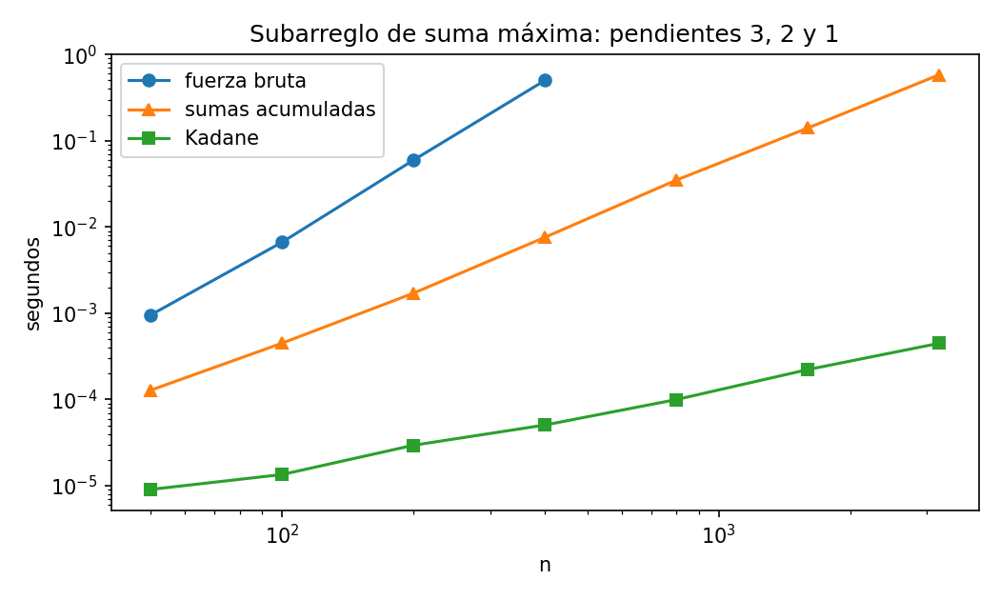

# Ejercicio 14: el subarreglo de suma máxima

> ★★★ Escoge un problema que no hayamos visto, recorre el ciclo completo de la
> conferencia 2 sobre él y consigue que el algoritmo y la cota mínima coincidan. Es
> el formato de la pregunta larga del examen final. (C2 a C5)

**Código:** [`ejercicio-14.py`](ejercicio-14.py). Prueba los tres algoritmos contra la
definición en 3000 arreglos, vigila el invariante de Kadane en cada paso, cuenta las
lecturas del arreglo, implementa el adversario de la cota mínima, prueba dos errores
plantados con cuatro generadores y mide los tiempos.

**Resultado:** el algoritmo de Kadane lee cada elemento del arreglo exactamente una
vez, es decir, hace $n$ lecturas. Un adversario demuestra que cualquier algoritmo
correcto tiene que leer los $n$ elementos, y no solo en el peor caso sino en **toda**
entrada. El algoritmo y la cota coinciden exactamente.

## 1. ¿Cuál es el problema?

**Entrada:** un arreglo $A[0..n-1]$ de enteros, con $n \ge 1$, que pueden ser negativos.
**Salida:** la mayor suma de un **tramo** $A[i..j]$, con $0 \le i \le j \le n - 1$, es
decir, de un subarreglo contiguo **no vacío**.

$$
\text{respuesta} = \max_{0 \le i \le j \le n-1} \; \big(A[i] + A[i+1] + \dots + A[j]\big).
$$

**Ejemplo.** En $[2, -5, 3, 4, -1, 6, -8]$ el mejor tramo es $[3, 4, -1, 6]$, que suma
12. Conviene incluir el $-1$, porque junta el $3 + 4$ con el $6$. En cambio, el $-5$ no
conviene: el 2 que hay antes no alcanza para compensarlo.

**Una decisión que importa: el tramo no puede ser vacío.** Si todos los números son
negativos, la respuesta es el mayor de ellos (el menos negativo), no 0. Hay versiones
del problema que permiten el tramo vacío y responden 0. Esa diferencia es el origen de
uno de los errores de la sección 6.

**Modelo.** El modelo RAM de la conferencia 1: leer $A[i]$, sumar y comparar enteros
cuestan $O(1)$. Para la cota mínima contamos en particular las **lecturas del
arreglo**, porque es lo que el adversario puede controlar.

## 2. Primera solución: fuerza bruta, $\Theta(n^3)$

Probar cada tramo y sumarlo desde cero:

```python
def fuerza_bruta(A):
    mejor = None
    for i in range(n):
        for j in range(i, n):
            s = 0
            for k in range(i, j + 1):
                s += A[k]
            if mejor is None or s > mejor:
                mejor = s
    return mejor
```

Es correcta por definición: recorre todos los tramos no vacíos. El tramo $[i, j]$
cuesta $j - i + 1$ lecturas, y sumando sobre todos los tramos salen
$\sum_{\ell=1}^{n} \ell (n - \ell + 1) = \frac{n(n+1)(n+2)}{6}$ lecturas, porque hay
$n - \ell + 1$ tramos de largo $\ell$. El script cuenta las lecturas y coinciden
exactamente con esa fórmula. Es $\Theta(n^3)$.

## 3. Una mejor: sumas acumuladas, $\Theta(n^2)$

La fuerza bruta suma muchas veces lo mismo. Si se calcula de antemano
$P[k] = A[0] + \dots + A[k-1]$, con $P[0] = 0$, la suma de un tramo sale de una resta:

$$
A[i] + \dots + A[j] = P[j+1] - P[i].
$$

```python
def acumuladas(A):
    P = [0] * (n + 1)
    for k in range(n):
        P[k + 1] = P[k] + A[k]
    return max(P[j + 1] - P[i] for i in range(n) for j in range(i, n))
```

Calcular $P$ cuesta $n$ lecturas y $n$ sumas. Después hay $\frac{n(n+1)}{2}$ tramos, cada
uno con una resta y una comparación: $\Theta(n^2)$. Es correcta porque calcula
exactamente las mismas sumas que la fuerza bruta.

Hay un detalle interesante: este algoritmo **solo lee el arreglo $n$ veces**, y aun
así cuesta $\Theta(n^2)$, porque el trabajo está en las restas y no en las lecturas.
Volveremos sobre esto en la cota mínima.

## 4. La óptima: Kadane, $\Theta(n)$

La idea es recorrer el arreglo una sola vez y, en cada posición $i$, responder dos
preguntas:

- $E_i$: ¿cuál es la mayor suma de un tramo que **termina exactamente en $i$**?
- $M_i$: ¿cuál es la mayor suma de un tramo **contenido en $A[0..i]$**?

La respuesta al problema es $M_{n-1}$.

Las dos se calculan con la anterior:

$$
E_i = \max(A[i], \ E_{i-1} + A[i]), \qquad M_i = \max(M_{i-1}, \ E_i).
$$

La primera dice que, si lo que se trae de atrás es negativo ($E_{i-1} < 0$), conviene
**empezar de nuevo** en $i$; si no, conviene **extender**. La segunda dice que el mejor
tramo hasta $i$ o termina en $i$ o ya estaba antes. Por qué valen las dos se demuestra
en el mantenimiento del invariante (sección 5).

```python
def kadane(A):
    max_actual = max_global = A[0]                  # E_0 = M_0 = A[0]
    for i in range(1, n):
        max_actual = max(A[i], max_actual + A[i])   # E_i
        max_global = max(max_global, max_actual)    # M_i
    return max_global
```

El script también guarda dónde empieza y termina el mejor tramo. En el ejemplo
devuelve suma 12, de la posición 2 a la 5: el tramo $[3, 4, -1, 6]$.

## 5. ¿Es correcto? El invariante de Kadane

> **Invariante.** Al terminar la vuelta $i$ (y antes del ciclo, con $i = 0$):
> `max_actual` $= E_i$, el mayor tramo que termina exactamente en $i$; y
> `max_global` $= M_i$, el mayor tramo contenido en $A[0..i]$.

**Inicialización ($i = 0$).** El único tramo que termina en 0, y el único contenido en
$A[0..0]$, es $[A[0]]$. Entonces $E_0 = M_0 = A[0]$, que es lo que valen `max_actual` y
`max_global` antes del ciclo.

**Mantenimiento.** Supongamos el invariante para $i - 1$, es decir, `max_actual` $= E_{i-1}$ y
`max_global` $= M_{i-1}$. La vuelta $i$ hace dos asignaciones, y hay que ver que dejan
$E_i$ y $M_i$.

*Primera asignación:* `max_actual = max(A[i], max_actual + A[i])`, que por la hipótesis
vale $\max(A[i], E_{i-1} + A[i])$. Veamos que eso es $E_i$. Un tramo que termina en $i$
es $A[k..i]$ para algún $k \le i$, y hay dos casos:

- **$k = i$:** es el tramo $[A[i]]$ solo, que suma $A[i]$.
- **$k \le i - 1$:** su suma es $\text{suma}(A[k..i-1]) + A[i]$. El primer sumando es la
  suma de un tramo que termina en $i - 1$, así que es como máximo $E_{i-1}$, y llega a
  $E_{i-1}$ eligiendo el $k$ del mejor de esos tramos. Entonces el mejor tramo de este
  caso suma exactamente $E_{i-1} + A[i]$.

El mayor tramo que termina en $i$ es el mejor de los dos casos:
$E_i = \max(A[i], E_{i-1} + A[i])$, que es justo lo que quedó en `max_actual`.

*Segunda asignación:* `max_global = max(max_global, max_actual)`. Importa el orden:
`max_actual` ya tiene el valor nuevo, así que esto vale $\max(M_{i-1}, E_i)$. Veamos que
eso es $M_i$. Un tramo contenido en $A[0..i]$ es de una de dos formas:

- **termina en $i$:** el mejor de estos suma $E_i$, por definición de $E_i$;
- **no termina en $i$:** entonces está contenido en $A[0..i-1]$, y el mejor de estos
  suma $M_{i-1}$, por definición de $M_{i-1}$.

Todo tramo cae en exactamente uno de los dos casos, así que
$M_i = \max(M_{i-1}, E_i)$, que es lo que quedó en `max_global`. El invariante vale
al terminar la vuelta $i$.

**Conclusión.** Al terminar la última vuelta, $i = n - 1$, así que `max_global` $= M_{n-1}$, el
mayor tramo de todo el arreglo, que es la respuesta.

**Terminación.** El ciclo es un `for` sobre $n - 1$ valores. Si se quiere un potencial,
$\Phi = n - 1 - i$ baja 1 por vuelta y es $\ge 0$.

**Comprobación.** En 3000 arreglos aleatorios, el script compara en **cada vuelta**
`max_actual` y `max_global` con $E_i$ y $M_i$ calculados por definición, y además verifica que los
índices guardados suman exactamente `max_global`. Los tres algoritmos dan lo mismo que la
definición, también en los casos borde: un elemento, todos negativos y todos cero.

## 6. ¿Cuánto cuesta?

Kadane hace, para $n$ elementos:

| operación                  | cantidad      |
| --------------------------- | ------------- |
| lecturas del arreglo        | exactamente n |
| sumas                       | n − 1        |
| comparaciones (los dos max) | 2(n − 1)     |

Es $\Theta(n)$ en tiempo y $O(1)$ en memoria extra. El script cuenta las lecturas de
los tres algoritmos:

```
     n   fuerza bruta  n(n+1)(n+2)/6  acumuladas  kadane
     1              1              1           1       1
     2              4              4           2       2
    10            220            220          10      10
   100         171700         171700         100     100
   300        4545100        4545100         300     300
```

Y los tiempos medidos, en escala log-log, donde la pendiente es el exponente:



Las tres rectas tienen pendiente 3, 2 y 1. En mi máquina, con $n = 400$, la fuerza
bruta tarda unas 0,7 s, las sumas acumuladas unos 11 ms y Kadane menos de un décimo de
milisegundo. Los tiempos exactos cambian de una corrida a otra; las pendientes no.

## 7. ¿Se puede hacer mejor? La cota mínima por adversario

**Teorema.** Todo algoritmo correcto lee las $n$ posiciones del arreglo, **en cualquier
entrada**. En particular hace al menos $n$ lecturas, y por lo tanto
$\Omega(n)$ operaciones.

*Demostración.* Tomamos un algoritmo correcto y una entrada $A$ cualquiera. Supongamos
que termina sin haber leído la posición $i$, y que responde $S$. Como es correcto, $S$
es la respuesta para $A$. El adversario construye otra entrada $A'$, igual a $A$ salvo
en la posición $i$:

$$
A'[i] = S + 1.
$$

- **El algoritmo hace lo mismo con $A'$.** Su comportamiento depende solo de los valores
  que lee. Paso por paso, lee las mismas posiciones que con $A$, porque ninguna es $i$, y
  en ellas encuentra los mismos valores, porque $A'$ solo cambió en $i$. Así que termina
  igual y responde $S$.
- **Pero en $A'$ la respuesta es mayor que $S$.** El tramo formado solo por $A'[i]$ suma
  $S + 1$, así que la mayor suma de $A'$ es al menos $S + 1 > S$.

El algoritmo se equivoca con $A'$, y eso contradice que sea correcto. Por lo tanto no
puede terminar sin leer alguna posición. $\square$

**La coincidencia.** Kadane hace exactamente $n$ lecturas y la cota dice que hacen falta
al menos $n$:

$$
\boxed{\text{lecturas de Kadane} = n = \text{cota mínima}}
$$

En operaciones totales, Kadane hace $O(n)$ y la cota da $\Omega(n)$, porque cada lectura
es una operación. El problema cuesta $\Theta(n)$, y Kadane es óptimo.

**Lo que la cota no dice.** Contar lecturas es necesario, pero no suficiente para medir
el costo: las sumas acumuladas también leen el arreglo solo $n$ veces y cuestan
$\Theta(n^2)$. La cota de lecturas descarta a cualquier algoritmo sublineal, pero no
distingue entre $n$ y $n^2$. Lo que muestra que Kadane es óptimo es que **además** de
hacer $n$ lecturas hace $O(n)$ operaciones en total.

**El adversario en acción.** El error más común al escribir Kadane es un error de rango,
`range(1, n - 1)` en lugar de `range(1, n)`, que nunca lee el último elemento. El
script lo enfrenta al adversario con un arreglo de 8 elementos: el adversario pone
"respuesta + 1" en la posición que no se leyó y verifica con `assert` que el algoritmo
responde lo mismo y que la respuesta correcta es otra:

```
Kadane sin el último elemento    no leyó alguna posición; con [-13, -17, -5, -11, -14, -9, 18, 19] responde 18, pero la respuesta es 37
Kadane                           leyó las 8 posiciones: el adversario no puede hacer nada
```

El adversario cambió el último elemento por $18 + 1 = 19$, y el mejor tramo pasó a ser
$18 + 19 = 37$. Contra Kadane el adversario no puede hacer nada: el script verifica en
1000 entradas aleatorias que siempre lee todas las posiciones.

## 8. Dos errores plantados, y qué pruebas los atrapan

**Error 1: reiniciar en 0.** Es la versión que más circula:

```python
max_actual = max_global = 0
for x in A:
    max_actual = max(0, max_actual + x)
    max_global = max(max_global, max_actual)
```

Resuelve el problema **con tramo vacío permitido**: nunca devuelve algo negativo. Con
nuestro enunciado falla exactamente cuando todos los números son negativos. En el
invariante, el problema está en la inicialización: $E$ arranca en 0, que es la suma del
tramo vacío, y no en $A[0]$.

**Error 2: actualizar `max_global` antes que `max_actual`.** Con las dos líneas del ciclo
invertidas, `max_global` se queda con $M_{i-1}$ en lugar de $M_i$: siempre va un paso
atrás. Nunca considera los tramos que terminan en el último elemento. En el invariante,
es el paso de mantenimiento el que se rompe, justo donde dice "importa el orden".

Porcentaje de arreglos en que fallan, sobre 2000 por generador, con $n$ entre 1 y 30:

| generador                          | reinicia en 0 | desfasado |
| ---------------------------------- | ------------- | --------- |
| enteros uniformes en [−100, 100]  | 3,1 %         | 24,6 %    |
| mayoría positivos, en [−10, 100] | 0,5 %         | 85,3 %    |
| todos negativos                    | 100,0 %       | 10,5 %    |
| el mejor tramo al final            | 0,0 %         | 96,5 %    |

- El generador uniforme, que es lo primero que uno escribe, **casi no ve el error 1**:
  solo falla cuando el arreglo es tan corto que todos sus números salen negativos.
  Hace falta el generador "todos negativos", que es justo el caso que señala la
  decisión de la sección 1.
- El error 2 se ve con casi cualquier generador, y sobre todo con "el mejor tramo al
  final", que es el caso que señala la demostración.

La misma lección de los ejercicios 2, 5 y 8: cada error vive en un paso concreto de la
demostración (la inicialización en el error 1, el orden del mantenimiento en el
error 2), y ese paso dice qué generador de pruebas lo encuentra.

## Resumen

|                   |                                                                                          |
| ----------------- | ---------------------------------------------------------------------------------------- |
| Problema          | la mayor suma de un tramo contiguo no vacío                                             |
| Fuerza bruta      | n(n+1)(n+2)/6 lecturas, Θ(n³)                                                          |
| Sumas acumuladas  | n lecturas pero Θ(n²) restas                                                           |
| Kadane            | E_i = max(A[i], E_(i−1) + A[i]) y M_i = max(M_(i−1), E_i); n lecturas, Θ(n)           |
| Correctitud       | invariante: max_actual = E_i y max_global = M_i, vigilado en cada vuelta      |
| Cota mínima      | adversario: con una posición sin leer, se pone respuesta + 1 ahí; vale en toda entrada |
| Coincidencia      | n lecturas = n lecturas: exacta                                                          |
| Errores plantados | reiniciar en 0 (solo lo ve "todos negativos") y actualizar en el orden equivocado        |
