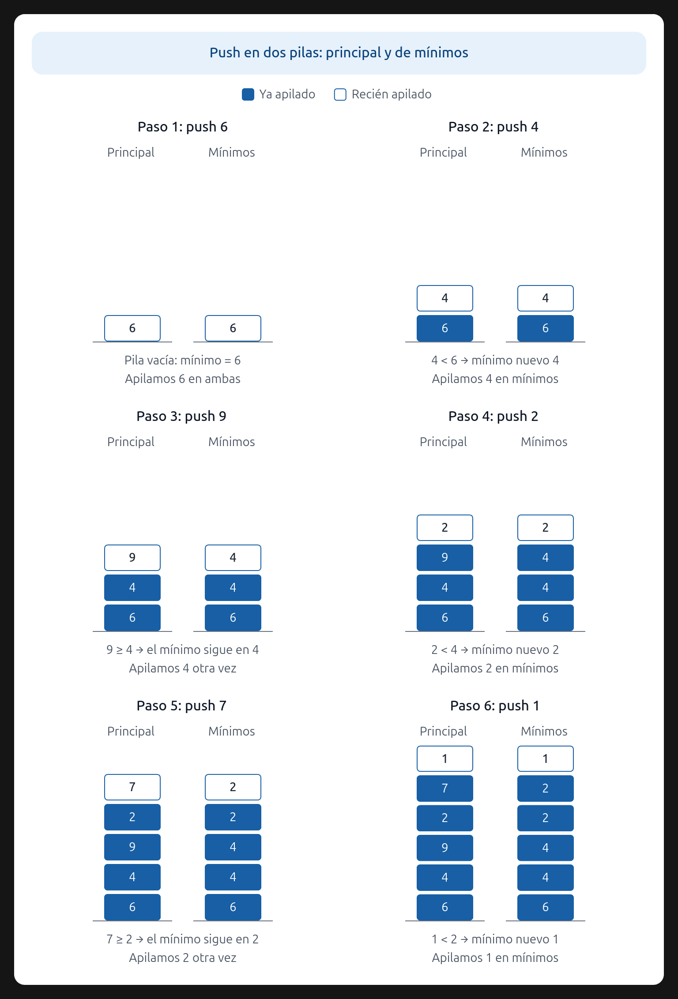

# Ejercicio 3 — Pila con mínimo en O(1) en el peor caso

**Diseño y Análisis de Algoritmos · Tema 1 · Curso 2026**

> Una pila con una operación de mínimo que cuesta O(1) en el peor caso. Diseña la estructura, enuncia el invariante que la hace correcta y da el costo de cada operación. (C3)

---

## 1. Enunciado y objetivos

Se pide diseñar una estructura de datos que soporte las operaciones habituales de una pila (`push`, `pop`, `top`, `isEmpty`) junto con una operación adicional `min()` que devuelva el mínimo de los elementos actualmente en la pila **sin sacarlos**. La operación `min()` debe costar O(1) **en el peor caso**; las operaciones habituales de la pila heredan la cota estándar de los arreglos dinámicos (O(1) amortizado para `push`, O(1) peor caso para `pop` y `top`). Además se pide enunciar el invariante que garantiza la correctitud y dar el costo de cada operación, con su análisis.

## 2. Representación

Se mantienen dos arreglos dinámicos usados como pilas:

- $P$: la pila principal, con los elementos.
- $M$: la pila auxiliar, donde $M[i]$ es el mínimo de $P[1..i]$ (los primeros $i$ elementos desde el fondo).

Ambas pilas tienen **siempre la misma cantidad de elementos**. La elección de arreglos dinámicos (como `list` en Python, `ArrayList` en Java o `vector` en C++) es deliberada: es la implementación estándar de una pila. Su `push` es O(1) **amortizado**, y esa cota se analiza explícitamente en la Sección 6 con el método del potencial (Conferencia 4).

### Representación visual

La siguiente imagen muestra cómo se mantienen la pila principal y la pila de mínimos durante varias operaciones `push`:

## 3. Invariante

> **Después de cualquier secuencia de operaciones, si $P$ tiene $k$ elementos, entonces $M$ tiene $k$ elementos y $M[k] = \min(P[1..k])$.**

Es inductivo: se cumple al inicio (ambas vacías, $k=0$) y se preserva con cada operación, como se demuestra en la Sección 5.

## 4. Operaciones

### `push(x)`

1. `P.push(x)`
2. Si $M$ está vacía: `M.push(x)`.
3. Si no: `M.push(min(M.top(), x))`.

### `pop()`

1. Si $P$ está vacía, error.
2. `P.pop()`
3. `M.pop()`

### `min()`

1. Si $M$ está vacía, error.
2. Devolver `M.top()`.

### `top()`, `isEmpty()`

Las habituales sobre $P$.

## 5. Correctitud total

La correctitud total se compone de correctitud parcial más terminación. El invariante demuestra la correctitud parcial; la terminación se demuestra por separado (C3).

### 5.1 Correctitud parcial (invariante)

Invariante I: "si P tiene k elementos, entonces M tiene k elementos y M[i] = min(P[0..i]) para todo i ∈ [0..k-1]".

**Inicialización.** Con k = 0, ambas pilas están vacías. I se cumple trivialmente.

**Mantenimiento.** Para cada operación op, se verifica {I ∧ pre_op} op {I ∧ post_op}:

- push(x): suponemos I antes de la operación (P y M con k elementos, M[i] = min(P[0..i]) para todo i). Después del push:
  - P tiene k+1 elementos, P[k] = x.
  - M tiene k+1 elementos, M[k] = min(M[k-1], x) = min(min(P[0..k-1]), x) = min(P[0..k]).
  - I se preserva.
- pop(): suponemos I con k elementos. Después del pop:
  - P y M tienen k-1 elementos.
  - M[i] no cambió para i ∈ [0..k-2], así que M[i] = min(P[0..i]) sigue valiendo.
  - I se preserva.
- top(), min(), isEmpty(): no modifican el estado, así que I se preserva trivialmente.

**Conclusión (parcial).** Si la operación termina, entonces I se cumple después, y min() devuelve M.top() = M[k-1] = min(P[0..k-1]), que es el mínimo de P. Correctitud parcial.

Nota: la conclusión es condicional ("si la operación termina"). Por eso hace falta el argumento de terminación de 5.2.

### 5.2 Terminación

Cada operación ejecuta un número acotado de operaciones elementales:

- push: dos append (uno a P, uno a M) y una comparación: O(1) pasos.
- pop: dos pop (uno de P, uno de M): O(1) pasos.
- top(), min(): una lectura: O(1) pasos.
- isEmpty(): una comparación: O(1) pasos.

Ninguna operación contiene ciclos ni recursión. Por lo tanto, cada operación termina después de un número constante de pasos, y cualquier secuencia finita de operaciones termina.

### 5.3 Correctitud total

De 5.1 (correctitud parcial) y 5.2 (terminación) se sigue la correctitud total: para cualquier secuencia finita de operaciones, cada operación termina y, al terminar, el invariante se cumple y el resultado es el correcto.

## 6. Costo y análisis amortizado

### 6.1 Análisis amortizado del `push` (método del potencial)

Modelo: arreglo dinámico que duplica su capacidad cuando se llena. Estado: $n$ = cantidad de elementos, $c$ = capacidad. Se arranca con $c=1$, $n=0$. Al insertar con $n=c$: se reserva un arreglo de capacidad $2c$, se copian los $n$ elementos, se inserta el nuevo.

Potencial: $\Phi = 2n - c$.

Observación: como solo se duplica (nunca se achica) y se arranca con $c=1$, justo después de cualquier duplicación queda $n = c/2 + 1 > c/2$; entre duplicaciones $n$ crece mientras $c$ queda fijo. Por lo tanto, $n \ge c/2$ siempre, y $\Phi = 2n - c \ge 0$. La condición $\Phi \ge 0$ se cumple.

Costo amortizado de un `push` = costo real + $\Delta\Phi$:

- **Sin duplicación** ($n < c$): $n'=n+1$, $c'=c$. $\Delta\Phi = 2$. Costo real $=1$. Amortizado $=1+2=3$.
- **Con duplicación** ($n=c$): $n'=c+1$, $c'=2c$. $\Phi_{\text{antes}}=c$, $\Phi_{\text{después}}=2$. $\Delta\Phi=2-c$. Costo real $=1+c$. Amortizado $=(1+c)+(2-c)=3$.

En ambos casos el amortizado es exactamente 3. Por lo tanto, para $m$ inserciones desde el arreglo vacío:

$$
\sum_{i=1}^{m}\text{costo real}_i = \sum_{i=1}^{m}\text{amortizado}_i - (\Phi_m-\Phi_0) \le 3m.
$$

Total $O(m)$, amortizado $O(1)$ por `push`.

### 6.2 Costo del `pop` y del `top`

El `pop` sobre el arreglo dinámico no dispara redimensionamiento (no se achica), así que es $O(1)$ **en el peor caso**: solo decrementa $n$. El `top` es una lectura, $O(1)$ peor caso.

### 6.3 Costo de `min()`

`min()` lee el tope de $M$. Es $O(1)$ **en el peor caso**, sin amortización de ningún tipo: una sola lectura de posición, independiente del contenido. **Este es el punto que el enunciado exige**, y se cumple estrictamente.

### 6.4 Costo de MinStack completa

Cada `push` de MinStack hace 2 `push` sobre arreglos + 1 comparación + 1 `min`: amortizado $\le 2\cdot 3 + 2 = 8 = O(1)$. Cada `pop` hace 2 `pop` sobre arreglos: $O(1)$ peor caso. `min()` lee el tope auxiliar: $O(1)$ peor caso.

| Operación | Costo |
|---|---|
| `push(x)` | $O(1)$ amortizado (potencial: $\Phi=2n-c$, amortizado por `push` $\le 3$) |
| `pop()` | $O(1)$ peor caso |
| `top()` | $O(1)$ peor caso |
| `min()` | $O(1)$ peor caso |
| `isEmpty()` | $O(1)$ peor caso |

En una secuencia de $m$ operaciones, el costo total es $O(m)$, así que el costo amortizado por operación es $O(1)$. Y `min()` en particular es $O(1)$ **en el peor caso**, como pide el enunciado.

### 6.5 Por qué esta elección es consistente con el enunciado

El enunciado pide $O(1)$ peor caso **para `min()`**, no para todas las operaciones. Los arreglos dinámicos son la implementación estándar de una pila, y su `push` amortizado es lo que se asume cuando se dice “una pila con `push` en $O(1)$”. Usar el potencial para demostrar la amortización muestra dominio del método de la Conferencia 4 y conecta C3 (correctitud) con C4 (amortizado) en una misma respuesta. Por lo tanto, la solución es consistente: `min()` en $O(1)$ peor caso, `push` en $O(1)$ amortizado con análisis explícito, `pop`/`top` en $O(1)$ peor caso.

## 7. Ejemplo de ejecución

| Operación | $P$ (fondo→tope) | $M$ (fondo→tope) | `min()` |
|---|---|---|---|
| `push(3)` | [3] | [3] | 3 |
| `push(1)` | [3, 1] | [3, 1] | 1 |
| `push(4)` | [3, 1, 4] | [3, 1, 1] | 1 |
| `pop()` | [3, 1] | [3, 1] | 1 |
| `pop()` | [3] | [3] | 3 |

En cada fila se verifica que $M[i]=\min(P[1..i])$, y `min()` es simplemente leer el tope de $M$.

## 8. Detalles de borde

- **Pila vacía.** `pop()` y `min()` deben lanzar error si la pila está vacía. Sin esto, la estructura no está completamente definida.
- **Duplicados.** Si se hace `push(3)`, `push(3)`, la auxiliar queda $[3,3]$, no $[3]$. Necesario para el `pop`: si se guardara solo una vez, al desapilar un 3 se perdería el mínimo aunque el otro 3 siga en la pila.
- **Equivalencia con “mínimo por nodo”.** La misma idea se puede implementar guardando en cada nodo de la pila principal el mínimo acumulado hasta ese nodo. Equivalente en costo y correctitud, distinta en layout de memoria.

## 9. Conclusión

La estructura de dos pilas paralelas sobre arreglos dinámicos, donde la auxiliar guarda el mínimo acumulado hasta cada nivel, resuelve el problema con `min()` en $O(1)$ **en el peor caso** (lo que exige el enunciado) y las operaciones habituales de pila en $O(1)$ amortizado para `push` y $O(1)$ peor caso para `pop`/`top`. El invariante inductivo $M[i]=\min(P[1..i])$ es lo que garantiza la correctitud, y el método del potencial con $\Phi=2n-c$ es lo que justifica la amortización del `push` de forma rigurosa, no por suposición.
