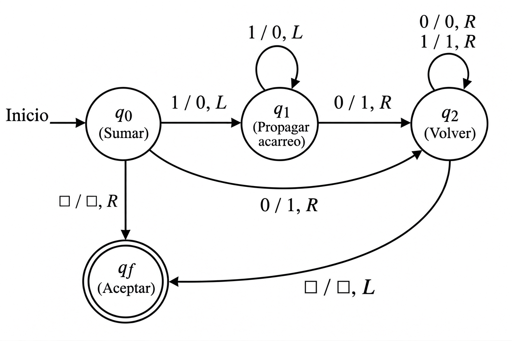

# Ejercicio 4 — Contador binario en máquina de Turing

**Diseño y Análisis de Algoritmos · Tema 1 · Curso 2026**

> El contador binario en una máquina de Turing, del ejercicio 7 de la conferencia 1. Demuestra con un potencial que m incrementos desde 0 cuestan O(m) pasos en total, aunque uno solo pueda costar Θ(log m). (C1, C4)

---

## 1. Enunciado y objetivos

Se tiene un contador binario que empieza en 0 y se incrementa $m$ veces. La operación de incremento es la de la máquina de Turing del Ejercicio 7 de la Conferencia 1: una sola cinta, cabezal que empieza en el bit menos significativo (LSB) y vuelve a él al terminar. Se pide demostrar con un potencial que $m$ incrementos desde 0 cuestan $O(m)$ pasos en total, aunque un incremento individual pueda costar $\Theta(\log m)$. La herramienta es el método del potencial de la Conferencia 4.

## 2. Modelo de costo (basado en la TM del Ejercicio 7)

No se rehace el diseño de la TM; usamos sus estados $q_0$ (Sumar), $q_1$ (Propagar acarreo) y $q_2$ (Volver). Lo único que necesitamos es **cuánto cuesta un incremento**.

La estructura de estados y transiciones de la máquina de Turing es la siguiente:

Sea $j$ la cantidad de unos consecutivos al final del contador (desde el LSB). La ejecución de la TM es:
- **$q_0$:** Si lee un `1` (caso $j \ge 1$), lo escribe como `0`, se mueve a la izquierda y va a $q_1$ (1 paso). Si lee un `0` (caso $j=0$), lo escribe como `1`, se mueve a la derecha y va directo a $q_2$ (1 paso).
- **$q_1$:** Procesa los $j-1$ unos restantes, convirtiéndolos en `0`s y moviéndose a la izquierda ($j-1$ pasos). Al leer el `0` que detiene el acarreo, lo convierte en `1`, se mueve a la derecha y va a $q_2$ (1 paso).
- **$q_2$:** Se mueve a la derecha pasando por los ceros que acabamos de crear ($j$ pasos). Al encontrar el espacio en blanco ($\square$), se mueve a la izquierda para volver al LSB y termina en $q_f$ (1 paso).

El costo real de un incremento es:
- Para $j \ge 1$: $c(j) = 1 + (j-1) + 1 + j + 1 = 2j + 2$.
- Para $j = 0$: $c(0) = 1 + 1 = 2$.

Por lo tanto, la fórmula unificada para cualquier $j \ge 0$ es:
$$
c(j) = 2j + 2.
$$

**Peor caso.** Si el contador tiene $k$ bits y todos son 1 (valor $2^k - 1$), entonces $j = k$ y el incremento cuesta $2k+2 = \Theta(k) = \Theta(\log m)$. Esto confirma el enunciado: un solo incremento puede costar $\Theta(\log m)$.

## 3. Elección del potencial

Se define el potencial como **el doble de la cantidad total de 1s** en el contador:
$$
\Phi = 2 \cdot \#\{i : \text{bit } i \text{ del contador es } 1\}.
$$

**Propiedad básica:** $\Phi \ge 0$ siempre (es el doble de un conteo) y $\Phi_0 = 0$ al inicio (contador en 0).

**Por qué el coeficiente 2.** El método del potencial exige que el potencial absorba la parte variable del costo. Como el costo real es $2j + 2$, el potencial debe bajar en $2j$ (menos una constante) para que el costo amortizado no dependa de $j$. El coeficiente correcto es, por tanto, exactamente el coeficiente de $j$ en el costo: $2$.

## 4. Análisis amortizado de un incremento

Analizamos $\hat{c} = c + \Delta\Phi$, con $\Delta\Phi = \Phi_{\text{después}} - \Phi_{\text{antes}}$, en los dos casos posibles.

### 4.1 Caso caro: $j$ unos al final ($j \ge 1$)

Antes del incremento, el contador tiene $t$ unos en total (los $j$ finales más los de la izquierda).
- **Después:** los $j$ unos finales se vuelven 0 ($-j$) y el 0 se vuelve 1 ($+1$). Total de unos: $t - j + 1$.
- **Variación de potencial:** $\Delta\Phi = 2(t-j+1) - 2t = 2(1-j)$.
- **Costo real:** $c = 2j + 2$.
- **Costo amortizado:**
  $$
  \hat{c} = (2j + 2) + 2(1-j) = 2j + 2 + 2 - 2j = 4.
  $$

### 4.2 Caso barato: LSB = 0 ($j = 0$)

- **Después:** el LSB se vuelve 1 ($+1$). Total de unos: $t + 1$.
- **Variación de potencial:** $\Delta\Phi = 2(t+1) - 2t = 2$.
- **Costo real:** $c = 2$.
- **Costo amortizado:** $\hat{c} = 2 + 2 = 4$.

### 4.3 Conclusión del análisis por operación
En ambos casos, el costo amortizado es exactamente $4$. Por lo tanto, para todo incremento $i$:
$$
\hat{c}_i = 4.
$$

## 5. Suma telescópica: costo total de $m$ incrementos

El método del potencial garantiza que:
$$
\sum_{i=1}^{m} c_i = \sum_{i=1}^{m} \hat{c}_i - (\Phi_m - \Phi_0).
$$
Sustituyendo $\hat{c}_i = 4$, $\Phi_0 = 0$ y $\Phi_m \ge 0$:
$$
\sum_{i=1}^{m} c_i = 4m - \Phi_m \le 4m.
$$
Por lo tanto, el costo total de $m$ incrementos desde 0 es $O(m)$, y el costo amortizado por incremento es $O(1)$.

## 6. Correctitud y terminación (C3)

Aunque el objetivo es el análisis amortizado (C4), registramos que el algoritmo es correcto y termina.

**Correctitud parcial.** Invariante: "después de $i$ incrementos, el contador contiene $i$ en binario". 
- *Inicialización:* con 0 incrementos, el contador vale 0.
- *Mantenimiento:* si el contador vale $i$, la TM suma 1 en binario (propagando el acarreo por los 1s finales) y pasa a $i+1$.
- *Conclusión:* tras $m$ incrementos, el contador vale $m$.

**Terminación.** En cada incremento, la TM visita un número finito de celdas ($2j+2$ pasos). Al no haber ciclos infinitos entre $q_0, q_1$ y $q_2$ (el cabezal solo se mueve en una dirección dentro de cada estado), cada incremento termina. Una secuencia de $m$ incrementos termina en un número finito de pasos, en particular, en $O(m)$ pasos según el análisis amortizado anterior.

## 7. Conclusión

Se ha demostrado que, con $\Phi = 2\cdot(\text{número de 1s})$:
- El costo amortizado de cada incremento es exactamente $4$.
- El costo total de $m$ incrementos desde 0 es $\le 4m = O(m)$.
- El costo amortizado por incremento es $O(1)$.

Esto responde la pregunta de la Conferencia 1: **un incremento individual puede costar $\Theta(\log m)$, pero la secuencia de $m$ incrementos cuesta $O(m)$**. La razón es que los incrementos caros (propagar acarreo) son raros y se pagan con el potencial acumulado por los incrementos baratos. Es el ejemplo canónico del método del potencial de la Conferencia 4, y muestra que la cota amortizada es una garantía de peor caso sobre secuencias, no un promedio probabilístico.