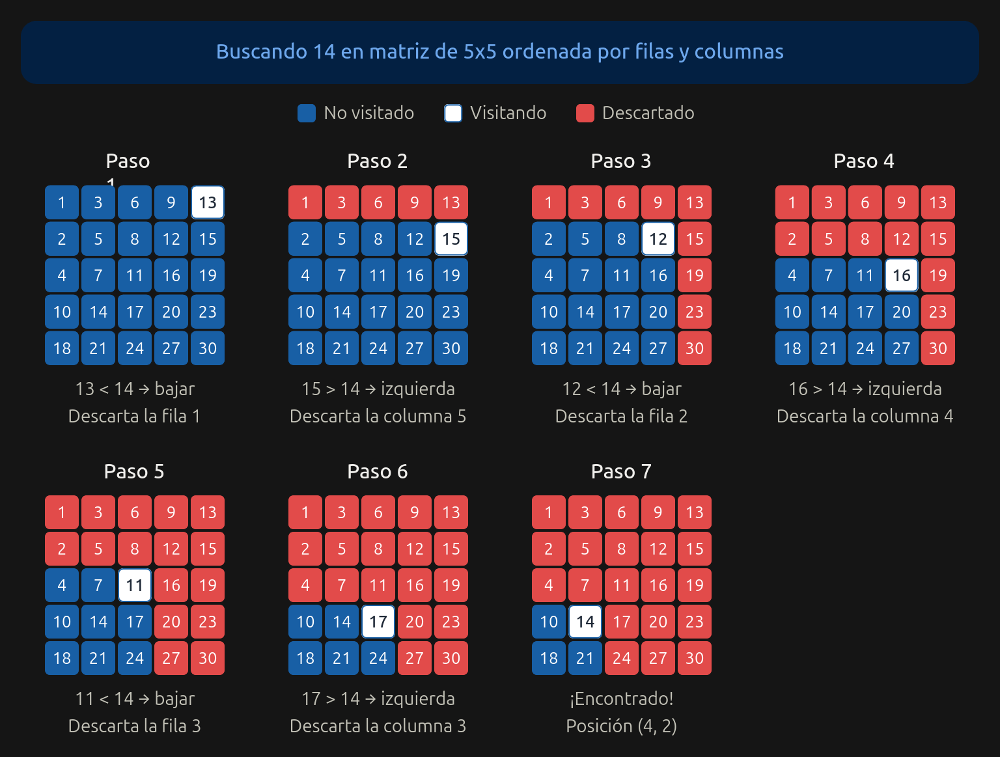

# Ejercicio 6 — Búsqueda en matriz ordenada por filas y columnas

**Diseño y Análisis de Algoritmos · Tema 1 · Curso 2026**

> Una matriz $n \times n$ tiene filas y columnas ordenadas de forma creciente. Diseña un algoritmo que decida si contiene un valor $x$ en $O(n)$ comparaciones, demuestra su correctitud con un invariante, y demuestra con un adversario que no se puede en $o(n)$. (C3, C5)

---

## 1. Enunciado y objetivos

Dada una matriz $A$ de tamaño $n \times n$ cuyas filas están ordenadas de forma estrictamente creciente de izquierda a derecha, y cuyas columnas están ordenadas de forma estrictamente creciente de arriba hacia abajo, se pide:
1. Diseñar un algoritmo que busque un valor $x$ en $O(n)$ comparaciones. Si $x$ está, debe devolver su posición `(i, j)`; si no está, debe devolver `(-1, -1)`.
2. Demostrar su correctitud.
3. Demostrar con un argumento de adversario que el problema tiene una cota mínima de $\Omega(n)$ comparaciones en el peor caso (C5).

## 2. Descripción del algoritmo

Para lograr un costo $O(n)$, debemos asegurarnos de que cada paso del algoritmo descarte **una fila entera o una columna entera**. 

El algoritmo comienza en la **esquina superior derecha** de la matriz, en la posición `(0, n-1)`. Mantenemos dos índices, `i` para la fila actual y `j` para la columna actual.

En cada iteración, comparamos el elemento actual `A[i][j]` con $x$:
- Si `A[i][j] == x`, hemos encontrado el valor y devolvemos `(i, j)`.
- Si `A[i][j] > x`, sabemos por la propiedad de orden de las columnas que todos los elementos por debajo de `A[i][j]` (desde la fila `i` hasta `n-1`) también serán mayores que $x$. Por lo tanto, podemos descartar toda la columna `j` y movernos una posición hacia la izquierda (`j = j - 1`).
- Si `A[i][j] < x`, sabemos por la propiedad de orden de las filas que todos los elementos a la izquierda de `A[i][j]` (desde la columna `j` hasta 0) también serán menores que $x$. Por lo tanto, podemos descartar toda la fila `i` y movernos una posición hacia abajo (`i = i + 1`).

El proceso se repite mientras los índices estén dentro de los límites de la matriz (es decir, `i < n` y `j >= 0`). Si el algoritmo sale de la matriz sin haber encontrado $x$, devuelve `(-1, -1)`.

### Ejemplo visual

La imagen muestra la búsqueda de $14$ en una matriz de $5\times5$, indicando en cada paso las filas y columnas descartadas.

## 3. Correctitud total

La correctitud total se compone de correctitud parcial (demostrada con el invariante) más terminación.

### 3.1 Correctitud parcial (Invariante)

**Invariante:** *Al inicio de cada iteración del ciclo, si $x$ se encuentra en la matriz, entonces se encuentra en la submatriz $A[i \ldots n-1, 0 \ldots j]$.* (Es decir, en la región que va desde la fila `i` hasta la última, y desde la primera columna hasta la columna `j`).

- **Inicialización:** Antes de la primera iteración, `i = 0` y `j = n - 1`. La submatriz es $A[0 \ldots n-1, 0 \ldots n-1]$, que abarca la matriz completa. El invariante se cumple.
- **Mantenimiento:** Supongamos que el invariante se cumple antes de una iteración.
  - **Si `A[i][j] > x`:** Todos los elementos en la columna `j` desde la fila `i` hacia abajo son estrictamente mayores que `A[i][j]`, y por lo tanto mayores que $x$. Así, $x$ no puede estar en esa columna. Al hacer `j = j - 1`, descartamos esa columna con seguridad, y el nuevo espacio de búsqueda es $A[i \ldots n-1, 0 \ldots j-1]$, que conserva la propiedad.
  - **Si `A[i][j] < x`:** Todos los elementos en la fila `i` desde la columna `j` hacia la izquierda son estrictamente menores que `A[i][j]`, y por lo tanto menores que $x$. Así, $x$ no puede estar en esa fila. Al hacer `i = i + 1`, descartamos esa fila con seguridad, y el nuevo espacio de búsqueda es $A[i+1 \ldots n-1, 0 \ldots j]$, que conserva la propiedad.
- **Conclusión:** Si el ciclo termina porque `i >= n` o `j < 0`, significa que la submatriz de búsqueda está vacía. Por el invariante, si $x$ estuviera en la matriz, debería estar en esa submatriz vacía, lo cual es una contradicción. Por lo tanto, retornar `(-1, -1)` es correcto. Si se retorna una posición `(i, j)`, es porque se encontró `A[i][j] == x`.

### 3.2 Terminación

En cada iteración del ciclo, o bien el índice `i` aumenta en 1 (al movernos hacia abajo), o bien el índice `j` disminuye en 1 (al movernos hacia la izquierda). El índice `i` empieza en 0 y no puede superar $n$, y el índice `j` empieza en $n-1$ y no puede ser menor que 0. Por lo tanto, el ciclo puede ejecutarse a lo sumo $n + n = 2n$ veces antes de que los índices salgan de los límites. Esto garantiza que el algoritmo siempre termina.

## 4. Costo computacional

- **Tiempo:** En el peor caso, el algoritmo realiza a lo sumo $2n - 1$ comparaciones (cada paso descarta una fila o una columna). Por lo tanto, el costo en comparaciones es $O(n)$.
- **Espacio:** $O(1)$ adicional, ya que solo se utilizan los índices `i` y `j`.

## 5. Cota mínima ($\Omega(n)$) con adversario

Demostraremos que cualquier algoritmo basado en comparaciones necesita al menos $\Omega(n)$ comparaciones en el peor caso. Usamos el método del adversario (C5).

**Estrategia del adversario:**
El adversario puede responder a las consultas del algoritmo de modo que lo obligue a recorrer toda una "frontera" de elementos antes de poder asegurar que $x$ no está en la matriz.

1. Supongamos que el algoritmo busca un valor $x$ que no está en la matriz. Por la propiedad de orden de filas y columnas, cualquier matriz válida puede dividirse en dos regiones: una región superior-izquierda con elementos menores que $x$, y una región inferior-derecha con elementos mayores que $x$. La división entre ambas regiones es una frontera que avanza desde la esquina superior derecha hasta la inferior izquierda.
2. Esta frontera está compuesta por exactamente $2n - 1$ elementos (pues debe cruzar $n$ filas y $n$ columnas).
3. Cada vez que el algoritmo consulta una celda, el adversario responde:
   - Un valor menor que $x$ si la celda está en la región superior-izquierda.
   - Un valor mayor que $x$ si la celda está en la región inferior-derecha.
4. El adversario tiene la libertad de elegir la posición exacta de esta frontera mientras responde. Mientras el algoritmo no haya consultado al menos un elemento de cada una de las $n$ filas o $n$ columnas que conforman la frontera, el adversario puede colocar $x$ en una celda adyacente no consultada, de modo que las respuestas dadas sigan siendo válidas y el algoritmo falle al decir que $x$ no está.
5. Para que el algoritmo pueda concluir con certeza que $x$ no está, debe haber descartado todas las filas o todas las columnas cruzando la frontera. Cada comparación que realiza el algoritmo le permite descartar **como máximo una fila o una columna** (avanza un paso en la frontera). Por lo tanto, se requieren al menos $2n - 1$ comparaciones en el peor caso.

**Conclusión de la cota:** Cualquier algoritmo requiere $\Omega(n)$ comparaciones en el peor caso. Nuestro algoritmo realiza $O(n)$ comparaciones, por lo que es asintóticamente óptimo.