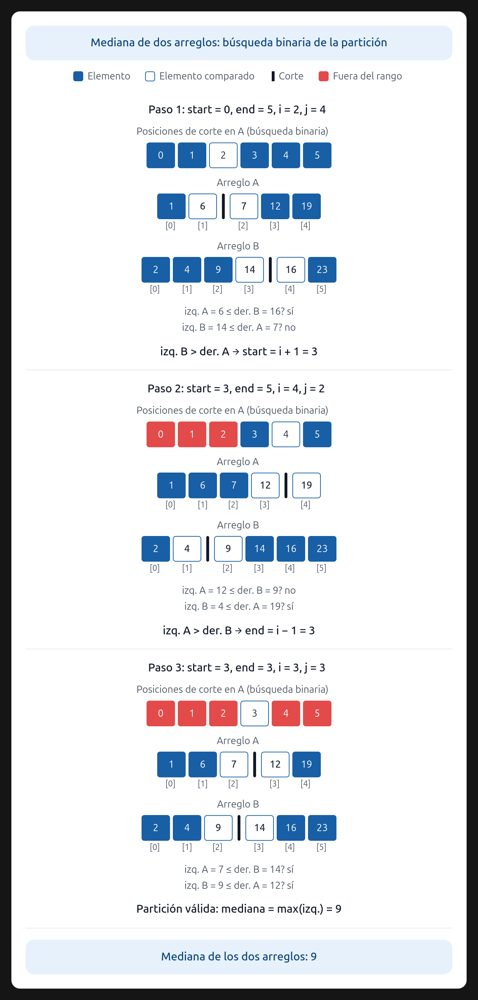

# Ejercicio 7 — Mediana de dos arreglos ordenados

**Diseño y Análisis de Algoritmos · Tema 1 · Curso 2026**

> Mediana de dos arreglos ordenados de largo $n$: el $n$-ésimo menor de los $2n$ elementos. Diseña un algoritmo $O(\log n)$, demuestra su correctitud y da la cota de información. (C2, C3, C5)

---

## 1. Enunciado y objetivos

Dados dos arreglos ordenados en sentido ascendente, $A$ y $B$, ambos de tamaño $n$, se pide encontrar el $n$-ésimo menor elemento del conjunto total de $2n$ elementos (es decir, el que ocuparía la posición $n$ si los mezcláramos). Se requiere:
1. Un algoritmo de tiempo $O(\log n)$.
2. Demostrar su correctitud (correctitud parcial + terminación).
3. Demostrar una cota mínima de $\Omega(\log n)$ comparaciones en el modelo de árboles de decisión (C5).

## 2. Descripción del algoritmo

La clave está en encontrar la **partición** correcta de los dos arreglos en dos mitades: una mitad izquierda de exactamente $n$ elementos y una mitad derecha de exactamente $n$ elementos. 

Supongamos que tomamos $i$ elementos de $A$ (desde $A[0]$ hasta $A[i-1]$) y $j$ elementos de $B$ (desde $B[0]$ hasta $B[j-1]$) para la mitad izquierda. Como queremos $n$ elementos en total, se debe cumplir $i + j = n$, por lo que $j = n - i$.

Para que esta partición sea válida (y por tanto, la mediana sea el máximo de la mitad izquierda), se deben cumplir dos condiciones de frontera:
1. El máximo de la izquierda de $A$ debe ser menor o igual al mínimo de la derecha de $B$: $A[i-1] \le B[j]$.
2. El máximo de la izquierda de $B$ debe ser menor o igual al mínimo de la derecha de $A$: $B[j-1] \le A[i]$.

Como $A$ y $B$ ya están ordenados, solo necesitamos verificar estas dos fronteras. 

El algoritmo hace una **búsqueda binaria sobre $i$** (la cantidad de elementos tomados de $A$), en el rango de $0$ a $n$:
- Calculamos $i$ como el punto medio del rango actual, y $j = n - i$.
- Si $A[i-1] > B[j]$, significa que tomamos demasiados elementos de $A$ (el borde izquierdo de $A$ se pasa del borde derecho de $B$). Por lo tanto, $i$ es muy grande y debemos buscar en la mitad inferior (achicamos el límite superior).
- Si $B[j-1] > A[i]$, significa que tomamos muy pocos elementos de $A$. Por lo tanto, $i$ es muy pequeño y debemos buscar en la mitad superior (agrandamos el límite inferior).
- Si se cumplen ambas condiciones, encontramos la partición perfecta. La mediana será $\max(A[i-1], B[j-1])$.
- Para manejar los bordes (cuando $i=0$, $i=n$, $j=0$ o $j=n$), se usan valores centinela $-\infty$ y $+\infty$ en las comparaciones, para que las condiciones no fallen artificialmente.

### Ejemplo visual

La siguiente imagen ilustra la búsqueda binaria de la partición correcta en dos arreglos ordenados.

## 3. Correctitud total

La correctitud total se compone de correctitud parcial (invariante) y terminación.

### 3.1 Correctitud parcial (Invariante)

**Invariante:** *Al inicio de cada iteración del ciclo de búsqueda binaria, el índice $i$ que produce la partición correcta se encuentra dentro del rango $[\text{start}, \text{end}]$.*

- **Inicialización:** Antes de la primera iteración, $\text{start} = 0$ y $\text{end} = n$. El rango cubre todas las particiones posibles, por lo que el $i$ correcto está ahí.
- **Mantenimiento:** Supongamos que el $i$ correcto está en $[\text{start}, \text{end}]$.
  - Si evaluamos $i = \lfloor(\text{start}+\text{end})/2\rfloor$ y obtenemos $A[i-1] > B[j]$, sabemos que este $i$ es demasiado grande. Como los arreglos están ordenados, cualquier índice mayor que $i$ también será demasiado grande. Por lo tanto, el $i$ correcto debe ser estrictamente menor que $i$. Actualizamos $\text{end} = i - 1$, preservando el invariante.
  - Análogamente, si $B[j-1] > A[i]$, el $i$ es demasiado pequeño. El $i$ correcto debe ser estrictamente mayor. Actualizamos $\text{start} = i + 1$, preservando el invariante.
- **Conclusión:** Cuando se cumple la condición de parada (ambas fronteras son válidas), el algoritmo retorna $\max(A[i-1], B[j-1])$. Por el invariante, esta es la partición correcta, por lo que todos los elementos de la mitad izquierda son menores o iguales a los de la derecha. El máximo de la mitad izquierda es exactamente el $n$-ésimo menor elemento (la mediana).

### 3.2 Terminación

En cada iteración del ciclo, o bien el límite superior $\text{end}$ se reduce a $i-1$, o bien el límite inferior $\text{start}$ se incrementa a $i+1$. El tamaño del rango $[\text{start}, \text{end}]$ se reduce a la mitad en cada paso. Dado que el rango inicial tiene tamaño $n+1$, el ciclo se ejecutará a lo sumo en $O(\log n)$ iteraciones antes de encontrar la partición válida o cruzar los límites. Por lo tanto, el algoritmo siempre termina.

## 4. Costo computacional

- **Tiempo:** La búsqueda binaria sobre $i$ toma $O(\log n)$ iteraciones. En cada iteración se realizan solo operaciones de comparación y asignación en $O(1)$. Por lo tanto, el costo total es $O(\log n)$.
- **Espacio:** $O(1)$ adicional, ya que solo se usan índices y variables auxiliares.

## 5. Cota mínima de información ($\Omega(\log n)$)

El modelo es el de árboles de decisión, donde cada nodo interno representa una comparación entre dos elementos y las hojas representan las posibles salidas del algoritmo.

Es crucial distinguir entre el espacio de búsqueda del algoritmo y el espacio de respuestas del problema:
1. **Espacio de respuestas del problema:** El problema no pregunta por un índice, sino por el valor del $n$-ésimo menor elemento. Este valor puede ser cualquiera de los $2n$ elementos totales (cualquiera de los $n$ de $A$ o cualquiera de los $n$ de $B$). Por lo tanto, el árbol de decisión debe tener al menos $2n$ hojas distintas para poder identificar correctamente cuál es el elemento.
2. **Altura del árbol:** Un árbol binario con $L$ hojas tiene una altura mínima de $\lceil \log_2 L \rceil$. Sustituyendo $L = 2n$, la altura mínima es $\lceil \log_2(2n) \rceil$.
3. **Conclusión:** La altura del árbol representa el número de comparaciones en el peor caso. Por lo tanto, cualquier algoritmo basado en comparaciones requiere al menos $\log_2(2n) = \log_2 n + 1 = \Omega(\log n)$ comparaciones. Nuestro algoritmo es $O(\log n)$, por lo que es asintóticamente óptimo.