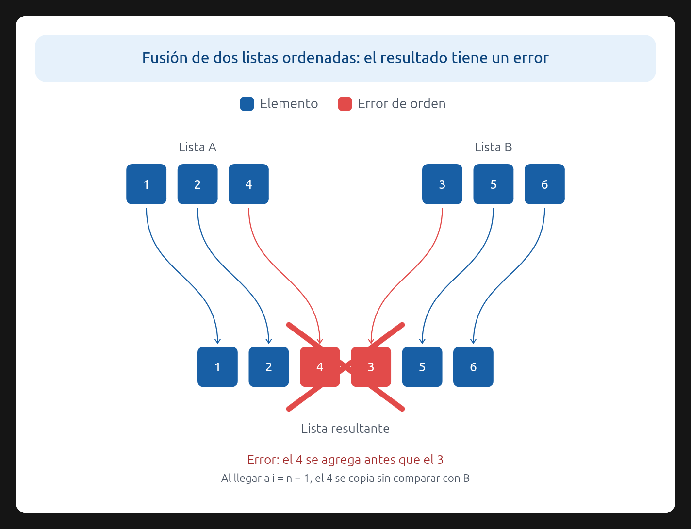

# Ejercicio 9 — Mezcla "optimizada" incorrecta

**Diseño y Análisis de Algoritmos · Tema 1 · Curso 2026**

> Una mezcla "optimizada" de dos listas ordenadas de largo $n$ deja de comparar cuando a la primera lista le queda un solo elemento, y lo pone al final. Cuenta cuántas comparaciones hace en el peor caso. Sin probarla, usa la sección 6 de la conferencia 5 para decidir si es correcta, y construye con el adversario la entrada en la que falla. (C5)

---

## 1. Análisis del peor caso (Costo)

El algoritmo propuesto es una modificación del algoritmo de mezcla estándar. El ciclo principal avanza comparando el elemento actual de la primera lista ($A$) con el de la segunda ($B$), consumiendo el menor de los dos. 

La siguiente imagen muestra un contraejemplo: cuando a $A$ le queda un solo elemento, el algoritmo lo coloca sin compararlo con $B$, y la lista resultante deja de estar ordenada.

Sin embargo, la condición de parada es diferente: el ciclo termina prematuramente cuando a la lista $A$ le queda **exactamente un elemento**, sin importar cuántos elementos le queden a $B$.

**Conteo de comparaciones en el peor caso:**
Para que el algoritmo realice el máximo número de comparaciones, debe consumir la mayor cantidad de elementos posible antes de detenerse. 
- El algoritmo se detiene cuando $A$ tiene 1 elemento, lo que significa que se consumieron exactamente $n - 1$ elementos de $A$.
- Para maximizar las comparaciones, el adversario elegirá los datos de modo que por cada elemento consumido de $A$, se consuma también un elemento de $B$. Es decir, los elementos se consumen de forma intercalada.
- Al consumirse $n - 1$ elementos de $B$ y $n - 1$ elementos de $A$, el ciclo habrá realizado exactamente $(n - 1) + (n - 1) = 2n - 2$ comparaciones.

Por lo tanto, el peor caso del algoritmo realiza **$2n - 2$** comparaciones.

## 2. Correctitud total

La correctitud total se compone de correctitud parcial (demostrada con el invariante) más terminación.

### 2.1 Terminación

En cada iteración del ciclo, o bien se incrementa el índice de $A$ o bien el de $B$. El ciclo se detiene cuando el índice de $A$ llega a $n-1$ (es decir, cuando queda 1 elemento) o cuando $B$ se agota. Como los índices son cotas estrictamente crecientes acotadas por $n$, el ciclo termina después de un número finito de pasos. El algoritmo siempre termina.

### 2.2 Correctitud parcial (El fallo del algoritmo)

El algoritmo es **incorrecto**. Para demostrarlo, usamos el método del adversario (Sección 6 de la Conferencia 5). El adversario es un oponente que responde a las comparaciones del algoritmo de forma consistente, es decir, siempre existe al menos una entrada real cuyos datos coinciden con todas las respuestas dadas hasta el momento, pero que obliga al algoritmo a equivocarse.

**Estrategia del adversario:**
El algoritmo asume erróneamente que, si a la lista $A$ le queda un solo elemento, ese elemento debe ser el mayor de todos los restantes (y por eso lo coloca al final). El adversario aprovechará esta suposición ocultando un elemento mayor en la lista $B$.

El adversario mantiene oculta la siguiente secuencia perfectamente ordenada:
$$
A[0] < A[1] < \ldots < A[n-2] < B[0] < A[n-1] < B[1] < \ldots
$$
Esta secuencia es completamente válida (las listas $A$ y $B$ están ordenadas de forma creciente individualmente).

**Ejecución y respuestas del adversario:**
1. El algoritmo compara $A[0]$ con $B[0]$. El adversario responde: $A[0] < B[0]$. El algoritmo consume $A[0]$ y avanza en $A$.
2. El algoritmo compara $A[1]$ con $B[0]$. El adversario responde: $A[1] < B[0]$. El algoritmo consume $A[1]$ y avanza en $A$.
3. ...
4. El algoritmo compara $A[n-2]$ con $B[0]$. El adversario responde: $A[n-2] < B[0]$. El algoritmo consume $A[n-2]$ y avanza en $A$.

**El fallo:**
En este punto, a la lista $A$ le queda exactamente 1 elemento: $A[n-1]$. El algoritmo, por su condición de parada, se detiene inmediatamente. Asume que $A[n-1]$ es el máximo y lo coloca al final de la mezcla, seguido de lo que quede de $B$.
La salida producida es: $[\ldots, A[n-2], A[n-1], B[0], \ldots]$.

Sin embargo, el adversario había ocultado que $B[0] < A[n-1]$. La respuesta correcta debería colocar a $B[0]$ antes que a $A[n-1]$. Al no haber comparado nunca $A[n-1]$ con $B[0]$, el algoritmo no tiene forma de saberlo y produce una salida desordenada.

Como el adversario logró construir una entrada válida que hace fallar al algoritmo, la correctitud parcial no se cumple. Por lo tanto, el algoritmo es **incorrecto**.