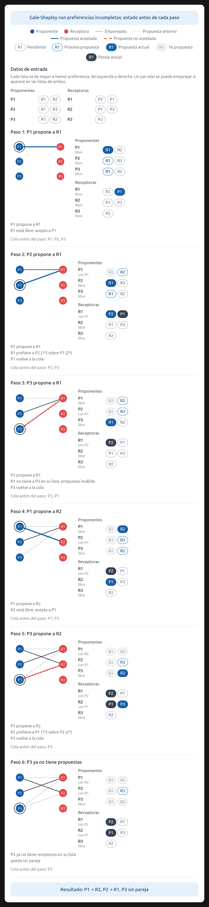

# Ejercicio 12 — Gale-Shapley con listas incompletas

**Diseño y Análisis de Algoritmos · Tema 1 · Curso 2026**

> Gale-Shapley con listas incompletas: cada proponente lista solo a algunos receptores, y prefiere quedarse solo antes que con uno que no listó. Adapta el algoritmo, su potencial y la definición de pareja bloqueante. ¿Sigue siendo estable el resultado? Demuéstralo. (C3)

---

## 1. Adaptación del algoritmo

El algoritmo de Gale-Shapley se adapta de la siguiente manera:
1. Inicialmente, todos los proponentes y receptores están solteros.
2. Mientras exista un proponente soltero $p$ que **no haya agotado su lista de preferencias**:
   - $p$ le propone matrimonio al siguiente receptor $r$ en su lista (el primero al que no le haya propuesto aún).
   - Si $r$ está soltero y $p$ está en la lista de $r$ (es decir, son mutuamente aceptables), $r$ acepta y se comprometen.
   - Si $r$ ya está comprometido con $p'$, $r$ compara a $p$ con $p'$ según su propia lista. Si prefiere a $p$, rechaza a $p'$ y se compromete con $p$ ($p'$ vuelve a estar soltero). Si prefiere a $p'$, rechaza a $p$.
   - *(Nota: Si $p$ no está en la lista de $r$, $r$ lo rechaza automáticamente porque prefiere estar solo).*
3. Si un proponente agota su lista y sigue soltero, **se queda solo de forma permanente**. El algoritmo termina cuando no quedan proponentes solteros con elementos pendientes en su lista.

### Ejemplo visual

La imagen resume una ejecución de Gale-Shapley con listas incompletas, incluyendo propuestas válidas, propuestas rechazadas y participantes que terminan sin pareja.

## 2. Potencial y Terminación

**Potencial:** Sea $\Phi$ la cantidad total de propuestas que aún no se han realizado, es decir, la suma de las longitudes de las listas de preferencias que les quedan a los proponentes solteros. 
Alternativamente, $\Phi$ puede ser la suma de los índices de los próximos receptores a los que propondrá cada proponente.

- **Propiedad básica:** $\Phi \ge 0$ siempre (es una suma de longitudes o índices).
- **Decrecimiento estricto:** En cada iteración, un proponente soltero le propone al siguiente receptor de su lista. Esto reduce su lista pendiente en 1 (o incrementa su índice en 1). Por lo tanto, $\Phi$ disminuye estrictamente en cada paso.
- **Conclusión (Terminación):** Al ser $\Phi$ un entero no negativo que decrece en cada paso, el algoritmo debe terminar. El número máximo de propuestas es $\sum_{p} |L_p| \le n^2$, donde $n$ es la cantidad de proponentes.

## 3. Correctitud parcial: Definición de pareja bloqueante

Una pareja $(p, r)$ se considera **bloqueante** si y solo si se cumplen tres condiciones:
1. **Aceptación mutua:** $r$ está en la lista de $p$, y $p$ está en la lista de $r$.
2. $p$ prefiere a $r$ antes que a su pareja actual en el emparejamiento final (o $p$ está soltero y prefiere a $r$ antes que quedarse solo).
3. $r$ prefiere a $p$ antes que a su pareja actual en el emparejamiento final (o $r$ está soltero y prefiere a $p$ antes que quedarse solo).

Un emparejamiento es **estable** si no contiene ninguna pareja bloqueante.

## 4. Demostración de Estabilidad

**Teorema:** El emparejamiento resultante del algoritmo es estable.

**Demostración (por contradicción):**
Supongamos que el algoritmo termina y el emparejamiento final $M$ no es estable. Entonces, existe al menos una pareja bloqueante $(p, r)$.

Por la definición de pareja bloqueante, $p$ prefiere a $r$ antes que a su pareja actual (o antes que quedarse solo). Como $p$ va proponiendo en orden de preferencia y el algoritmo termina cuando no le quedan propuestas por hacer, $p$ **debió haberle propuesto a $r$** en algún momento antes de proponerle a su pareja actual (o antes de agotar su lista).

Como $r$ es parte de la pareja bloqueante, $r$ prefiere a $p$ antes que a su pareja actual $M(r)$ (o antes que quedarse solo). Si $p$ le propuso a $r$ y $r$ lo rechazó en ese momento, fue porque $r$ ya estaba comprometido con alguien a quien prefería sobre $p$.

Por la propiedad de **monotonía** del algoritmo (el receptor solo mejora a su pareja a lo largo del tiempo, nunca empeora), si $r$ prefirió a alguien sobre $p$ en el pasado, su pareja final $M(r)$ debe ser alguien a quien prefiere aún más (o igual). Por lo tanto, $r$ **prefiere a $M(r)$ antes que a $p$**.

Esto contradice nuestra suposición de que $r$ prefiere a $p$ antes que a su pareja actual. Por lo tanto, la pareja bloqueante $(p, r)$ no puede existir.

**Conclusión (Correctitud total):** Como el algoritmo termina (demostrado en la sección 2) y al terminar produce un emparejamiento estable (demostrado en esta sección), el algoritmo es correcto.

## 5. Nota sobre la cantidad de parejas: El Teorema del Matching Rural

Es natural preguntarse si el algoritmo de Gale-Shapley (GS) podría dejar más personas emparejadas si se eligiera otro orden de propuestas, o si existiera otro emparejamiento estable con mayor cantidad de parejas. La respuesta es **no**. 

En cualquier problema de emparejamiento estable (incluso con listas incompletas), **el conjunto de personas que quedan solteras es exactamente el mismo en todos los emparejamientos estables**. Este hecho se conoce como el Teorema del Matching Rural. A continuación, lo demostramos.

### 5.1 Lema: Las rechazadas mejoran

**Lema:** Si un receptor $r$ rechaza a un proponente $p$ durante la ejecución de GS, entonces la pareja final de $r$ (si tiene alguna) es alguien a quien $r$ prefiere sobre $p$.
**Demostración:** Cuando $r$ rechaza a $p$, es porque $r$ está actualmente comprometido con alguien a quien prefiere sobre $p$ (o porque $p$ no estaba en la lista de $r$). Por la propiedad de monotonía del algoritmo, la pareja de $r$ solo puede mejorar (o mantenerse igual) a lo largo de la ejecución. Por lo tanto, su pareja final $M(r)$ será alguien a quien prefiere al menos tanto como a su pareja en el momento del rechazo, y por transitividad, estrictamente más que a $p$. $\square$

### 5.2 Teorema: Un soltero en GS es soltero en todo emparejamiento estable

**Teorema:** Si un proponente $p$ termina soltero en el emparejamiento $M$ producido por GS, entonces $p$ está soltero en **todos** los emparejamientos estables.
**Demostración:** Si $p$ termina soltero en GS, significa que agotó su lista de preferencias: le propuso a todos los receptores de su lista $L_p$, y **todos** lo rechazaron. 

Por el Lema 5.1, para cada receptor $r \in L_p$, su pareja final $M(r)$ es alguien a quien $r$ prefiere sobre $p$.
Supongamos, por contradicción, que existe otro emparejamiento estable $M'$ en el que $p$ está emparejado con algún receptor $r \in L_p$. 
En $M'$, $r$ está con $p$. Pero en $M$, $r$ está con $M(r)$, y sabemos que $r$ prefiere a $M(r)$ sobre $p$ (por el lema). Por lo tanto, $r$ y $M(r)$ se prefieren mutuamente antes que a sus parejas en $M'$, formando una pareja bloqueante. Esto contradice que $M'$ sea estable. 
Por lo tanto, $p$ no puede estar emparejado en ningún emparejamiento estable. $\square$

### 5.3 Conclusión sobre la cardinalidad

Como cualquier emparejamiento estable tiene exactamente el mismo conjunto de personas emparejadas, **todos los emparejamientos estables tienen exactamente la misma cantidad de parejas**. 

Por lo tanto, Gale-Shapley no solo produce un emparejamiento estable, sino que **maximiza la cantidad de parejas entre todos los emparejamientos estables posibles**. No existe una "distribución mejor" (estable) que empareje a más personas, porque cualquier intento de emparejar a alguien que GS dejó soltero rompería la estabilidad y crearía una pareja bloqueante.