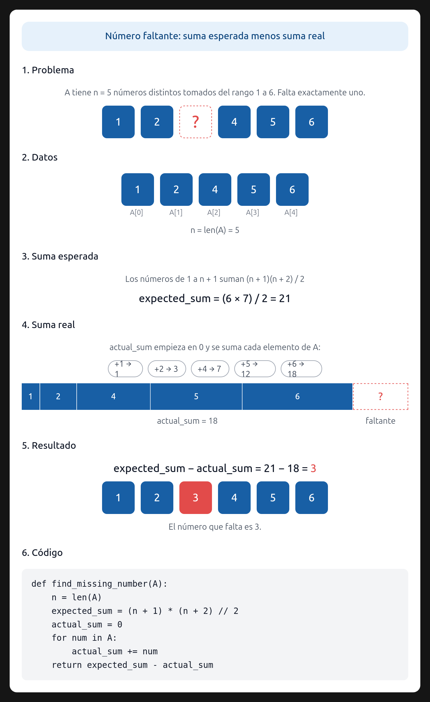

# Ejercicio 14 — El elemento faltante (formato de examen)

Diseño y Análisis de Algoritmos · Tema 1 · Curso 2026

> Escoge un problema que no hayamos visto, recorre el ciclo completo de la conferencia 2 sobre él y consigue que el algoritmo y la cota mínima coincidan. Es el formato de la pregunta larga del examen final. (C2 a C5)

---

## 1. El problema

**Enunciado:** Dado un arreglo $A$ de $n$ números enteros distintos, cuyos elementos pertenecen al conjunto $\{1,2,\ldots,n+1\}$, encontrar el único número de ese conjunto que falta en el arreglo.

**Precisiones:**

- **Entrada:** Un arreglo $A$ de tamaño $n$ con elementos distintos, donde cada $A[i]\in\{1,2,\ldots,n+1\}$.
- **Salida:** El entero $x\in\{1,2,\ldots,n+1\}$ tal que $x\notin A$.
- **Garantía:** El arreglo contiene exactamente un número faltante, porque tiene $n$ elementos distintos tomados de un conjunto de $n+1$ elementos.

## 2. El algoritmo

El algoritmo se basa en la suma de Gauss. La suma de todos los números enteros desde $1$ hasta $n+1$ es:

$$
S_{\text{total}}=\sum_{k=1}^{n+1}k=\frac{(n+1)(n+2)}{2}.
$$

Se recorre el arreglo una vez para calcular:

$$
S_{\text{arreglo}}=\sum_{i=0}^{n-1}A[i].
$$

El número faltante $x$ es la diferencia entre la suma total esperada y la suma de los elementos presentes:

$$
x=S_{\text{total}}-S_{\text{arreglo}}.
$$

En pseudocódigo:

```text
suma_actual ← 0
para i desde 0 hasta n − 1:
    suma_actual ← suma_actual + A[i]
devolver (n + 1)(n + 2) / 2 − suma_actual
```

### Ejemplo visual

La siguiente imagen muestra el cálculo del elemento faltante mediante la diferencia entre la suma esperada y la suma real.



## 3. Correctitud total

La correctitud total se obtiene demostrando la correctitud parcial y la terminación. La correctitud parcial demuestra que, **si el algoritmo termina, devuelve la respuesta correcta**; la terminación demuestra que **siempre termina**.

### 3.1 Correctitud parcial (invariante)

**Invariante:** Al inicio de la iteración $i$, con $0\le i\le n$, la variable `suma_actual` contiene la suma de los primeros $i$ elementos del arreglo:

$$
\text{suma\_actual}=\sum_{j=0}^{i-1}A[j].
$$

- **Inicialización:** Antes de la primera iteración ($i=0$), `suma_actual = 0`. La suma de cero elementos es $0$.
- **Mantenimiento:** Si el invariante se cumple al inicio de la iteración $i$, el algoritmo suma $A[i]$ a `suma_actual`. Después de la iteración:
  $$
  \text{suma\_actual}=\sum_{j=0}^{i-1}A[j]+A[i]=\sum_{j=0}^{i}A[j].
  $$
  Por tanto, el invariante se mantiene para la siguiente iteración.
- **Conclusión:** Cuando el ciclo termina, $i=n$, y:
  $$
  \text{suma\_actual}=\sum_{j=0}^{n-1}A[j]=S_{\text{arreglo}}.
  $$

El arreglo contiene todos los elementos de $\{1,2,\ldots,n+1\}$ excepto $x$. Por lo tanto:

$$
S_{\text{total}}=x+S_{\text{arreglo}}.
$$

Despejando $x$:

$$
x=S_{\text{total}}-S_{\text{arreglo}}.
$$

Como el algoritmo devuelve $S_{\text{total}}-\text{suma\_actual}$, devuelve exactamente $x$.

### 3.2 Terminación

El único ciclo `for` recorre las $n$ posiciones del arreglo. Cada iteración realiza un número constante de operaciones y no hay recursión ni ciclos anidados. Por lo tanto, el algoritmo termina después de exactamente $n$ iteraciones.

### 3.3 Correctitud total

Como el algoritmo termina y devuelve la respuesta correcta al finalizar, es totalmente correcto.

## 4. Costo computacional

- **Tiempo:** El arreglo se recorre una sola vez, por lo que el costo es $\Theta(n)$. El cálculo de $S_{\text{total}}$ y la resta final cuestan $O(1)$.
- **Espacio:** Se usan únicamente variables auxiliares, sin espacio proporcional a $n$; el espacio adicional es $O(1)$.

## 5. Cota mínima ($\Omega(n)$)

Demostraremos que cualquier algoritmo que resuelva este problema debe leer al menos $\Omega(n)$ elementos en el peor caso. Usaremos el **método del adversario**.

**Protocolo del adversario:** Supongamos que un algoritmo determinista lee menos de $n$ posiciones. Después de esas lecturas, quedan al menos dos elementos del conjunto $\{1,\ldots,n+1\}$ que todavía no se han descartado como posibles valores faltantes.

Sean $x$ e $y$ dos de esos valores. Como el algoritmo no leyó todas las posiciones, se pueden completar las posiciones no consultadas de dos maneras indistinguibles para él:

1. En la primera entrada, $x$ es el valor faltante y $y$ aparece en una posición no consultada.
2. En la segunda entrada, $y$ es el valor faltante y $x$ aparece en esa posición no consultada.

Las dos entradas producen exactamente las mismas respuestas en todas las consultas realizadas. Por tanto, el algoritmo debe producir la misma salida en ambas, aunque sus respuestas correctas sean distintas. Se equivoca en al menos una de ellas.

En consecuencia, cualquier algoritmo correcto debe leer las $n$ posiciones en el peor caso, y la cota mínima es $\Omega(n)$.

## 6. Conclusión

Hemos demostrado que:

- el algoritmo tiene un costo de $\Theta(n)$ en tiempo;
- cualquier algoritmo requiere al menos $\Omega(n)$ lecturas en el peor caso.

Por lo tanto, el algoritmo es **asintóticamente óptimo**.
