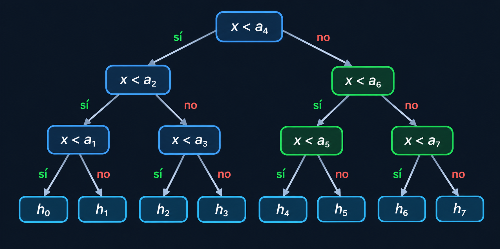

# Ejercicio 2 — Búsqueda binaria: invariante, potencial y cota de información

**Tema 1 · Diseño y Análisis de Algoritmos · MatCom 2026**
Conferencias que usa: **C3** (especificación, invariante y potencial de la búsqueda binaria; reforzar un invariante; ejercicio 7) · **C5** (árboles de decisión, Lema 1, Lema 4) · Dificultad: ★

---

## Enunciado

> Da el invariante y el potencial de la búsqueda binaria, y la cota de información que la hace óptima.

---

## 1. Especificación

- **Precondición.** $A[0] < A[1] < \dots < A[n-1]$, ordenado y sin repetidos.
- **Postcondición.** Devuelve `("está", m)` con $A[m] = x$ si $x$ está en el arreglo, y si no, `("hueco", h)` donde $h$ es la cantidad de elementos menores que $x$: el hueco $h_h$, entre $A[h-1]$ y $A[h]$.
- **Modelo.** Comparaciones de tres salidas entre $x$ y un elemento del arreglo: $<$, $=$ o $>$.


## 2. Algoritmo

```python
def busqueda_binaria(A, x, comparar):
    """Devuelve ("está", posición) o ("hueco", número de hueco)."""
    lo, hi = 0, len(A)               # invariante: si x está, está en A[lo:hi]
    while lo < hi:
        m = (lo + hi) // 2
        r = comparar(x, A[m])        # -1, 0 o 1
        if r == 0:
            return ("está", m)
        if r < 0:
            hi = m
        else:
            lo = m + 1
    return ("hueco", lo)
```

## 3. Correctitud parcial: el invariante

> **(I)** Si $x$ está en $A$, está en $A[lo..hi-1]$.

(I) es inductivo, y alcanza para la mitad "está" de la postcondición. Pero no alcanza para la otra mitad: al salir con $lo = hi$, (I) dice que $x$ no está, y no dice nada sobre **en qué hueco** cae. La afirmación es verdadera, pero no da información suficiente para la conclusión que queremos. Se refuerza:

> **(I⁺)** Todo $k < lo$ cumple $A[k] < x$, y todo $k \ge hi$ cumple $A[k] > x$.

```text
  índice:   0        lo-1  lo              hi-1  hi          n-1
          ┌──────────────┬──────────────────────┬──────────────────┐
  A[k]:   │   todos < x  │   todavía no sé      │    todos > x     │
          └──────────────┴──────────────────────┴──────────────────┘
```

(I⁺) implica (I): si $x = A[k]$, entonces $k$ no puede ser $< lo$ ni $\ge hi$.

**Inicialización.** $lo = 0$ y $hi = n$: no hay índices $k < 0$ ni $k \ge n$. Se cumple trivialmente.

**Mantenimiento.** Supongamos (I⁺) y $lo < hi$, así que $lo \le m < hi$. Hay tres casos, uno por rama:

- $x = A[m]$: el algoritmo devuelve `("está", m)`, que cumple la postcondición.
- $x < A[m]$: por el orden, todo $k \ge m$ cumple $A[k] \ge A[m] > x$. Después de `hi = m`, todo $k \ge hi$ cumple $A[k] > x$. La parte de $lo$ no cambió.
- $x > A[m]$: todo $k \le m$ cumple $A[k] \le A[m] < x$. Después de `lo = m + 1`, todo $k < lo$ cumple $A[k] < x$.

**Conclusión.** Si el ciclo termina sin devolver, $lo = hi$, y por (I⁺) todo índice $k < lo$ tiene $A[k] < x$ y todo $k \ge lo$ tiene $A[k] > x$. Entonces $x$ no está y exactamente $lo$ elementos son menores que $x$: `("hueco", lo)` es la respuesta correcta. ∎

## 4. Terminación: el potencial

> **Potencial.** $\Phi = hi - lo$, el largo del intervalo "todavía no sé".

- $\Phi \ge 0$ siempre, porque $lo \le hi$: $m < hi$ da $m + 1 \le hi$, y $m \ge lo$.
- Si $\Phi > 0$, la vuelta lo deja en $\Phi' \le \lfloor \Phi/2\rfloor$. Escribiendo $m = lo + \lfloor \Phi/2\rfloor$:
  - si `hi = m`: $\Phi' = m - lo = \lfloor \Phi/2\rfloor$;
  - si `lo = m + 1`: $\Phi' = hi - m - 1 = \lceil \Phi/2\rceil - 1 \le \lfloor\Phi/2\rfloor$.

Un entero no negativo que baja estrictamente en cada vuelta no puede bajar para siempre, así que el ciclo termina.

## 5. Costo

Como $\Phi' \le \lfloor \Phi/2 \rfloor$, y la rama `hi = m` deja exactamente $\lfloor \Phi/2\rfloor$, el número de vueltas en el peor caso cumple

$$
C(0) = 0, \qquad C(\Phi) = 1 + C(\lfloor \Phi/2 \rfloor)\quad (\Phi \ge 1),
$$

que da $C(n) = \lfloor\log_2 n\rfloor + 1 = \lceil \log_2(n+1)\rceil$, la cantidad de bits de $n$. Cada vuelta hace una comparación de tres salidas. Memoria $O(1)$.

## 6. Cota mínima: el argumento de información

> **Teorema.** Todo algoritmo de comparaciones de tres salidas que cumpla la especificación hace, en el peor caso, al menos $\lceil \log_2(n+1)\rceil$ comparaciones.

**La trampa.** Con tres respuestas por comparación el árbol de decisión es ternario, y el Lema 1 adaptado a tres ramas solo daría $\log_3$.Se evita mirando solo las entradas donde $x$ **no está**: ahí ninguna comparación responde "$=$", así que esos caminos usan solo las ramas $<$ y $>$, y forman un árbol binario.

**Lema 4.** Si $x_1$ y $x_2$ caen en huecos distintos, un algoritmo correcto los lleva a hojas distintas.

**Conclusión.** Los $n+1$ huecos necesitan $n+1$ hojas distintas en un árbol binario. Por el Lema 1 (un árbol binario de altura $h$ tiene a lo sumo $2^h$ hojas), $2^h \ge n + 1$, y como la altura es entera, $h \ge \lceil\log_2(n+1)\rceil$. ∎

La búsqueda binaria hace exactamente $\lceil\log_2(n+1)\rceil$ en el peor caso, así que **es óptima en el modelo de comparaciones, sin que sobre ni una comparación**.



(En el árbol completo, cada nodo tiene además una rama "$=$" que termina enseguida en "está". El dibujo muestra solo la parte binaria, la de los huecos.)

## 7. Casos de prueba

1. Contra `bisect` en todos los arreglos chicos, incluyendo $x$ presente, $x$ en cada hueco y el arreglo vacío.
2. El invariante reforzado (I⁺) y el potencial, vigilados en cada vuelta (la técnica del invariante vigilado de C3).
3. El peor caso de comparaciones es exactamente $\lceil\log_2(n+1)\rceil$, la cota del Lema 4.
4. La variante del ejercicio 7 de C3 (`lo = m`): encuentro la entrada más chica donde no termina, y compruebo que el potencial deja de bajar cuando $hi - lo = 1$.
5. La variante de dos salidas, contra `bisect_left`.

```python
import bisect, itertools, math, random

def comparar_contado(contador):
    def comparar(x, y):
        contador[0] += 1
        return (x > y) - (x < y)
    return comparar

def busqueda_vigilada(A, x):
    """La misma búsqueda, comprobando (I+) y el potencial en cada vuelta."""
    lo, hi = 0, len(A)
    while lo < hi:
        assert all(A[k] < x for k in range(lo)), "falla (I+) a la izquierda"
        assert all(A[k] > x for k in range(hi, len(A))), "falla (I+) a la derecha"
        phi = hi - lo
        m = (lo + hi) // 2
        if x == A[m]:
            return ("está", m)
        if x < A[m]:
            hi = m
        else:
            lo = m + 1
        assert 0 <= hi - lo <= phi // 2, "el potencial no se dividió por 2"
    return ("hueco", lo)

def esperado(A, x):
    h = bisect.bisect_left(A, x)
    return ("está", h) if h < len(A) and A[h] == x else ("hueco", h)

# 1) y 2) exhaustivo: todos los arreglos estrictamente crecientes con valores pares en 0..12
casos = 0
for n in range(0, 8):
    for A in itertools.combinations(range(0, 13, 2), n):
        A = list(A)
        for x in range(-1, 14):                     # pares: presentes o no; impares: en huecos
            c = [0]
            assert busqueda_binaria(A, x, comparar_contado(c)) == esperado(A, x)
            assert busqueda_vigilada(A, x) == esperado(A, x)
            casos += 1
print(f"exhaustivo: {casos} casos correctos, (I+) y potencial vigilados")

random.seed(2026)
for _ in range(2000):
    A = sorted(random.sample(range(10**6), random.randint(0, 300)))
    x = random.randint(-5, 10**6 + 5)
    assert busqueda_binaria(A, x, comparar_contado([0])) == esperado(A, x)
print("aleatorio: 2000 casos correctos")

# 3) peor caso == ceil(log2(n+1)), sobre x en cada hueco y x igual a cada elemento
print(f"\n{'n':>5} {'peor caso medido':>17} {'ceil(log2(n+1))':>16}")
for n in [1, 2, 3, 6, 7, 8, 100, 1000, 1023, 1024]:
    A = list(range(0, 2 * n, 2))                     # pares; los impares caen en los huecos
    peor = 0
    for x in range(-1, 2 * n):
        c = [0]
        busqueda_binaria(A, x, comparar_contado(c))
        peor = max(peor, c[0])
    cota = math.ceil(math.log2(n + 1))
    print(f"{n:5} {peor:17} {cota:16}")
    assert peor == cota
print("la búsqueda binaria alcanza exactamente la cota del Lema 4")

# 4) el ejercicio 7 de C3: lo = m en lugar de lo = m + 1
def busqueda_lo_igual_m(A, x, max_vueltas=1000):
    lo, hi, vueltas = 0, len(A), 0
    while lo < hi:
        vueltas += 1
        if vueltas > max_vueltas:
            return ("no termina", lo, hi)
        m = (lo + hi) // 2
        if x == A[m]:
            return ("está", m)
        if x < A[m]:
            hi = m
        else:
            lo = m                                   # <- el cambio
    return ("hueco", lo)

encontrada = None
for n in range(1, 5):
    for A in itertools.combinations(range(0, 9, 2), n):
        for x in range(-1, 10):
            r = busqueda_lo_igual_m(list(A), x)
            if r[0] == "no termina":
                encontrada = (list(A), x, r)
                break
        if encontrada: break
    if encontrada: break
A, x, (_, lo, hi) = encontrada
print(f"\nlo = m: la entrada más chica que no termina es A = {A}, x = {x};"
      f" se queda con lo = {lo}, hi = {hi} (potencial {hi - lo})")
assert hi - lo == 1

# 5) variante de dos salidas
def rango(A, x, contador):
    lo, hi = 0, len(A)
    while lo < hi:
        mid = (lo + hi) // 2
        contador[0] += 1
        if A[mid] < x:
            lo = mid + 1
        else:
            hi = mid
    return lo

for n in range(0, 7):
    for A in itertools.combinations_with_replacement(range(4), n):
        A = list(A)
        for x in [-1, 0, 0.5, 1, 1.5, 2, 2.5, 3, 4]:
            assert rango(A, x, [0]) == bisect.bisect_left(A, x)
for n in [1, 7, 8, 1000]:
    A = list(range(n))
    peor = 0
    for x in range(-1, n):                           # las n+1 respuestas posibles
        c = [0]
        rango(A, x + 0.5, c)
        peor = max(peor, c[0])
    assert peor == math.ceil(math.log2(n + 1))
print("variante de dos salidas (con repetidos): correcta y con el mismo peor caso")
```

### Salida

```text
exhaustivo: 1920 casos correctos, (I+) y potencial vigilados
aleatorio: 2000 casos correctos

    n  peor caso medido  ceil(log2(n+1))
    1                 1                1
    2                 2                2
    3                 2                2
    6                 3                3
    7                 3                3
    8                 4                4
  100                 7                7
 1000                10               10
 1023                10               10
 1024                11               11
la búsqueda binaria alcanza exactamente la cota del Lema 4

lo = m: la entrada más chica que no termina es A = [0], x = 1; se queda con lo = 0, hi = 1 (potencial 1)
variante de dos salidas (con repetidos): correcta y con el mismo peor caso
```

---

**Uso de IA** (declarado según C1): implementación de algoritmos, generación de casos de prueba y correcciones de redacción.
