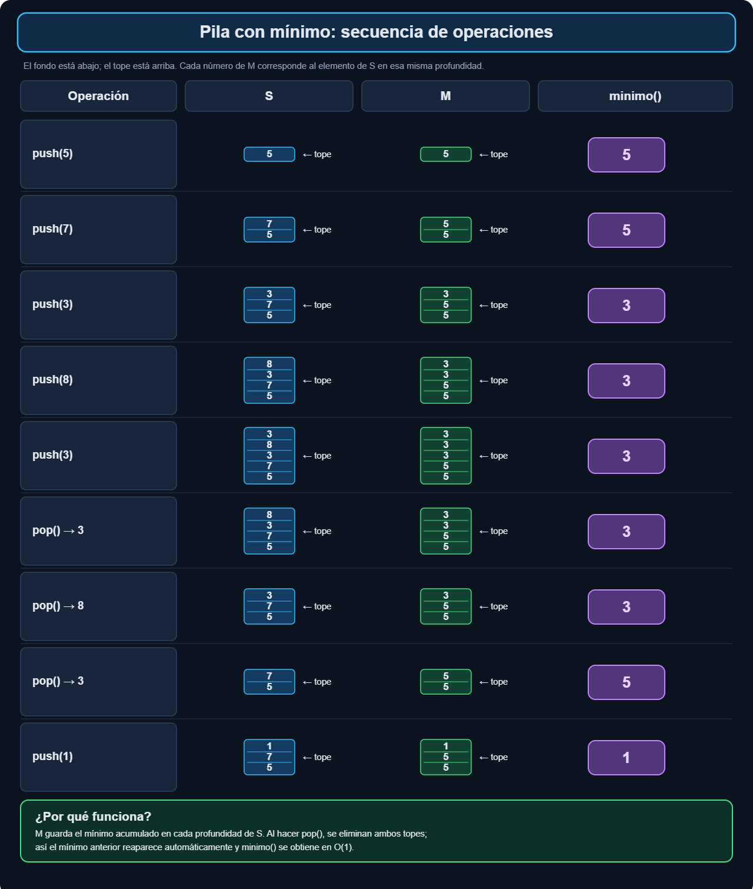

# Ejercicio 3 — Una pila con `minimo` en $O(1)$

**Tema 1 · Diseño y Análisis de Algoritmos · MatCom 2026**
Conferencias que usa: **C3** (especificación e invariante en tres pasos, invariante inductivo, la hipótesis dice qué probar) · menciones a **C4** (arreglo dinámico, cola con dos pilas, amortizado contra peor caso) · Dificultad: ★

---

## Enunciado

> Una pila con una operación `minimo` que cuesta $O(1)$ en el peor caso. Diseña la estructura, enuncia el invariante que la hace correcta y da el costo de cada operación.

---

## 1. Diseño de la estructura 
La estructura debe tener las operaciones clásicas de una pila:
`push(x)`  , `pop()` y en este caso agregar `minimo()`
Primeramente se podría pensar que basta con tener una variable m que almacene el mínimo, El mantenimiento es obvio al hacer push `m = min(m,x)` pero este diseño se rompe al hacer `pop()`.
Si se saca el elemento que era el mínimo, para recalcular m habría que recorrer toda la pila que es $O(n)$. 


Basado en que la pila agrega elementos al tope y lo extrae de allí mismo, el resto, es decir lo que esta debajo no cambia al hacer `push(x)`  o `pop()`. De modo que el mínimo antes de agregar x es el mismo que luego de sacar x.

- `S[0..k-1]`: los elementos, `S[k-1]` es el tope;
- `M[0..k-1]`: `M[i]` es el mínimo de `S[0..i]`.

```python
class PilaMin:
    def __init__(self):
        self.S = []     # elementos
        self.M = []     # M[i] = min(S[0..i])

    def push(self, x):
        self.S.append(x)
        if not self.M or x < self.M[-1]:
            self.M.append(x)
        else:
            self.M.append(self.M[-1])

    def pop(self):
        self.M.pop()
        return self.S.pop()

    def minimo(self):
        return self.M[-1]

    def __len__(self):
        return len(self.S)
```


## 2. El invariante
En este caso el invariante debe ser una propiedad que se mantenga entre operaciones.

Invariante:
> $ M[i] = \min(S[0], S[1], \dots, S[i]). $ para toda $ i \le n$

**Inicialización**: La pila vacía: $n = 0$, no hay nada que verificar.

**Mantenimiento**:

- `push(x)`: Las posiciones de $0..n-1$ de `S` y `M` no cambian, el invariante se cumple para ellas; al agregar $x$ en la posición $n$ y:
$$
\min(S[0..n]) = \min\big(\min(S[0..n-1]),\, x\big) = \min(M[n-1], x),
$$

- `pop()`: Quita la última posición de las dos pilas. Para las posiciones que quedan, $0..n-2$, ni `S[0..i]` ni `M[i]` cambiaron, así que el invariante se cumple. Este es el paso donde se usa que la estructura es una **pila**: la propiedad de la posición $i$ depende solo de lo que está *debajo* de $i$, y el `pop` nunca toca lo de debajo.

**Conclusión**: Si la pila no está vacía, $n \ge 1$ y `minimo()` devuelve $M[n-1] = \min(S[0..n-1])$, el mínimo de toda la pila. ∎

**Terminación.** Ninguna operación tiene ciclos ni recursión: cada una ejecuta una cantidad fija de instrucciones, así que siempre termina, y no hace falta un potencial.

## 3. Costo

| operación | trabajo | costo peor caso |
|---|---|---|
| `push` | 1 comparación, 2 escrituras | $O(1)$ |
| `pop` | 2 borrados | $O(1)$ |
| `minimo` | 1 lectura | $O(1)$ |
| memoria | $2k$ celdas | $\Theta(k)$ |

(Asumo que el arreglo de la pila no se redimensiona, o que tiene capacidad máxima conocida. Con un arreglo dinámico que duplica al llenarse, como la lista de Python, `push` es $O(1)$ **amortizado** y no en el peor caso: C4 muestra que un `append` que encuentra el bloque lleno copia todo y cuesta $\Theta(k)$, aunque $n$ `append` cuesten menos de $3n$.)


## 4. Casos de prueba

Comparo contra una pila ingenua (que calcula `min(S)` en $O(k)$), con secuencias aleatorias de operaciones, vigilando el invariante.

```python
import random

def chequear_invariante(p):
    assert len(p.S) == len(p.M)
    for i in range(len(p.S)):
        assert p.M[i] == min(p.S[:i + 1])

def prueba_aleatoria(clase, generar_valor, ops=200, vigilar=False):
    p, ref = clase(), []
    for _ in range(ops):
        if ref and random.random() < 0.45:
            assert p.pop() == ref.pop()
        else:
            x = generar_valor()
            p.push(x); ref.append(x)
        if ref:
            if p.minimo() != min(ref):
                return False
        if vigilar:
            chequear_invariante(p)
    return True

random.seed(3)

# 1) Ejemplo de la ilustración
p = PilaMin()
for x in [5, 7, 3, 8, 3]:
    p.push(x)
assert p.minimo() == 3
assert p.pop() == 3 and p.minimo() == 3
assert p.pop() == 8 and p.minimo() == 3
assert p.pop() == 3 and p.minimo() == 5
p.push(1); assert p.minimo() == 1
print("ejemplo de la ilustración: OK")

# 2) PilaMin con invariante vigilado, valores con muchos empates
for _ in range(300):
    assert prueba_aleatoria(PilaMin, lambda: random.randint(0, 5), vigilar=True)
print("PilaMin: 300 secuencias aleatorias, invariante vigilado en cada paso: OK")

# 3) Costo: contar comparaciones por operación (debe ser <= 1 siempre)
class PilaMinContada(PilaMin):
    comps = 0
    def push(self, x):
        if self.M:
            PilaMinContada.comps += 1
        super().push(x)
p = PilaMinContada()
for i in range(10000):
    p.push(random.random())
print(f"10000 push -> {PilaMinContada.comps} comparaciones (<= 1 por push)")
assert PilaMinContada.comps <= 10000
```

### Salida

```text
ejemplo de la ilustración: OK
PilaMin: 300 secuencias aleatorias, invariante vigilado en cada paso: OK
10000 push -> 9999 comparaciones (<= 1 por push)
```

---

**Uso de IA** : implementación de algoritmos, generación de casos de prueba y correcciones de redacción.
